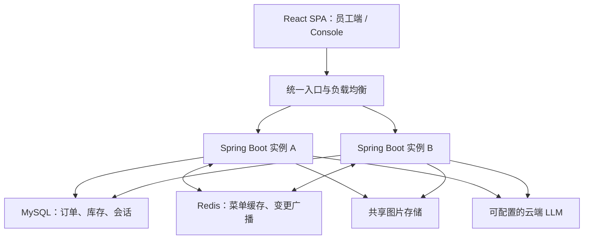
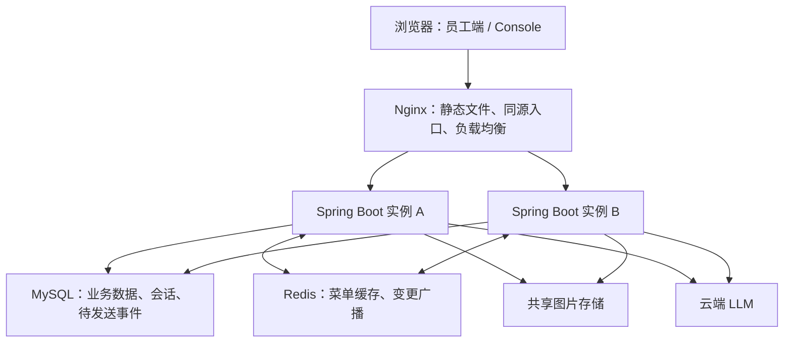
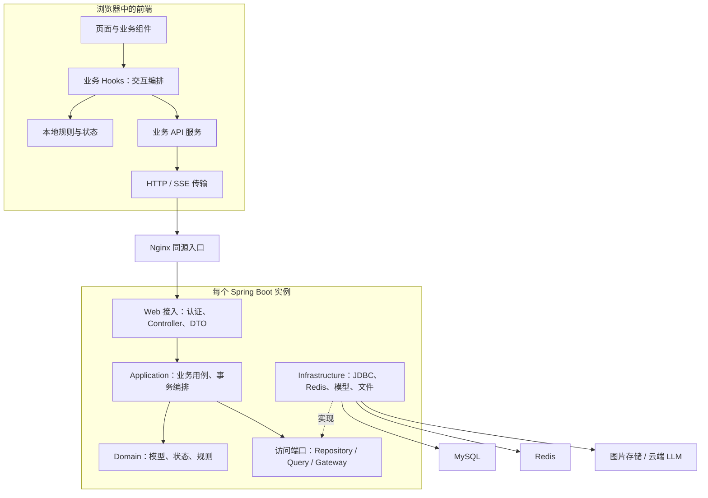
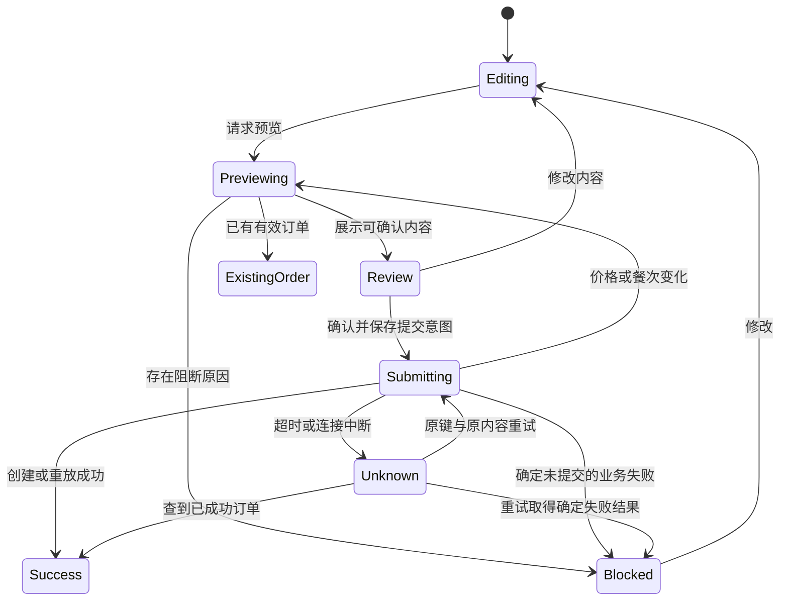
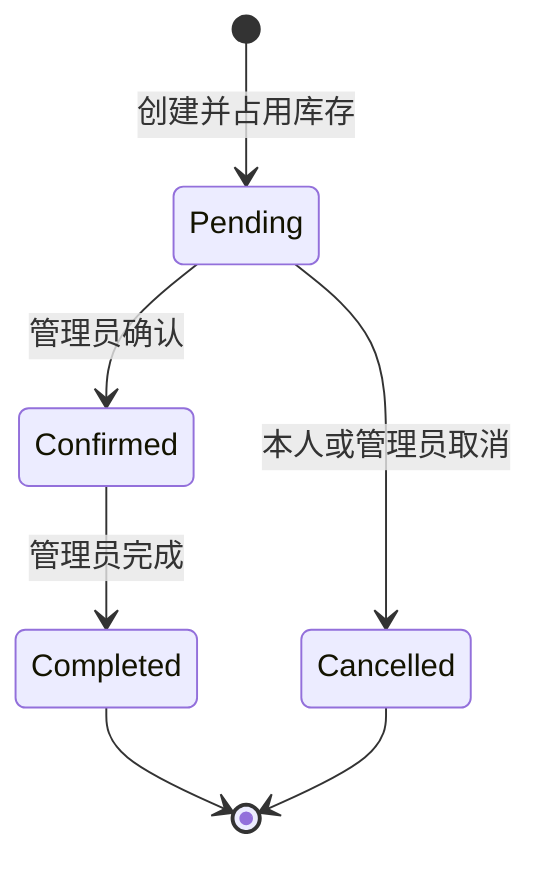
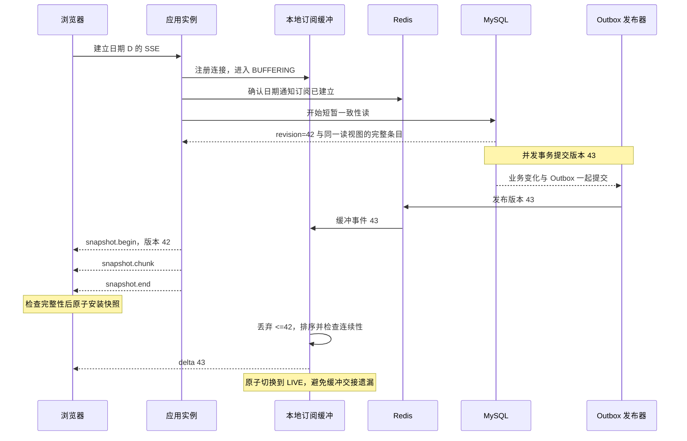

# Codex conversation

## User

/Users/zhoubo/Downloads/WeBox-PRD-候选人交付包/AI\ Vibe\ Coding\ V3.0\ -\ PRD.html /Users/zhoubo/Downloads/WeBox-PRD-候选人交付包/AI\ Vibe\ Coding\ V3.0\ -\ PRD.md /Users/zhoubo/Downloads/WeBox-PRD-候选人交付包/README.txt 只整理需求与判据，不写业务实现

从 PRD 提取明确要求，编号为 REQ，并注明原文出处。对缺失、歧义或实现中必须补充的规则，单独编号为 DEC，记录关联需求、采用的解释、理由、影响和确认状态。不要把推测写成 PRD 原要求

## Assistant

我会先读取 PRD、交付说明和工作区约定，区分原文明确要求与需要补充的决策，并梳理可验证的验收判据；本轮只做需求整理方案，不写业务实现。

## Activity

    $ ls -l '/Users/zhoubo/Downloads/WeBox-PRD-候选人交付包' && cat '/Users/zhoubo/Downloads/WeBox-PRD-候选人交付包/README.txt' && wc -l '/Users/zhoubo/Downloads/WeBox-PRD-候选人交付包/AI Vibe Coding V3.0 - PRD.md' '/Users/zhoubo/Downloads/WeBox-PRD-候选人交付包/AI Vibe Coding V3.0 - PRD.html'
    total 640
    -rw-r--r--@  1 zhoubo  staff   29497 Jul 21 05:26 AI Vibe Coding V3.0 - PRD.html
    -rw-r--r--@  1 zhoubo  staff   23614 Jul 21 05:26 AI Vibe Coding V3.0 - PRD.md
    -rw-r--r--@  1 zhoubo  staff    1081 Jul 21 05:26 README.txt
    drwxrwxr-x@ 22 zhoubo  staff     704 Mar  6  2026 product_images
    -rw-r--r--@  1 zhoubo  staff  262302 Jul 21 05:26 webox_product_images.zip
    WeBox — 企业员工餐食订购平台 · AI Vibe Coding V3.0
    候选人命题材料包
    =================================================
    
    本包内容：
      1. AI Vibe Coding V3.0 - PRD.md      产品需求文档（Markdown 源文件）
      2. AI Vibe Coding V3.0 - PRD.html     产品需求文档（浏览器直接打开阅读）
      3. webox_product_images.zip           菜品图片资源（20 张，解压后见 product_images/）
    
    阅读顺序：
      先打开 PRD.html（或 PRD.md）通读需求，再解压图片资源用于菜品展示。
    
    重要提醒（请务必阅读 PRD 第 7 章"交付标准"）：
      - 需完整实现前后端并可本地运行；后端 Java 17 + Spring Boot，数据库为独立 MySQL
        （不接受 H2/SQLite 等嵌入式数据库）。
      - 系统所有面向用户的内容一律使用英文（界面、菜单数据、提示信息等）。
      - AI 推荐功能需自备 LLM API Key 或本地模型（现场不提供）。
      - 必须随项目提交完整的 AI 编程对话原始记录（存于 ai-conversations/ 目录）。
    
    时长：1.5 小时。
         294 /Users/zhoubo/Downloads/WeBox-PRD-候选人交付包/AI Vibe Coding V3.0 - PRD.md
         519 /Users/zhoubo/Downloads/WeBox-PRD-候选人交付包/AI Vibe Coding V3.0 - PRD.html
         813 total
    ✓ • 0ms

## Activity

    $ pwd && rg --files -g 'AGENTS.md' -g 'README*' -g '*REQ*' -g '*DEC*' -g '*requirement*' -g '*需求*' -g '*PRD*' -g '!node_modules' -g '!.git'
    /Users/zhoubo/webox1016
    ✗ (1) • 160ms

## Activity

    $ ls -la && for p in /AGENTS.md /Users/AGENTS.md /Users/zhoubo/AGENTS.md /Users/zhoubo/webox1016/AGENTS.md; do if [ -f "$p" ]; then printf '\n%s\n' "$p"; cat "$p"; fi; done
    total 0
    drwxr-xr-x@   2 zhoubo  staff    64 Oct 16 11:29 .
    drwxr-x---+ 142 zhoubo  staff  4544 Oct 16 11:29 ..
    ✓ • 0ms

## Activity

    $ nl -ba '/Users/zhoubo/Downloads/WeBox-PRD-候选人交付包/AI Vibe Coding V3.0 - PRD.md'
         1    # AI Vibe Coding V3.0
         2
         3    ## WeBox — 企业员工餐食订购平台（全栈合并版 PRD）
         4
         5    ### 产品需求文档 (PRD)
         6
         7    | 项目     | 内容                     |
         8    | -------- | ------------------------ |
         9    | 文档版本 | V3.0（前后端合并）        |
        10    | 创建日期 | 2026-03-24               |
        11    | 场景     | 1.5 小时 AI 全栈开发挑战 |
        12    | 适用岗位 | 前端 / 后端（同一份 PRD，均要求完整前后端交付；评分侧重按岗位区分，详见附录 A） |
        13
        14    ---
        15
        16    ## 1. 产品背景
        17
        18    WeBox 是一个企业内部的员工餐食订购平台。公司约 200 名员工，食堂每日提供菜品供员工选择，菜品库会持续扩充，当前约 50 个菜品。**员工通过手机和电脑两种设备访问平台**，提前选餐下单，食堂据此备餐。
        19
        20    **每天上午 9:30-10:00 是订餐高峰期**，大部分员工会在这个时段集中下单午餐，菜单数据在此期间被高频访问。
        21
        22    平台有两类用户，**使用同一套系统，但拥有不同的功能权限**：
        23    - **员工**：浏览菜单、搜索菜品、下单订餐
        24    - **管理员**：通过 **Console 后台管理模块**管理菜品、处理订单、了解平台经营情况
        25
        26    > **系统语言要求（强制）**：本系统面向用户的**所有内容一律使用英文**，包括但不限于——界面文案与按钮、导航与页面标题、菜单数据（菜品名称/描述/分类/过敏原/辣度/选项）、表单标签与占位符、提示与错误信息（toast / 弹窗 / 校验提示）、AI 推荐理由、数据看板文案等。本 PRD 中出现的中文示例字符串仅用于说明语义，实现时须以对应英文呈现。
        27
        28    ---
        29
        30    ## 2. 需求分层
        31
        32    本项目需求分为三层，候选人按顺序完成。**核心功能为必须完成项，进阶功能为主要考察项，挑战功能为可选加分项**——请优先保证核心与进阶功能完整可用，行有余力再挑战 Tier 3。**注意：无论选择完成到哪一层，都必须交付完整可运行的前后端（全栈交付为强制要求）。**
        33
        34    | 层级       | 范围                                       | 是否必做 |
        35    | ---------- | ------------------------------------------ | -------- |
        36    | 核心功能（Tier 1） | 员工端：注册登录、菜单浏览与搜索、购物车、下单 | ✅ 必做 |
        37    | 进阶功能（Tier 2） | 员工端：偏好设置 + 订餐规则；Console 后台：菜品管理  | ✅ 主要考察项 |
        38    | 挑战功能（Tier 3） | 库存实时展示与扣减、AI 智能推荐、经营数据看板  | ⭐ 可选加分项 |
        39
        40    ---
        41
        42    ## 3. 核心功能
        43
        44    ### 3.1 员工注册 / 登录
        45
        46    员工使用企业邮箱注册账号（需通过邮箱格式校验；**不强制校验特定公司域名**，同一邮箱不可重复注册）。注册后可登录系统。刷新页面不应丢失登录状态。注册、登录过程中的异常情况（如邮箱已被注册、密码不正确等）需要给予用户明确的反馈。
        47
        48    密码需满足基本安全要求（**至少 8 位，且同时包含字母与数字**），且**不得以明文形式存储**。注册和登录表单需对用户输入做校验与长度限制（邮箱格式校验；各文本输入设合理长度上限——如邮箱/地址 ≤ 200 字符、搜索关键词 ≤ 50 字符），并对特殊字符做安全处理。系统需要区分员工和管理员两种角色，不同角色可访问的功能不同。
        49
        50    ### 3.2 每日菜单
        51
        52    员工进入系统后看到的主页面是当日菜单。菜单以卡片形式展示菜品，每个卡片包含菜品图片、名称、价格（精确到分，如 ¥22.50）和菜系标签。
        53
        54    点击卡片可查看菜品详情，详情页包含：
        55    - 菜品描述
        56    - 成分信息：蛋白质来源（如鸡肉、牛肉、鱼肉、豆制品等）、过敏原、辣度等级（不辣/微辣/中辣/重辣）
        57    - 自定义选项（如有）：部分菜品支持加料或配置选择。例如汉堡可选择酱料（番茄酱/芥末酱/蛋黄酱/BBQ酱）和面胚（普通/全麦），意面可选择面型和加料（培根 +¥5/芝士 +¥3）。每个选项组可能是必选（如面胚）或可选（如加料），部分选项有额外费用。员工选择后，菜品价格需实时更新。
        58
        59    员工可以按菜系筛选菜品（分类以英文展示：`Chinese`、`Western`、`Japanese`、`Light Meal`、`Korean`、`Southeast Asian` 等）。筛选时支持多选，例如同时查看 `Chinese` 和 `Japanese`。
        60
        61    员工可以通过搜索框搜索菜品，输入菜品名称或描述中的关键词查找菜品。
        62
        63    **注意**：菜品数量会持续增长，菜单数据在高峰期被高频访问，页面需要在菜品数量较多、访问量较高时仍能流畅使用。
        64
        65    ### 3.3 购物车
        66
        67    员工在菜单页可以将菜品加入购物车。同一菜品可重复添加，每次点击数量加一。购物车内可以调整每个菜品的数量，也可以移除菜品。购物车需实时显示当前总价。
        68
        69    如果菜品有自定义选项，购物车中需展示员工已选择的配置（如"全麦面胚 + 芥末酱"）。同一菜品不同配置视为不同条目（例如一个全麦汉堡和一个普通汉堡分别显示）。
        70
        71    **注意**：早高峰时段（9:30-10:00）是订餐高峰，大量员工会频繁点击"加入购物车"按钮。
        72
        73    ### 3.4 下单
        74
        75    员工从购物车进入结算页面。结算页展示订单明细（菜品、自定义选项、数量、小计含加料费用、总价），员工需要选择配送日期（默认当天）、用餐时段（`Lunch` 或 `Dinner`）、配送地址（可从历史地址选择或输入新地址）。
        76
        77    确认无误后提交订单。**订单提交必须保证每次请求只会创建一个订单**，即使员工因网络延迟连续点击了多次"提交"按钮。提交成功后展示订单成功页面，包含订单编号和预计配送信息（配送日期、用餐时段、配送地址）。
        78
        79    员工可以在"我的订单"页面查看所有历史订单，点击可查看订单详情（含每个菜品的所选自定义选项、数量、小计与总价）。订单支持取消操作（仅限状态为 `Pending` 的订单）。订单状态英文枚举：`Pending`、`Confirmed`、`Completed`、`Cancelled`。
        80
        81    ---
        82
        83    ## 4. 进阶功能
        84
        85    ### 4.1 饮食偏好设置
        86
        87    员工可以在个人设置中配置饮食偏好：
        88
        89    - **过敏原标记**：标记自己的过敏原（枚举与菜品过敏原字段一致：`Peanuts`、`Dairy`、`Egg`、`Gluten`、`Soy`、`Fish`、`Shellfish`）。当员工将含有已标记过敏原的菜品加入购物车时，系统需弹窗提醒（英文，例如 `This dish contains an allergen you flagged: [Egg]. Add anyway?`），由员工自行决定是否继续。注意：**不是过滤掉含过敏原的菜品**，而是在加入时提醒。
        90    - **菜系偏好**：选择偏好的菜系；当开启下文的「为我推荐」开关时，菜单页优先展示偏好菜系的菜品（关闭时按默认顺序展示）。
        91    - **口味偏好**：辣度偏好（不辣/微辣/中辣/重辣，与菜品辣度枚举 `None/Mild/Medium/Hot` 一一对应，用于菜单排序/高亮）、口味浓淡偏好（清淡/适中/重口，主要作为 AI 推荐 §5.2 的个性化参考，不强制驱动菜单硬排序）。
        92    - **单餐预算**：设置每餐的预算范围，如 ¥15-¥30。当购物车总价超出预算上限时，在结算页给予提示（但不阻止下单）。
        93
        94    菜单页提供"为我推荐"开关，开启后根据偏好自动排序和高亮匹配菜品。
        95
        96    ### 4.2 订餐规则
        97
        98    食堂运营有以下规则，系统需要严格执行：
        99
       100    - **每单数量上限**：每个订单最多包含 5 份餐品（注意是总份数，不是品种数。比如 3 份宫保鸡丁 + 3 份麻婆豆腐 = 6 份，超限）。达到上限后，菜单页的"加入购物车"按钮和购物车内的"+"按钮都应该不可用，并说明原因。
       101    - **截单时间**：午餐订单须在当日上午 10:00 前提交，晚餐订单须在当日下午 15:00 前提交。过了某餐次的截单时间，系统应**自动切换到时间上最近的可订餐次**，判定规则为：**当日晚餐若未过 15:00 → 切换为当日晚餐；当日晚餐也已截单 → 切换为次日午餐**。例如上午 10:30 提交午餐订单（午餐已截单、晚餐未截单）→ 自动切换为当日晚餐。
       102    - **不可重复下单**：同一天同一餐次（如周三午餐），每位员工只能有一个有效订单（`Pending` 或 `Confirmed` 状态）。如果已有有效订单，结算页的 `Place Order` 按钮应变为 `View Existing Order` 并跳转。
       103
       104    ### 4.3 Console 后台管理模块 — 菜品管理
       105
       106    管理员登录后进入 **Console 后台管理模块**（英文 UI 名 `Console`，与员工端使用不同的导航布局）。**普通员工不可访问 Console 后台功能。**
       107
       108    **菜品管理页面**：
       109    - 以表格形式展示所有菜品，支持搜索和按分类筛选
       110    - 可新增菜品：填写名称、描述、价格、分类、过敏原标签，上传图片
       111    - 可编辑已有菜品信息
       112    - 可设置菜品的"上架/下架"状态，下架的菜品员工端不可见
       113    - 可设置每日菜单：选择哪些菜品出现在指定日期（默认次日）的菜单中，并为每个菜品设置该日供应数量
       114
       115    > **数据初始化说明**：系统须预置**当日可下单的菜单与库存种子数据**，供演示当天直接完成下单、库存扣减、看板统计；「设置每日菜单」既可面向次日、也可用于初始化或调整当日菜单。评分演示以「当日可下单菜单」为准。
       116
       117    ---
       118
       119    ## 5. 挑战功能（可选加分项）
       120
       121    > 本层为**可选加分项，不计入功能完成度门槛**。未完成不影响基础评级，完成则作为加分与技术亮点。建议在核心 + 进阶功能完整可用后再投入。
       122
       123    ### 5.1 库存、实时展示与扣减
       124
       125    每个菜品每日有限量供应。菜单页需展示每个菜品的剩余数量。当剩余数量较少时（≤ 3 份），需要有视觉提示。售罄的菜品不可下单。
       126
       127    **关键要求**：
       128    - **多个员工可能同时下单同一个菜品，库存扣减不能出现超卖。**
       129    - 当一位员工下单后，其他正在浏览菜单的员工应当能够**实时看到库存变化，而不需要手动刷新页面**。
       130    - 提交订单时需要再次确认库存充足，如果提交时发现库存不足，需要告知员工具体哪些菜品库存不足，并允许调整后重新提交。
       131    - 订单取消后，对应库存应恢复。
       132
       133    ### 5.2 AI 智能推荐
       134
       135    在菜单页面提供一个 AI 选餐助手入口。员工可以用自然语言（英文）描述想吃什么（例如 `I want something light today` / `A high-protein low-fat lunch` / `Nothing I ate yesterday`），AI 助手根据以下信息给出个性化推荐：
       136
       137    - 员工的饮食偏好设置（如已配置）
       138    - 当日可用的菜品（排除已售罄的）
       139    - 员工的过敏原（含过敏原的菜品不应出现在推荐中）
       140    - 员工近期（**近 7 天**）订餐记录（避免重复推荐近期已点过的菜品）
       141
       142    推荐结果以菜品卡片形式展示（不是纯文字），每个推荐附带个性化的推荐理由，员工可直接将推荐菜品加入购物车。推荐过程应有流式的响应体验，而非长时间等待后一次性展示。
       143
       144    **注意**：本功能需要实际接入 LLM 服务，候选人需自行准备 LLM API Key 或本地模型，面试现场不提供。该功能必须实际可运行。
       145
       146    ### 5.3 Console 后台管理模块 — 经营数据看板
       147
       148    Console 后台管理模块增加一个数据看板页面，展示食堂的经营状况：
       149
       150    - **今日概览**：今日订单数、总收入、已完成/待处理/已取消订单数
       151    - **菜品排行**：按销量排序的菜品 Top 10，展示为柱状图
       152    - **时段分布**：午餐 vs 晚餐的订单量对比
       153    - **趋势图**：最近 7 天的订单量和收入趋势折线图
       154    - **库存预警**：当前库存 ≤ 3 份的菜品列表（低库存阈值与 §5.1 一致：售罄 = 0，低库存 = 1~3）
       155
       156    看板数据应能实时刷新（或提供手动刷新按钮），且数据须来自真实订单。
       157
       158    ---
       159
       160    ## 6. 菜品数据
       161
       162    候选人可使用以下菜品信息或自行补充。**入库与展示均须使用英文**（下表即为系统中应存储/展示的英文内容）：
       163
       164    | Name | Description | Price | Category | Protein | Allergens | Spice Level | Customization Options |
       165    |------|-------------|-------|----------|---------|-----------|-------------|-----------------------|
       166    | Kung Pao Chicken | Classic Sichuan dish, chicken stir-fried with peanuts and dried chili | ¥22.00 | Chinese | Chicken | Peanuts | Medium | — |
       167    | Caesar Salad | Fresh romaine lettuce with Parmesan and Caesar dressing | ¥28.50 | Light Meal | None | Dairy, Egg | None | Add-ons: Grilled Chicken (+¥6) / Bacon (+¥5) / Avocado (+¥4) |
       168    | Salmon Sashimi Set | Fresh salmon sashimi with rice and miso soup | ¥45.00 | Japanese | Fish | Fish | None | — |
       169    | Tomato Pasta | Classic Italian tomato pasta with fresh basil | ¥26.50 | Western | None | Gluten | None | Pasta Type (required): Spaghetti / Fusilli / Penne; Add-ons: Bacon (+¥5) / Cheese (+¥3) |
       170    | Tom Yum Soup | Thai hot & sour shrimp soup with lemongrass, galangal, lime leaves | ¥32.00 | Southeast Asian | Shrimp | Shellfish | Hot | — |
       171    | Chicken Quinoa Bowl | Low-fat high-protein grilled chicken with quinoa, avocado, veggies | ¥35.80 | Light Meal | Chicken | None | None | Base (required): Quinoa / Brown Rice / Mixed Grains |
       172    | Mapo Tofu | Sichuan classic, soft tofu with spicy minced meat | ¥18.00 | Chinese | Tofu, Pork | Soy | Medium | — |
       173    | Korean Bibimbap | Stone-pot mixed rice with veggies, fried egg, and chili sauce | ¥30.00 | Korean | Egg | Egg, Soy | Mild | Add-ons: Cheese (+¥3) / Fried Egg (+¥2) / Beef Slices (+¥8) |
       174    | Classic Beef Burger | Angus beef patty with lettuce, tomato, onion | ¥38.00 | Western | Beef | Gluten, Dairy | None | Bun (required): Plain / Whole Wheat; Sauce (required): Ketchup / Mustard / Mayo / BBQ; Add-ons: Cheese (+¥3) / Bacon (+¥5) / Fried Egg (+¥2) |
       175
       176    > 分类枚举（英文）：`Chinese`、`Western`、`Japanese`、`Light Meal`、`Korean`、`Southeast Asian`。
       177    > 辣度枚举（英文）：`None`、`Mild`、`Medium`、`Hot`。
       178    > 过敏原枚举（英文，固定全集）：`Peanuts`、`Dairy`、`Egg`、`Gluten`、`Soy`、`Fish`、`Shellfish`（海鲜类统一用 `Fish` / `Shellfish`，不单列 `Seafood`，以免偏好标记与菜品标签不匹配）。
       179    > 货币：价格统一使用人民币、精确到分，货币符号保留 `¥`（如 `¥22.50`）；金额展示与计算须避免浮点精度问题。
       180
       181    菜品图片资源见附件 `webox_product_images.zip`。
       182
       183    ---
       184
       185    ## 7. 交付标准
       186
       187    本项目定位为企业级应用，不是演示 Demo。技术选型和实现质量需要满足生产环境运行标准。
       188
       189    ### 7.1 技术选型要求
       190
       191    - **本项目要求完整实现前后端**，不能只做前端或只做后端，必须是可完整运行的前后端项目
       192    - 前端技术栈不限，需说明选型理由
       193    - 后端使用 **Java（JDK 17）+ Spring Boot** 框架
       194    - 数据持久化使用 **独立部署的 MySQL 服务**，**不接受嵌入式 / 内存数据库**（如 H2、SQLite、HSQLDB、Derby、嵌入式 MySQL 等一律不可）；MySQL 须作为独立进程真实运行，并可按 README 步骤连接
       195    - **缓存方案不限，Redis 为可选项**：菜单等高频数据缓存、会话/令牌、库存与幂等控制等，可选用 Redis，也可用进程内缓存或其他方案，**不强制使用 Redis**。若引入 Redis，需在 README 给出启动步骤
       196    - AI 推荐功能需要实际接入 LLM 服务（候选人自行准备，面试现场不提供 API Key），该功能必须可实际运行
       197    - **系统语言**：所有面向用户的内容（界面文案、菜单数据、错误/提示信息、AI 推荐理由等）**一律使用英文**（参见 §1 系统语言要求）
       198    - 可使用任意 AI 编码工具辅助开发
       199
       200    **目标架构**：`前端 SPA → 后端服务（JDK 17 + Spring Boot）→ 独立 MySQL 服务（持久化）` 为**强制**基础设施；缓存层（如 Redis）为**可选增强**，用与不用不影响功能门槛。README 须给出 JDK + Spring Boot 应用 + MySQL 的完整本地启动步骤（若引入 Redis 等额外服务，一并说明）。
       201
       202    ### 7.2 交付物清单
       203
       204    候选人需要交付以下完整内容：
       205
       206    | 交付物 | 要求 |
       207    |--------|------|
       208    | 可运行代码 | 项目可在本地完整启动和运行 |
       209    | README | 项目介绍、技术栈说明、本地启动步骤（确保他人能从零开始启动项目） |
       210    | API 文档 | 接口清单、请求/响应格式说明（格式不限） |
       211    | 架构说明 | 系统架构图或文字说明，包含核心模块划分和数据流 |
       212    | 测试 | 核心业务逻辑的测试用例，可运行并通过 |
       213    | **AI 编程对话记录** | **从项目开始到结束的完整原始对话导出**（Cursor / Claude Code / ChatGPT / Copilot Chat / Windsurf / Cline 等任意工具的原生导出文件均可）。**不接受截图、节选、片段或事后整理摘要**。多个工具混用时全部提交。存放于项目根目录 `ai-conversations/` 子目录，或在 README 中明确指出存放路径。**该项缺失或不达标将直接影响最终评级，请务必妥善保存。** |
       214
       215    ### 7.3 项目定位
       216
       217    **这是一个长期运行的项目，你是这个项目的 Owner。** 请从项目长期稳定运行的角度考虑你的设计和实现，确保项目具备可维护性和可靠性。
       218
       219    ### 7.4 演示要求
       220
       221    1.5 小时后，候选人需要：
       222    - 演示已完成的功能
       223    - 展示交付文档（含 AI 编程对话记录）
       224    - 简要说明技术选型理由
       225    - 说明遇到的问题和解决方式
       226
       227    ---
       228
       229    ## 附录 A：岗位评分侧重（面试官内部使用，不对候选人公开）
       230
       231    > 本 PRD 为前端 / 后端候选人共用同一份，业务内容一致，**均要求完整前后端交付**（JDK 17 + Spring Boot + 独立 MySQL 架构，Redis 等缓存层为可选增强；全栈交付为强制要求，不因岗位或完成层级豁免）。产品优化（10）维度前后端评分标准相同；**主要差异在「技术方案 P6+（20 分）」的考察侧重，以及后端架构相关评分对前端岗位的放宽**——面试官按候选人**实际报考岗位**选择对应的 P6+ 考察表与架构评分口径。AI 对话记录门槛、下单级联归零等铁律对两类岗位一视同仁（详见评分指南 §1.3）。
       232
       233    ### A.0 功能完成度口径（Tier 3 加分化后）
       234
       235    > 挑战功能（Tier 3）已调整为**可选加分项**，不再计入功能完成度基数与门槛。功能完成度重新以 **Tier 1 + Tier 2 = 50 分** 为基数：
       236
       237    | 项目 | 分值 | 说明 |
       238    |------|------|------|
       239    | Tier 1 核心功能 | 30 | 必做，端到端可用才计分 |
       240    | Tier 2 进阶功能 | 20 | 主要考察项，端到端可用才计分 |
       241    | **功能完成度基数** | **50** | 门槛与评级按此基数计算 |
       242    | Tier 3 挑战功能 | **+10（加分）** | 可选，做了加分、不做不扣；加分后功能维度上限仍以 60 封顶 |
       243
       244    **功能完成度门槛（90%）随基数调整为 ≥ 45 / 50**：
       245
       246    | 功能完成度（基数 50） | 最高可达评级 |
       247    |----------------------|------------|
       248    | ≥ 45 分（90%） | 按总分正常评级 |
       249    | 40–44 分（80–89%） | 最高「不推荐」，无论总分多高 |
       250    | < 40 分（< 80%） | 直接「不通过」 |
       251
       252    > 说明一：Tier 3 中依赖下单的项（实时同步、库存扣减、看板真实数据、并发安全等）**级联归零规则依旧适用**——只是这些项现在归在「加分」而非「门槛」，下单不通仅使对应加分/ P6+ 项归零，不再直接拉低功能门槛基数。
       253    >
       254    > 说明二：P6+（20 分）中的「并发安全」「下单幂等」等仍照常考察，其业务锚点（同时下单不超卖、幂等提交）在 Tier 1「下单」与 Tier 3「库存」中均有体现；即使候选人未做 Tier 3 的实时/看板，只要下单与库存扣减可用，仍可验证这些 P6+ 项。
       255
       256    ### A.1 前端候选人 · P6+ 考察侧重（20 分）
       257
       258    | 考察点 | 分值 | PRD 中的业务锚点 |
       259    |--------|------|-----------------|
       260    | 多屏幕适配 / 响应式 | 4 | §1「员工通过手机和电脑两种设备访问」 |
       261    | 分页 / 列表性能 | 4 | §3.2「菜品约 50 个且持续增长，数量较多时仍能流畅使用」 |
       262    | 按钮防抖 / 节流 | 4 | §3.3「早高峰频繁点击加入购物车」 |
       263    | 价格精度处理 | 4 | §3.2「价格精确到分，如 ¥22.50」 |
       264    | 输入校验与限制 | 4 | §3.1 注册/地址、§3.2 搜索框 |
       265
       266    ### A.2 后端候选人 · P6+ 考察侧重（20 分）
       267
       268    | 考察点 | 分值 | PRD 中的业务锚点 |
       269    |--------|------|-----------------|
       270    | 缓存策略 | 4 | §1「9:30-10:00 高峰集中下单」+ §3.2「菜单高频访问」；对菜单等热点数据做缓存并有合理的更新/失效策略（Redis 或进程内缓存等方案均可，不限定 Redis） |
       271    | 下单幂等 | 4 | §3.4「每次请求只会创建一个订单，即使连续点击多次提交」 |
       272    | SQL 注入防护 | 4 | §3.2「员工可搜索菜品」 |
       273    | 用户权限校验 | 4 | §1 / §3.1 / §4.3「两类用户不同权限，员工不可访问 Console 后台」 |
       274    | 并发安全（防超卖） | 4 | §5.1「多个员工同时下单同一菜品，不能超卖」 |
       275
       276    > 说明：合并版 PRD 已同时包含前后端两套业务锚点（高峰并发 + 多端访问、幂等提交 + 价格精度等），因此**同一份文档发给任一岗位都能完整承载其 P6+ 考察点**，无需再区分发放。评分时仅需按岗位切换附录 A.1 / A.2 对应的 P6+ 表格即可。
       277
       278    ### A.3 前端候选人 · 后端架构评分放宽
       279
       280    > 前端岗位的核心考察在前端工程能力（A.1），后端架构不作为其能力评判重点。因此对前端候选人，**后端架构相关项按「能合理接入并端到端跑通即可」的标准评分，不做深度/最优性考察**：
       281
       282    | 架构相关项 | 后端候选人口径 | **前端候选人（放宽）口径** |
       283    |-----------|--------------|--------------------------|
       284    | 缓存方案（含可选 Redis） | 若做缓存，考察更新与失效策略、命中率、一致性；Redis 为可选方案之一 | **是否做缓存/是否用 Redis 均不作为前端评分点，不考察策略优劣** |
       285    | 缓存策略（P6+ 4 分） | 后端 P6+ 项，占 4 分 | **不在前端 P6+ 考察范围**（前端 P6+ 用 A.1 表，20 分全部为前端项） |
       286    | 下单幂等 / 并发安全 | 后端 P6+ 各 4 分，端到端验证 | **不计入前端 P6+**；仅要求下单结果正确、不重复、不超卖（属功能正确性），不深究后端实现方案 |
       287    | 架构说明文档（稳定性 3 分之一） | 需体现 MySQL 分层、数据流、并发决策（若用缓存/Redis 一并说明） | **只需说明整体前后端架构与数据流即可，后端内部架构深度不扣分** |
       288    | 后端代码质量 / 分层设计 | 纳入观察 | **不作为前端评分依据** |
       289
       290    > **底线不变**：前端候选人仍须交付**完整可运行的全栈项目**（JDK 17 + Spring Boot + 独立 MySQL 齐全并能启动；**Redis 为可选项，用与不用均可**）。放宽的是「后端架构的深度与最优性」，不是「是否需要后端」。若前端候选人后端完全跑不起来、或核心流程因后端不可用而中断，仍按对应功能项归零处理；若候选人声明使用 Redis，则不可用内存 Map 假替。
       291
       292    ---
       293
       294    — 文档结束 —
    ✓ • 0ms

## Activity

    $ sed -n '1,170p' '/Users/zhoubo/Downloads/WeBox-PRD-候选人交付包/AI Vibe Coding V3.0 - PRD.html' && nl -ba '/Users/zhoubo/Downloads/WeBox-PRD-候选人交付包/README.txt'
    <!doctype html><html lang="zh-CN"><head><meta charset="utf-8"><meta name="viewport" content="width=device-width, initial-scale=1"><title>WeBox PRD V3.0</title><style>body{max-width:900px;margin:0 auto;padding:40px 24px;font-family:-apple-system,BlinkMacSystemFont,"PingFang SC","Microsoft YaHei",Segoe UI,sans-serif;line-height:1.7}
    @media(prefers-color-scheme:light){body{color:#1a1a1a;background:#fff}h1,h2,h3{color:#111}th{background:#4f6bed;color:#fff}tr:nth-child(even){background:#f5f7ff}code{background:#eee;color:#b5390b}blockquote{background:#f0f3ff}}
    @media(prefers-color-scheme:dark){body{color:#e8e8e8;background:#1c1c1e}h1,h2,h3{color:#fff}th{background:#3a4ba8;color:#fff}tr:nth-child(even){background:#262629}code{background:rgba(255,255,255,.12);color:#ffd9a0}blockquote{background:rgba(107,134,255,.12)}}
    h1{border-bottom:3px solid #6b86ff;padding-bottom:.3em}h2{border-bottom:1px solid #888;padding-bottom:.2em;margin-top:1.8em}
    table{border-collapse:collapse;width:100%;margin:1em 0;font-size:.92em}th,td{border:1px solid #888;padding:8px 10px;text-align:left;vertical-align:top}
    code{padding:2px 5px;border-radius:4px;font-size:.9em}blockquote{border-left:4px solid #6b86ff;margin:1em 0;padding:.4em 1em}</style></head><body><h1 id="ai-vibe-coding-v30">AI Vibe Coding V3.0</h1>
    <h2 id="webox-prd">WeBox — 企业员工餐食订购平台（全栈合并版 PRD）</h2>
    <h3 id="prd">产品需求文档 (PRD)</h3>
    <table>
    <thead>
    <tr>
    <th>项目</th>
    <th>内容</th>
    </tr>
    </thead>
    <tbody>
    <tr>
    <td>文档版本</td>
    <td>V3.0（前后端合并）</td>
    </tr>
    <tr>
    <td>创建日期</td>
    <td>2026-03-24</td>
    </tr>
    <tr>
    <td>场景</td>
    <td>1.5 小时 AI 全栈开发挑战</td>
    </tr>
    <tr>
    <td>适用岗位</td>
    <td>前端 / 后端（同一份 PRD，均要求完整前后端交付；评分侧重按岗位区分，详见附录 A）</td>
    </tr>
    </tbody>
    </table>
    <hr />
    <h2 id="1">1. 产品背景</h2>
    <p>WeBox 是一个企业内部的员工餐食订购平台。公司约 200 名员工，食堂每日提供菜品供员工选择，菜品库会持续扩充，当前约 50 个菜品。<strong>员工通过手机和电脑两种设备访问平台</strong>，提前选餐下单，食堂据此备餐。</p>
    <p><strong>每天上午 9:30-10:00 是订餐高峰期</strong>，大部分员工会在这个时段集中下单午餐，菜单数据在此期间被高频访问。</p>
    <p>平台有两类用户，<strong>使用同一套系统，但拥有不同的功能权限</strong>：
    - <strong>员工</strong>：浏览菜单、搜索菜品、下单订餐
    - <strong>管理员</strong>：通过 <strong>Console 后台管理模块</strong>管理菜品、处理订单、了解平台经营情况</p>
    <blockquote>
    <p><strong>系统语言要求（强制）</strong>：本系统面向用户的<strong>所有内容一律使用英文</strong>，包括但不限于——界面文案与按钮、导航与页面标题、菜单数据（菜品名称/描述/分类/过敏原/辣度/选项）、表单标签与占位符、提示与错误信息（toast / 弹窗 / 校验提示）、AI 推荐理由、数据看板文案等。本 PRD 中出现的中文示例字符串仅用于说明语义，实现时须以对应英文呈现。</p>
    </blockquote>
    <hr />
    <h2 id="2">2. 需求分层</h2>
    <p>本项目需求分为三层，候选人按顺序完成。<strong>核心功能为必须完成项，进阶功能为主要考察项，挑战功能为可选加分项</strong>——请优先保证核心与进阶功能完整可用，行有余力再挑战 Tier 3。<strong>注意：无论选择完成到哪一层，都必须交付完整可运行的前后端（全栈交付为强制要求）。</strong></p>
    <table>
    <thead>
    <tr>
    <th>层级</th>
    <th>范围</th>
    <th>是否必做</th>
    </tr>
    </thead>
    <tbody>
    <tr>
    <td>核心功能（Tier 1）</td>
    <td>员工端：注册登录、菜单浏览与搜索、购物车、下单</td>
    <td>✅ 必做</td>
    </tr>
    <tr>
    <td>进阶功能（Tier 2）</td>
    <td>员工端：偏好设置 + 订餐规则；Console 后台：菜品管理</td>
    <td>✅ 主要考察项</td>
    </tr>
    <tr>
    <td>挑战功能（Tier 3）</td>
    <td>库存实时展示与扣减、AI 智能推荐、经营数据看板</td>
    <td>⭐ 可选加分项</td>
    </tr>
    </tbody>
    </table>
    <hr />
    <h2 id="3">3. 核心功能</h2>
    <h3 id="31">3.1 员工注册 / 登录</h3>
    <p>员工使用企业邮箱注册账号（需通过邮箱格式校验；<strong>不强制校验特定公司域名</strong>，同一邮箱不可重复注册）。注册后可登录系统。刷新页面不应丢失登录状态。注册、登录过程中的异常情况（如邮箱已被注册、密码不正确等）需要给予用户明确的反馈。</p>
    <p>密码需满足基本安全要求（<strong>至少 8 位，且同时包含字母与数字</strong>），且<strong>不得以明文形式存储</strong>。注册和登录表单需对用户输入做校验与长度限制（邮箱格式校验；各文本输入设合理长度上限——如邮箱/地址 ≤ 200 字符、搜索关键词 ≤ 50 字符），并对特殊字符做安全处理。系统需要区分员工和管理员两种角色，不同角色可访问的功能不同。</p>
    <h3 id="32">3.2 每日菜单</h3>
    <p>员工进入系统后看到的主页面是当日菜单。菜单以卡片形式展示菜品，每个卡片包含菜品图片、名称、价格（精确到分，如 ¥22.50）和菜系标签。</p>
    <p>点击卡片可查看菜品详情，详情页包含：
    - 菜品描述
    - 成分信息：蛋白质来源（如鸡肉、牛肉、鱼肉、豆制品等）、过敏原、辣度等级（不辣/微辣/中辣/重辣）
    - 自定义选项（如有）：部分菜品支持加料或配置选择。例如汉堡可选择酱料（番茄酱/芥末酱/蛋黄酱/BBQ酱）和面胚（普通/全麦），意面可选择面型和加料（培根 +¥5/芝士 +¥3）。每个选项组可能是必选（如面胚）或可选（如加料），部分选项有额外费用。员工选择后，菜品价格需实时更新。</p>
    <p>员工可以按菜系筛选菜品（分类以英文展示：<code>Chinese</code>、<code>Western</code>、<code>Japanese</code>、<code>Light Meal</code>、<code>Korean</code>、<code>Southeast Asian</code> 等）。筛选时支持多选，例如同时查看 <code>Chinese</code> 和 <code>Japanese</code>。</p>
    <p>员工可以通过搜索框搜索菜品，输入菜品名称或描述中的关键词查找菜品。</p>
    <p><strong>注意</strong>：菜品数量会持续增长，菜单数据在高峰期被高频访问，页面需要在菜品数量较多、访问量较高时仍能流畅使用。</p>
    <h3 id="33">3.3 购物车</h3>
    <p>员工在菜单页可以将菜品加入购物车。同一菜品可重复添加，每次点击数量加一。购物车内可以调整每个菜品的数量，也可以移除菜品。购物车需实时显示当前总价。</p>
    <p>如果菜品有自定义选项，购物车中需展示员工已选择的配置（如"全麦面胚 + 芥末酱"）。同一菜品不同配置视为不同条目（例如一个全麦汉堡和一个普通汉堡分别显示）。</p>
    <p><strong>注意</strong>：早高峰时段（9:30-10:00）是订餐高峰，大量员工会频繁点击"加入购物车"按钮。</p>
    <h3 id="34">3.4 下单</h3>
    <p>员工从购物车进入结算页面。结算页展示订单明细（菜品、自定义选项、数量、小计含加料费用、总价），员工需要选择配送日期（默认当天）、用餐时段（<code>Lunch</code> 或 <code>Dinner</code>）、配送地址（可从历史地址选择或输入新地址）。</p>
    <p>确认无误后提交订单。<strong>订单提交必须保证每次请求只会创建一个订单</strong>，即使员工因网络延迟连续点击了多次"提交"按钮。提交成功后展示订单成功页面，包含订单编号和预计配送信息（配送日期、用餐时段、配送地址）。</p>
    <p>员工可以在"我的订单"页面查看所有历史订单，点击可查看订单详情（含每个菜品的所选自定义选项、数量、小计与总价）。订单支持取消操作（仅限状态为 <code>Pending</code> 的订单）。订单状态英文枚举：<code>Pending</code>、<code>Confirmed</code>、<code>Completed</code>、<code>Cancelled</code>。</p>
    <hr />
    <h2 id="4">4. 进阶功能</h2>
    <h3 id="41">4.1 饮食偏好设置</h3>
    <p>员工可以在个人设置中配置饮食偏好：</p>
    <ul>
    <li><strong>过敏原标记</strong>：标记自己的过敏原（枚举与菜品过敏原字段一致：<code>Peanuts</code>、<code>Dairy</code>、<code>Egg</code>、<code>Gluten</code>、<code>Soy</code>、<code>Fish</code>、<code>Shellfish</code>）。当员工将含有已标记过敏原的菜品加入购物车时，系统需弹窗提醒（英文，例如 <code>This dish contains an allergen you flagged: [Egg]. Add anyway?</code>），由员工自行决定是否继续。注意：<strong>不是过滤掉含过敏原的菜品</strong>，而是在加入时提醒。</li>
    <li><strong>菜系偏好</strong>：选择偏好的菜系；当开启下文的「为我推荐」开关时，菜单页优先展示偏好菜系的菜品（关闭时按默认顺序展示）。</li>
    <li><strong>口味偏好</strong>：辣度偏好（不辣/微辣/中辣/重辣，与菜品辣度枚举 <code>None/Mild/Medium/Hot</code> 一一对应，用于菜单排序/高亮）、口味浓淡偏好（清淡/适中/重口，主要作为 AI 推荐 §5.2 的个性化参考，不强制驱动菜单硬排序）。</li>
    <li><strong>单餐预算</strong>：设置每餐的预算范围，如 ¥15-¥30。当购物车总价超出预算上限时，在结算页给予提示（但不阻止下单）。</li>
    </ul>
    <p>菜单页提供"为我推荐"开关，开启后根据偏好自动排序和高亮匹配菜品。</p>
    <h3 id="42">4.2 订餐规则</h3>
    <p>食堂运营有以下规则，系统需要严格执行：</p>
    <ul>
    <li><strong>每单数量上限</strong>：每个订单最多包含 5 份餐品（注意是总份数，不是品种数。比如 3 份宫保鸡丁 + 3 份麻婆豆腐 = 6 份，超限）。达到上限后，菜单页的"加入购物车"按钮和购物车内的"+"按钮都应该不可用，并说明原因。</li>
    <li><strong>截单时间</strong>：午餐订单须在当日上午 10:00 前提交，晚餐订单须在当日下午 15:00 前提交。过了某餐次的截单时间，系统应<strong>自动切换到时间上最近的可订餐次</strong>，判定规则为：<strong>当日晚餐若未过 15:00 → 切换为当日晚餐；当日晚餐也已截单 → 切换为次日午餐</strong>。例如上午 10:30 提交午餐订单（午餐已截单、晚餐未截单）→ 自动切换为当日晚餐。</li>
    <li><strong>不可重复下单</strong>：同一天同一餐次（如周三午餐），每位员工只能有一个有效订单（<code>Pending</code> 或 <code>Confirmed</code> 状态）。如果已有有效订单，结算页的 <code>Place Order</code> 按钮应变为 <code>View Existing Order</code> 并跳转。</li>
    </ul>
    <h3 id="43-console">4.3 Console 后台管理模块 — 菜品管理</h3>
    <p>管理员登录后进入 <strong>Console 后台管理模块</strong>（英文 UI 名 <code>Console</code>，与员工端使用不同的导航布局）。<strong>普通员工不可访问 Console 后台功能。</strong></p>
    <p><strong>菜品管理页面</strong>：
    - 以表格形式展示所有菜品，支持搜索和按分类筛选
    - 可新增菜品：填写名称、描述、价格、分类、过敏原标签，上传图片
    - 可编辑已有菜品信息
    - 可设置菜品的"上架/下架"状态，下架的菜品员工端不可见
    - 可设置每日菜单：选择哪些菜品出现在指定日期（默认次日）的菜单中，并为每个菜品设置该日供应数量</p>
    <blockquote>
    <p><strong>数据初始化说明</strong>：系统须预置<strong>当日可下单的菜单与库存种子数据</strong>，供演示当天直接完成下单、库存扣减、看板统计；「设置每日菜单」既可面向次日、也可用于初始化或调整当日菜单。评分演示以「当日可下单菜单」为准。</p>
    </blockquote>
    <hr />
    <h2 id="5">5. 挑战功能（可选加分项）</h2>
    <blockquote>
    <p>本层为<strong>可选加分项，不计入功能完成度门槛</strong>。未完成不影响基础评级，完成则作为加分与技术亮点。建议在核心 + 进阶功能完整可用后再投入。</p>
    </blockquote>
    <h3 id="51">5.1 库存、实时展示与扣减</h3>
    <p>每个菜品每日有限量供应。菜单页需展示每个菜品的剩余数量。当剩余数量较少时（≤ 3 份），需要有视觉提示。售罄的菜品不可下单。</p>
    <p><strong>关键要求</strong>：
    - <strong>多个员工可能同时下单同一个菜品，库存扣减不能出现超卖。</strong>
    - 当一位员工下单后，其他正在浏览菜单的员工应当能够<strong>实时看到库存变化，而不需要手动刷新页面</strong>。
    - 提交订单时需要再次确认库存充足，如果提交时发现库存不足，需要告知员工具体哪些菜品库存不足，并允许调整后重新提交。
    - 订单取消后，对应库存应恢复。</p>
    <h3 id="52-ai">5.2 AI 智能推荐</h3>
    <p>在菜单页面提供一个 AI 选餐助手入口。员工可以用自然语言（英文）描述想吃什么（例如 <code>I want something light today</code> / <code>A high-protein low-fat lunch</code> / <code>Nothing I ate yesterday</code>），AI 助手根据以下信息给出个性化推荐：</p>
    <ul>
    <li>员工的饮食偏好设置（如已配置）</li>
    <li>当日可用的菜品（排除已售罄的）</li>
    <li>员工的过敏原（含过敏原的菜品不应出现在推荐中）</li>
    <li>员工近期（<strong>近 7 天</strong>）订餐记录（避免重复推荐近期已点过的菜品）</li>
    </ul>
    <p>推荐结果以菜品卡片形式展示（不是纯文字），每个推荐附带个性化的推荐理由，员工可直接将推荐菜品加入购物车。推荐过程应有流式的响应体验，而非长时间等待后一次性展示。</p>
    <p><strong>注意</strong>：本功能需要实际接入 LLM 服务，候选人需自行准备 LLM API Key 或本地模型，面试现场不提供。该功能必须实际可运行。</p>
    <h3 id="53-console">5.3 Console 后台管理模块 — 经营数据看板</h3>
    <p>Console 后台管理模块增加一个数据看板页面，展示食堂的经营状况：</p>
    <ul>
    <li><strong>今日概览</strong>：今日订单数、总收入、已完成/待处理/已取消订单数</li>
    <li><strong>菜品排行</strong>：按销量排序的菜品 Top 10，展示为柱状图</li>
    <li><strong>时段分布</strong>：午餐 vs 晚餐的订单量对比</li>
    <li><strong>趋势图</strong>：最近 7 天的订单量和收入趋势折线图</li>
    <li><strong>库存预警</strong>：当前库存 ≤ 3 份的菜品列表（低库存阈值与 §5.1 一致：售罄 = 0，低库存 = 1~3）</li>
    </ul>
    <p>看板数据应能实时刷新（或提供手动刷新按钮），且数据须来自真实订单。</p>
    <hr />
    <h2 id="6">6. 菜品数据</h2>
    <p>候选人可使用以下菜品信息或自行补充。<strong>入库与展示均须使用英文</strong>（下表即为系统中应存储/展示的英文内容）：</p>
    <table>
    <thead>
    <tr>
    <th>Name</th>
    <th>Description</th>
    <th>Price</th>
    <th>Category</th>
    <th>Protein</th>
    <th>Allergens</th>
    <th>Spice Level</th>
    <th>Customization Options</th>
         1    WeBox — 企业员工餐食订购平台 · AI Vibe Coding V3.0
         2    候选人命题材料包
         3    =================================================
         4
         5    本包内容：
         6      1. AI Vibe Coding V3.0 - PRD.md      产品需求文档（Markdown 源文件）
         7      2. AI Vibe Coding V3.0 - PRD.html     产品需求文档（浏览器直接打开阅读）
         8      3. webox_product_images.zip           菜品图片资源（20 张，解压后见 product_images/）
         9
        10    阅读顺序：
        11      先打开 PRD.html（或 PRD.md）通读需求，再解压图片资源用于菜品展示。
        12
        13    重要提醒（请务必阅读 PRD 第 7 章"交付标准"）：
        14      - 需完整实现前后端并可本地运行；后端 Java 17 + Spring Boot，数据库为独立 MySQL
        15        （不接受 H2/SQLite 等嵌入式数据库）。
        16      - 系统所有面向用户的内容一律使用英文（界面、菜单数据、提示信息等）。
        17      - AI 推荐功能需自备 LLM API Key 或本地模型（现场不提供）。
        18      - 必须随项目提交完整的 AI 编程对话原始记录（存于 ai-conversations/ 目录）。
        19
        20    时长：1.5 小时。
    ✓ • 0ms

## Activity

    $ nl -ba '/Users/zhoubo/Downloads/WeBox-PRD-候选人交付包/AI Vibe Coding V3.0 - PRD.md' | sed -n '215,294p'
       215    ### 7.3 项目定位
       216
       217    **这是一个长期运行的项目，你是这个项目的 Owner。** 请从项目长期稳定运行的角度考虑你的设计和实现，确保项目具备可维护性和可靠性。
       218
       219    ### 7.4 演示要求
       220
       221    1.5 小时后，候选人需要：
       222    - 演示已完成的功能
       223    - 展示交付文档（含 AI 编程对话记录）
       224    - 简要说明技术选型理由
       225    - 说明遇到的问题和解决方式
       226
       227    ---
       228
       229    ## 附录 A：岗位评分侧重（面试官内部使用，不对候选人公开）
       230
       231    > 本 PRD 为前端 / 后端候选人共用同一份，业务内容一致，**均要求完整前后端交付**（JDK 17 + Spring Boot + 独立 MySQL 架构，Redis 等缓存层为可选增强；全栈交付为强制要求，不因岗位或完成层级豁免）。产品优化（10）维度前后端评分标准相同；**主要差异在「技术方案 P6+（20 分）」的考察侧重，以及后端架构相关评分对前端岗位的放宽**——面试官按候选人**实际报考岗位**选择对应的 P6+ 考察表与架构评分口径。AI 对话记录门槛、下单级联归零等铁律对两类岗位一视同仁（详见评分指南 §1.3）。
       232
       233    ### A.0 功能完成度口径（Tier 3 加分化后）
       234
       235    > 挑战功能（Tier 3）已调整为**可选加分项**，不再计入功能完成度基数与门槛。功能完成度重新以 **Tier 1 + Tier 2 = 50 分** 为基数：
       236
       237    | 项目 | 分值 | 说明 |
       238    |------|------|------|
       239    | Tier 1 核心功能 | 30 | 必做，端到端可用才计分 |
       240    | Tier 2 进阶功能 | 20 | 主要考察项，端到端可用才计分 |
       241    | **功能完成度基数** | **50** | 门槛与评级按此基数计算 |
       242    | Tier 3 挑战功能 | **+10（加分）** | 可选，做了加分、不做不扣；加分后功能维度上限仍以 60 封顶 |
       243
       244    **功能完成度门槛（90%）随基数调整为 ≥ 45 / 50**：
       245
       246    | 功能完成度（基数 50） | 最高可达评级 |
       247    |----------------------|------------|
       248    | ≥ 45 分（90%） | 按总分正常评级 |
       249    | 40–44 分（80–89%） | 最高「不推荐」，无论总分多高 |
       250    | < 40 分（< 80%） | 直接「不通过」 |
       251
       252    > 说明一：Tier 3 中依赖下单的项（实时同步、库存扣减、看板真实数据、并发安全等）**级联归零规则依旧适用**——只是这些项现在归在「加分」而非「门槛」，下单不通仅使对应加分/ P6+ 项归零，不再直接拉低功能门槛基数。
       253    >
       254    > 说明二：P6+（20 分）中的「并发安全」「下单幂等」等仍照常考察，其业务锚点（同时下单不超卖、幂等提交）在 Tier 1「下单」与 Tier 3「库存」中均有体现；即使候选人未做 Tier 3 的实时/看板，只要下单与库存扣减可用，仍可验证这些 P6+ 项。
       255
       256    ### A.1 前端候选人 · P6+ 考察侧重（20 分）
       257
       258    | 考察点 | 分值 | PRD 中的业务锚点 |
       259    |--------|------|-----------------|
       260    | 多屏幕适配 / 响应式 | 4 | §1「员工通过手机和电脑两种设备访问」 |
       261    | 分页 / 列表性能 | 4 | §3.2「菜品约 50 个且持续增长，数量较多时仍能流畅使用」 |
       262    | 按钮防抖 / 节流 | 4 | §3.3「早高峰频繁点击加入购物车」 |
       263    | 价格精度处理 | 4 | §3.2「价格精确到分，如 ¥22.50」 |
       264    | 输入校验与限制 | 4 | §3.1 注册/地址、§3.2 搜索框 |
       265
       266    ### A.2 后端候选人 · P6+ 考察侧重（20 分）
       267
       268    | 考察点 | 分值 | PRD 中的业务锚点 |
       269    |--------|------|-----------------|
       270    | 缓存策略 | 4 | §1「9:30-10:00 高峰集中下单」+ §3.2「菜单高频访问」；对菜单等热点数据做缓存并有合理的更新/失效策略（Redis 或进程内缓存等方案均可，不限定 Redis） |
       271    | 下单幂等 | 4 | §3.4「每次请求只会创建一个订单，即使连续点击多次提交」 |
       272    | SQL 注入防护 | 4 | §3.2「员工可搜索菜品」 |
       273    | 用户权限校验 | 4 | §1 / §3.1 / §4.3「两类用户不同权限，员工不可访问 Console 后台」 |
       274    | 并发安全（防超卖） | 4 | §5.1「多个员工同时下单同一菜品，不能超卖」 |
       275
       276    > 说明：合并版 PRD 已同时包含前后端两套业务锚点（高峰并发 + 多端访问、幂等提交 + 价格精度等），因此**同一份文档发给任一岗位都能完整承载其 P6+ 考察点**，无需再区分发放。评分时仅需按岗位切换附录 A.1 / A.2 对应的 P6+ 表格即可。
       277
       278    ### A.3 前端候选人 · 后端架构评分放宽
       279
       280    > 前端岗位的核心考察在前端工程能力（A.1），后端架构不作为其能力评判重点。因此对前端候选人，**后端架构相关项按「能合理接入并端到端跑通即可」的标准评分，不做深度/最优性考察**：
       281
       282    | 架构相关项 | 后端候选人口径 | **前端候选人（放宽）口径** |
       283    |-----------|--------------|--------------------------|
       284    | 缓存方案（含可选 Redis） | 若做缓存，考察更新与失效策略、命中率、一致性；Redis 为可选方案之一 | **是否做缓存/是否用 Redis 均不作为前端评分点，不考察策略优劣** |
       285    | 缓存策略（P6+ 4 分） | 后端 P6+ 项，占 4 分 | **不在前端 P6+ 考察范围**（前端 P6+ 用 A.1 表，20 分全部为前端项） |
       286    | 下单幂等 / 并发安全 | 后端 P6+ 各 4 分，端到端验证 | **不计入前端 P6+**；仅要求下单结果正确、不重复、不超卖（属功能正确性），不深究后端实现方案 |
       287    | 架构说明文档（稳定性 3 分之一） | 需体现 MySQL 分层、数据流、并发决策（若用缓存/Redis 一并说明） | **只需说明整体前后端架构与数据流即可，后端内部架构深度不扣分** |
       288    | 后端代码质量 / 分层设计 | 纳入观察 | **不作为前端评分依据** |
       289
       290    > **底线不变**：前端候选人仍须交付**完整可运行的全栈项目**（JDK 17 + Spring Boot + 独立 MySQL 齐全并能启动；**Redis 为可选项，用与不用均可**）。放宽的是「后端架构的深度与最优性」，不是「是否需要后端」。若前端候选人后端完全跑不起来、或核心流程因后端不可用而中断，仍按对应功能项归零处理；若候选人声明使用 Redis，则不可用内存 Map 假替。
       291
       292    ---
       293
       294    — 文档结束 —
    ✓ • 0ms

## Activity

    $ python3 - <<'PY'
        from pathlib import Path
        from html.parser import HTMLParser
        import re, hashlib
        base=Path('/Users/zhoubo/Downloads/WeBox-PRD-候选人交付包')
        class Text(HTMLParser):
            def __init__(self):
                super().__init__(); self.in_body=False; self.data=[]
            def handle_starttag(self,tag,attrs):
                if tag=='body': self.in_body=True
            def handle_endtag(self,tag):
                if tag=='body': self.in_body=False
            def handle_data(self,data):
                if self.in_body: self.data.append(data)
        md=(base/'AI Vibe Coding V3.0 - PRD.md').read_text()
        h=(base/'AI Vibe Coding V3.0 - PRD.html').read_text()
        p=Text();p.feed(h)
        def norm(s): return re.sub(r'[\s\|#*`>_\-]+','',s)
        a,b=norm(md),norm(''.join(p.data))
        print('Markdown and HTML body match after removing whitespace and Markdown structural punctuation:', a==b)
        if a!=b:
            import difflib
            for op,i,j,k,l in difflib.SequenceMatcher(None,a,b,autojunk=False).get_opcodes():
                if op!='equal': print(op, repr(a[max(0,i-60):j+60]), repr(b[max(0,k-60):l+60]))
        for name in ['AI Vibe Coding V3.0 - PRD.md','AI Vibe Coding V3.0 - PRD.html','README.txt']:
            data=(base/name).read_bytes()
            print(name,'SHA256',hashlib.sha256(data).hexdigest())
        PY
    Markdown and HTML body match after removing whitespace and Markdown structural punctuation: True
    AI Vibe Coding V3.0 - PRD.md SHA256 21230fe66d756426d2c808e4cb1e3b80551035c9464c218261cc35caf45de8a5
    AI Vibe Coding V3.0 - PRD.html SHA256 bac3d3d076b1b49990a553659be2648f1892f4654cc17a0b19973229e2cedb3a
    README.txt SHA256 e4cd6df9562bb91a7c753366239b7581b8f9e48d9992974be74266d96e6fbb20
    ✓ • 0ms

## Assistant

已核对：HTML 与 Markdown 正文内容一致；工作区为空，没有既有文档约定。可以用 Markdown 的章节、行号和原文短引建立追溯。

有几处需要单列 DEC：库存属于 Tier 3 可选项，但附录仍考察防超卖；截单规则未明确时区与跨日菜单处理；看板未定义收入统计口径。另外，“约 200 名员工、约 50 个菜品”是背景描述，不能直接当作并发指标或种子数据数量要求。

## Plan

# WeBox 需求与验收判据整理方案

## 交付内容

仅整理文档，在工作区生成三个相互关联的 Markdown 文件：

- `docs/requirements.md`：PRD 明确要求清单。
- `docs/decisions.md`：缺失、歧义、冲突及补充规则台账。
- `docs/acceptance.md`：验收场景与需求追溯矩阵。

覆盖正文、交付标准和附录 A；分别保留 Tier 1、Tier 2、Tier 3 及前后端岗位评分口径。

## REQ：只收录原文明确要求

采用稳定编号 `REQ-001` 起顺序编号，每条表达一个可独立核验的要求，包含：

- 要求描述、所属模块、适用层级或岗位。
- 要求性质：强制、主要考察、可选功能、条件要求或评分规则。
- 原文出处：文件名、章节、行号范围和原文短引。
- 关联验收编号和 DEC 编号。

Markdown 作为主要定位来源，HTML 作为已核对一致的阅读版本；记录三个输入文件的 SHA-256。README 单独标明来源，重复内容合并引用，差异进入 DEC。

背景规模、说明性示例和实现建议不升级为强制要求。例如，“约 50 个菜品”不转化为必须初始化 50 条数据；Redis 不转化为必需组件。未提供的《评分指南》内容不补写。

## DEC：明确区分原要求与项目解释

采用稳定编号 `DEC-001` 起顺序编号，字段包括：问题类型、关联 REQ、原文依据或缺口、采用的解释、理由、影响、确认状态。

按本次授权，补充解释标记为 **“已采用：用户授权合理默认；未经 PRD 方确认”**。纯粹描述原文缺失的条目标记为“已识别”，不伪造已取得的外部信息。

优先整理下列规则，并采用以下默认口径：

- **层级与评分冲突**：Tier 3 保持可选；附录的防超卖等考察单独标注适用条件，不据此将整个 Tier 3 改为必做。
- **时间规则**：采用 `Asia/Shanghai` 和服务端时间；到达 10:00、15:00 即截单。切换日期或餐次后重新检查菜单可用性及已有有效订单。
- **每日库存**：同一菜品同一配送日期的午晚餐共用每日库存；取消恢复原配送日期的库存，不得重复恢复。
- **订单历史**：历史名称、配置和金额保留下单时快照，不随菜品编辑而变化；管理员处理订单的具体状态流转作为补充规则单列。
- **筛选与推荐排序**：多菜系之间取并集，与名称或描述关键词搜索取交集；偏好开启后优先菜系匹配、其次辣度匹配，同级保持稳定顺序。
- **统计口径**：按配送日期归属业务日；订单总数包含全部状态，待处理包含 `Pending` 和 `Confirmed`，收入及销量采用 `Completed` 订单。
- **AI 历史范围**：近七天采用包含当天的七个业务自然日，参考非取消订单；近期菜品降权，过敏原与售罄菜品严格排除。
- **缺失量化指标**：不从员工数量推导并发量或响应时限。性能和实时性的数值门槛明确记录为原文未提供，不伪称已有 SLA。

其余缺口按同样规则记录；不额外设计数据库、接口协议或实现技术。

## 验收与文档校验

验收编号使用 `AC-REQ-001-01`，每项记录前置条件、操作、预期结果、验证方式及依据。**原文判据**与**依赖 DEC 的补充判据**分开标识。

覆盖正常、异常、边界和并发场景，重点包括五份上限、截单切换、重复提交、有效订单限制、配置计价、过敏原提醒、角色权限，以及选择 Tier 3 后的库存与 AI 行为。

交付前检查：

- 每条 REQ 都有可定位出处和验收项；每条 DEC 都有关联需求及确认状态。
- 编号唯一、引用有效，正文与附录没有漏项或重复计数。
- 所有新增阈值、统计口径和业务解释均能追溯到 DEC。
- 验收项标记为“未执行”，不声称系统已经通过测试。

文档使用中文说明，保留英文枚举与界面原文；本次交付不包含业务实现或可执行业务测试。

## User

扩展类型的需求也都做，不要考虑时间限制

## Plan

# WeBox 全范围需求与验收判据整理方案

## 范围与交付

覆盖 PRD 全部要求，包括 Tier 1、Tier 2，以及 Tier 3 的库存实时同步、AI 智能推荐、经营数据看板。**全部纳入项目交付与验收范围，不因时间限制删减。** 当前工作仍限于需求与判据整理。

生成三个关联文档：

- `docs/requirements.md`：原文需求清单。
- `docs/decisions.md`：解释、补充规则及用户范围决策。
- `docs/acceptance.md`：验收场景与追溯矩阵。

## REQ：保留原文性质与出处

采用稳定编号 `REQ-001` 起顺序编号，每条表达一个可独立核验的要求，包含：

- 要求描述、所属模块、原始层级及适用岗位。
- 原文要求性质，以及本项目是否纳入交付。
- 来源文件、章节、行号范围及原文短引。
- 关联 DEC 和验收项。

**Tier 3 的原文性质仍标为“可选加分”，本项目范围标为“已选择，必须验收”**，通过 DEC 关联本次用户指示。

以 Markdown 为主要引用来源，HTML 为已核对一致的阅读版本，README 单独标注来源；记录输入文件的 SHA-256。覆盖正文、交付标准及附录 A，区分功能要求与岗位评分规则。

背景规模、示例及建议保持原有性质，不转化为强制数量、固定实现方案或性能指标。缺失的外部评分指南仅记录引用缺口。

## DEC：记录采用解释及确认依据

采用稳定编号 `DEC-001` 起顺序编号，记录：问题类型、关联 REQ、依据或缺口、采用的解释、理由、影响及确认状态。

首先登记两项明确决策：

- **全范围交付**：全部 Tier 3 功能纳入交付；状态为“已确认——用户明确指定”。
- **取消挑战时限约束**：项目排期不受原始 1.5 小时挑战时限限制；状态为“已确认——用户明确指定”。产品的订餐截单时间仍按需求执行。

其他补充规则采用“已采用——用户授权合理默认；未经 PRD 方确认”，包括：

- **时间**：采用 `Asia/Shanghai` 和服务端时间；到达 10:00、15:00 即截单；切换日期或餐次后重新核验菜单与有效订单。
- **库存**：同一菜品同一配送日期的午晚餐共用每日库存；取消恢复原日期库存，每笔取消只恢复一次。
- **订单历史**：保留下单时名称、配置和金额快照，菜品编辑不改变历史订单。
- **筛选与排序**：多菜系取并集，再与名称或描述关键词搜索取交集；偏好排序先按菜系匹配、再按辣度匹配，同级保持稳定顺序。
- **统计**：按配送日期归属业务日；订单总数包含全部状态，待处理包含 `Pending`、`Confirmed`，收入及销量采用 `Completed` 订单。
- **AI 历史**：采用包含当天的七个业务自然日，参考非取消订单；近期菜品降权，过敏原及售罄菜品严格排除。
- **未量化质量要求**：明确区分原文的定性要求与项目补充指标；任何新增响应时间、实时延迟或负载阈值均单列 DEC。

其他影响验收的缺口，包括管理员订单处理、选项约束、输入长度、跨日菜单、订单状态流转和异常处理，逐项形成明确解释，不混入 REQ 原文要求。

## 验收与完整性检查

使用 `AC-REQ-001-01` 编号，记录前置条件、操作、预期结果、验证方式和依据；区分原文判据与依赖 DEC 的补充判据。

覆盖全部功能的正常、异常、边界及并发场景，重点包括：

- 注册登录、英文内容、多端使用、菜单搜索、配置计价与购物车。
- 五份上限、截单切换、重复提交、有效订单限制及取消规则。
- 偏好提醒、Console 权限、菜品管理和每日菜单。
- 并发防超卖、跨用户库存更新、库存不足反馈及取消恢复。
- 真实 LLM 接入、流式推荐、过敏原排除、历史参考及推荐加入购物车。
- 真实订单驱动的看板、统计口径、刷新与七日趋势。
- 全栈运行、独立 MySQL、交付文档、核心测试及完整 AI 原始对话记录。

交付前核验来源覆盖、编号唯一、引用有效、REQ 与验收项完整对应，以及所有补充规则均有 DEC。验收场景统一标为“未执行”。

文档使用中文说明，保留英文枚举与界面原文；本轮交付为需求、决策和验收文档。

## User

Implement the plan.

## Assistant

我会按已确认的全范围方案生成需求清单、决策台账和验收矩阵，保留原文出处，并区分 PRD 要求与本项目采用的补充规则。本次只写这三份文档。

## Activity

    $ nl -ba '/Users/zhoubo/Downloads/WeBox-PRD-候选人交付包/AI Vibe Coding V3.0 - PRD.md'
         1    # AI Vibe Coding V3.0
         2
         3    ## WeBox — 企业员工餐食订购平台（全栈合并版 PRD）
         4
         5    ### 产品需求文档 (PRD)
         6
         7    | 项目     | 内容                     |
         8    | -------- | ------------------------ |
         9    | 文档版本 | V3.0（前后端合并）        |
        10    | 创建日期 | 2026-03-24               |
        11    | 场景     | 1.5 小时 AI 全栈开发挑战 |
        12    | 适用岗位 | 前端 / 后端（同一份 PRD，均要求完整前后端交付；评分侧重按岗位区分，详见附录 A） |
        13
        14    ---
        15
        16    ## 1. 产品背景
        17
        18    WeBox 是一个企业内部的员工餐食订购平台。公司约 200 名员工，食堂每日提供菜品供员工选择，菜品库会持续扩充，当前约 50 个菜品。**员工通过手机和电脑两种设备访问平台**，提前选餐下单，食堂据此备餐。
        19
        20    **每天上午 9:30-10:00 是订餐高峰期**，大部分员工会在这个时段集中下单午餐，菜单数据在此期间被高频访问。
        21
        22    平台有两类用户，**使用同一套系统，但拥有不同的功能权限**：
        23    - **员工**：浏览菜单、搜索菜品、下单订餐
        24    - **管理员**：通过 **Console 后台管理模块**管理菜品、处理订单、了解平台经营情况
        25
        26    > **系统语言要求（强制）**：本系统面向用户的**所有内容一律使用英文**，包括但不限于——界面文案与按钮、导航与页面标题、菜单数据（菜品名称/描述/分类/过敏原/辣度/选项）、表单标签与占位符、提示与错误信息（toast / 弹窗 / 校验提示）、AI 推荐理由、数据看板文案等。本 PRD 中出现的中文示例字符串仅用于说明语义，实现时须以对应英文呈现。
        27
        28    ---
        29
        30    ## 2. 需求分层
        31
        32    本项目需求分为三层，候选人按顺序完成。**核心功能为必须完成项，进阶功能为主要考察项，挑战功能为可选加分项**——请优先保证核心与进阶功能完整可用，行有余力再挑战 Tier 3。**注意：无论选择完成到哪一层，都必须交付完整可运行的前后端（全栈交付为强制要求）。**
        33
        34    | 层级       | 范围                                       | 是否必做 |
        35    | ---------- | ------------------------------------------ | -------- |
        36    | 核心功能（Tier 1） | 员工端：注册登录、菜单浏览与搜索、购物车、下单 | ✅ 必做 |
        37    | 进阶功能（Tier 2） | 员工端：偏好设置 + 订餐规则；Console 后台：菜品管理  | ✅ 主要考察项 |
        38    | 挑战功能（Tier 3） | 库存实时展示与扣减、AI 智能推荐、经营数据看板  | ⭐ 可选加分项 |
        39
        40    ---
        41
        42    ## 3. 核心功能
        43
        44    ### 3.1 员工注册 / 登录
        45
        46    员工使用企业邮箱注册账号（需通过邮箱格式校验；**不强制校验特定公司域名**，同一邮箱不可重复注册）。注册后可登录系统。刷新页面不应丢失登录状态。注册、登录过程中的异常情况（如邮箱已被注册、密码不正确等）需要给予用户明确的反馈。
        47
        48    密码需满足基本安全要求（**至少 8 位，且同时包含字母与数字**），且**不得以明文形式存储**。注册和登录表单需对用户输入做校验与长度限制（邮箱格式校验；各文本输入设合理长度上限——如邮箱/地址 ≤ 200 字符、搜索关键词 ≤ 50 字符），并对特殊字符做安全处理。系统需要区分员工和管理员两种角色，不同角色可访问的功能不同。
        49
        50    ### 3.2 每日菜单
        51
        52    员工进入系统后看到的主页面是当日菜单。菜单以卡片形式展示菜品，每个卡片包含菜品图片、名称、价格（精确到分，如 ¥22.50）和菜系标签。
        53
        54    点击卡片可查看菜品详情，详情页包含：
        55    - 菜品描述
        56    - 成分信息：蛋白质来源（如鸡肉、牛肉、鱼肉、豆制品等）、过敏原、辣度等级（不辣/微辣/中辣/重辣）
        57    - 自定义选项（如有）：部分菜品支持加料或配置选择。例如汉堡可选择酱料（番茄酱/芥末酱/蛋黄酱/BBQ酱）和面胚（普通/全麦），意面可选择面型和加料（培根 +¥5/芝士 +¥3）。每个选项组可能是必选（如面胚）或可选（如加料），部分选项有额外费用。员工选择后，菜品价格需实时更新。
        58
        59    员工可以按菜系筛选菜品（分类以英文展示：`Chinese`、`Western`、`Japanese`、`Light Meal`、`Korean`、`Southeast Asian` 等）。筛选时支持多选，例如同时查看 `Chinese` 和 `Japanese`。
        60
        61    员工可以通过搜索框搜索菜品，输入菜品名称或描述中的关键词查找菜品。
        62
        63    **注意**：菜品数量会持续增长，菜单数据在高峰期被高频访问，页面需要在菜品数量较多、访问量较高时仍能流畅使用。
        64
        65    ### 3.3 购物车
        66
        67    员工在菜单页可以将菜品加入购物车。同一菜品可重复添加，每次点击数量加一。购物车内可以调整每个菜品的数量，也可以移除菜品。购物车需实时显示当前总价。
        68
        69    如果菜品有自定义选项，购物车中需展示员工已选择的配置（如"全麦面胚 + 芥末酱"）。同一菜品不同配置视为不同条目（例如一个全麦汉堡和一个普通汉堡分别显示）。
        70
        71    **注意**：早高峰时段（9:30-10:00）是订餐高峰，大量员工会频繁点击"加入购物车"按钮。
        72
        73    ### 3.4 下单
        74
        75    员工从购物车进入结算页面。结算页展示订单明细（菜品、自定义选项、数量、小计含加料费用、总价），员工需要选择配送日期（默认当天）、用餐时段（`Lunch` 或 `Dinner`）、配送地址（可从历史地址选择或输入新地址）。
        76
        77    确认无误后提交订单。**订单提交必须保证每次请求只会创建一个订单**，即使员工因网络延迟连续点击了多次"提交"按钮。提交成功后展示订单成功页面，包含订单编号和预计配送信息（配送日期、用餐时段、配送地址）。
        78
        79    员工可以在"我的订单"页面查看所有历史订单，点击可查看订单详情（含每个菜品的所选自定义选项、数量、小计与总价）。订单支持取消操作（仅限状态为 `Pending` 的订单）。订单状态英文枚举：`Pending`、`Confirmed`、`Completed`、`Cancelled`。
        80
        81    ---
        82
        83    ## 4. 进阶功能
        84
        85    ### 4.1 饮食偏好设置
        86
        87    员工可以在个人设置中配置饮食偏好：
        88
        89    - **过敏原标记**：标记自己的过敏原（枚举与菜品过敏原字段一致：`Peanuts`、`Dairy`、`Egg`、`Gluten`、`Soy`、`Fish`、`Shellfish`）。当员工将含有已标记过敏原的菜品加入购物车时，系统需弹窗提醒（英文，例如 `This dish contains an allergen you flagged: [Egg]. Add anyway?`），由员工自行决定是否继续。注意：**不是过滤掉含过敏原的菜品**，而是在加入时提醒。
        90    - **菜系偏好**：选择偏好的菜系；当开启下文的「为我推荐」开关时，菜单页优先展示偏好菜系的菜品（关闭时按默认顺序展示）。
        91    - **口味偏好**：辣度偏好（不辣/微辣/中辣/重辣，与菜品辣度枚举 `None/Mild/Medium/Hot` 一一对应，用于菜单排序/高亮）、口味浓淡偏好（清淡/适中/重口，主要作为 AI 推荐 §5.2 的个性化参考，不强制驱动菜单硬排序）。
        92    - **单餐预算**：设置每餐的预算范围，如 ¥15-¥30。当购物车总价超出预算上限时，在结算页给予提示（但不阻止下单）。
        93
        94    菜单页提供"为我推荐"开关，开启后根据偏好自动排序和高亮匹配菜品。
        95
        96    ### 4.2 订餐规则
        97
        98    食堂运营有以下规则，系统需要严格执行：
        99
       100    - **每单数量上限**：每个订单最多包含 5 份餐品（注意是总份数，不是品种数。比如 3 份宫保鸡丁 + 3 份麻婆豆腐 = 6 份，超限）。达到上限后，菜单页的"加入购物车"按钮和购物车内的"+"按钮都应该不可用，并说明原因。
       101    - **截单时间**：午餐订单须在当日上午 10:00 前提交，晚餐订单须在当日下午 15:00 前提交。过了某餐次的截单时间，系统应**自动切换到时间上最近的可订餐次**，判定规则为：**当日晚餐若未过 15:00 → 切换为当日晚餐；当日晚餐也已截单 → 切换为次日午餐**。例如上午 10:30 提交午餐订单（午餐已截单、晚餐未截单）→ 自动切换为当日晚餐。
       102    - **不可重复下单**：同一天同一餐次（如周三午餐），每位员工只能有一个有效订单（`Pending` 或 `Confirmed` 状态）。如果已有有效订单，结算页的 `Place Order` 按钮应变为 `View Existing Order` 并跳转。
       103
       104    ### 4.3 Console 后台管理模块 — 菜品管理
       105
       106    管理员登录后进入 **Console 后台管理模块**（英文 UI 名 `Console`，与员工端使用不同的导航布局）。**普通员工不可访问 Console 后台功能。**
       107
       108    **菜品管理页面**：
       109    - 以表格形式展示所有菜品，支持搜索和按分类筛选
       110    - 可新增菜品：填写名称、描述、价格、分类、过敏原标签，上传图片
       111    - 可编辑已有菜品信息
       112    - 可设置菜品的"上架/下架"状态，下架的菜品员工端不可见
       113    - 可设置每日菜单：选择哪些菜品出现在指定日期（默认次日）的菜单中，并为每个菜品设置该日供应数量
       114
       115    > **数据初始化说明**：系统须预置**当日可下单的菜单与库存种子数据**，供演示当天直接完成下单、库存扣减、看板统计；「设置每日菜单」既可面向次日、也可用于初始化或调整当日菜单。评分演示以「当日可下单菜单」为准。
       116
       117    ---
       118
       119    ## 5. 挑战功能（可选加分项）
       120
       121    > 本层为**可选加分项，不计入功能完成度门槛**。未完成不影响基础评级，完成则作为加分与技术亮点。建议在核心 + 进阶功能完整可用后再投入。
       122
       123    ### 5.1 库存、实时展示与扣减
       124
       125    每个菜品每日有限量供应。菜单页需展示每个菜品的剩余数量。当剩余数量较少时（≤ 3 份），需要有视觉提示。售罄的菜品不可下单。
       126
       127    **关键要求**：
       128    - **多个员工可能同时下单同一个菜品，库存扣减不能出现超卖。**
       129    - 当一位员工下单后，其他正在浏览菜单的员工应当能够**实时看到库存变化，而不需要手动刷新页面**。
       130    - 提交订单时需要再次确认库存充足，如果提交时发现库存不足，需要告知员工具体哪些菜品库存不足，并允许调整后重新提交。
       131    - 订单取消后，对应库存应恢复。
       132
       133    ### 5.2 AI 智能推荐
       134
       135    在菜单页面提供一个 AI 选餐助手入口。员工可以用自然语言（英文）描述想吃什么（例如 `I want something light today` / `A high-protein low-fat lunch` / `Nothing I ate yesterday`），AI 助手根据以下信息给出个性化推荐：
       136
       137    - 员工的饮食偏好设置（如已配置）
       138    - 当日可用的菜品（排除已售罄的）
       139    - 员工的过敏原（含过敏原的菜品不应出现在推荐中）
       140    - 员工近期（**近 7 天**）订餐记录（避免重复推荐近期已点过的菜品）
       141
       142    推荐结果以菜品卡片形式展示（不是纯文字），每个推荐附带个性化的推荐理由，员工可直接将推荐菜品加入购物车。推荐过程应有流式的响应体验，而非长时间等待后一次性展示。
       143
       144    **注意**：本功能需要实际接入 LLM 服务，候选人需自行准备 LLM API Key 或本地模型，面试现场不提供。该功能必须实际可运行。
       145
       146    ### 5.3 Console 后台管理模块 — 经营数据看板
       147
       148    Console 后台管理模块增加一个数据看板页面，展示食堂的经营状况：
       149
       150    - **今日概览**：今日订单数、总收入、已完成/待处理/已取消订单数
       151    - **菜品排行**：按销量排序的菜品 Top 10，展示为柱状图
       152    - **时段分布**：午餐 vs 晚餐的订单量对比
       153    - **趋势图**：最近 7 天的订单量和收入趋势折线图
       154    - **库存预警**：当前库存 ≤ 3 份的菜品列表（低库存阈值与 §5.1 一致：售罄 = 0，低库存 = 1~3）
       155
       156    看板数据应能实时刷新（或提供手动刷新按钮），且数据须来自真实订单。
       157
       158    ---
       159
       160    ## 6. 菜品数据
       161
       162    候选人可使用以下菜品信息或自行补充。**入库与展示均须使用英文**（下表即为系统中应存储/展示的英文内容）：
       163
       164    | Name | Description | Price | Category | Protein | Allergens | Spice Level | Customization Options |
       165    |------|-------------|-------|----------|---------|-----------|-------------|-----------------------|
       166    | Kung Pao Chicken | Classic Sichuan dish, chicken stir-fried with peanuts and dried chili | ¥22.00 | Chinese | Chicken | Peanuts | Medium | — |
       167    | Caesar Salad | Fresh romaine lettuce with Parmesan and Caesar dressing | ¥28.50 | Light Meal | None | Dairy, Egg | None | Add-ons: Grilled Chicken (+¥6) / Bacon (+¥5) / Avocado (+¥4) |
       168    | Salmon Sashimi Set | Fresh salmon sashimi with rice and miso soup | ¥45.00 | Japanese | Fish | Fish | None | — |
       169    | Tomato Pasta | Classic Italian tomato pasta with fresh basil | ¥26.50 | Western | None | Gluten | None | Pasta Type (required): Spaghetti / Fusilli / Penne; Add-ons: Bacon (+¥5) / Cheese (+¥3) |
       170    | Tom Yum Soup | Thai hot & sour shrimp soup with lemongrass, galangal, lime leaves | ¥32.00 | Southeast Asian | Shrimp | Shellfish | Hot | — |
       171    | Chicken Quinoa Bowl | Low-fat high-protein grilled chicken with quinoa, avocado, veggies | ¥35.80 | Light Meal | Chicken | None | None | Base (required): Quinoa / Brown Rice / Mixed Grains |
       172    | Mapo Tofu | Sichuan classic, soft tofu with spicy minced meat | ¥18.00 | Chinese | Tofu, Pork | Soy | Medium | — |
       173    | Korean Bibimbap | Stone-pot mixed rice with veggies, fried egg, and chili sauce | ¥30.00 | Korean | Egg | Egg, Soy | Mild | Add-ons: Cheese (+¥3) / Fried Egg (+¥2) / Beef Slices (+¥8) |
       174    | Classic Beef Burger | Angus beef patty with lettuce, tomato, onion | ¥38.00 | Western | Beef | Gluten, Dairy | None | Bun (required): Plain / Whole Wheat; Sauce (required): Ketchup / Mustard / Mayo / BBQ; Add-ons: Cheese (+¥3) / Bacon (+¥5) / Fried Egg (+¥2) |
       175
       176    > 分类枚举（英文）：`Chinese`、`Western`、`Japanese`、`Light Meal`、`Korean`、`Southeast Asian`。
       177    > 辣度枚举（英文）：`None`、`Mild`、`Medium`、`Hot`。
       178    > 过敏原枚举（英文，固定全集）：`Peanuts`、`Dairy`、`Egg`、`Gluten`、`Soy`、`Fish`、`Shellfish`（海鲜类统一用 `Fish` / `Shellfish`，不单列 `Seafood`，以免偏好标记与菜品标签不匹配）。
       179    > 货币：价格统一使用人民币、精确到分，货币符号保留 `¥`（如 `¥22.50`）；金额展示与计算须避免浮点精度问题。
       180
       181    菜品图片资源见附件 `webox_product_images.zip`。
       182
       183    ---
       184
       185    ## 7. 交付标准
       186
       187    本项目定位为企业级应用，不是演示 Demo。技术选型和实现质量需要满足生产环境运行标准。
       188
       189    ### 7.1 技术选型要求
       190
       191    - **本项目要求完整实现前后端**，不能只做前端或只做后端，必须是可完整运行的前后端项目
       192    - 前端技术栈不限，需说明选型理由
       193    - 后端使用 **Java（JDK 17）+ Spring Boot** 框架
       194    - 数据持久化使用 **独立部署的 MySQL 服务**，**不接受嵌入式 / 内存数据库**（如 H2、SQLite、HSQLDB、Derby、嵌入式 MySQL 等一律不可）；MySQL 须作为独立进程真实运行，并可按 README 步骤连接
       195    - **缓存方案不限，Redis 为可选项**：菜单等高频数据缓存、会话/令牌、库存与幂等控制等，可选用 Redis，也可用进程内缓存或其他方案，**不强制使用 Redis**。若引入 Redis，需在 README 给出启动步骤
       196    - AI 推荐功能需要实际接入 LLM 服务（候选人自行准备，面试现场不提供 API Key），该功能必须可实际运行
       197    - **系统语言**：所有面向用户的内容（界面文案、菜单数据、错误/提示信息、AI 推荐理由等）**一律使用英文**（参见 §1 系统语言要求）
       198    - 可使用任意 AI 编码工具辅助开发
       199
       200    **目标架构**：`前端 SPA → 后端服务（JDK 17 + Spring Boot）→ 独立 MySQL 服务（持久化）` 为**强制**基础设施；缓存层（如 Redis）为**可选增强**，用与不用不影响功能门槛。README 须给出 JDK + Spring Boot 应用 + MySQL 的完整本地启动步骤（若引入 Redis 等额外服务，一并说明）。
       201
       202    ### 7.2 交付物清单
       203
       204    候选人需要交付以下完整内容：
       205
       206    | 交付物 | 要求 |
       207    |--------|------|
       208    | 可运行代码 | 项目可在本地完整启动和运行 |
       209    | README | 项目介绍、技术栈说明、本地启动步骤（确保他人能从零开始启动项目） |
       210    | API 文档 | 接口清单、请求/响应格式说明（格式不限） |
       211    | 架构说明 | 系统架构图或文字说明，包含核心模块划分和数据流 |
       212    | 测试 | 核心业务逻辑的测试用例，可运行并通过 |
       213    | **AI 编程对话记录** | **从项目开始到结束的完整原始对话导出**（Cursor / Claude Code / ChatGPT / Copilot Chat / Windsurf / Cline 等任意工具的原生导出文件均可）。**不接受截图、节选、片段或事后整理摘要**。多个工具混用时全部提交。存放于项目根目录 `ai-conversations/` 子目录，或在 README 中明确指出存放路径。**该项缺失或不达标将直接影响最终评级，请务必妥善保存。** |
       214
       215    ### 7.3 项目定位
       216
       217    **这是一个长期运行的项目，你是这个项目的 Owner。** 请从项目长期稳定运行的角度考虑你的设计和实现，确保项目具备可维护性和可靠性。
       218
       219    ### 7.4 演示要求
       220
       221    1.5 小时后，候选人需要：
       222    - 演示已完成的功能
       223    - 展示交付文档（含 AI 编程对话记录）
       224    - 简要说明技术选型理由
       225    - 说明遇到的问题和解决方式
       226
       227    ---
       228
       229    ## 附录 A：岗位评分侧重（面试官内部使用，不对候选人公开）
       230
       231    > 本 PRD 为前端 / 后端候选人共用同一份，业务内容一致，**均要求完整前后端交付**（JDK 17 + Spring Boot + 独立 MySQL 架构，Redis 等缓存层为可选增强；全栈交付为强制要求，不因岗位或完成层级豁免）。产品优化（10）维度前后端评分标准相同；**主要差异在「技术方案 P6+（20 分）」的考察侧重，以及后端架构相关评分对前端岗位的放宽**——面试官按候选人**实际报考岗位**选择对应的 P6+ 考察表与架构评分口径。AI 对话记录门槛、下单级联归零等铁律对两类岗位一视同仁（详见评分指南 §1.3）。
       232
       233    ### A.0 功能完成度口径（Tier 3 加分化后）
       234
       235    > 挑战功能（Tier 3）已调整为**可选加分项**，不再计入功能完成度基数与门槛。功能完成度重新以 **Tier 1 + Tier 2 = 50 分** 为基数：
       236
       237    | 项目 | 分值 | 说明 |
       238    |------|------|------|
       239    | Tier 1 核心功能 | 30 | 必做，端到端可用才计分 |
       240    | Tier 2 进阶功能 | 20 | 主要考察项，端到端可用才计分 |
       241    | **功能完成度基数** | **50** | 门槛与评级按此基数计算 |
       242    | Tier 3 挑战功能 | **+10（加分）** | 可选，做了加分、不做不扣；加分后功能维度上限仍以 60 封顶 |
       243
       244    **功能完成度门槛（90%）随基数调整为 ≥ 45 / 50**：
       245
       246    | 功能完成度（基数 50） | 最高可达评级 |
       247    |----------------------|------------|
       248    | ≥ 45 分（90%） | 按总分正常评级 |
       249    | 40–44 分（80–89%） | 最高「不推荐」，无论总分多高 |
       250    | < 40 分（< 80%） | 直接「不通过」 |
       251
       252    > 说明一：Tier 3 中依赖下单的项（实时同步、库存扣减、看板真实数据、并发安全等）**级联归零规则依旧适用**——只是这些项现在归在「加分」而非「门槛」，下单不通仅使对应加分/ P6+ 项归零，不再直接拉低功能门槛基数。
       253    >
       254    > 说明二：P6+（20 分）中的「并发安全」「下单幂等」等仍照常考察，其业务锚点（同时下单不超卖、幂等提交）在 Tier 1「下单」与 Tier 3「库存」中均有体现；即使候选人未做 Tier 3 的实时/看板，只要下单与库存扣减可用，仍可验证这些 P6+ 项。
       255
       256    ### A.1 前端候选人 · P6+ 考察侧重（20 分）
       257
       258    | 考察点 | 分值 | PRD 中的业务锚点 |
       259    |--------|------|-----------------|
       260    | 多屏幕适配 / 响应式 | 4 | §1「员工通过手机和电脑两种设备访问」 |
       261    | 分页 / 列表性能 | 4 | §3.2「菜品约 50 个且持续增长，数量较多时仍能流畅使用」 |
       262    | 按钮防抖 / 节流 | 4 | §3.3「早高峰频繁点击加入购物车」 |
       263    | 价格精度处理 | 4 | §3.2「价格精确到分，如 ¥22.50」 |
       264    | 输入校验与限制 | 4 | §3.1 注册/地址、§3.2 搜索框 |
       265
       266    ### A.2 后端候选人 · P6+ 考察侧重（20 分）
       267
       268    | 考察点 | 分值 | PRD 中的业务锚点 |
       269    |--------|------|-----------------|
       270    | 缓存策略 | 4 | §1「9:30-10:00 高峰集中下单」+ §3.2「菜单高频访问」；对菜单等热点数据做缓存并有合理的更新/失效策略（Redis 或进程内缓存等方案均可，不限定 Redis） |
       271    | 下单幂等 | 4 | §3.4「每次请求只会创建一个订单，即使连续点击多次提交」 |
       272    | SQL 注入防护 | 4 | §3.2「员工可搜索菜品」 |
       273    | 用户权限校验 | 4 | §1 / §3.1 / §4.3「两类用户不同权限，员工不可访问 Console 后台」 |
       274    | 并发安全（防超卖） | 4 | §5.1「多个员工同时下单同一菜品，不能超卖」 |
       275
       276    > 说明：合并版 PRD 已同时包含前后端两套业务锚点（高峰并发 + 多端访问、幂等提交 + 价格精度等），因此**同一份文档发给任一岗位都能完整承载其 P6+ 考察点**，无需再区分发放。评分时仅需按岗位切换附录 A.1 / A.2 对应的 P6+ 表格即可。
       277
       278    ### A.3 前端候选人 · 后端架构评分放宽
       279
       280    > 前端岗位的核心考察在前端工程能力（A.1），后端架构不作为其能力评判重点。因此对前端候选人，**后端架构相关项按「能合理接入并端到端跑通即可」的标准评分，不做深度/最优性考察**：
       281
       282    | 架构相关项 | 后端候选人口径 | **前端候选人（放宽）口径** |
       283    |-----------|--------------|--------------------------|
       284    | 缓存方案（含可选 Redis） | 若做缓存，考察更新与失效策略、命中率、一致性；Redis 为可选方案之一 | **是否做缓存/是否用 Redis 均不作为前端评分点，不考察策略优劣** |
       285    | 缓存策略（P6+ 4 分） | 后端 P6+ 项，占 4 分 | **不在前端 P6+ 考察范围**（前端 P6+ 用 A.1 表，20 分全部为前端项） |
       286    | 下单幂等 / 并发安全 | 后端 P6+ 各 4 分，端到端验证 | **不计入前端 P6+**；仅要求下单结果正确、不重复、不超卖（属功能正确性），不深究后端实现方案 |
       287    | 架构说明文档（稳定性 3 分之一） | 需体现 MySQL 分层、数据流、并发决策（若用缓存/Redis 一并说明） | **只需说明整体前后端架构与数据流即可，后端内部架构深度不扣分** |
       288    | 后端代码质量 / 分层设计 | 纳入观察 | **不作为前端评分依据** |
       289
       290    > **底线不变**：前端候选人仍须交付**完整可运行的全栈项目**（JDK 17 + Spring Boot + 独立 MySQL 齐全并能启动；**Redis 为可选项，用与不用均可**）。放宽的是「后端架构的深度与最优性」，不是「是否需要后端」。若前端候选人后端完全跑不起来、或核心流程因后端不可用而中断，仍按对应功能项归零处理；若候选人声明使用 Redis，则不可用内存 Map 假替。
       291
       292    ---
       293
       294    — 文档结束 —
    ✓ • 0ms

## Activity

    $ ls -la && rg --files -g 'AGENTS.md' -g '*.md' -g '!node_modules' -g '!.git'
    total 0
    drwxr-xr-x@   2 zhoubo  staff    64 Oct 16 11:29 .
    drwxr-x---+ 142 zhoubo  staff  4544 Oct 16 11:29 ..
    ✗ (1) • 0ms

## Activity

    $ nl -ba '/Users/zhoubo/Downloads/WeBox-PRD-候选人交付包/README.txt' && shasum -a 256 '/Users/zhoubo/Downloads/WeBox-PRD-候选人交付包/AI Vibe Coding V3.0 - PRD.md' '/Users/zhoubo/Downloads/WeBox-PRD-候选人交付包/AI Vibe Coding V3.0 - PRD.html' '/Users/zhoubo/Downloads/WeBox-PRD-候选人交付包/README.txt'
         1    WeBox — 企业员工餐食订购平台 · AI Vibe Coding V3.0
         2    候选人命题材料包
         3    =================================================
         4
         5    本包内容：
         6      1. AI Vibe Coding V3.0 - PRD.md      产品需求文档（Markdown 源文件）
         7      2. AI Vibe Coding V3.0 - PRD.html     产品需求文档（浏览器直接打开阅读）
         8      3. webox_product_images.zip           菜品图片资源（20 张，解压后见 product_images/）
         9
        10    阅读顺序：
        11      先打开 PRD.html（或 PRD.md）通读需求，再解压图片资源用于菜品展示。
        12
        13    重要提醒（请务必阅读 PRD 第 7 章"交付标准"）：
        14      - 需完整实现前后端并可本地运行；后端 Java 17 + Spring Boot，数据库为独立 MySQL
        15        （不接受 H2/SQLite 等嵌入式数据库）。
        16      - 系统所有面向用户的内容一律使用英文（界面、菜单数据、提示信息等）。
        17      - AI 推荐功能需自备 LLM API Key 或本地模型（现场不提供）。
        18      - 必须随项目提交完整的 AI 编程对话原始记录（存于 ai-conversations/ 目录）。
        19
        20    时长：1.5 小时。
    21230fe66d756426d2c808e4cb1e3b80551035c9464c218261cc35caf45de8a5  /Users/zhoubo/Downloads/WeBox-PRD-候选人交付包/AI Vibe Coding V3.0 - PRD.md
    bac3d3d076b1b49990a553659be2648f1892f4654cc17a0b19973229e2cedb3a  /Users/zhoubo/Downloads/WeBox-PRD-候选人交付包/AI Vibe Coding V3.0 - PRD.html
    e4cd6df9562bb91a7c753366239b7581b8f9e48d9992974be74266d96e6fbb20  /Users/zhoubo/Downloads/WeBox-PRD-候选人交付包/README.txt
    ✓ • 0ms

## Assistant

需求拆分已覆盖正文和附录。Tier 3 会同时记录“PRD 原文为可选”和“本项目已选择交付”两种属性；统计口径、时区、订单快照等补充解释将进入 DEC，不作为原文要求。接下来会为每条 REQ 配置可核验的场景。

## Activity

    file changes: Completed · 1 changes
    Add: /private/tmp/webox_requirements_build.py
    from pathlib import Path
    import hashlib, re
    
    ROOT = Path('/Users/zhoubo/webox1016/docs')
    SOURCE = Path('/Users/zhoubo/Downloads/WeBox-PRD-候选人交付包')
    PRD = SOURCE / 'AI Vibe Coding V3.0 - PRD.md'
    R = []
    D = []
    EXTRA = []
    
    def req(n, group, title, kind, section, lines, quote, pre, action, expected):
        R.append(dict(n=n, group=group, title=title, kind=kind, section=section, lines=lines, quote=quote, pre=pre, action=action, expected=expected))
    
    def dec(n, title, refs, gap, adopted, reason, impact, status='授权默认'):
        D.append(dict(n=n, title=title, refs=refs, gap=gap, adopted=adopted, reason=reason, impact=impact, status=status))
    
    def case(req_id, decs, pre, action, expected, mode='端到端/接口核验'):
        EXTRA.append(dict(req=req_id, decs=decs, pre=pre, action=action, expected=expected, mode=mode))
    
    # 仅用于编排三份文档的数据；不是业务实现或自动化业务测试。
    req(1,'全局与范围','员工可通过手机和电脑访问平台。','全局要求','1',(18,18),'员工通过手机和电脑两种设备访问平台','有可运行系统和员工账号','分别在手机与电脑浏览、选餐、下单','两类设备均可完成员工核心流程。')
    req(2,'全局与范围','系统区分员工、管理员两种角色，提供不同功能权限。','全局要求','1 / 3.1',(22,24),'使用同一套系统，但拥有不同的功能权限','分别有员工、管理员账号','以两种角色登录并访问相应功能','员工可浏览、搜索、下单；管理员可使用其管理功能，权限有区分。')
    req(3,'全局与范围','管理员通过 Console 管理菜品、处理订单并了解经营情况；原文未细化订单处理流程。','全局能力声明','1',(24,24),'管理菜品、处理订单、了解平台经营情况','管理员已登录','检查管理能力及订单处理入口','覆盖菜品管理、订单处理、经营情况；订单处理细则按关联 DEC 验收。')
    req(4,'全局与范围','所有系统面向用户的内容使用英文，涵盖界面、菜单字段、校验、错误、提示、AI 理由及看板。','全局强制','1 / 7.1',(26,26),'所有内容一律使用英文','各角色、主要页面和成功/失败场景可访问','巡视页面、菜单、自定义选项、提示及 AI 输出','系统提供的用户可见文案为英文；货币符号按 REQ-084。')
    req(5,'全局与范围','原始分层为 Tier 1 必做、Tier 2 主要考察、Tier 3 可选加分；优先完成核心与进阶；任一层级均需全栈交付。','原始范围规则','2',(32,38),'核心功能为必须完成项，进阶功能为主要考察项，挑战功能为可选加分项','需求与交付清单已准备','对照原文层级及本项目范围','保留原文分层；本项目依据 DEC-001 将三个层级全部纳入交付。')
    
    req(6,'注册与登录','以邮箱注册，校验邮箱格式，不强制特定公司域名，同一邮箱不可重复注册。','Tier 1 必做','3.1',(46,46),'不强制校验特定公司域名','没有对应邮箱账号','以合法不同域名邮箱注册；再尝试无效格式及重复邮箱','合法邮箱可注册；格式错误与重复注册被拒绝；不增加公司域名白名单要求。')
    req(7,'注册与登录','注册后员工可登录系统。','Tier 1 必做','3.1',(46,46),'注册后可登录系统','已注册账号','使用正确凭据登录','登录成功并可访问员工功能。')
    req(8,'注册与登录','刷新页面不丢失登录状态。','Tier 1 必做','3.1',(46,46),'刷新页面不应丢失登录状态','员工已登录','刷新当前页面','仍识别为该员工，已登录功能可继续使用。')
    req(9,'注册与登录','注册、登录异常需给予明确反馈，包括重复邮箱和密码错误。','Tier 1 必做','3.1',(46,46),'需要给予用户明确的反馈','存在已注册账号','重复注册、输入错误密码','显示明确英文失败反馈，不显示成功或静默失败。')
    req(10,'注册与登录','密码至少 8 位且同时包含字母和数字。','Tier 1 必做','3.1',(48,48),'至少 8 位，且同时包含字母与数字','打开注册表单','分别提交 7 位、8 位纯字母、8 位纯数字、8 位字母数字组合密码','前三种被拒绝；组合密码满足本条基本规则。')
    req(11,'注册与登录','密码不得明文存储。','Tier 1 必做','3.1',(48,48),'不得以明文形式存储','完成新账号注册','核验持久化数据与凭据存储方式','不保存可直接读取的原始密码；不限定具体算法为 PRD 原要求。')
    req(12,'注册与登录','输入需校验、设置合理长度上限并安全处理特殊字符；原文所列 200/50 字符带有“如”的示例限定。','Tier 1 必做','3.1',(48,48),'各文本输入设合理长度上限','注册、登录、地址、搜索表单可用','提交无效、超限和带特殊字符的输入','执行校验与长度限制；特殊字符不改变查询或执行脚本；具体长度按 DEC-006。')
    
    req(13,'菜单与菜品详情','员工进入系统后的主页面是当日菜单。','Tier 1 必做','3.2',(52,52),'员工进入系统后看到的主页面是当日菜单','有当日菜单','员工进入系统','主页面展示当日菜单。')
    req(14,'菜单与菜品详情','菜单采用卡片，每卡含图片、名称、精确到分的价格和菜系标签。','Tier 1 必做','3.2',(52,52),'每个卡片包含菜品图片、名称、价格','菜单含多个菜品','检查每张菜品卡片','上述字段齐全；价格显示两位小数。')
    req(15,'菜单与菜品详情','点击卡片可看详情，包含描述、蛋白质来源、过敏原和辣度。','Tier 1 必做','3.2',(54,56),'蛋白质来源','菜单含已填写成分的菜品','点击卡片并查看详情','详情可访问，所需描述与成分字段完整。')
    req(16,'菜单与菜品详情','支持菜品自定义选项、必选或可选的选项组，以及部分选项额外费用。','Tier 1 必做','3.2',(57,57),'每个选项组可能是必选','存在有必选配置和可选加料的菜品','查看并选择各组选项','可识别必选/可选与额外费用；选择规则细则见 DEC-009。')
    req(17,'菜单与菜品详情','员工选择自定义选项后，菜品价格实时更新。','Tier 1 必做','3.2',(57,57),'菜品价格需实时更新','有收费加料','选择、取消收费加料','展示价格随选择变化，无需手动刷新。')
    req(18,'菜单与菜品详情','按菜系筛选，支持多选，菜系英文展示。','Tier 1 必做','3.2',(59,59),'筛选时支持多选','有 Chinese、Japanese 及其他菜系菜品','同时选择 Chinese 与 Japanese','两个选项均可选中并影响列表；组合规则按 DEC-012。')
    req(19,'菜单与菜品详情','可用菜品名称或描述中的关键词搜索。','Tier 1 必做','3.2',(61,61),'输入菜品名称或描述中的关键词查找菜品','准备仅名称命中、仅描述命中和不命中的菜品','分别搜索名称、描述关键词','两种字段均可命中相应菜品。')
    req(20,'菜单与菜品详情','菜品数量较多、访问量较高时菜单仍需流畅使用。','Tier 1 质量要求','3.2',(63,63),'访问量较高时仍能流畅使用','有增加菜品量和多用户访问的评估环境','浏览、搜索、筛选并记录卡顿、错误和响应情况','功能保持可用并有性能观测记录；原文没有数值 SLA，判定限制见 DEC-033。')
    
    req(21,'购物车','菜单页可加入购物车，同一菜品重复添加，每次点击数量加一。','Tier 1 必做','3.3',(67,67),'每次点击数量加一','购物车为空且未达数量上限','连续加入同一菜品三次','同一配置累计为三份；高频点击与防抖关系见 DEC-008。')
    req(22,'购物车','购物车可调整菜品数量并移除菜品。','Tier 1 必做','3.3',(67,67),'可以调整每个菜品的数量，也可以移除菜品','购物车有条目','增加、减少数量并移除条目','数量及条目按操作更新。')
    req(23,'购物车','购物车实时显示当前总价。','Tier 1 必做','3.3',(67,67),'购物车需实时显示当前总价','购物车有不同价格条目','增减数量和移除条目','总价随购物车变化更新，无需手动刷新。')
    req(24,'购物车','购物车展示员工已选择的自定义配置。','Tier 1 必做','3.3',(69,69),'购物车中需展示员工已选择的配置','已添加有配置的菜品','查看购物车','显示实际选择的配置。')
    req(25,'购物车','同一菜品不同配置视为不同购物车条目。','Tier 1 必做','3.3',(69,69),'同一菜品不同配置视为不同条目','同一菜品有两种配置','分别加入两种配置','独立条目分别显示配置、数量和价格。')
    
    req(26,'结算与订单','从购物车进入结算，展示菜品、配置、数量、含加料费小计及总价。','Tier 1 必做','3.4',(75,75),'小计含加料费用、总价','购物车含有配置和加料的条目','进入结算页','明细完整，数量、小计与总价可核对。')
    req(27,'结算与订单','结算可选择配送日期，默认当天。','Tier 1 必做','3.4',(75,75),'配送日期（默认当天）','尚未触发截单切换','打开结算并修改日期','初始为当天，可以选择其他允许日期；允许范围由 DEC-016 补充。')
    req(28,'结算与订单','结算可选择 Lunch 或 Dinner 用餐时段。','Tier 1 必做','3.4',(75,75),'用餐时段','结算页可用','检查餐次选择','提供 Lunch 和 Dinner。')
    req(29,'结算与订单','配送地址可选择历史地址或输入新地址。','Tier 1 必做','3.4',(75,75),'可从历史地址选择或输入新地址','员工有一条历史地址','选择历史地址，再输入不同新地址','两种方式均可用于结算。')
    req(30,'结算与订单','订单提交必须避免网络延迟下连续点击造成重复创建。','Tier 1 强制','3.4',(77,77),'即使员工因网络延迟连续点击了多次','一份待提交订单且模拟响应延迟','连续多次提交同一订单意图','只创建一个订单；与同餐次有效订单限制分别验证。')
    req(31,'结算与订单','提交成功页包含订单编号、配送日期、餐次和地址。','Tier 1 必做','3.4',(77,77),'包含订单编号和预计配送信息','成功提交订单','查看成功页','四项信息齐全，反映实际创建的订单。')
    req(32,'结算与订单','员工在“我的订单”查看所有历史订单。','Tier 1 必做','3.4',(79,79),'查看所有历史订单','同一员工有多个日期及状态订单','打开我的订单并遍历列表','所有本人历史订单可访问，不因状态隐藏。')
    req(33,'结算与订单','订单详情包含每个菜品的配置、数量、小计与总价。','Tier 1 必做','3.4',(79,79),'数量、小计与总价','历史订单含多个配置','从列表打开详情','与该订单一致地展示配置、数量及金额。')
    req(34,'结算与订单','支持取消订单，仅限 Pending 状态。','Tier 1 必做','3.4',(79,79),'仅限状态为','分别有四种状态订单','尝试取消各订单','仅 Pending 能发生取消；其他状态不能转为 Cancelled。')
    req(35,'结算与订单','订单状态枚举为 Pending、Confirmed、Completed、Cancelled。','Tier 1 枚举要求','3.4',(79,79),'订单状态英文枚举','可访问不同状态订单','检查状态存储语义、展示及接口输出','状态限定为原文四种，界面使用对应英文。')
    
    req(36,'饮食偏好','员工可标记自己的过敏原，枚举与菜品字段一致。','Tier 2 主要考察','4.1',(87,89),'枚举与菜品过敏原字段一致','员工打开个人设置','保存多个过敏原标记并重新访问','标记可配置，使用 REQ-083 的统一枚举。')
    req(37,'饮食偏好','加入含已标记过敏原的菜品时弹窗提醒，由员工决定是否继续；不据此过滤菜单。','Tier 2 主要考察','4.1',(89,89),'不是过滤掉含过敏原的菜品','员工标记 Egg，菜单有标记 Egg 的菜品','查看菜单并加入；分别选择继续、取消','菜品仍可见；加入时英文提示过敏原；继续可加入、取消不加入。')
    req(38,'饮食偏好','可设置菜系偏好；推荐开关开启时优先展示偏好菜系，关闭时默认顺序。','Tier 2 主要考察','4.1',(90,90),'关闭时按默认顺序展示','设置菜系偏好','切换推荐开关','开启时偏好菜系优先，关闭时恢复默认顺序。')
    req(39,'饮食偏好','可设置辣度偏好，使用 None/Mild/Medium/Hot，用于菜单排序和高亮。','Tier 2 主要考察','4.1',(91,91),'用于菜单排序/高亮','有不同辣度菜品','设置辣度偏好并开启推荐','菜单体现相应匹配排序或高亮；综合规则见 DEC-013。')
    req(40,'饮食偏好','可设置口味浓淡偏好，主要用于 AI 个性化参考，不强制菜单硬排序。','Tier 2 主要考察','4.1',(91,91),'不强制驱动菜单硬排序','员工可设置口味浓淡','修改偏好并调用 AI 推荐','偏好进入推荐参考；不将口味硬排序列为原文必验项。')
    req(41,'饮食偏好','可设置单餐预算范围；结算总价超过上限时提示但不阻止下单。','Tier 2 主要考察','4.1',(92,92),'但不阻止下单','预算上限 30，其他下单规则均满足','以总价 30 和 30.01 分别结算','30 不触发超上限提示，30.01 提示且仍允许下单。')
    req(42,'饮食偏好','菜单提供“为我推荐”开关，开启后按偏好自动排序和高亮匹配菜品。','Tier 2 主要考察','4.1',(94,94),'根据偏好自动排序和高亮匹配菜品','已设置偏好','开启推荐开关','无需逐项手工排序，列表自动排序且有匹配高亮。')
    
    req(43,'订餐规则','每单总份数最多 5；达到上限后菜单加入按钮和购物车加号禁用并解释原因。','Tier 2 严格规则','4.2',(100,100),'注意是总份数，不是品种数','购物车已有四份','加至五份，再尝试添加或加一','五份可保留；所有增量入口不可继续增加并说明原因；三份加三份不合法。')
    req(44,'订餐规则','午餐须在当日 10:00 前提交，晚餐须在当日 15:00 前提交。','Tier 2 严格规则','4.2',(101,101),'午餐订单须在当日上午 10:00 前提交','业务时间可控制','分别在午餐及晚餐截止前后提交','截止前可按选定餐次提交，截止后不能创建原已截止餐次订单。')
    req(45,'订餐规则','某餐次截单后自动切换最近可订餐次：当日晚餐未截单则切晚餐，否则切次日午餐。','Tier 2 严格规则','4.2',(101,101),'当日晚餐也已截单 → 切换为次日午餐','选择已截止的当日餐次','在 10:30 提交午餐；在晚餐也截单后再结算','前者切当日晚餐，后者切次日午餐；跨日可用性补充见 DEC-017。')
    req(46,'订餐规则','同一员工、同一配送日期、同一餐次最多一个有效订单，有效状态为 Pending 或 Confirmed。','Tier 2 严格规则','4.2',(102,102),'每位员工只能有一个有效订单','已有 Pending 或 Confirmed 订单','为同一员工日期餐次再次提交','不产生第二个有效订单；不同员工不共用此限制。')
    req(47,'订餐规则','存在有效订单时，结算 Place Order 变为 View Existing Order 并跳转已有订单。','Tier 2 主要考察','4.2',(102,102),'View Existing Order','当前日期餐次已有有效订单','打开结算并点击主按钮','按钮文案替换，点击打开对应已有订单。')
    
    req(48,'Console 与每日菜单','管理员登录进入 Console，使用与员工端不同的导航布局。','Tier 2 主要考察','4.3',(106,106),'与员工端使用不同的导航布局','管理员账号可登录','登录并对照员工导航','默认进入英文 Console 管理模块，导航布局有区分。')
    req(49,'Console 与每日菜单','普通员工不可访问 Console 后台功能。','Tier 2 强制','4.3',(106,106),'普通员工不可访问 Console 后台功能','员工已登录','直接访问管理页面及管理操作','无法读取或执行后台管理功能；后端校验补充见 DEC-004。')
    req(50,'Console 与每日菜单','菜品管理以表格展示所有菜品，支持搜索和按分类筛选。','Tier 2 主要考察','4.3',(109,109),'以表格形式展示所有菜品','有多分类且上下架混合的菜品','打开管理表格、搜索并筛选','全部菜品可访问，搜索与分类筛选可用。')
    req(51,'Console 与每日菜单','管理员可新增菜品，填写名称、描述、价格、分类、过敏原标签并上传图片。','Tier 2 主要考察','4.3',(110,110),'填写名称、描述、价格、分类、过敏原标签，上传图片','管理员打开新增表单','填写字段、上传图片并保存','菜品成功创建，字段和图片可读取。')
    req(52,'Console 与每日菜单','管理员可编辑已有菜品信息。','Tier 2 主要考察','4.3',(111,111),'可编辑已有菜品信息','已有菜品','修改并保存信息后重新读取','新值被保存并展示。')
    req(53,'Console 与每日菜单','管理员可上架、下架菜品，下架菜品员工端不可见。','Tier 2 主要考察','4.3',(112,112),'下架的菜品员工端不可见','上架菜品位于当日菜单','下架后以员工身份浏览和搜索','下架菜品不出现在员工当前可选菜品中；历史与已有购物车按 DEC-023。')
    req(54,'Console 与每日菜单','管理员可为指定日期选择每日菜单，日期默认次日；也可调整当日菜单。','Tier 2 主要考察','4.3',(113,115),'选择哪些菜品出现在指定日期（默认次日）的菜单中','管理员打开每日菜单管理','检查默认日期并分别修改今天、明天的菜单','默认次日，可对两个日期独立配置菜品。')
    req(55,'Console 与每日菜单','可为每日菜单中的每道菜设置该日供应数量。','Tier 2 主要考察','4.3',(113,113),'为每个菜品设置该日供应数量','某日菜单有多个菜品','分别填写供应数量并保存','各菜品具有该日独立供应数量。')
    req(56,'Console 与每日菜单','预置当日可下单菜单与库存种子数据，用于下单、扣库存和看板演示。','Tier 2 强制初始化','4.3',(115,115),'当日可下单的菜单与库存种子数据','按项目说明初始化','检查当天菜单与库存并运行演示链路','存在当天菜单和库存，能够支持对应链路；演示时钟与截单冲突按 DEC-028。')
    
    req(57,'库存','菜品每日限量，菜单显示各菜品剩余数量。','Tier 3 原文可选','5.1',(125,125),'菜单页需展示每个菜品的剩余数量','当日菜单有库存','打开菜单并核对库存','各菜品展示对应每日剩余数量。')
    req(58,'库存','剩余数量 ≤3 时有视觉提示；售罄与低库存的区分见 §5.3。','Tier 3 原文可选','5.1 / 5.3',(125,125),'需要有视觉提示','分别准备剩余 4、3、1、0 份','观察库存显示','3、1 有低库存提示，0 呈现售罄，4 不作为低库存。')
    req(59,'库存','售罄菜品不可下单。','Tier 3 原文可选','5.1',(125,125),'售罄的菜品不可下单','目标菜品剩余 0','从菜单、购物车及请求入口尝试购买','不能创建包含无库存菜品的成功订单。')
    req(60,'库存','多个员工同时下单同一道菜，库存扣减不能超卖。','Tier 3 原文可选','5.1',(128,128),'库存扣减不能出现超卖','库存少于多个员工合计购买量','让多个员工并发提交购买','成功订单合计数量不超过可用库存，剩余库存不为负。')
    req(61,'库存','其他正在浏览的员工无需手动刷新就能实时看到下单后的库存变化。','Tier 3 原文可选','5.1',(129,129),'而不需要手动刷新页面','两个员工分别打开同一菜单','其中一人下单，另一人保持页面打开','另一人的剩余数量自动更新；原文未给定延迟秒数。')
    req(62,'库存','提交时再次检查库存；不足时指出具体菜品，允许调整后重新提交。','Tier 3 原文可选','5.1',(130,130),'告知员工具体哪些菜品库存不足','购物车建立后部分菜品库存被其他人消耗','提交，再调整不足条目并重新提交','指出具体不足菜品；调整后仍可提交合法订单。')
    req(63,'库存','订单取消后恢复对应库存。','Tier 3 原文可选','5.1',(131,131),'对应库存应恢复','Pending 订单已占用库存','取消订单','对应菜品库存按订单份数恢复。')
    
    req(64,'AI 推荐','菜单页提供 AI 选餐助手入口，可输入英文自然语言意图。','Tier 3 原文可选','5.2',(135,135),'提供一个 AI 选餐助手入口','员工打开菜单','进入助手并输入英文选餐诉求','能发起个性化选餐推荐。')
    req(65,'AI 推荐','AI 推荐参考员工已配置的饮食偏好。','Tier 3 原文可选','5.2',(137,137),'员工的饮食偏好设置（如已配置）','员工已设置偏好','请求推荐并查看推荐请求证据与结果','个性化参考包含已配置偏好；未配置仍可推荐。')
    req(66,'AI 推荐','AI 从当日可用菜品推荐，排除售罄菜品。','Tier 3 原文可选','5.2',(138,138),'当日可用的菜品（排除已售罄的）','有当日可用、售罄及非当日菜单菜品','发起推荐','只推荐当日可用且未售罄的菜品。')
    req(67,'AI 推荐','含员工已标记过敏原的菜品不得出现在 AI 推荐中。','Tier 3 原文可选','5.2',(139,139),'含过敏原的菜品不应出现在推荐中','员工标记过敏原且菜单中有对应菜品','以各种自然语言请求推荐','结果不包含触发该过敏原规则的菜品。')
    req(68,'AI 推荐','参考员工近七天订餐记录，避免重复推荐近期点过的菜品。','Tier 3 原文可选','5.2',(140,140),'近 7 天','员工有近期和更早订单','请求推荐并检查历史参考与排序','参考近七天记录并体现避免重复；时间口径与回退按 DEC-029。')
    req(69,'AI 推荐','结果以菜品卡片呈现，每项附个性化理由，不是纯文本。','Tier 3 原文可选','5.2',(142,142),'每个推荐附带个性化的推荐理由','推荐成功','查看结果','可识别的菜品卡片附英文个性化理由。')
    req(70,'AI 推荐','员工可直接将推荐菜品加入购物车。','Tier 3 原文可选','5.2',(142,142),'可直接将推荐菜品加入购物车','已有有效推荐','点击推荐卡片的加入操作','菜品进入购物车；必选配置与通用购物车规则仍适用。')
    req(71,'AI 推荐','推荐过程具有流式响应体验，不长时间等待后一次展示。','Tier 3 原文可选','5.2',(142,142),'推荐过程应有流式的响应体验','LLM 返回可分段内容','发起推荐并观察过程及网络记录','真实生成过程中逐步出现内容，非完成后假打字。')
    req(72,'AI 推荐','实际接入可运行 LLM 服务；自行准备 API Key 或本地模型。','Tier 3 原文可选；选做后必须真实','5.2 / 7.1',(144,144),'该功能必须实际可运行','配置可用模型服务','发起真实推荐并核验服务调用','真实模型调用成功；静态假数据或仅界面占位不能通过。')
    
    req(73,'经营看板','Console 增加经营数据看板页面。','Tier 3 原文可选','5.3',(148,148),'增加一个数据看板页面','管理员已登录','从 Console 打开看板','存在可访问的经营看板。')
    req(74,'经营看板','今日概览展示今日订单数与总收入。','Tier 3 原文可选','5.3',(150,150),'今日订单数、总收入','存在订单数据','读取今日概览并对账','订单数、收入有展示；计算口径按 DEC-031。')
    req(75,'经营看板','今日概览展示已完成、待处理、已取消订单数。','Tier 3 原文可选','5.3',(150,150),'已完成/待处理/已取消订单数','存在各状态订单','检查状态汇总','三类计数齐全；状态归类按 DEC-031。')
    req(76,'经营看板','按销量排序的菜品 Top 10 使用柱状图展示。','Tier 3 原文可选','5.3',(151,151),'按销量排序的菜品 Top 10','有不同销量菜品','查看排行','显示最多十道菜，按销量排序，使用柱状图。')
    req(77,'经营看板','展示 Lunch 与 Dinner 订单量对比。','Tier 3 原文可选','5.3',(152,152),'午餐 vs 晚餐的订单量对比','两个餐次均有订单','查看时段分布','两个餐次订单量均可核对。')
    req(78,'经营看板','最近七天订单量与收入趋势使用折线图。','Tier 3 原文可选','5.3',(153,153),'订单量和收入趋势折线图','有跨日订单','查看趋势','覆盖最近七天，同时展示订单量与收入折线。')
    req(79,'经营看板','库存预警列出当前库存 ≤3 的菜品，0 为售罄，1～3 为低库存。','Tier 3 原文可选','5.3',(154,154),'售罄 = 0，低库存 = 1~3','库存为 0、1、3、4 的菜品各一','查看预警列表','0、1、3 出现且区分售罄与低库存，4 不出现。')
    req(80,'经营看板','看板支持实时刷新或手动刷新，数据来自真实订单。','Tier 3 原文可选','5.3',(156,156),'且数据须来自真实订单','系统中有可追溯订单','创建或更新订单后刷新看板并对账','看板反映真实订单变化；原文允许两种刷新方式。')
    
    req(81,'数据与金额','菜系使用 Chinese、Western、Japanese、Light Meal、Korean、Southeast Asian 英文枚举。','数据规范','6',(176,176),'分类枚举（英文）','菜品分类和筛选可访问','检查分类输入、持久化及展示','使用原文列举英文类别；本期是否可扩展由 DEC-026 固定。')
    req(82,'数据与金额','辣度枚举为 None、Mild、Medium、Hot。','数据规范','6',(177,177),'辣度枚举（英文）','菜品及偏好已配置辣度','检查入库与展示值','菜品和偏好使用统一四级枚举。')
    req(83,'数据与金额','过敏原固定全集为 Peanuts、Dairy、Egg、Gluten、Soy、Fish、Shellfish，不单列 Seafood。','数据强制规范','6',(178,178),'过敏原枚举（英文，固定全集）','菜品和用户偏好均可设置标签','检查枚举及拒绝未支持值','七项固定全集一致；没有单独 Seafood 标签。')
    req(84,'数据与金额','入库和展示的菜品信息为英文；金额使用人民币、保留 ¥、精确到分，计算与展示避免浮点精度问题。','数据强制规范','6',(179,179),'金额展示与计算须避免浮点精度问题','有小数价格和收费选项','核验菜品数据与多项金额运算','英文数据要求同时见 §6 L162；金额以 ¥ 和两位小数正确呈现。')
    
    req(85,'技术与交付','项目满足生产运行质量，考虑长期稳定、可维护性及可靠性。','交付质量要求','7 / 7.3',(217,217),'确保项目具备可维护性和可靠性','有项目与设计说明','评审运行、错误处理和维护方式','提供可维护、可靠运行的证据；原文未给可用性百分比等量化标准。')
    req(86,'技术与交付','完整可本地运行的全栈项目，强制架构为前端 SPA → JDK 17 + Spring Boot → 独立 MySQL。','交付强制','7.1 / 7.2',(200,200),'前端 SPA → 后端服务','有交付代码和启动文档','从零启动并完成员工下单到后台查询','前后端和真实数据库端到端可用，不能仅交付单端。')
    req(87,'技术与交付','前端技术栈不限，需说明选型理由。','交付要求','7.1',(192,192),'前端技术栈不限，需说明选型理由','有前端和说明文档','查看选型说明','有具体选型及理由，不将某框架写为 PRD 指定。')
    req(88,'技术与交付','后端使用 JDK 17 和 Spring Boot。','交付强制','7.1',(193,193),'JDK 17','后端可启动','核验运行版本与应用框架','后端实际以 JDK 17 和 Spring Boot 运行。')
    req(89,'技术与交付','使用独立进程真实运行的 MySQL 持久化；不接受嵌入式或内存数据库；按 README 可连接。','交付强制','7.1',(194,194),'MySQL 须作为独立进程真实运行','按 README 配置环境','核验独立进程、连接和写入后重启读取','业务数据保存在真实独立 MySQL；禁止以 H2、SQLite 等替代。')
    req(90,'技术与交付','缓存方案不限，Redis 可选；引入 Redis 时 README 提供启动步骤。','允许项及条件要求','7.1',(195,195),'不强制使用 Redis','已明确是否使用缓存与 Redis','检查依赖、运行状态和文档','无 Redis 不因本条失败；选用时需真实可运行且有启动说明。')
    req(91,'技术与交付','README 包含项目介绍、技术栈及从零启动全部依赖和应用的步骤。','交付必需','7.1 / 7.2',(209,209),'确保他人能从零开始启动项目','干净环境与交付 README','按步骤启动 JDK、应用、MySQL 及实际额外服务','读者能完整启动；文档与实际依赖一致。')
    req(92,'技术与交付','交付 API 文档，包含接口清单及请求、响应格式，格式不限。','交付必需','7.2',(210,210),'接口清单、请求/响应格式说明','有交付 API 文档','与实际接口对照','接口清单及请求响应说明可用且一致。')
    req(93,'技术与交付','交付架构图或文字说明，覆盖核心模块划分和数据流。','交付必需','7.2',(211,211),'包含核心模块划分和数据流','有架构说明','核对核心模块与实际数据流','图或文字能说明模块和数据流，岗位深度按附录区分。')
    req(94,'技术与交付','交付核心业务逻辑测试用例，可运行并通过。','交付必需','7.2',(212,212),'可运行并通过','有后续交付的测试与执行说明','实际运行核心测试','测试可运行且通过；本次验收矩阵不能替代可执行测试。')
    req(95,'技术与交付','交付从项目开始到结束的完整 AI 编程原始对话，多工具全部提交；不接受截图、片段或事后摘要，缺失或不达标影响评级。','交付强制','7.2',(213,213),'不接受截图、节选、片段或事后整理摘要','有原生对话导出','核验覆盖时间、所用工具及导出形式','全部原始对话完整，未以摘要或截图替代；评级细则缺失见 DEC-003。')
    req(96,'技术与交付','原始对话放项目根目录 ai-conversations/，或在 README 明确存放路径。','交付必需','7.2',(213,213),'或在 README 中明确指出存放路径','有导出文件和项目 README','从根目录或 README 定位原始记录','能按上述任一途径找到完整导出；本项目默认目录见 DEC-035。')
    req(97,'技术与交付','演示已完成功能、交付文档和 AI 记录，并说明技术选型、问题及解决方式。','演示要求','7.4',(222,225),'说明遇到的问题和解决方式','项目完成且交付资料可用','执行演示检查','四类内容均展示或说明。')
    req(98,'技术与交付','原始挑战要求 1.5 小时后进行演示。','原始时限；项目覆盖','7.4',(221,221),'1.5 小时后','审阅原始材料及用户范围决策','检查时限记录','如实保留原始时限；本项目根据 DEC-002 不采用该时限。')
    
    req(99,'评分口径','按实际岗位选择对应 P6+ 表及架构口径；产品优化维度同为 10 分，P6+ 为 20 分，两岗位适用相同记录门槛与级联原则。','评分规则','A',(231,231),'按候选人实际报考岗位','已知实际报考岗位或尚未指定','核对采用的评分表','仅按实际岗位选表；未指定时并列保留两套，不相加。')
    req(100,'评分口径','Tier 1 为 30 分、Tier 2 为 20 分，功能完成度基数 50，端到端可用才计分。','评分规则','A.0',(235,241),'端到端可用才计分','有功能验收证据','核对评分结构及端到端状态','保留 30+20=50 基数；不以本需求条数平均分配分值。')
    req(101,'评分口径','Tier 3 原始加分共 +10，功能维度含加分上限 60；不计入原始门槛基数。','评分规则','A.0',(242,242),'加分后功能维度上限仍以 60 封顶','有 Tier 3 验收结果','核对原始评分口径','原始基数仍 50，上限 60；项目全选不改写原始评分公式。')
    req(102,'评分口径','原始功能门槛：≥45/50 正常评级，40～44 最高不推荐，<40 不通过。','评分规则','A.0',(244,250),'最高「不推荐」','有可合法计算的原始功能分数','核对 39、40、44、45 分对应门槛','分别为不通过、不推荐上限、不推荐上限、正常评级资格；不据此宣称整个项目合格。')
    req(103,'评分口径','下单不通时，依赖下单的 Tier 3 加分和 P6+ 项按原文级联归零，不直接改变功能门槛基数。','评分规则','A.0',(252,252),'下单不通仅使对应加分/ P6+ 项归零','模拟核心下单链路不可用','审阅实时同步、扣库存、真实看板和并发安全证据','依赖链路的相关项不能取得分值；缺失细则不自行补写。')
    req(104,'评分口径','P6+ 的幂等、并发安全继续考察；下单和扣库存可用时，即使未做实时界面或看板也可验证这些项。','评分规则','A.0',(254,254),'仍可验证这些 P6+ 项','有下单及扣库存能力证据','单独评估幂等和并发安全','评估依据是对应行为，不以界面存在代替能力验证。')
    req(105,'评分口径','前端 P6+：多屏幕适配/响应式，4 分。','前端评分项','A.1',(260,260),'多屏幕适配 / 响应式','手机和电脑视口','检查关键页面布局与交互','保留 4 分评分项并验证适配证据；不直接分配细分得分。')
    req(106,'评分口径','前端 P6+：分页/列表性能，4 分。','前端评分项','A.1',(261,261),'分页 / 列表性能','较多菜品列表','评估列表加载与浏览','保留 4 分评分项并记录性能处理证据；不推断固定分页技术。')
    req(107,'评分口径','前端 P6+：按钮防抖/节流，4 分。','前端评分项','A.1',(262,262),'按钮防抖 / 节流','可高频点击购物车入口','检查交互及高频触发控制','有相应考察证据，且不破坏合法点击加一语义，详见 DEC-008。')
    req(108,'评分口径','前端 P6+：价格精度处理，4 分。','前端评分项','A.1',(263,263),'价格精度处理','存在小数价格和加料','核对多次计价结果','保留 4 分项并有金额精度验证证据。')
    req(109,'评分口径','前端 P6+：输入校验与限制，4 分。','前端评分项','A.1',(264,264),'输入校验与限制','注册、地址、搜索输入可用','执行有效/无效与长度边界场景','保留 4 分项并有输入校验证据。')
    req(110,'评分口径','后端 P6+：菜单等热点数据缓存及合理更新、失效策略，4 分，不限定 Redis。','后端评分项','A.2',(270,270),'有合理的更新/失效策略','有缓存方案','修改热点数据并检查缓存更新、失效','保留 4 分考察项和一致性证据；项目选择见 DEC-034。')
    req(111,'评分口径','后端 P6+：下单幂等，4 分。','后端评分项','A.2',(271,271),'下单幂等','具备重复提交条件','运行下单重复与重试场景','有端到端幂等证据；不只核对按钮禁用。')
    req(112,'评分口径','后端 P6+：SQL 注入防护，4 分。','后端评分项','A.2',(272,272),'SQL 注入防护','受控测试环境及可搜索菜品','输入包含引号、注释符等注入测试字符串','不改变查询语义、绕过权限或泄漏数据库错误。')
    req(113,'评分口径','后端 P6+：用户权限校验，4 分。','后端评分项','A.2',(273,273),'用户权限校验','员工与管理员账号','直接请求不属于当前角色的功能','服务端权限有效，不能通过直接调用绕过。')
    req(114,'评分口径','后端 P6+：并发安全、防超卖，4 分。','后端评分项','A.2',(274,274),'并发安全（防超卖）','可并发下单及核对库存','运行多员工争抢库存场景','有不超卖证据，成功订单与库存变化一致。')
    req(115,'评分口径','前端岗位放宽后端架构深度：缓存是否使用及策略、后端分层质量不作为前端评分依据。','岗位放宽规则','A.3',(280,288),'不作为前端评分依据','实际岗位为前端','核对缓存与后端架构评价','不使用后端 P6+ 项或其深度要求扣前端分；功能正确性仍需满足。')
    req(116,'评分口径','前端岗位不计后端幂等/并发 P6+ 分，但功能仍要求下单正确、不重复、不超卖。','岗位功能底线','A.3',(286,286),'仅要求下单结果正确、不重复、不超卖','实际岗位为前端','验证下单、重复和库存争抢','功能结果正确；不以“非前端 P6+”豁免功能要求。')
    req(117,'评分口径','架构说明按岗位区分深度：后端体现 MySQL 分层、数据流、并发决策及所用缓存；前端说明整体架构与数据流即可。','岗位文档口径','A.3',(287,287),'只需说明整体前后端架构与数据流即可','有架构文档及岗位信息','按岗位评审','按对应口径核验，不混用深度标准。')
    req(118,'评分口径','前端也必须交付可运行全栈；后端不可用导致中断则对应功能归零；声明使用 Redis 时不可用内存 Map 假替。','岗位交付底线','A.3',(290,290),'若候选人声明使用 Redis，则不可用内存 Map 假替','有交付项目及依赖声明','核验后端运行及声明依赖真实性','全栈底线不被放宽，声明与运行依赖一致。')

## Assistant

原文需求已拆成逐条可追溯的条目，并保留了附录中的评分条件。正在补齐会直接影响验收的规则，重点是重复提交与重复订餐的区别、截单后的跨日处理、库存取消恢复，以及看板的日期和收入口径。

## Activity

    file changes: Completed · 1 changes
    Update { move_path: None }: /private/tmp/webox_requirements_build.py
    @@ -151 +151,188 @@
     req(118,'评分口径','前端也必须交付可运行全栈；后端不可用导致中断则对应功能归零；声明使用 Redis 时不可用内存 Map 假替。','岗位交付底线','A.3',(290,290),'若候选人声明使用 Redis，则不可用内存 Map 假替','有交付项目及依赖声明','核验后端运行及声明依赖真实性','全栈底线不被放宽，声明与运行依赖一致。')
    +
    +# 需求原文不含以下规则的全部细节；全部独立登记为 DEC。
    +dec(1,'全部功能纳入项目范围',[3,5,*range(57,81),101],
    +    '§2、§5、附录 A.0 将 Tier 3 定义为可选。用户随后明确要求“扩展类型的需求也都做”。',
    +    'Tier 1、Tier 2、Tier 3 全部为本项目交付范围，库存、实时同步、真实 LLM 与看板均需验收；保留原文“可选加分”属性。未获授权的新产品功能不因“扩展”二字无限增加。',
    +    '落实用户明确范围，同时保持原文可追溯。',
    +    '任何已纳入功能缺失均使本项目验收未完成；原始评分基数和岗位分值不随之改写。','用户明确确认')
    +dec(2,'不以挑战时限裁剪范围',[5,97,98],
    +    '§7.4 L221、README L20 写明 1.5 小时；用户明确要求“不考虑时间限制”。',
    +    '本项目不设 1.5 小时交付截止，也不据此降级功能、文档或验收覆盖；仍保留演示内容要求。业务截单时间继续适用。',
    +    '用户的项目执行约束优先于材料中的挑战时限。',
    +    'REQ-098 仅保留原文事实，不作为本项目逾期失败判据。','用户明确确认')
    +dec(3,'来源优先级及缺失评分指南',[5,95,96,*range(99,119)],
    +    'HTML 与 MD 正文一致；README 是摘要。附录 A L231 引用“评分指南 §1.3”，该文件不在所给材料中。',
    +    '引用以 MD 完整条款为准，README 用于补充佐证；保留原文的岗位差异及所有已给分值。对未给的细项分配、评级总分、记录扣分程度不推导、不平均分摊。评分指南缺失标为外部资料缺口；本次文档不计算最终面试等级。',
    +    '避免把缺失资料当作可自由制定的产品规则。',
    +    '项目验收可逐项进行；完整面试评分仍需原始评分指南及实际岗位。该外部资料缺口未解决。')
    +dec(4,'管理员开通、服务端权限与数据归属',[2,3,6,32,36,48,49,113],
    +    '原文区分角色但没有管理员注册入口、资源归属或角色开通规则。',
    +    '公开注册只创建员工；管理员由初始化流程建立并在启动说明中说明登录方式，不开放客户端自选管理员。管理操作由服务端校验管理员身份；员工仅能读取或修改本人的订单、偏好、地址和购物车。管理员进入 Console，员工进入菜单。',
    +    '角色要求只有在直接请求和对象归属层面也成立，才能形成有效权限边界。',
    +    '新增越权、匿名访问和篡改角色场景；不要求多级管理员或组织权限体系。')
    +dec(5,'邮箱规范化',[6,7,9,12],
    +    '“同一邮箱”未说明空格及大小写处理。',
    +    '邮箱去除首尾空白后按不区分大小写进行注册唯一性与登录匹配；不得按不同大小写创建多个账号。任何符合格式的域名均可。密码保持用户原值，不自动去空格或改大小写。',
    +    '避免同一用户因输入表现形式获得重复账号，同时避免改变密码。',
    +    '需有大小写/首尾空格的重复注册和登录验收。')
    +dec(6,'输入长度、数值与特殊字符规则',[10,12,19,29,41,51,55,64,109,112],
    +    '§3.1 的邮箱/地址 200、搜索 50 使用“如”；其他文本上限、空值和数值有效范围未定义。',
    +    '采用示例值作为项目默认：邮箱与地址最多 200 个 Unicode 码点，菜单/Console 搜索最多 50；密码 8～128；菜品名 100、描述 2000、选项组及选项名称各 100、AI 输入 1000。除密码外输入去首尾空白；邮箱、地址、名称、描述、AI 输入不可为空；搜索可空。价格/加价/预算为 0～999999.99 的非负至多两位小数，数量为整数；日供应量 0～1000000。预算下限不得大于上限。前后端均核验，超限拒绝且不静默截断。特殊字符按普通数据安全处理，合法标点不一律禁止；上传限制另见 DEC-025。',
    +    '使“合理上限”可核验；将全部新增数值与 PRD 原文明确区分。',
    +    '新增所有输入的边界、空值及恶意载荷场景；这些数字是项目默认，不是 PRD 原定指标。')
    +dec(7,'登录有效期与退出',[7,8,11],
    +    '仅要求刷新不掉登录，未定义会话期限、退出或凭据保护细则。',
    +    '登录态自成功登录起有效 24 小时，期限内刷新与重开同一浏览器可保持；到期或主动退出后受保护操作要求重新登录。提供退出入口并使该会话失效。密码以带盐、不可逆的适当密码散列保存，不写入日志、对话导出示例或响应。具体会话和散列实现方案不在本次文档选定。',
    +    '明确持久登录的可测边界并补齐凭据生命周期。',
    +    '新增退出、过期、刷新和凭据泄漏核验；24 小时为项目选择。')
    +dec(8,'购物车同配置合并、持久化与高频点击',[21,22,23,24,25,43,107],
    +    '原文只明确不同配置分条；未定义同配置标识、刷新持久化及防抖是否可吞点击。',
    +    '条目以菜品及所选选项集合区分，选项选择顺序不影响等价性；同配置合并数量，不同配置独立。每次有效点击累计一份，直至总份数五；防抖/节流不得吞掉仍在上限内的合法增量。购物车按账号隔离，在同一设备刷新与重新登录后恢复；不要求跨设备同步。成功创建订单后清空此次结算的条目，失败保留；跨日期处理见 DEC-017。',
    +    '同时满足重复加入语义、配置区分及附录高频操作考察。',
    +    '覆盖点击累计、配置等价、账号切换、刷新和失败保留；网络优化方法未指定。')
    +dec(9,'自定义选项约束',[16,17,24,25,26,70],
    +    '原文未统一说明组的单选/多选、必选数量或加料是否可重复选择。',
    +    '选项组显式标记必选和单选/多选；种子中的 Pasta Type、Base、Bun、Sauce 为必选单选，Add-ons 为可选多选。必选单选恰选一项，可选多选可零项，每个选项每份餐最多选一次。未完成必选项时不能加入/提交，提示并打开配置选择；推荐卡片遵守相同规则。组和选项必须属于该菜品且当前可用。',
    +    '把原文示例转成明确、最小的项目配置规则。',
    +    '补齐遗漏必选、重复选项、伪造选项与推荐加入验收；不引入加料独立份数。')
    +dec(10,'配置过敏原及 AI 排除边界',[15,36,37,66,67,70,83],
    +    '菜品存在加料，但原文未给选项过敏原模型；普通菜单提醒与 AI 严格排除不同。',
    +    '配置有效过敏原取菜品标签与已选选项标签的并集；所有加入入口遇到匹配均先提醒，继续才加入。选项改变导致新匹配时重新提醒。AI 采用保守规则：菜品基础标签或任一可选配置标签与用户标记相交时，整道菜不进入推荐。管理员负责录入已知标签，不从名称或示例猜测真实食品成分；空标签代表数据未标记，不向用户承诺医学安全。',
    +    '避免通过加料绕过过敏原规则，并保持 AI 严格排除与普通菜单用户自决的区别。',
    +    'Console 需维护选项标签；测试使用显式标签夹具；AI 候选范围可能更小。')
    +dec(11,'计价权威、价格变动与历史快照',[17,23,26,30,31,33,52,84],
    +    '原文未说明客户端报价是否可信、改价中的结算或历史订单是否随菜品更新。',
    +    '单份价=基础价+已选加价，行小计=单份价×份数，总价为行小计之和；未定义的税、配送费、优惠和支付流程不加入本期。提交按服务端有效价格重算；与结算展示不一致时提示更新明细并要求重新确认，不静默按新价创建。成功订单保存下单时名称、配置、单价、小计、总价及配送信息，后续菜品编辑不改历史。',
    +    '保持金额可信及订单历史可追溯；避免实现中自行添加收费规则。',
    +    '新增改价、篡改金额与历史快照验收；不规定金额底层存储类型。')
    +dec(12,'搜索与筛选组合',[18,19,50],
    +    '未定义多分类的集合运算、搜索匹配方式、大小写与空查询。',
    +    '多分类取并集，分类结果与关键词匹配取交集；未选分类表示全部。关键词去首尾空白，按完整输入字符串在名称或描述中不区分大小写做包含匹配；空关键词不限制结果。不支持正则、通配或多词语法。Console 采用相同名称/描述搜索语义。无匹配时显示英文空态。',
    +    '让组合筛选和特殊字符搜索有确定结果。',
    +    '需要组合、大小写、描述命中、空关键词与无结果测试。')
    +dec(13,'偏好持久化、默认排序及预算边界',[36,38,39,40,41,42,65],
    +    '原文未定义默认排序、偏好权重、开关初值、预算下限用途及无偏好行为。',
    +    '偏好按员工保存；初始不设置偏好，推荐开关默认关闭并记住用户选择。默认按稳定菜品标识升序；开启后先菜系匹配、再辣度匹配、最后默认顺序，高亮任一匹配的菜品；未配置某项视为不参与该项排序。口味浓淡采用 Light/Moderate/Strong，只作 AI 参考。预算上下限一起设置或一起留空；低于下限不阻止且不额外提示，仅严格高于上限时提示。',
    +    '避免未声明的推荐评分、默认口味和预算硬限制。',
    +    '排序与预算场景可确定复现；新增口味英文值是项目解释。')
    +dec(14,'份数校验与空购物车',[22,26,30,43],
    +    '原文未明示零份、负数、小数、空单及绕过前端数量校验的行为。',
    +    '每个条目数量为正整数，订单总份数为 1～5；条目减至零视为移除。空购物车不能进入有效提交。服务端拒绝负数、小数、零份条目和超过五份的请求；加料不另算餐品份数。容量满时各加入入口禁用，移除后可恢复。',
    +    '使“五份”在所有提交入口成立。',
    +    '新增绕过界面提交、配置多条目累计和空单场景。')
    +dec(15,'业务时区、时钟与截止边界',[13,27,44,45,54,56,68,74,78],
    +    '原文给出时间但未说明时区、客户端与服务端谁为准及毫秒边界。',
    +    '业务日期使用 Asia/Shanghai；服务端接收本次下单尝试的时间为判断依据，客户端时钟不决定可订性。Lunch 仅在目标日期 10:00:00 前可订，Dinner 仅在 15:00:00 前可订，恰等于截止时刻已截止。日期统计和七天窗口使用同一时区。',
    +    '避免设备时间与边界比较产生不同订单结果。',
    +    '需覆盖两个截止点前、等于、后及客户端时钟偏差。')
    +dec(16,'可选配送日期及历史地址',[27,28,29,44,54],
    +    '只说明日期可选和默认当天，未给预约范围、过去日期、无菜单日及地址保存时机。',
    +    '可选日期为今天及未来已经发布且有上架菜品的每日菜单日期，不另设预约天数上限；过去日期禁止。今天默认 Lunch，若已截止按 DEC-017 自动切换；未来日期默认 Lunch，可手动改 Dinner。未发布或空菜单显示不可订，不自动复制当日菜单。新地址仅在下单成功后加入本人历史，按去首尾空白后的完全一致字符串去重；本期不要求独立地址簿管理。',
    +    '把可选日期绑定真实供餐计划，避免凭空生成菜单与历史地址。',
    +    '需要未来日、过去日、无菜单和失败不保存地址场景。')
    +dec(17,'截单自动切换与二次确认',[13,27,30,31,43,44,45,46,47,54,62,66],
    +    '自动切换未说明购物车跨日、价格/库存变化、重复订单及已提交旧页面的处理。',
    +    '仅当所选餐次已截止时切到当日晚餐或次日午餐；未截止的未来日期餐次保持用户选择。切换后明确展示新日期餐次，核验目标日菜单、上架状态、配置、价格、库存、五份上限及已有有效订单。仍有效条目可保留；不可用条目标记并阻止提交，用户修改后重试。若目标日无菜单，仍展示规定的目标餐次和不可订原因，不跳到更远日期。旧结算页提交时若发生切换，更新结算并要求重新确认后创建；已有有效订单则跳转入口优先。员工默认主菜单仍为当日，结算按目标日期校验；AI 仍只推荐当日菜品。',
    +    '保留原文自动选择行为，同时避免用户未经知悉就买到另一日或另一餐次。',
    +    '跨日规则属于补充验收；自动选择不等于自动创建更改后的订单。')
    +dec(18,'幂等意图、请求重试与失败原子性',[30,31,46,60,62,63,111],
    +    '“每次请求一个订单”与连点语义未定义同一次意图的范围、失败重试及创建和扣库存的一致性。',
    +    '同一员工对同一份已确认结算内容的提交及因超时产生的重试属于同一意图，已成功时始终返回同一订单编号，不重复扣库存；不同内容不能被当成同一意图成功重放，须重新确认。提交失败不能留下半张订单或部分扣库存；内容修改后为新的提交意图。还需独立满足 DEC-019 的同餐次唯一规则，不能仅靠这一规则冒充幂等。已成功意图在对应订单保留期间仍识别，不因取消而重新创建。',
    +    '明确网络重试、业务重复订餐及库存原子性之间的区别。',
    +    '需检查响应丢失、并发重试、修改内容、取消后重放与部分库存不足；不指定键格式或锁实现。')
    +dec(19,'有效订单唯一性与并发竞争',[34,35,46,47,103,116],
    +    '有效状态已明确，但没有 Completed 后再订、并发多页、取消与新建竞争的说明。',
    +    '唯一性按员工+配送日期+餐次，且仅 Pending/Confirmed 占用资格；Cancelled/Completed 不占用，重新下单仍受截单等规则约束。不额外扩成“曾经下过单永远不可再订”。不同提交意图并发争同一资格时最多一个创建成功，其余提示并提供已有订单入口。取消、确认、新建竞争后的结果必须同时满足合法状态和唯一性。',
    +    '严格保留原文有效状态定义，并补齐并发结果。',
    +    '新增 Completed 后再订、取消再订、双标签页与不同员工互不干扰场景。')
    +dec(20,'管理员订单处理与状态机',[3,32,34,35,63,75],
    +    '§1 要求管理员处理订单，但未提供后台订单页面或状态流转细则。',
    +    '新增最小订单处理能力：管理员查看全部订单及详情，可 Pending→Confirmed、Confirmed→Completed；员工只可取消自己的 Pending，管理员也仅可将 Pending→Cancelled。新建为 Pending，Completed/Cancelled 为终态，禁止跳级完成、回退和编辑已成立订单内容。并发取消/确认只有一个转换生效；重复取消不重复恢复库存。',
    +    '使背景中的“处理订单”、四种状态和看板均可由真实操作形成闭环。',
    +    '后台订单处理与管理员取消是项目补充能力，不能声称 §4.3 明文列出；需独立标注测试依据。')
    +dec(21,'每日库存粒度与扣减时机',[55,57,59,60,62,63],
    +    '每日限量未说明午晚餐共享、不同配置库存粒度、加入购物车是否占用。',
    +    '库存按菜品+配送日期共享，Lunch/Dinner 及该菜品所有配置共用；购物车不预占库存。订单成功创建为 Pending 时一次扣减；Confirmed、Completed 不再扣减。取消按订单原日期及份数恢复一次。每份餐扣一份，选项无独立库存。',
    +    '遵循“每日供应数量”的最小解释，避免引入餐次和加料库存体系。',
    +    '需要跨餐次、跨配置、跨日期及状态变化库存测试。')
    +dec(22,'供应量调整与在途订单',[52,54,55,57,60,63],
    +    '管理员可调整当日菜单，但没有已售后修改供应数量、删除菜单的限制。',
    +    '供应量表示该菜品该日总额度，已占用为 Pending/Confirmed/Completed 的累计份数；剩余=总额度−已占用。新总额度不得小于已占用。管理员调整和下单/取消并发后也不得出现负库存。已有订单涉及的日库存记录保留以供追溯与取消；从菜单撤下只停止新售卖，不删除历史订单或扣减事实。',
    +    '避免编辑总量覆盖已有订单占用，或删除后无法恢复库存。',
    +    '新增低于已售额度拒绝、增补库存及调整竞争场景。')
    +dec(23,'下架、菜单撤下与已有购物车',[13,25,32,33,52,53,54,62,66],
    +    '“员工端不可见”与历史订单、已打开页面和购物车引用存在边界歧义。',
    +    '下架/从目标日菜单撤下后，不出现在可购买菜单、搜索或 AI 推荐中，直接打开详情或提交旧引用均不能绕过。已有购物车可保留不可用标记，须移除或替换后提交；历史订单继续显示原快照，不按“不可见”抹除历史。已成立订单不自动取消。',
    +    '区分当前可售性与历史事实。',
    +    '需验证多个入口、旧页面和历史保留；实时传播补充见 DEC-032。')
    +dec(24,'Console 可维护的详情与选项字段',[15,16,51,52,81,82,83],
    +    '新增表单列出的字段没有蛋白质、辣度和选项，但员工详情需要这些信息。',
    +    'Console 新增/编辑除明确列出的字段外，也提供蛋白质来源、辣度、选项组的必选/选择方式、选项名称/加价/过敏原维护。无蛋白质来源以 None 表示、无过敏原为空集合；选项组可为空。分类限于本期枚举；不能写入不存在的组/选项引用。',
    +    '保证员工端必需数据可持续维护，而不是只能硬编码种子。',
    +    '新增字段属于项目补充；需有管理员编辑到员工详情生效的场景。')
    +dec(25,'图片上传限制',[14,51,52],
    +    '原文只要求上传图片，没有格式、大小或失败替换规则。',
    +    '支持 JPEG、PNG、WebP，按实际文件内容验证，单文件不超过 5 MiB；拒绝空文件、伪造扩展名、SVG 与非图片内容。新增菜品必须有可用图片；更换失败时保留旧图并显示英文错误。图片通过项目实际存储可重新读取，不限定存储服务。',
    +    '提供可测试的最小上传能力和失败一致性。',
    +    '格式与 5 MiB 是项目默认；无需扩展到任意文件上传。')
    +dec(26,'枚举、示例菜单与种子覆盖',[14,15,16,56,81,82,83,84],
    +    '§3.2 分类带“等”，§6 给出六类；九道菜和二十张图片是参考，约五十道菜为背景规模。',
    +    '本期分类固定为 §6 六类，不新增分类管理。采用 §6 九道示例菜作为演示种子，保留英文名称、价格、已给标签和选项，额外补充字段标明是项目数据。提供所需图片映射，九道不要求消耗全部二十张图片。None 过敏原表示空集合，不是第八种枚举；种子覆盖必选、可选、收费和无配置等场景。',
    +    '选用可直接追溯的数据，避免把资源数量或背景规模当作强制种子数量。',
    +    '九道、固定六类和图片映射为项目默认；原文仍允许自行补充菜品。')
    +dec(27,'种子幂等与真实业务数据',[56,72,74,80,89],
    +    '未给初始化重复运行、历史订单与看板演示数据来源规则。',
    +    '种子初始化可重复执行，不重复账号、菜品和菜单，不覆盖用户已改数据或重置已使用库存。首次按业务当天和次日建立九道种子菜菜单，每道初始供应 20 份；后续日的演示初始化显式执行。看板数据通过真实下单、取消、确认、完成链路产生；可用受控测试时钟建立七日夹具，但不能返回硬编码统计。',
    +    '保证每日演示可启动且真实数据可追溯。',
    +    '次日菜单、20 份及幂等初始化是补充默认，不是 PRD 的种子数量要求。')
    +dec(28,'晚于截单时间的当日演示',[44,45,56,97,98],
    +    '要求“当日可下单演示”但若真实时间已过 15:00，又必须严格截单。',
    +    '正常运行严格使用真实业务时间；演示及自动验收允许显式启用隔离的测试时钟，将业务时间固定在当日 09:00，且演示说明披露。测试数据与正常运行数据隔离，不暗中放宽截单。真实时间下仍需验收自动切次日午餐。',
    +    '同时保留当日链路演示和截止规则，不声称 15:00 后还可真实订当日餐。',
    +    '新增演示环境说明与两种时钟场景；不要求具体时钟注入技术。')
    +dec(29,'AI 近七天与候选不足',[40,65,66,67,68],
    +    '近七天未说明按下单/配送时间、包含今天与否、订单状态及“避免重复”是否硬过滤。',
    +    '按业务配送日期取今天 D 与前六日 [D−6,D]，仅参考非 Cancelled 订单。近期吃过/点过的菜品降权，仍有候选但全部近期点过时允许推荐并解释；过敏原、当日可售和非售罄约束绝不放松。用户明确指定的额外排除条件也作为本次请求硬条件；没有合格结果则显示英文空态，不编造菜品。',
    +    '把软性避免重复与硬性排除分开，保持候选不足时的可解释行为。',
    +    '新增日期边界、取消订单、无偏好、全重复与空集合场景。')
    +dec(30,'LLM 失败、流式输出与加入前重验',[64,66,67,69,70,71,72],
    +    '未说明模型失败、无密钥、输出虚构菜品、断流或推荐后库存变化的处理。',
    +    '推荐卡片只能映射到真实当日可用菜品，展示前校验硬过滤；不合法项剔除，不能把任意模型文本当有效菜品。真实流式内容在生成过程中增量展示；网络/服务错误或断流给英文状态和重试入口，已收到的合法卡片可保留但标记响应未完成。未配置服务显示不可用，验收不通过，不以静态规则假冒 LLM。加入前重验可售性、库存及必选配置，提交仍按订单规则复验。密钥不放浏览器或导出示例中。',
    +    '使外部模型不可靠性不会绕过业务规则或伪造功能完成。',
    +    '需真实调用证据和故障场景；推荐数量、供应商、传输协议及首字延迟不预设为 PRD 要求。')
    +dec(31,'看板日期、状态、收入与排行榜口径',[35,74,75,76,77,78,79,80],
    +    '未说明按下单日还是配送日、收入包含哪些状态、待处理定义及排行时间范围。',
    +    '统一按配送业务日期：今日订单数含四种状态；待处理=Pending+Confirmed，已完成=Completed，已取消=Cancelled。收入只累计 Completed 订单总额，包含加料，表示完成订单金额而非已收款，因为无支付需求。Top 10 为今天 Completed 订单按菜品份数汇总，配置合并，按销量降序、并列按稳定菜品标识升序；不足十道则展示实际数量。餐次对比含今天所有状态。七日趋势为 D−6 至 D，每日总订单数与 Completed 收入，无数据日补零。预警为今天仍上架且在菜单中的菜品剩余 0～3；历史下架菜销量仍保留。',
    +    '统一各图的业务日与可对账规则，防止把订单额当真实支付流水。',
    +    '这套口径是授权默认而非原文公式；需要固定订单夹具对账。')
    +dec(32,'库存实时更新、重连与看板刷新',[53,57,58,59,61,63,79,80],
    +    '未指定实时传输方式、断线行为及看板二选一刷新策略。',
    +    '浏览中的菜单在下单、取消、管理员改供应量或上下架后自动更新相关数量/状态，更新针对正在查看的配送日期。连接恢复后自动重新取得最新状态；过期或断线状态给英文提示，最终提交仍由服务端校验。看板采用手动 Refresh 按钮，加载完成后各组件来自同一统计口径；无需自动实时刷新。传输实现不限，不制定原文未给的秒数 SLA。',
    +    '落实菜单无需手动刷新与看板允许手动刷新的不同要求。',
    +    '验收观察自动更新及重连；不把无限等待作为通过证据，数值性能限制见 DEC-033。')
    +dec(33,'定性质量要求的证据及量化缺口',[1,20,61,71,85,105,106],
    +    '“流畅”“实时”“生产环境标准”缺少负载、硬件、响应时间、可用性指标；背景 200 人不等于 200 并发。',
    +    '本轮不凭空制定性能硬门槛。验收必须记录设备、数据量、并发方式、观察时段、响应/更新耗时与错误，并验证流程可交互、数据会自动更新、流式内容先于最终完成出现。未执行或无法观察到效果不能记通过；功能性观察通过也不能宣称达到数值 SLA、生产容量或可用性承诺。后续若需要这些承诺，必须新增或修订 DEC 明确测试条件与阈值。',
    +    '避免把主观性能声明或测试夹具规模写成 PRD 强制指标。',
    +    '当前量化质量标准为已识别且尚未规定的外部/产品指标缺口；不影响功能验收设计，不得据此做完整生产认证结论。')
    +dec(34,'缓存与岗位评分的项目处理',[90,99,105,106,107,108,109,110,115,117,118],
    +    '通用技术要求允许无缓存，后端 P6+ 单列缓存策略，前端评分不要求缓存；用户未指定报考岗位。',
    +    '本项目纳入菜单热点数据缓存及更新/失效行为的验收以覆盖后端考察，同时保留其原文评分属性；缓存介质不在需求阶段指定，Redis 仍是条件依赖而非必选。前后端 P6+ 两套证据分别保留，只按实际岗位计分，不叠加成 40 分。管理员菜单、价格、库存变更后不能因缓存让服务端接受旧的不合法订单。',
    +    '全范围覆盖考察点，同时不误写 Redis 强制或混算岗位分值。',
    +    '新增缓存一致性证据；具体框架与组件属于后续技术设计。')
    +dec(35,'原始 AI 对话保存路径与当前产物边界',[91,94,95,96,97],
    +    'PRD 允许根目录或 README 指向路径，README 提醒只提根目录；当前任务仅整理需求。',
    +    '后续项目默认使用根目录 ai-conversations/ 保存从项目开始以来所有工具的原生完整导出，包含需求整理阶段；导出不可由本次整理文档替代，不能伪造或事后重写原始记录。当前只生成三份文档，不声称已导出对话、已交付 API 文档或已运行核心业务测试。',
    +    '选择最容易发现的合规路径并准确说明本次完成边界。',
    +    '后续交付需真实导出记录；本次 REQ/DEC/AC 文件本身不满足 REQ-095。')
    +dec(36,'安全反馈与可重试错误',[9,12,30,49,51,62,72,85,112,113],
    +    '要求明确英文反馈与安全处理，但未规定 API 错误形态及失败后界面保留。',
    +    '校验失败指出可修正字段，库存失败列具体菜品，权限失败不给受保护数据；技术异常不向用户暴露堆栈、SQL、密钥或密码。可恢复失败保留用户的有效输入/购物车并提供重试；未成功操作不能显示成功。错误协议、HTTP 码及响应结构在接口设计阶段确定，此处只约束可观察行为。',
    +    '补齐失败场景判据而不越界设计接口。',
    +    '新增安全错误、失败状态一致性与重试场景。')
    +dec(37,'英文范围与用户输入',[4,29,51,64,69,84],
    +    '“所有面向用户内容英文”未明确用户自由输入的地址、名称等是否必须强制翻译。',
    +    '系统提供的文案、菜单/配置数据、枚举、默认数据、模型推荐理由必须英文；管理员菜单录入需符合英文数据约定。用户自填地址等自由文本按原值安全保存，不自动翻译或捏造；AI 助手按英文诉求验收。人民币符号 ¥、数字、用户自填邮箱/地址不算系统中文文案。',
    +    '区分系统生成内容与用户原始输入，避免翻译地址造成配送信息失真。',
    +    '用户输入例外是项目解释，须明确标注；英文验收同时检查错误路径与流式输出。')

## Activity

    file changes: Completed · 1 changes
    Update { move_path: None }: /private/tmp/webox_requirements_build.py
    @@ -338 +338,76 @@
         '用户输入例外是项目解释，须明确标注；英文验收同时检查错误路径与流式输出。')
    +
    +# 补充验收只放在明确关联的 DEC 下，不能被读取为 PRD 原文新增要求。
    +case(5,[1],'需求范围清单','逐项检查 Tier 1～3 与管理员订单处理','全部纳入项目交付；Tier 3 仍保留原文可选加分标签。','文档审阅')
    +case(98,[2],'原始 1.5 小时时限与用户指示均已记录','审查排期/范围口径','不以 1.5 小时截断任务或豁免功能，业务截单规则仍有效。','文档审阅')
    +case(99,[3,34],'未给实际岗位，且缺少评分指南','尝试汇总面试得分','并列保留两个 20 分 P6+ 表，不相加；不生成未知细项分值或完整最终评级。','文档审阅')
    +case(96,[3,35],'存在后续实际原生导出及 README','检查导出路径、工具覆盖与时间覆盖','默认根目录 ai-conversations/；不得以本次文档冒充原始记录，需求阶段也应包含在实际导出中。','交付物核验')
    +case(6,[4,5],'邮箱 Alice@example.com 未注册','以该邮箱注册，再以首尾空格或大小写变化重复注册；尝试提交管理员角色','只创建一个员工账号，变化后的邮箱不得重复，客户端角色字段不能提权。')
    +case(7,[5,7],'密码有首尾空格且符合规则','使用原密码与去空格后的密码分别登录','原密码可匹配，自动去空格后的不同密码不被当作相同凭据。')
    +case(49,[4,36],'员工/匿名用户，已知管理资源与另一员工的订单标识','直接请求后台、他人订单/偏好/地址并尝试修改','服务端拒绝，无受保护数据泄漏，无状态变化。')
    +case(12,[6],'DEC-006 所列每种输入均可提交','对每项用上限−1、上限、上限+1 码点测试；提交空白与特殊字符','符合内容规则的上限内值可用，超限/必填空值拒绝；无静默截断；多字节字符按码点计；安全标点可保存。')
    +case(10,[6],'注册表单与服务端请求可用','测试 128 与 129 位有效密码，以及缺字母或缺数字密码','128 位组合密码通过长度规则，129 位拒绝；复杂性规则始终执行。')
    +case(51,[6,24],'管理表单可编辑价格、标签、配置等','提交负数、超过金额上限、三位小数、未知枚举和不存在选项引用','拒绝无效输入且指出字段，已有菜品内容不被失败请求部分覆盖。')
    +case(8,[7],'刚登录账号，具备可控测试时钟','刷新、重开同浏览器；推进到 24 小时；重新登录后退出并重放旧会话','期限内保留身份；到期与退出均失效，旧会话不能继续执行受保护操作。')
    +case(11,[7],'新注册账号及运行日志','核验数据库、响应、日志与凭据处理方式','密码散列带盐且不可逆，原密码不出现在持久化明文、日志或响应。','数据/运行配置检查')
    +case(21,[8],'空购物车；同一可用配置','高频有效点击五次，再点击第六次','累计五份；合法前五次不丢增量，第六次受上限限制。')
    +case(25,[8,9],'同菜品可选配置 A、B','先按 A/B 顺序选中，再按 B/A 顺序选中相同集合；另选不同集合','相同集合合并为同条目，不同集合独立；选择顺序不制造重复配置条目。')
    +case(22,[8],'员工甲购物车有配置，员工乙为空','刷新、退出、换乙登录、再换甲登录','甲刷新及重新登录恢复自身配置；乙看不到甲购物车。')
    +case(16,[9],'有必选单选与可选多选菜品','漏选必选、多选单选组、重复提交同一加料或伪造其他菜品选项','各无效配置均拒绝；有效可选空集允许；必选齐全才可加入和提交。')
    +case(37,[10],'用户标记 Egg；菜品基础无 Egg，但某选项显式标记 Egg','从普通菜单及购物车配置入口选择该选项，再分别继续/取消','按有效标签并集弹窗；继续加入、取消不增加数量；换配置出现新匹配重新提醒。')
    +case(67,[10,29],'基础标签安全，但某可选配置有用户过敏原；其余均是近期菜品','请求推荐','含风险选项的整道菜排除；其余近期菜可降权后推荐；无合格候选时不放松过敏原规则。')
    +case(84,[11],'测试菜基础价 26.50，两个选项分别 5.00、3.00，数量二','选择配置并查看详情、购物车、结算和订单','单份 ¥34.50，行小计 ¥69.00；各界面一致，客户端篡改合计不能改变真实订单金额。')
    +case(33,[11,23],'已成立订单含收费配置；另一个尚未提交的结算使用同菜品','管理员修改名称/价格或下架，再访问旧订单与旧结算','旧订单名称、配置、金额不变；未下单结算重验，改价需重新确认，下架不能继续买。')
    +case(19,[12],'名称含 Chicken、描述含 chicken 的不同菜系菜品','搜索首尾空格和大小写变体，同时多选分类；清空词和分类','名称/描述包含匹配不区分大小写；分类并集与搜索交集；清空后解除对应限制。')
    +case(38,[13],'多菜系、多辣度并有相同匹配等级菜品','切换偏好开关，修改菜系和辣度，再重新登录','开启按菜系、辣度、稳定标识顺序；关闭恢复默认；保存的偏好与开关恢复。')
    +case(41,[6,13],'预算范围 15～30，且其他规则允许下单','测试空预算、负数、下限大于上限；分别结算 14.99、15、30、30.01','无效预算拒绝，留空表示未设置；仅 30.01 有超预算提示且不阻止下单。')
    +case(43,[14],'多配置条目总份数五','直接请求提交六份、负数、小数、零份条目或空单，再减至四份','无效请求在服务端拒绝；配置不影响总份数累计；加料不算份数；减至四份后增量入口恢复。')
    +case(44,[15],'D 日菜单和库存有效，无重复订单，每次用独立员工','分别在 D 09:59:59.999、10:00:00、10:00:00.001 测 Lunch；14:59:59.999、15:00:00、15:00:00.001 测 Dinner','仅各截止前可按原餐次下单；等于与之后按截止规则处理，客户端改时间无效。')
    +case(27,[15,16],'有今天、明天菜单，更远日期无菜单','选择过去、已发布未来、未发布未来日期','过去禁止；已发布未来可选且默认 Lunch；无菜单日不可订，不生成或复制菜单。')
    +case(29,[6,16],'员工无历史地址','新地址提交失败；修正后成功；用首尾空格变体再次使用；切换员工','失败不保存历史；成功才保存；等价地址不重复；其他员工不可读取。')
    +case(45,[15,17],'D 10:30，结算仍选 D Lunch，目标 Dinner 可用','提交旧结算','自动显示 D Dinner 的更新明细并要求重新确认；本次旧确认不直接创建变更后的订单。')
    +case(45,[16,17],'D 15:00 后；D+1 仅部分购物车菜品有菜单','触发切至次日午餐并尝试提交','日期为 D+1 Lunch；不可用条目标记并阻止提交，有效条目保留，修正后可确认。')
    +case(45,[16,17],'D 晚餐截单；D+1 无菜单，但 D+2 有菜单','触发自动切换','选定 D+1 Lunch 且明确无可订菜单；不静默跳 D+2，不用 D 的库存创建 D+1 订单。')
    +case(47,[17,19],'自动切换后的目标餐次已有本人 Confirmed 订单','触发切换并查看主操作','显示 View Existing Order，指向正确日期餐次订单，不创建第二单。')
    +case(27,[17],'D 10:30；用户已主动选择 D+2 Dinner 且菜单可用','打开/提交结算','保留未截止的未来选择，不因当天 Lunch 已截止改成 D Dinner。')
    +case(30,[18,21],'一次提交实际成功但响应丢失','对同一结算意图并发重试，再取消该单后重放旧提交','所有成功重放指向原订单编号；仅首次创建扣库存；取消后重放仍不新建、不再扣库存。')
    +case(30,[18,19],'相同员工日期餐次，两个不同结算意图或不同内容','并发提交，或将修改后的内容伪装成旧意图','最多一个有效订单；不同内容不能误返回为已确认的新订单；冲突提供已有订单信息。')
    +case(62,[18,21,36],'购物车含两道菜，其中一道库存不足','提交后查订单与全部菜品库存，再修正重新提交','失败无半张订单、无部分扣库存；列出不足菜品并保留输入；修正后可创建一张完整订单。')
    +case(46,[15,19],'同日期餐次分别有 Pending、Confirmed、Cancelled、Completed 四种独立夹具','在未截止时各尝试另一次新意图下单','前两类阻止新有效单；后两类允许在其他规则满足时再订；不得被旧意图重放混淆。')
    +case(3,[4,20],'管理员与订单所属员工，初始 Pending','管理员确认再完成；另单由员工/管理员取消；尝试跳级与回退','仅允许 Pending→Confirmed→Completed、Pending→Cancelled；终态不可改，员工不能确认/完成。')
    +case(34,[18,19,20,21],'同一 Pending 订单有库存占用','并发确认和取消；并发重复取消','仅一个合法状态转换生效；若取消获胜只恢复一次，若确认获胜不恢复；无非法终态。')
    +case(60,[18,21],'D 日某菜剩余三份；两位员工各买两份，不同餐次/配置','并发提交','最多一单成功购买两份，剩余一份；配置和餐次共用日库存，失败单不占用。')
    +case(63,[20,21],'D 和 D+1 同菜均有库存；D 的 Pending 订单买两份','取消 D 订单，再重复取消，随后核对 D+1','只给 D 恢复两份一次；D+1 不受影响；确认或完成不会再扣库存。')
    +case(55,[6,22],'某日供应十份，非取消订单已占用六份','将供应改五、六、十二；同时模拟下单和调量竞争','五被拒绝，六的剩余为零，十二的剩余为六；竞争结果不能小于占用或出现负库存。')
    +case(53,[11,22,23,32],'已有历史订单、未结算购物车和另一个已打开菜单','下架或从目标日菜单撤下，再从搜索、直达详情、AI、旧购物车提交','当前购买入口不可用；旧购物车标记不可用；历史保留快照，已有订单不自动取消。')
    +case(52,[9,10,24],'管理员新增菜品','维护蛋白质、辣度、组约束、加价与选项过敏原，再以员工打开','所有补充字段可维护，员工详情和选项约束一致生效。')
    +case(51,[25,36],'已有有效旧图','上传有效 JPEG/PNG/WebP；再传超过 5 MiB、假扩展名、SVG、空文件','合法图可保存并重读；无效文件拒绝；替换失败保留旧图并英文反馈。')
    +case(56,[26,27],'干净数据环境及业务日期 D','首次初始化，然后修改一个菜品和库存，再重复初始化','D 与 D+1 初始各九道菜单且每道二十份；重复执行不重复数据，不覆盖修改，不重置占用。')
    +case(56,[15,27,28],'真实时间已过 D 15:00；另有隔离演示数据与时钟','正常运行结算；再以明确披露的 D 09:00 测试时钟演示','正常运行切 D+1；隔离演示可下 D Lunch；不隐藏跳过截单或混入正常数据。')
    +case(68,[15,29],'订单配送日在 D−7、D−6、D；另有 D−2 Cancelled 与未来订单','检查推荐历史上下文并推荐','只用 D−6 至 D 的非取消订单；旧单、取消单及未来单不加入近期集合。')
    +case(68,[29],'有近期与未近期且同样符合要求的候选；另一夹具全部近期','分别请求推荐，再明确要求排除昨天菜品','通常优先未近期；全部近期可解释后推荐；用户明确排除不可放松，无结果显示空态。')
    +case(72,[30,36],'真实模型可用；随后配置失效或服务超时','调用成功、无密钥、服务失败、断流等场景','成功有真实调用证据；失败明确提示及可重试，不用静态推荐冒充；秘密不进入浏览器或错误。')
    +case(71,[30,33],'模型产生多个分段，并可在途中断流','观察网络和页面先后关系','完成前已有真实内容增量；断流显示未完成，可保留合法卡片；不把加载动画当作流式内容。')
    +case(69,[10,29,30],'模型输出真实菜、虚构标识、已售罄菜及过敏原冲突菜','处理输出','只生成符合硬规则的真实卡片；无合法结果则英文空态；非法项不因模型解释合理而放行。')
    +case(70,[9,14,17,30],'推荐产生后菜品售罄/下架，或含未选必选组；购物车可能已满','点击加入推荐菜品','先复验；不可售拒绝，未选必选打开配置，满五份不能加入；当日推荐不自动当作未来菜单可用。')
    +case(74,[15,31],'D：Pending ¥10、Confirmed ¥20、Completed ¥30、Cancelled ¥40；另有创建于 D 但配送 D+1 的订单','查看 D 概览及餐次分布','总订单四、待处理二、已完成一、已取消一、收入 ¥30；D+1 配送订单不计入 D。')
    +case(76,[11,31],'今天有十二道 Completed 菜品，含同菜不同配置和相同销量；另有非完成订单','查看排行并对照明细','仅 Completed 按份数合并配置；取前十，平销量按稳定标识；含已下架但历史售出的菜。')
    +case(78,[15,31],'D−7、D−6、D 有订单，窗口中有空日；另有未来订单','查看七日折线','恰 D−6 至 D 七个日期，空日补零；不混入 D−7 或未来单；收入仅完成订单。')
    +case(79,[21,23,31],'今天库存 0/1/3/4；另有下架菜与未来日期低库存','刷新预警','仅今天在售菜单中 0/1/3 出现并区分售罄/低库存；其他不出现。')
    +case(80,[27,31,32],'通过真实订单链路创建 Pending，再确认、完成、取消另一单','每次操作后点击 Refresh 对账','各状态数量和收入按口径更新；数据可追溯至订单，非静态图表或预写汇总。')
    +case(61,[21,22,23,32,33],'甲乙查看 D 同菜，丙查看 D+1；可断开乙更新连接','甲下单、取消；管理员补货；乙恢复连接','乙无需手动刷新看到 D 最新数量/可售性；丙的 D+1 不被 D 变化覆盖；断线有状态提示并恢复同步。')
    +case(20,[33],'记录好设备、数据量、并发方式和观察时段','在菜品量增长与多用户访问下浏览、筛选、搜索并记录响应','有可复核数据及问题记录；未观察到更新或交互失败不能通过；不宣称满足未经定义的容量/SLA。','性能观察与证据审阅')
    +case(110,[23,32,34],'热点菜单已进入缓存','修改菜品价格、上下架、日菜单及供应量，再读取和提交旧订单','有明确更新/失效证据，服务端不会接受过时规则下的非法订单；Redis 与否按实际声明核验。','接口、缓存行为与设计审阅')
    +case(85,[33,36],'可运行环境与维护说明','检查异常处理、重启持久化、权限、核心规则及维护文档','有相关可靠性证据；没有数值标准时不宣称生产可用性已认证。','运行/文档评审')
    +case(4,[6,30,37],'用户有原文自由地址，管理员录入英文菜品；模型正常/异常可复现','检查界面、所有错误、枚举、菜单和流式理由，再核对地址','系统提供内容英文；地址安全保留原值；不将保存用户原值当作系统中文文案缺陷。')
    +
    +# 可读来源补充：不把多个原文段落的佐证误归于主引文所在行。
    +SUPPORT = {
    +  2:[('3.1',48,48)], 4:[('6',162,162),('7.1',197,197)],
    +  20:[('1',18,20)], 35:[('4.2',102,102)], 58:[('5.3',154,154)],
    +  72:[('7.1',196,196)], 84:[('6',162,162)], 85:[('7',187,187)],
    +  86:[('2',32,32),('7.1',191,191),('7.2',208,208)],
    +  90:[('7.1',200,200)], 91:[('7.1',200,200)], 98:[('文档信息',11,11)],
    +  99:[('A',276,276)], 101:[('5',121,121)]
    +}
    +README_SUPPORT = {4:(16,16),72:(17,17),86:(14,15),88:(14,14),89:(14,15),95:(18,18),96:(18,18),98:(20,20)}

## Assistant

决策台账已补齐，包括订单状态流转、配置过敏原、库存调量、AI 失败处理和演示时钟。另有两项资料限制会明确保留：材料未附完整评分指南，也未给出性能 SLA，因此文档不会推算最终面试评级或虚构性能门槛。接下来检查交叉引用和验收覆盖。

## Activity

    file changes: Completed · 1 changes
    Update { move_path: None }: /private/tmp/webox_requirements_build.py
    @@ -413 +413,206 @@
     README_SUPPORT = {4:(16,16),72:(17,17),86:(14,15),88:(14,14),89:(14,15),95:(18,18),96:(18,18),98:(20,20)}
    +
    +# 将英文数据与金额拆分归到对应要求，避免混合两个独立验收主题。
    +R[3]['title'] += '菜品数据入库亦须使用英文。'
    +R[83]['title'] = '金额使用人民币、保留 ¥、精确到分，计算与展示避免浮点精度问题。'
    +R[83]['pre'] = '有小数价格和收费选项'
    +R[83]['action'] = '核验多项金额运算与展示'
    +R[83]['expected'] = '计算结果准确，金额以 ¥ 和两位小数呈现。'
    +SUPPORT.pop(84)
    +
    +def rid(n): return f'REQ-{n:03d}'
    +def did(n): return f'DEC-{n:03d}'
    +def aid(n, seq=1): return f'AC-{rid(n)}-{seq:02d}'
    +def link(name, file): return f'[{name}]({file}#{name.lower()})'
    +def rlink(n): return link(rid(n),'requirements.md')
    +def dlink(n): return link(did(n),'decisions.md')
    +def alink(n, seq=1): return link(aid(n,seq),'acceptance.md')
    +def cell(s): return str(s).replace('|',r'\|').replace('\n','<br>')
    +def anchor(s): return f'<a id="{s.lower()}"></a>{s}'
    +def table(headers, rows):
    +    return '\n'.join(['| '+' | '.join(headers)+' |','| '+' | '.join(['---']*len(headers))+' |'] + ['| '+' | '.join(cell(v) for v in row)+' |' for row in rows])+'\n'
    +def source_link(start, end, section):
    +    line = f'L{start}' if start == end else f'L{start}–{end}'
    +    return f'[PRD §{section} {line}](<{PRD}:{start}>)'
    +def source(r):
    +    a,b=r['lines']
    +    s=source_link(a,b,r['section'])+f'：「{r["quote"]}」'
    +    for sec,x,y in SUPPORT.get(r['n'],[]): s+='；佐证 '+source_link(x,y,sec)
    +    if r['n'] in README_SUPPORT:
    +        x,y=README_SUPPORT[r['n']]
    +        label=f'L{x}' if x==y else f'L{x}–{y}'
    +        s+=f'；[README {label}](<{SOURCE / "README.txt"}:{x}>)（摘要）'
    +    return s
    +def applicable(r):
    +    n=r['n']
    +    if n==98: return '原始记录；时限由 DEC-002 覆盖'
    +    if n>=99: return '评分证据纳入；按实际岗位适用，不合并计分'
    +    if n==90: return '缓存行为纳入；Redis 仅选用后适用'
    +    if n==5: return '原始分层保留；本项目全选'
    +    if 57<=n<=80: return '已选择，项目必交付（DEC-001）'
    +    return '已纳入项目交付/验收'
    +
    +prd_lines=PRD.read_text().splitlines()
    +assert [r['n'] for r in R] == list(range(1,119))
    +assert [d['n'] for d in D] == list(range(1,38))
    +def normalize(s): return re.sub(r'[*`\s]+','',s)
    +for r in R:
    +    a,b=r['lines']
    +    assert normalize(r['quote']) in normalize('\n'.join(prd_lines[a-1:b])), f"引文不符 {rid(r['n'])}"
    +for d in D:
    +    assert d['refs'] and all(1<=n<=len(R) for n in d['refs'])
    +for c in EXTRA:
    +    assert 1<=c['req']<=len(R)
    +    assert all(1<=n<=len(D) for n in c['decs'])
    +    # 补充场景的主需求需在每个关联决策中有回链。
    +    for n in c['decs']:
    +        if c['req'] not in D[n-1]['refs']: D[n-1]['refs'].append(c['req'])
    +DR={n:[d['n'] for d in D if n in d['refs']] for n in range(1,len(R)+1)}
    +CASES=[]
    +for r in R:
    +    explicit=[int(x) for x in re.findall(r'DEC-(\d+)',r['expected'])]
    +    mode='文档/证据核验' if r['n']>=85 else '端到端/界面/数据核验'
    +    if r['n'] in (2,11,12,30,34,43,46,49,59,60,62,63): mode='端到端 + 服务端/数据核验'
    +    CASES.append(dict(id=aid(r['n']),req=r['n'],decs=explicit,pre=r['pre'],action=r['action'],expected=r['expected'],mode=mode,base=True))
    +counter={n:1 for n in range(1,len(R)+1)}
    +for c in EXTRA:
    +    counter[c['req']]+=1
    +    CASES.append(dict(c,id=aid(c['req'],counter[c['req']]),base=False))
    +
    +manifest=[]
    +for name in ['AI Vibe Coding V3.0 - PRD.md','AI Vibe Coding V3.0 - PRD.html','README.txt']:
    +    p=SOURCE/name
    +    manifest.append([f'[{name}](<{p}>)',hashlib.sha256(p.read_bytes()).hexdigest()])
    +reqdoc = '''# WeBox 需求清单
    +
    +版本：1.0；整理日期：2026-10-16。本文只整理原始需求与来源，不表示业务已经实现。
    +
    +配套：[决策台账](decisions.md) · [验收场景与追溯矩阵](acceptance.md)。
    +
    +## 阅读口径与本项目范围
    +
    +- REQ 只记录提供材料中的明确要求。DEC 记录用户范围决策及原文未充分定义的规则，二者不混写。
    +- Tier 1、Tier 2、Tier 3 全部纳入本项目，包括库存实时更新、真实 AI 推荐、经营看板；依据 [DEC-001](decisions.md#dec-001)。原文 Tier 3 的“可选加分”属性仍如实保留。
    +- 本项目不按原始 1.5 小时挑战时限裁剪范围，依据 [DEC-002](decisions.md#dec-002)。当前任务仅交付三份整理文档，未实施产品或运行其验收。
    +- “已纳入”表示未来交付与验收范围，不表示已实现或通过。岗位评分条目与产品功能分开记录；功能项目验收要求全部完成，不以原始 45/50 评级门槛替代。
    +- REQ 编号建立后保持稳定，不因优先级或排序改变而重用。修订原文、补充解释、变更判据均需保留关联关系。
    +
    +## 来源基线
    +
    +原始文件目录：`/Users/zhoubo/Downloads/WeBox-PRD-候选人交付包/`。MD 文档版本为 V3.0，创建日期 2026-03-24；本次读取 294 行。HTML 是阅读版本，忽略排版标记与空白后正文内容与 MD 一致。README 为 20 行交付说明。
    +
    +以下 SHA-256 固定本次引用版本。文中 Lx–Ly 为该版本物理行号范围；链接定位起始行。文件移动后可按名称、散列、章节和原文短引定位，不依赖行号单独判定出处。
    +
    +'''+table(['源文件','SHA-256'],manifest)+'''
    +所有条目的短引均可在所列主来源行范围内找到；其他章节和 README 作为显式佐证。README 摘要不删除 PRD 完整条款中的允许选项，详见 DEC-003。
    +
    +## 原文覆盖与非要求内容
    +
    +'''+table(['原文部分','处理方式'],[
    +['文档信息 L1–12','保留版本、日期及岗位背景；1.5 小时原始时限见 REQ-098。'],
    +['§1 L18–26','双端、角色、英文分别入 REQ。约 200 名员工、约 50 道菜及 9:30–10:00 高峰属于背景，不推导并发指标或初始化数量。'],
    +['§2 L32–38','分层规则见 REQ-005；项目全选由 DEC-001 单独记录。'],
    +['§3.1–3.4 L46–79','注册、输入、菜单、购物车、结算、订单逐项拆分。示例选项和字段长度不自动当成固定硬规则。'],
    +['§4.1–4.3 L87–115','偏好、严格订餐规则、Console 和当日种子逐项拆分。'],
    +['§5 L121–156','全部挑战功能已收录；可选原文与项目必交付分栏保存。'],
    +['§6 L162–181','英文数据、枚举、货币进入 REQ；九道示例菜和图片附件作为可用资源，不列为原文强制菜品/图片数量。采用种子见 DEC-026。'],
    +['§7 L187–225','技术、完整交付物、长期质量与演示要求纳入；“可使用任意 AI 编码工具”为许可，不指定工具或新增采购义务。'],
    +['附录 A L229–290','全部已给评分口径、分值与岗位放宽分别保留。标题标注面试官内部使用；本次仅在用户提供的本地材料整理，未向外分发。未提供的评分指南不补造。'],
    +['README L5–20','文件清单和阅读顺序为说明；技术、语言、LLM、对话及挑战时限作为对应 REQ 的摘要佐证。']
    +])+f'\n## 需求明细\n\n共 **{len(R)} 条 REQ**。每条至少对应一个验收场景；详细补充判据见 DEC 和验收文档。\n'
    +groups=list(dict.fromkeys(r['group'] for r in R))
    +for group in groups:
    +    reqdoc+='\n### '+group+'\n\n'
    +    rows=[]
    +    for r in R:
    +        if r['group']!=group: continue
    +        ds='、'.join(dlink(n) for n in DR[r['n']]) or '无补充决策'
    +        acs=[c['id'] for c in CASES if c['req']==r['n']]
    +        rows.append([anchor(rid(r['n'])),r['title'],r['kind']+'；'+applicable(r),source(r),ds,'、'.join(link(a,'acceptance.md') for a in acs)])
    +    reqdoc+=table(['编号','原文要求（归纳）','原文性质 / 本项目适用','出处与原文短引','关联决策','验收项'],rows)
    +
    +decdoc='''# WeBox 决策台账
    +
    +版本：1.0；整理日期：2026-10-16。配套：[原文需求清单](requirements.md) · [验收场景](acceptance.md)。
    +
    +**本文件中的解释不等于 PRD 原要求。** 用户已选择“授权采用合理默认”，并明确全部扩展功能纳入、不考虑挑战时限；随后要求执行文档整理计划。
    +
    +## 确认状态与使用规则
    +
    +| 状态 | 含义 |
    +| --- | --- |
    +| 已确认——用户明确指定 | 直接来自本次用户指示，仅表示本项目范围决定，不表示 PRD 作者改写原文。 |
    +| 已采用——用户授权合理默认；未经 PRD 方确认 | 用户授权整理者选定本项目解释；可用于本项目补充验收，必须标明 DEC 依据。 |
    +| 外部资料/量化指标缺口 | 缺少的信息仍明确保留；不因“已采用处理方式”就声称资料已获得或指标已确认。 |
    +
    +DEC-001、DEC-002 属第一类，其余属于第二类。DEC-003 的完整评分资料、DEC-033 的量化质量指标仍属于第三类缺口。采用状态与外部信息是否齐备是两个维度。
    +
    +理由和影响必须与采用解释一起阅读。后续改动规则需修订对应 DEC 及关联 AC；不改写 REQ 短引。本文约束业务可观察行为，未选定前端框架、数据库表结构、HTTP 接口格式、锁、缓存介质或实时传输协议。
    +
    +## 决策索引
    +
    +'''+table(['编号','主题','确认状态'],[[link(did(d['n']),'decisions.md'),d['title'],'用户明确确认' if d['status']=='用户明确确认' else '授权默认；未获 PRD 方确认'] for d in D])
    +for d in D:
    +    state='已确认——用户明确指定' if d['status']=='用户明确确认' else '已采用——用户授权合理默认；未经 PRD 方确认'
    +    dtype='用户范围变更' if d['n'] in (1,2) else ('原文冲突/边界解释' if d['n'] in (3,8,17,23,28,34,35,37) else '原文缺失的补充规则')
    +    acs=[link(c['id'],'acceptance.md') for c in CASES if d['n'] in c['decs']]
    +    decdoc+=f'\n<a id="{did(d["n"]).lower()}"></a>\n### {did(d["n"])} · {d["title"]}\n\n'
    +    decdoc+=f'- **类型与确认状态**：{dtype}；{state}。\n'
    +    decdoc+='- **关联需求**：'+'、'.join(rlink(n) for n in sorted(set(d['refs'])))+'。\n'
    +    decdoc+=f'- **来源 / 缺口**：{d["gap"]}\n- **采用的解释**：{d["adopted"]}\n- **理由**：{d["reason"]}\n- **影响**：{d["impact"]}\n'
    +    decdoc+='- **补充验收**：'+('、'.join(acs) if acs else '见关联需求的验收项')+'。\n'
    +
    +acdoc=f'''# WeBox 验收场景与追溯矩阵
    +
    +版本：1.0；整理日期：2026-10-16。配套：[需求清单](requirements.md) · [决策台账](decisions.md)。
    +
    +共 **{len(CASES)} 个验收场景**，覆盖 **{len(R)} 条 REQ、{len(D)} 条 DEC**。全部为待执行的验收设计，**状态均为“未执行”**；没有业务实现、实测截图、性能结果或通过声明。
    +
    +## 执行与判定口径
    +
    +- 原文基础场景依据 REQ 及其出处；凡引入具体实现语义，须读取明确列出的 DEC。补充场景独立分组，不伪装成 PRD 原判据。
    +- 场景里的样例金额、库存和测试人数是夹具，不是生产规模、性能阈值或新增业务限制；只有 DEC 明确采用的上限等规则才构成项目补充门槛。
    +- 每项执行后记录时间、环境、账号/角色、业务日期、输入、实际结果与证据位置，并更新为通过/失败/阻塞；“未执行”不得计为通过。本次不创建虚构证据。
    +- 每项均需覆盖指定前置条件；复用订单/库存测试时重置或隔离夹具，避免唯一订单或截单条件掩盖真正被测规则。所有金额为人民币。
    +- 界面禁止不等于服务端保证。数量、权限、幂等、有效订单唯一、库存与配置需通过直接请求及持久化结果核验；本轮不指定具体 API 端点。
    +- 全部产品功能纳入项目验收，含 Tier 3。原始评分规则单独核验；REQ-098 原始挑战时限依据 DEC-002 不作为项目失败条件。
    +- 性能、实时性和可维护性采用有条件、有证据的观察；DEC-033 未制定数值 SLA，功能观察不得被描述为完整生产性能认证。
    +- 原始对话记录、可执行测试、API 文档与完整项目仍是后续交付物；本验收文档不代替它们。
    +
    +## 需求追溯矩阵
    +
    +'''
    +acdoc+=table(['REQ','关联 DEC','AC 场景','当前状态'],[[rlink(r['n']),'、'.join(dlink(n) for n in DR[r['n']]) or '—','、'.join(link(c['id'],'acceptance.md') for c in CASES if c['req']==r['n']),'未执行'] for r in R])
    +acdoc+='\n## 原文基础场景\n\n基础场景核验原文能力；预期中引用的 DEC 表示该处采用了项目解释，并非原文字面细则。\n'
    +for group in groups:
    +    acdoc+='\n### '+group+'\n\n'
    +    rows=[]
    +    for c in CASES:
    +        if not c['base'] or R[c['req']-1]['group']!=group: continue
    +        basis=rlink(c['req'])
    +        if c['decs']: basis+='；补充 '+ '、'.join(dlink(n) for n in c['decs'])
    +        rows.append([anchor(c['id']),basis,c['pre'],c['action'],c['expected'],c['mode'],'未执行'])
    +    acdoc+=table(['编号','依据','前置条件','操作','预期结果','验证方式','状态'],rows)
    +acdoc+='\n## DEC 补充场景\n\n以下场景明确采用项目决策；其中新增规则、数量限制与统计口径不得转录为 PRD 原文。\n\n'
    +acdoc+=table(['编号','依据','前置条件','操作','预期结果','验证方式','状态'],[[anchor(c['id']),rlink(c['req'])+'；'+ '、'.join(dlink(n) for n in c['decs']),c['pre'],c['action'],c['expected'],c['mode'],'未执行'] for c in CASES if not c['base']])
    +acdoc+='''
    +## 尚未具备的验收输入
    +
    +| 输入 | 当前处理 | 对结论的限制 |
    +| --- | --- | --- |
    +| 可运行产品、真实 MySQL、LLM、账号和测试环境 | 后续实现阶段提供 | 当前所有业务场景未执行。 |
    +| 实际岗位与完整评分指南 §1.3 | 保留已给分值及两套岗位口径，见 DEC-003 | 无法据本材料完整计算最终面试等级；不妨碍逐项功能验收。 |
    +| 性能负载与数值 SLA、生产可用性目标 | 原文未给，见 DEC-033 | 不声称满足未定义的容量、响应时限或可用性承诺。 |
    +| 完整原始 AI 对话导出 | 必须由所用工具原生导出，见 DEC-035 | 三份文档不能替代原始记录。 |
    +
    +## 本次文档校验
    +
    +已在生成后进行独立静态校验：输入文件散列与版本一致；原文短引存在于所列行范围；REQ/DEC/AC 编号唯一且引用可解析；所有 REQ 至少有一个 AC，所有 DEC 至少有一个补充 AC；所有验收场景仍标记未执行。
    +
    +以上仅为文档完整性校验，不是业务验收结果。
    +'''
    +
    +ROOT.mkdir(parents=True,exist_ok=True)
    +for name,content in [('requirements.md',reqdoc),('decisions.md',decdoc),('acceptance.md',acdoc)]:
    +    (ROOT/name).write_text(content)
    +print(f'生成 {len(R)} REQ、{len(D)} DEC、{len(CASES)} AC；补充场景 {len(EXTRA)} 个。')

## Activity

    $ python3 /private/tmp/webox_requirements_build.py
    生成 118 REQ、37 DEC、180 AC；补充场景 62 个。
    ✓ • 0ms

## Activity

    $ sed -n '1,92p' docs/requirements.md && sed -n '1,100p' docs/decisions.md && tail -n 28 docs/acceptance.md
    # WeBox 需求清单
    
    版本：1.0；整理日期：2026-10-16。本文只整理原始需求与来源，不表示业务已经实现。
    
    配套：[决策台账](decisions.md) · [验收场景与追溯矩阵](acceptance.md)。
    
    ## 阅读口径与本项目范围
    
    - REQ 只记录提供材料中的明确要求。DEC 记录用户范围决策及原文未充分定义的规则，二者不混写。
    - Tier 1、Tier 2、Tier 3 全部纳入本项目，包括库存实时更新、真实 AI 推荐、经营看板；依据 [DEC-001](decisions.md#dec-001)。原文 Tier 3 的“可选加分”属性仍如实保留。
    - 本项目不按原始 1.5 小时挑战时限裁剪范围，依据 [DEC-002](decisions.md#dec-002)。当前任务仅交付三份整理文档，未实施产品或运行其验收。
    - “已纳入”表示未来交付与验收范围，不表示已实现或通过。岗位评分条目与产品功能分开记录；功能项目验收要求全部完成，不以原始 45/50 评级门槛替代。
    - REQ 编号建立后保持稳定，不因优先级或排序改变而重用。修订原文、补充解释、变更判据均需保留关联关系。
    
    ## 来源基线
    
    原始文件目录：`/Users/zhoubo/Downloads/WeBox-PRD-候选人交付包/`。MD 文档版本为 V3.0，创建日期 2026-03-24；本次读取 294 行。HTML 是阅读版本，忽略排版标记与空白后正文内容与 MD 一致。README 为 20 行交付说明。
    
    以下 SHA-256 固定本次引用版本。文中 Lx–Ly 为该版本物理行号范围；链接定位起始行。文件移动后可按名称、散列、章节和原文短引定位，不依赖行号单独判定出处。
    
    | 源文件 | SHA-256 |
    | --- | --- |
    | [AI Vibe Coding V3.0 - PRD.md](</Users/zhoubo/Downloads/WeBox-PRD-候选人交付包/AI Vibe Coding V3.0 - PRD.md>) | 21230fe66d756426d2c808e4cb1e3b80551035c9464c218261cc35caf45de8a5 |
    | [AI Vibe Coding V3.0 - PRD.html](</Users/zhoubo/Downloads/WeBox-PRD-候选人交付包/AI Vibe Coding V3.0 - PRD.html>) | bac3d3d076b1b49990a553659be2648f1892f4654cc17a0b19973229e2cedb3a |
    | [README.txt](</Users/zhoubo/Downloads/WeBox-PRD-候选人交付包/README.txt>) | e4cd6df9562bb91a7c753366239b7581b8f9e48d9992974be74266d96e6fbb20 |
    
    所有条目的短引均可在所列主来源行范围内找到；其他章节和 README 作为显式佐证。README 摘要不删除 PRD 完整条款中的允许选项，详见 DEC-003。
    
    ## 原文覆盖与非要求内容
    
    | 原文部分 | 处理方式 |
    | --- | --- |
    | 文档信息 L1–12 | 保留版本、日期及岗位背景；1.5 小时原始时限见 REQ-098。 |
    | §1 L18–26 | 双端、角色、英文分别入 REQ。约 200 名员工、约 50 道菜及 9:30–10:00 高峰属于背景，不推导并发指标或初始化数量。 |
    | §2 L32–38 | 分层规则见 REQ-005；项目全选由 DEC-001 单独记录。 |
    | §3.1–3.4 L46–79 | 注册、输入、菜单、购物车、结算、订单逐项拆分。示例选项和字段长度不自动当成固定硬规则。 |
    | §4.1–4.3 L87–115 | 偏好、严格订餐规则、Console 和当日种子逐项拆分。 |
    | §5 L121–156 | 全部挑战功能已收录；可选原文与项目必交付分栏保存。 |
    | §6 L162–181 | 英文数据、枚举、货币进入 REQ；九道示例菜和图片附件作为可用资源，不列为原文强制菜品/图片数量。采用种子见 DEC-026。 |
    | §7 L187–225 | 技术、完整交付物、长期质量与演示要求纳入；“可使用任意 AI 编码工具”为许可，不指定工具或新增采购义务。 |
    | 附录 A L229–290 | 全部已给评分口径、分值与岗位放宽分别保留。标题标注面试官内部使用；本次仅在用户提供的本地材料整理，未向外分发。未提供的评分指南不补造。 |
    | README L5–20 | 文件清单和阅读顺序为说明；技术、语言、LLM、对话及挑战时限作为对应 REQ 的摘要佐证。 |
    
    ## 需求明细
    
    共 **118 条 REQ**。每条至少对应一个验收场景；详细补充判据见 DEC 和验收文档。
    
    ### 全局与范围
    
    | 编号 | 原文要求（归纳） | 原文性质 / 本项目适用 | 出处与原文短引 | 关联决策 | 验收项 |
    | --- | --- | --- | --- | --- | --- |
    | <a id="req-001"></a>REQ-001 | 员工可通过手机和电脑访问平台。 | 全局要求；已纳入项目交付/验收 | [PRD §1 L18](</Users/zhoubo/Downloads/WeBox-PRD-候选人交付包/AI Vibe Coding V3.0 - PRD.md:18>)：「员工通过手机和电脑两种设备访问平台」 | [DEC-033](decisions.md#dec-033) | [AC-REQ-001-01](acceptance.md#ac-req-001-01) |
    | <a id="req-002"></a>REQ-002 | 系统区分员工、管理员两种角色，提供不同功能权限。 | 全局要求；已纳入项目交付/验收 | [PRD §1 / 3.1 L22–24](</Users/zhoubo/Downloads/WeBox-PRD-候选人交付包/AI Vibe Coding V3.0 - PRD.md:22>)：「使用同一套系统，但拥有不同的功能权限」；佐证 [PRD §3.1 L48](</Users/zhoubo/Downloads/WeBox-PRD-候选人交付包/AI Vibe Coding V3.0 - PRD.md:48>) | [DEC-004](decisions.md#dec-004) | [AC-REQ-002-01](acceptance.md#ac-req-002-01) |
    | <a id="req-003"></a>REQ-003 | 管理员通过 Console 管理菜品、处理订单并了解经营情况；原文未细化订单处理流程。 | 全局能力声明；已纳入项目交付/验收 | [PRD §1 L24](</Users/zhoubo/Downloads/WeBox-PRD-候选人交付包/AI Vibe Coding V3.0 - PRD.md:24>)：「管理菜品、处理订单、了解平台经营情况」 | [DEC-001](decisions.md#dec-001)、[DEC-004](decisions.md#dec-004)、[DEC-020](decisions.md#dec-020) | [AC-REQ-003-01](acceptance.md#ac-req-003-01)、[AC-REQ-003-02](acceptance.md#ac-req-003-02) |
    | <a id="req-004"></a>REQ-004 | 所有系统面向用户的内容使用英文，涵盖界面、菜单字段、校验、错误、提示、AI 理由及看板。菜品数据入库亦须使用英文。 | 全局强制；已纳入项目交付/验收 | [PRD §1 / 7.1 L26](</Users/zhoubo/Downloads/WeBox-PRD-候选人交付包/AI Vibe Coding V3.0 - PRD.md:26>)：「所有内容一律使用英文」；佐证 [PRD §6 L162](</Users/zhoubo/Downloads/WeBox-PRD-候选人交付包/AI Vibe Coding V3.0 - PRD.md:162>)；佐证 [PRD §7.1 L197](</Users/zhoubo/Downloads/WeBox-PRD-候选人交付包/AI Vibe Coding V3.0 - PRD.md:197>)；[README L16](</Users/zhoubo/Downloads/WeBox-PRD-候选人交付包/README.txt:16>)（摘要） | [DEC-006](decisions.md#dec-006)、[DEC-030](decisions.md#dec-030)、[DEC-037](decisions.md#dec-037) | [AC-REQ-004-01](acceptance.md#ac-req-004-01)、[AC-REQ-004-02](acceptance.md#ac-req-004-02) |
    | <a id="req-005"></a>REQ-005 | 原始分层为 Tier 1 必做、Tier 2 主要考察、Tier 3 可选加分；优先完成核心与进阶；任一层级均需全栈交付。 | 原始范围规则；原始分层保留；本项目全选 | [PRD §2 L32–38](</Users/zhoubo/Downloads/WeBox-PRD-候选人交付包/AI Vibe Coding V3.0 - PRD.md:32>)：「核心功能为必须完成项，进阶功能为主要考察项，挑战功能为可选加分项」 | [DEC-001](decisions.md#dec-001)、[DEC-002](decisions.md#dec-002)、[DEC-003](decisions.md#dec-003) | [AC-REQ-005-01](acceptance.md#ac-req-005-01)、[AC-REQ-005-02](acceptance.md#ac-req-005-02) |
    
    ### 注册与登录
    
    | 编号 | 原文要求（归纳） | 原文性质 / 本项目适用 | 出处与原文短引 | 关联决策 | 验收项 |
    | --- | --- | --- | --- | --- | --- |
    | <a id="req-006"></a>REQ-006 | 以邮箱注册，校验邮箱格式，不强制特定公司域名，同一邮箱不可重复注册。 | Tier 1 必做；已纳入项目交付/验收 | [PRD §3.1 L46](</Users/zhoubo/Downloads/WeBox-PRD-候选人交付包/AI Vibe Coding V3.0 - PRD.md:46>)：「不强制校验特定公司域名」 | [DEC-004](decisions.md#dec-004)、[DEC-005](decisions.md#dec-005) | [AC-REQ-006-01](acceptance.md#ac-req-006-01)、[AC-REQ-006-02](acceptance.md#ac-req-006-02) |
    | <a id="req-007"></a>REQ-007 | 注册后员工可登录系统。 | Tier 1 必做；已纳入项目交付/验收 | [PRD §3.1 L46](</Users/zhoubo/Downloads/WeBox-PRD-候选人交付包/AI Vibe Coding V3.0 - PRD.md:46>)：「注册后可登录系统」 | [DEC-005](decisions.md#dec-005)、[DEC-007](decisions.md#dec-007) | [AC-REQ-007-01](acceptance.md#ac-req-007-01)、[AC-REQ-007-02](acceptance.md#ac-req-007-02) |
    | <a id="req-008"></a>REQ-008 | 刷新页面不丢失登录状态。 | Tier 1 必做；已纳入项目交付/验收 | [PRD §3.1 L46](</Users/zhoubo/Downloads/WeBox-PRD-候选人交付包/AI Vibe Coding V3.0 - PRD.md:46>)：「刷新页面不应丢失登录状态」 | [DEC-007](decisions.md#dec-007) | [AC-REQ-008-01](acceptance.md#ac-req-008-01)、[AC-REQ-008-02](acceptance.md#ac-req-008-02) |
    | <a id="req-009"></a>REQ-009 | 注册、登录异常需给予明确反馈，包括重复邮箱和密码错误。 | Tier 1 必做；已纳入项目交付/验收 | [PRD §3.1 L46](</Users/zhoubo/Downloads/WeBox-PRD-候选人交付包/AI Vibe Coding V3.0 - PRD.md:46>)：「需要给予用户明确的反馈」 | [DEC-005](decisions.md#dec-005)、[DEC-036](decisions.md#dec-036) | [AC-REQ-009-01](acceptance.md#ac-req-009-01) |
    | <a id="req-010"></a>REQ-010 | 密码至少 8 位且同时包含字母和数字。 | Tier 1 必做；已纳入项目交付/验收 | [PRD §3.1 L48](</Users/zhoubo/Downloads/WeBox-PRD-候选人交付包/AI Vibe Coding V3.0 - PRD.md:48>)：「至少 8 位，且同时包含字母与数字」 | [DEC-006](decisions.md#dec-006) | [AC-REQ-010-01](acceptance.md#ac-req-010-01)、[AC-REQ-010-02](acceptance.md#ac-req-010-02) |
    | <a id="req-011"></a>REQ-011 | 密码不得明文存储。 | Tier 1 必做；已纳入项目交付/验收 | [PRD §3.1 L48](</Users/zhoubo/Downloads/WeBox-PRD-候选人交付包/AI Vibe Coding V3.0 - PRD.md:48>)：「不得以明文形式存储」 | [DEC-007](decisions.md#dec-007) | [AC-REQ-011-01](acceptance.md#ac-req-011-01)、[AC-REQ-011-02](acceptance.md#ac-req-011-02) |
    | <a id="req-012"></a>REQ-012 | 输入需校验、设置合理长度上限并安全处理特殊字符；原文所列 200/50 字符带有“如”的示例限定。 | Tier 1 必做；已纳入项目交付/验收 | [PRD §3.1 L48](</Users/zhoubo/Downloads/WeBox-PRD-候选人交付包/AI Vibe Coding V3.0 - PRD.md:48>)：「各文本输入设合理长度上限」 | [DEC-005](decisions.md#dec-005)、[DEC-006](decisions.md#dec-006)、[DEC-036](decisions.md#dec-036) | [AC-REQ-012-01](acceptance.md#ac-req-012-01)、[AC-REQ-012-02](acceptance.md#ac-req-012-02) |
    
    ### 菜单与菜品详情
    
    | 编号 | 原文要求（归纳） | 原文性质 / 本项目适用 | 出处与原文短引 | 关联决策 | 验收项 |
    | --- | --- | --- | --- | --- | --- |
    | <a id="req-013"></a>REQ-013 | 员工进入系统后的主页面是当日菜单。 | Tier 1 必做；已纳入项目交付/验收 | [PRD §3.2 L52](</Users/zhoubo/Downloads/WeBox-PRD-候选人交付包/AI Vibe Coding V3.0 - PRD.md:52>)：「员工进入系统后看到的主页面是当日菜单」 | [DEC-015](decisions.md#dec-015)、[DEC-017](decisions.md#dec-017)、[DEC-023](decisions.md#dec-023) | [AC-REQ-013-01](acceptance.md#ac-req-013-01) |
    | <a id="req-014"></a>REQ-014 | 菜单采用卡片，每卡含图片、名称、精确到分的价格和菜系标签。 | Tier 1 必做；已纳入项目交付/验收 | [PRD §3.2 L52](</Users/zhoubo/Downloads/WeBox-PRD-候选人交付包/AI Vibe Coding V3.0 - PRD.md:52>)：「每个卡片包含菜品图片、名称、价格」 | [DEC-025](decisions.md#dec-025)、[DEC-026](decisions.md#dec-026) | [AC-REQ-014-01](acceptance.md#ac-req-014-01) |
    | <a id="req-015"></a>REQ-015 | 点击卡片可看详情，包含描述、蛋白质来源、过敏原和辣度。 | Tier 1 必做；已纳入项目交付/验收 | [PRD §3.2 L54–56](</Users/zhoubo/Downloads/WeBox-PRD-候选人交付包/AI Vibe Coding V3.0 - PRD.md:54>)：「蛋白质来源」 | [DEC-010](decisions.md#dec-010)、[DEC-024](decisions.md#dec-024)、[DEC-026](decisions.md#dec-026) | [AC-REQ-015-01](acceptance.md#ac-req-015-01) |
    | <a id="req-016"></a>REQ-016 | 支持菜品自定义选项、必选或可选的选项组，以及部分选项额外费用。 | Tier 1 必做；已纳入项目交付/验收 | [PRD §3.2 L57](</Users/zhoubo/Downloads/WeBox-PRD-候选人交付包/AI Vibe Coding V3.0 - PRD.md:57>)：「每个选项组可能是必选」 | [DEC-009](decisions.md#dec-009)、[DEC-024](decisions.md#dec-024)、[DEC-026](decisions.md#dec-026) | [AC-REQ-016-01](acceptance.md#ac-req-016-01)、[AC-REQ-016-02](acceptance.md#ac-req-016-02) |
    | <a id="req-017"></a>REQ-017 | 员工选择自定义选项后，菜品价格实时更新。 | Tier 1 必做；已纳入项目交付/验收 | [PRD §3.2 L57](</Users/zhoubo/Downloads/WeBox-PRD-候选人交付包/AI Vibe Coding V3.0 - PRD.md:57>)：「菜品价格需实时更新」 | [DEC-009](decisions.md#dec-009)、[DEC-011](decisions.md#dec-011) | [AC-REQ-017-01](acceptance.md#ac-req-017-01) |
    | <a id="req-018"></a>REQ-018 | 按菜系筛选，支持多选，菜系英文展示。 | Tier 1 必做；已纳入项目交付/验收 | [PRD §3.2 L59](</Users/zhoubo/Downloads/WeBox-PRD-候选人交付包/AI Vibe Coding V3.0 - PRD.md:59>)：「筛选时支持多选」 | [DEC-012](decisions.md#dec-012) | [AC-REQ-018-01](acceptance.md#ac-req-018-01) |
    | <a id="req-019"></a>REQ-019 | 可用菜品名称或描述中的关键词搜索。 | Tier 1 必做；已纳入项目交付/验收 | [PRD §3.2 L61](</Users/zhoubo/Downloads/WeBox-PRD-候选人交付包/AI Vibe Coding V3.0 - PRD.md:61>)：「输入菜品名称或描述中的关键词查找菜品」 | [DEC-006](decisions.md#dec-006)、[DEC-012](decisions.md#dec-012) | [AC-REQ-019-01](acceptance.md#ac-req-019-01)、[AC-REQ-019-02](acceptance.md#ac-req-019-02) |
    | <a id="req-020"></a>REQ-020 | 菜品数量较多、访问量较高时菜单仍需流畅使用。 | Tier 1 质量要求；已纳入项目交付/验收 | [PRD §3.2 L63](</Users/zhoubo/Downloads/WeBox-PRD-候选人交付包/AI Vibe Coding V3.0 - PRD.md:63>)：「访问量较高时仍能流畅使用」；佐证 [PRD §1 L18–20](</Users/zhoubo/Downloads/WeBox-PRD-候选人交付包/AI Vibe Coding V3.0 - PRD.md:18>) | [DEC-033](decisions.md#dec-033) | [AC-REQ-020-01](acceptance.md#ac-req-020-01)、[AC-REQ-020-02](acceptance.md#ac-req-020-02) |
    
    ### 购物车
    
    | 编号 | 原文要求（归纳） | 原文性质 / 本项目适用 | 出处与原文短引 | 关联决策 | 验收项 |
    | --- | --- | --- | --- | --- | --- |
    | <a id="req-021"></a>REQ-021 | 菜单页可加入购物车，同一菜品重复添加，每次点击数量加一。 | Tier 1 必做；已纳入项目交付/验收 | [PRD §3.3 L67](</Users/zhoubo/Downloads/WeBox-PRD-候选人交付包/AI Vibe Coding V3.0 - PRD.md:67>)：「每次点击数量加一」 | [DEC-008](decisions.md#dec-008) | [AC-REQ-021-01](acceptance.md#ac-req-021-01)、[AC-REQ-021-02](acceptance.md#ac-req-021-02) |
    | <a id="req-022"></a>REQ-022 | 购物车可调整菜品数量并移除菜品。 | Tier 1 必做；已纳入项目交付/验收 | [PRD §3.3 L67](</Users/zhoubo/Downloads/WeBox-PRD-候选人交付包/AI Vibe Coding V3.0 - PRD.md:67>)：「可以调整每个菜品的数量，也可以移除菜品」 | [DEC-008](decisions.md#dec-008)、[DEC-014](decisions.md#dec-014) | [AC-REQ-022-01](acceptance.md#ac-req-022-01)、[AC-REQ-022-02](acceptance.md#ac-req-022-02) |
    | <a id="req-023"></a>REQ-023 | 购物车实时显示当前总价。 | Tier 1 必做；已纳入项目交付/验收 | [PRD §3.3 L67](</Users/zhoubo/Downloads/WeBox-PRD-候选人交付包/AI Vibe Coding V3.0 - PRD.md:67>)：「购物车需实时显示当前总价」 | [DEC-008](decisions.md#dec-008)、[DEC-011](decisions.md#dec-011) | [AC-REQ-023-01](acceptance.md#ac-req-023-01) |
    | <a id="req-024"></a>REQ-024 | 购物车展示员工已选择的自定义配置。 | Tier 1 必做；已纳入项目交付/验收 | [PRD §3.3 L69](</Users/zhoubo/Downloads/WeBox-PRD-候选人交付包/AI Vibe Coding V3.0 - PRD.md:69>)：「购物车中需展示员工已选择的配置」 | [DEC-008](decisions.md#dec-008)、[DEC-009](decisions.md#dec-009) | [AC-REQ-024-01](acceptance.md#ac-req-024-01) |
    | <a id="req-025"></a>REQ-025 | 同一菜品不同配置视为不同购物车条目。 | Tier 1 必做；已纳入项目交付/验收 | [PRD §3.3 L69](</Users/zhoubo/Downloads/WeBox-PRD-候选人交付包/AI Vibe Coding V3.0 - PRD.md:69>)：「同一菜品不同配置视为不同条目」 | [DEC-008](decisions.md#dec-008)、[DEC-009](decisions.md#dec-009)、[DEC-023](decisions.md#dec-023) | [AC-REQ-025-01](acceptance.md#ac-req-025-01)、[AC-REQ-025-02](acceptance.md#ac-req-025-02) |
    
    # WeBox 决策台账
    
    版本：1.0；整理日期：2026-10-16。配套：[原文需求清单](requirements.md) · [验收场景](acceptance.md)。
    
    **本文件中的解释不等于 PRD 原要求。** 用户已选择“授权采用合理默认”，并明确全部扩展功能纳入、不考虑挑战时限；随后要求执行文档整理计划。
    
    ## 确认状态与使用规则
    
    | 状态 | 含义 |
    | --- | --- |
    | 已确认——用户明确指定 | 直接来自本次用户指示，仅表示本项目范围决定，不表示 PRD 作者改写原文。 |
    | 已采用——用户授权合理默认；未经 PRD 方确认 | 用户授权整理者选定本项目解释；可用于本项目补充验收，必须标明 DEC 依据。 |
    | 外部资料/量化指标缺口 | 缺少的信息仍明确保留；不因“已采用处理方式”就声称资料已获得或指标已确认。 |
    
    DEC-001、DEC-002 属第一类，其余属于第二类。DEC-003 的完整评分资料、DEC-033 的量化质量指标仍属于第三类缺口。采用状态与外部信息是否齐备是两个维度。
    
    理由和影响必须与采用解释一起阅读。后续改动规则需修订对应 DEC 及关联 AC；不改写 REQ 短引。本文约束业务可观察行为，未选定前端框架、数据库表结构、HTTP 接口格式、锁、缓存介质或实时传输协议。
    
    ## 决策索引
    
    | 编号 | 主题 | 确认状态 |
    | --- | --- | --- |
    | [DEC-001](decisions.md#dec-001) | 全部功能纳入项目范围 | 用户明确确认 |
    | [DEC-002](decisions.md#dec-002) | 不以挑战时限裁剪范围 | 用户明确确认 |
    | [DEC-003](decisions.md#dec-003) | 来源优先级及缺失评分指南 | 授权默认；未获 PRD 方确认 |
    | [DEC-004](decisions.md#dec-004) | 管理员开通、服务端权限与数据归属 | 授权默认；未获 PRD 方确认 |
    | [DEC-005](decisions.md#dec-005) | 邮箱规范化 | 授权默认；未获 PRD 方确认 |
    | [DEC-006](decisions.md#dec-006) | 输入长度、数值与特殊字符规则 | 授权默认；未获 PRD 方确认 |
    | [DEC-007](decisions.md#dec-007) | 登录有效期与退出 | 授权默认；未获 PRD 方确认 |
    | [DEC-008](decisions.md#dec-008) | 购物车同配置合并、持久化与高频点击 | 授权默认；未获 PRD 方确认 |
    | [DEC-009](decisions.md#dec-009) | 自定义选项约束 | 授权默认；未获 PRD 方确认 |
    | [DEC-010](decisions.md#dec-010) | 配置过敏原及 AI 排除边界 | 授权默认；未获 PRD 方确认 |
    | [DEC-011](decisions.md#dec-011) | 计价权威、价格变动与历史快照 | 授权默认；未获 PRD 方确认 |
    | [DEC-012](decisions.md#dec-012) | 搜索与筛选组合 | 授权默认；未获 PRD 方确认 |
    | [DEC-013](decisions.md#dec-013) | 偏好持久化、默认排序及预算边界 | 授权默认；未获 PRD 方确认 |
    | [DEC-014](decisions.md#dec-014) | 份数校验与空购物车 | 授权默认；未获 PRD 方确认 |
    | [DEC-015](decisions.md#dec-015) | 业务时区、时钟与截止边界 | 授权默认；未获 PRD 方确认 |
    | [DEC-016](decisions.md#dec-016) | 可选配送日期及历史地址 | 授权默认；未获 PRD 方确认 |
    | [DEC-017](decisions.md#dec-017) | 截单自动切换与二次确认 | 授权默认；未获 PRD 方确认 |
    | [DEC-018](decisions.md#dec-018) | 幂等意图、请求重试与失败原子性 | 授权默认；未获 PRD 方确认 |
    | [DEC-019](decisions.md#dec-019) | 有效订单唯一性与并发竞争 | 授权默认；未获 PRD 方确认 |
    | [DEC-020](decisions.md#dec-020) | 管理员订单处理与状态机 | 授权默认；未获 PRD 方确认 |
    | [DEC-021](decisions.md#dec-021) | 每日库存粒度与扣减时机 | 授权默认；未获 PRD 方确认 |
    | [DEC-022](decisions.md#dec-022) | 供应量调整与在途订单 | 授权默认；未获 PRD 方确认 |
    | [DEC-023](decisions.md#dec-023) | 下架、菜单撤下与已有购物车 | 授权默认；未获 PRD 方确认 |
    | [DEC-024](decisions.md#dec-024) | Console 可维护的详情与选项字段 | 授权默认；未获 PRD 方确认 |
    | [DEC-025](decisions.md#dec-025) | 图片上传限制 | 授权默认；未获 PRD 方确认 |
    | [DEC-026](decisions.md#dec-026) | 枚举、示例菜单与种子覆盖 | 授权默认；未获 PRD 方确认 |
    | [DEC-027](decisions.md#dec-027) | 种子幂等与真实业务数据 | 授权默认；未获 PRD 方确认 |
    | [DEC-028](decisions.md#dec-028) | 晚于截单时间的当日演示 | 授权默认；未获 PRD 方确认 |
    | [DEC-029](decisions.md#dec-029) | AI 近七天与候选不足 | 授权默认；未获 PRD 方确认 |
    | [DEC-030](decisions.md#dec-030) | LLM 失败、流式输出与加入前重验 | 授权默认；未获 PRD 方确认 |
    | [DEC-031](decisions.md#dec-031) | 看板日期、状态、收入与排行榜口径 | 授权默认；未获 PRD 方确认 |
    | [DEC-032](decisions.md#dec-032) | 库存实时更新、重连与看板刷新 | 授权默认；未获 PRD 方确认 |
    | [DEC-033](decisions.md#dec-033) | 定性质量要求的证据及量化缺口 | 授权默认；未获 PRD 方确认 |
    | [DEC-034](decisions.md#dec-034) | 缓存与岗位评分的项目处理 | 授权默认；未获 PRD 方确认 |
    | [DEC-035](decisions.md#dec-035) | 原始 AI 对话保存路径与当前产物边界 | 授权默认；未获 PRD 方确认 |
    | [DEC-036](decisions.md#dec-036) | 安全反馈与可重试错误 | 授权默认；未获 PRD 方确认 |
    | [DEC-037](decisions.md#dec-037) | 英文范围与用户输入 | 授权默认；未获 PRD 方确认 |
    
    <a id="dec-001"></a>
    ### DEC-001 · 全部功能纳入项目范围
    
    - **类型与确认状态**：用户范围变更；已确认——用户明确指定。
    - **关联需求**：[REQ-003](requirements.md#req-003)、[REQ-005](requirements.md#req-005)、[REQ-057](requirements.md#req-057)、[REQ-058](requirements.md#req-058)、[REQ-059](requirements.md#req-059)、[REQ-060](requirements.md#req-060)、[REQ-061](requirements.md#req-061)、[REQ-062](requirements.md#req-062)、[REQ-063](requirements.md#req-063)、[REQ-064](requirements.md#req-064)、[REQ-065](requirements.md#req-065)、[REQ-066](requirements.md#req-066)、[REQ-067](requirements.md#req-067)、[REQ-068](requirements.md#req-068)、[REQ-069](requirements.md#req-069)、[REQ-070](requirements.md#req-070)、[REQ-071](requirements.md#req-071)、[REQ-072](requirements.md#req-072)、[REQ-073](requirements.md#req-073)、[REQ-074](requirements.md#req-074)、[REQ-075](requirements.md#req-075)、[REQ-076](requirements.md#req-076)、[REQ-077](requirements.md#req-077)、[REQ-078](requirements.md#req-078)、[REQ-079](requirements.md#req-079)、[REQ-080](requirements.md#req-080)、[REQ-101](requirements.md#req-101)。
    - **来源 / 缺口**：§2、§5、附录 A.0 将 Tier 3 定义为可选。用户随后明确要求“扩展类型的需求也都做”。
    - **采用的解释**：Tier 1、Tier 2、Tier 3 全部为本项目交付范围，库存、实时同步、真实 LLM 与看板均需验收；保留原文“可选加分”属性。未获授权的新产品功能不因“扩展”二字无限增加。
    - **理由**：落实用户明确范围，同时保持原文可追溯。
    - **影响**：任何已纳入功能缺失均使本项目验收未完成；原始评分基数和岗位分值不随之改写。
    - **补充验收**：[AC-REQ-005-01](acceptance.md#ac-req-005-01)、[AC-REQ-005-02](acceptance.md#ac-req-005-02)。
    
    <a id="dec-002"></a>
    ### DEC-002 · 不以挑战时限裁剪范围
    
    - **类型与确认状态**：用户范围变更；已确认——用户明确指定。
    - **关联需求**：[REQ-005](requirements.md#req-005)、[REQ-097](requirements.md#req-097)、[REQ-098](requirements.md#req-098)。
    - **来源 / 缺口**：§7.4 L221、README L20 写明 1.5 小时；用户明确要求“不考虑时间限制”。
    - **采用的解释**：本项目不设 1.5 小时交付截止，也不据此降级功能、文档或验收覆盖；仍保留演示内容要求。业务截单时间继续适用。
    - **理由**：用户的项目执行约束优先于材料中的挑战时限。
    - **影响**：REQ-098 仅保留原文事实，不作为本项目逾期失败判据。
    - **补充验收**：[AC-REQ-098-01](acceptance.md#ac-req-098-01)、[AC-REQ-098-02](acceptance.md#ac-req-098-02)。
    
    <a id="dec-003"></a>
    ### DEC-003 · 来源优先级及缺失评分指南
    
    - **类型与确认状态**：原文冲突/边界解释；已采用——用户授权合理默认；未经 PRD 方确认。
    - **关联需求**：[REQ-005](requirements.md#req-005)、[REQ-095](requirements.md#req-095)、[REQ-096](requirements.md#req-096)、[REQ-099](requirements.md#req-099)、[REQ-100](requirements.md#req-100)、[REQ-101](requirements.md#req-101)、[REQ-102](requirements.md#req-102)、[REQ-103](requirements.md#req-103)、[REQ-104](requirements.md#req-104)、[REQ-105](requirements.md#req-105)、[REQ-106](requirements.md#req-106)、[REQ-107](requirements.md#req-107)、[REQ-108](requirements.md#req-108)、[REQ-109](requirements.md#req-109)、[REQ-110](requirements.md#req-110)、[REQ-111](requirements.md#req-111)、[REQ-112](requirements.md#req-112)、[REQ-113](requirements.md#req-113)、[REQ-114](requirements.md#req-114)、[REQ-115](requirements.md#req-115)、[REQ-116](requirements.md#req-116)、[REQ-117](requirements.md#req-117)、[REQ-118](requirements.md#req-118)。
    - **来源 / 缺口**：HTML 与 MD 正文一致；README 是摘要。附录 A L231 引用“评分指南 §1.3”，该文件不在所给材料中。
    - **采用的解释**：引用以 MD 完整条款为准，README 用于补充佐证；保留原文的岗位差异及所有已给分值。对未给的细项分配、评级总分、记录扣分程度不推导、不平均分摊。评分指南缺失标为外部资料缺口；本次文档不计算最终面试等级。
    - **理由**：避免把缺失资料当作可自由制定的产品规则。
    - **影响**：项目验收可逐项进行；完整面试评分仍需原始评分指南及实际岗位。该外部资料缺口未解决。
    - **补充验收**：[AC-REQ-095-01](acceptance.md#ac-req-095-01)、[AC-REQ-099-02](acceptance.md#ac-req-099-02)、[AC-REQ-096-02](acceptance.md#ac-req-096-02)。
    
    <a id="dec-004"></a>
    ### DEC-004 · 管理员开通、服务端权限与数据归属
    
    - **类型与确认状态**：原文缺失的补充规则；已采用——用户授权合理默认；未经 PRD 方确认。
    - **关联需求**：[REQ-002](requirements.md#req-002)、[REQ-003](requirements.md#req-003)、[REQ-006](requirements.md#req-006)、[REQ-032](requirements.md#req-032)、[REQ-036](requirements.md#req-036)、[REQ-048](requirements.md#req-048)、[REQ-049](requirements.md#req-049)、[REQ-113](requirements.md#req-113)。
    - **来源 / 缺口**：原文区分角色但没有管理员注册入口、资源归属或角色开通规则。
    - **采用的解释**：公开注册只创建员工；管理员由初始化流程建立并在启动说明中说明登录方式，不开放客户端自选管理员。管理操作由服务端校验管理员身份；员工仅能读取或修改本人的订单、偏好、地址和购物车。管理员进入 Console，员工进入菜单。
    | <a id="ac-req-071-02"></a>AC-REQ-071-02 | [REQ-071](requirements.md#req-071)；[DEC-030](decisions.md#dec-030)、[DEC-033](decisions.md#dec-033) | 模型产生多个分段，并可在途中断流 | 观察网络和页面先后关系 | 完成前已有真实内容增量；断流显示未完成，可保留合法卡片；不把加载动画当作流式内容。 | 端到端/接口核验 | 未执行 |
    | <a id="ac-req-069-02"></a>AC-REQ-069-02 | [REQ-069](requirements.md#req-069)；[DEC-010](decisions.md#dec-010)、[DEC-029](decisions.md#dec-029)、[DEC-030](decisions.md#dec-030) | 模型输出真实菜、虚构标识、已售罄菜及过敏原冲突菜 | 处理输出 | 只生成符合硬规则的真实卡片；无合法结果则英文空态；非法项不因模型解释合理而放行。 | 端到端/接口核验 | 未执行 |
    | <a id="ac-req-070-02"></a>AC-REQ-070-02 | [REQ-070](requirements.md#req-070)；[DEC-009](decisions.md#dec-009)、[DEC-014](decisions.md#dec-014)、[DEC-017](decisions.md#dec-017)、[DEC-030](decisions.md#dec-030) | 推荐产生后菜品售罄/下架，或含未选必选组；购物车可能已满 | 点击加入推荐菜品 | 先复验；不可售拒绝，未选必选打开配置，满五份不能加入；当日推荐不自动当作未来菜单可用。 | 端到端/接口核验 | 未执行 |
    | <a id="ac-req-074-02"></a>AC-REQ-074-02 | [REQ-074](requirements.md#req-074)；[DEC-015](decisions.md#dec-015)、[DEC-031](decisions.md#dec-031) | D：Pending ¥10、Confirmed ¥20、Completed ¥30、Cancelled ¥40；另有创建于 D 但配送 D+1 的订单 | 查看 D 概览及餐次分布 | 总订单四、待处理二、已完成一、已取消一、收入 ¥30；D+1 配送订单不计入 D。 | 端到端/接口核验 | 未执行 |
    | <a id="ac-req-076-02"></a>AC-REQ-076-02 | [REQ-076](requirements.md#req-076)；[DEC-011](decisions.md#dec-011)、[DEC-031](decisions.md#dec-031) | 今天有十二道 Completed 菜品，含同菜不同配置和相同销量；另有非完成订单 | 查看排行并对照明细 | 仅 Completed 按份数合并配置；取前十，平销量按稳定标识；含已下架但历史售出的菜。 | 端到端/接口核验 | 未执行 |
    | <a id="ac-req-078-02"></a>AC-REQ-078-02 | [REQ-078](requirements.md#req-078)；[DEC-015](decisions.md#dec-015)、[DEC-031](decisions.md#dec-031) | D−7、D−6、D 有订单，窗口中有空日；另有未来订单 | 查看七日折线 | 恰 D−6 至 D 七个日期，空日补零；不混入 D−7 或未来单；收入仅完成订单。 | 端到端/接口核验 | 未执行 |
    | <a id="ac-req-079-02"></a>AC-REQ-079-02 | [REQ-079](requirements.md#req-079)；[DEC-021](decisions.md#dec-021)、[DEC-023](decisions.md#dec-023)、[DEC-031](decisions.md#dec-031) | 今天库存 0/1/3/4；另有下架菜与未来日期低库存 | 刷新预警 | 仅今天在售菜单中 0/1/3 出现并区分售罄/低库存；其他不出现。 | 端到端/接口核验 | 未执行 |
    | <a id="ac-req-080-02"></a>AC-REQ-080-02 | [REQ-080](requirements.md#req-080)；[DEC-027](decisions.md#dec-027)、[DEC-031](decisions.md#dec-031)、[DEC-032](decisions.md#dec-032) | 通过真实订单链路创建 Pending，再确认、完成、取消另一单 | 每次操作后点击 Refresh 对账 | 各状态数量和收入按口径更新；数据可追溯至订单，非静态图表或预写汇总。 | 端到端/接口核验 | 未执行 |
    | <a id="ac-req-061-02"></a>AC-REQ-061-02 | [REQ-061](requirements.md#req-061)；[DEC-021](decisions.md#dec-021)、[DEC-022](decisions.md#dec-022)、[DEC-023](decisions.md#dec-023)、[DEC-032](decisions.md#dec-032)、[DEC-033](decisions.md#dec-033) | 甲乙查看 D 同菜，丙查看 D+1；可断开乙更新连接 | 甲下单、取消；管理员补货；乙恢复连接 | 乙无需手动刷新看到 D 最新数量/可售性；丙的 D+1 不被 D 变化覆盖；断线有状态提示并恢复同步。 | 端到端/接口核验 | 未执行 |
    | <a id="ac-req-020-02"></a>AC-REQ-020-02 | [REQ-020](requirements.md#req-020)；[DEC-033](decisions.md#dec-033) | 记录好设备、数据量、并发方式和观察时段 | 在菜品量增长与多用户访问下浏览、筛选、搜索并记录响应 | 有可复核数据及问题记录；未观察到更新或交互失败不能通过；不宣称满足未经定义的容量/SLA。 | 性能观察与证据审阅 | 未执行 |
    | <a id="ac-req-110-02"></a>AC-REQ-110-02 | [REQ-110](requirements.md#req-110)；[DEC-023](decisions.md#dec-023)、[DEC-032](decisions.md#dec-032)、[DEC-034](decisions.md#dec-034) | 热点菜单已进入缓存 | 修改菜品价格、上下架、日菜单及供应量，再读取和提交旧订单 | 有明确更新/失效证据，服务端不会接受过时规则下的非法订单；Redis 与否按实际声明核验。 | 接口、缓存行为与设计审阅 | 未执行 |
    | <a id="ac-req-085-02"></a>AC-REQ-085-02 | [REQ-085](requirements.md#req-085)；[DEC-033](decisions.md#dec-033)、[DEC-036](decisions.md#dec-036) | 可运行环境与维护说明 | 检查异常处理、重启持久化、权限、核心规则及维护文档 | 有相关可靠性证据；没有数值标准时不宣称生产可用性已认证。 | 运行/文档评审 | 未执行 |
    | <a id="ac-req-004-02"></a>AC-REQ-004-02 | [REQ-004](requirements.md#req-004)；[DEC-006](decisions.md#dec-006)、[DEC-030](decisions.md#dec-030)、[DEC-037](decisions.md#dec-037) | 用户有原文自由地址，管理员录入英文菜品；模型正常/异常可复现 | 检查界面、所有错误、枚举、菜单和流式理由，再核对地址 | 系统提供内容英文；地址安全保留原值；不将保存用户原值当作系统中文文案缺陷。 | 端到端/接口核验 | 未执行 |
    
    ## 尚未具备的验收输入
    
    | 输入 | 当前处理 | 对结论的限制 |
    | --- | --- | --- |
    | 可运行产品、真实 MySQL、LLM、账号和测试环境 | 后续实现阶段提供 | 当前所有业务场景未执行。 |
    | 实际岗位与完整评分指南 §1.3 | 保留已给分值及两套岗位口径，见 DEC-003 | 无法据本材料完整计算最终面试等级；不妨碍逐项功能验收。 |
    | 性能负载与数值 SLA、生产可用性目标 | 原文未给，见 DEC-033 | 不声称满足未定义的容量、响应时限或可用性承诺。 |
    | 完整原始 AI 对话导出 | 必须由所用工具原生导出，见 DEC-035 | 三份文档不能替代原始记录。 |
    
    ## 本次文档校验
    
    已在生成后进行独立静态校验：输入文件散列与版本一致；原文短引存在于所列行范围；REQ/DEC/AC 编号唯一且引用可解析；所有 REQ 至少有一个 AC，所有 DEC 至少有一个补充 AC；所有验收场景仍标记未执行。
    
    以上仅为文档完整性校验，不是业务验收结果。
    ✓ • 0ms

## Activity

    $ python3 - <<'PY'
        from pathlib import Path
        from html.parser import HTMLParser
        from urllib.parse import unquote
        from collections import Counter
        import re, hashlib
        root=Path('/Users/zhoubo/webox1016/docs')
        paths=list(root.glob('*.md'))
        texts={p.name:p.read_text() for p in paths}
        anchors={name:re.findall(r'<a id="([^"]+)">',text) for name,text in texts.items()}
        errors=[]
        for name,ids in anchors.items():
            dup=[a for a,n in Counter(ids).items() if n>1]
            if dup: errors.append((name,'duplicate anchors',dup))
            for file,anchor in re.findall(r'\]\(([^()\s#]+\.md)#([^()\s]+)\)',texts[name]):
                if file not in anchors or anchor not in anchors[file]: errors.append((name,'bad link',file,anchor))
            for prefix,target in [('REQ','requirements.md'),('DEC','decisions.md')]:
                for num in re.findall(r'\b'+prefix+r'-(\d{3})\b',texts[name]):
                    if f'{prefix.lower()}-{num}' not in anchors[target]: errors.append((name,'undefined reference',prefix,num))
            for m in re.finditer(r'\]\(<(/[^>]+):(\d+)>\)',texts[name]):
                p=Path(m[1]); line=int(m[2])
                if not p.exists() or line>len(p.read_text().splitlines()): errors.append((name,'invalid source',m[0]))
            for table in re.split(r'\n\s*\n',texts[name]):
                rows=[line for line in table.splitlines() if line.startswith('|')]
                if rows:
                    widths={len(re.split(r'(?<!\\)\|',line)) for line in rows}
                    if len(widths)>1: errors.append((name,'inconsistent table widths',widths,rows[0]))
        req_ids=anchors['requirements.md']; dec_ids=anchors['decisions.md']; ac_ids=anchors['acceptance.md']
        for r in req_ids:
            if not any(a.startswith('ac-'+r+'-') for a in ac_ids): errors.append(('no AC',r))
        for d in dec_ids:
            block=texts['decisions.md'].split(f'<a id="{d}"></a>')[1].split('<a id=')[0]
            if 'AC-REQ-' not in block: errors.append(('DEC no AC',d))
        ac_rows=[line for line in texts['acceptance.md'].splitlines() if '<a id="ac-req-' in line]
        if len(ac_rows)!=len(ac_ids): errors.append(('AC rows mismatch',len(ac_rows),len(ac_ids)))
        if not all(row.endswith('| 未执行 |') for row in ac_rows): errors.append(('AC status not 未执行',))
        base=Path('/Users/zhoubo/Downloads/WeBox-PRD-候选人交付包')
        for name in ['AI Vibe Coding V3.0 - PRD.md','AI Vibe Coding V3.0 - PRD.html','README.txt']:
            digest=hashlib.sha256((base/name).read_bytes()).hexdigest()
            if digest not in texts['requirements.md']: errors.append(('source hash mismatch',name))
        class Body(HTMLParser):
            def __init__(self): super().__init__(); self.active=False; self.parts=[]
            def handle_starttag(self,t,a):
                if t=='body': self.active=True
            def handle_endtag(self,t):
                if t=='body': self.active=False
            def handle_data(self,s):
                if self.active: self.parts.append(s)
        p=Body();p.feed((base/'AI Vibe Coding V3.0 - PRD.html').read_text())
        norm=lambda s:re.sub(r'[\s\|#*`>_\-]+','',s)
        if norm(''.join(p.parts))!=norm((base/'AI Vibe Coding V3.0 - PRD.md').read_text()): errors.append(('MD HTML differ',))
        for p in paths: print(p.name,len(p.read_text().splitlines()),'lines',p.stat().st_size,'bytes')
        print('REQ',len(req_ids),'DEC',len(dec_ids),'AC',len(ac_ids),'all AC 未执行',all(row.endswith('| 未执行 |') for row in ac_rows))
        print('ERRORS',errors)
        assert not errors
        PY
    requirements.md 234 lines 65886 bytes
    decisions.md 466 lines 59676 bytes
    acceptance.md 415 lines 86691 bytes
    REQ 118 DEC 37 AC 180 all AC 未执行 True
    ERRORS []
    ✓ • 0ms

## Activity

    file changes: Completed · 1 changes
    Update { move_path: None }: /private/tmp/webox_requirements_build.py
    @@ -71,3 +71,3 @@
     req(45,'订餐规则','某餐次截单后自动切换最近可订餐次：当日晚餐未截单则切晚餐，否则切次日午餐。','Tier 2 严格规则','4.2',(101,101),'当日晚餐也已截单 → 切换为次日午餐','选择已截止的当日餐次','在 10:30 提交午餐；在晚餐也截单后再结算','前者切当日晚餐，后者切次日午餐；跨日可用性补充见 DEC-017。')
    -req(46,'订餐规则','同一员工、同一配送日期、同一餐次最多一个有效订单，有效状态为 Pending 或 Confirmed。','Tier 2 严格规则','4.2',(102,102),'每位员工只能有一个有效订单','已有 Pending 或 Confirmed 订单','为同一员工日期餐次再次提交','不产生第二个有效订单；不同员工不共用此限制。')
    +req(46,'订餐规则','同一天同一餐次，每位员工最多一个有效订单，有效状态为 Pending 或 Confirmed。','Tier 2 严格规则','4.2',(102,102),'每位员工只能有一个有效订单','已有 Pending 或 Confirmed 订单','为同一员工同一天同一餐次再次提交','不产生第二个有效订单；不同员工不共用此限制。')
     req(47,'订餐规则','存在有效订单时，结算 Place Order 变为 View Existing Order 并跳转已有订单。','Tier 2 主要考察','4.2',(102,102),'View Existing Order','当前日期餐次已有有效订单','打开结算并点击主按钮','按钮文案替换，点击打开对应已有订单。')
    @@ -180,3 +180,3 @@
         '§3.1 的邮箱/地址 200、搜索 50 使用“如”；其他文本上限、空值和数值有效范围未定义。',
    -    '采用示例值作为项目默认：邮箱与地址最多 200 个 Unicode 码点，菜单/Console 搜索最多 50；密码 8～128；菜品名 100、描述 2000、选项组及选项名称各 100、AI 输入 1000。除密码外输入去首尾空白；邮箱、地址、名称、描述、AI 输入不可为空；搜索可空。价格/加价/预算为 0～999999.99 的非负至多两位小数，数量为整数；日供应量 0～1000000。预算下限不得大于上限。前后端均核验，超限拒绝且不静默截断。特殊字符按普通数据安全处理，合法标点不一律禁止；上传限制另见 DEC-025。',
    +    '采用示例值作为项目默认：邮箱与地址最多 200 个 Unicode 码点，菜单/Console 搜索最多 50；密码 8～128；菜品名 100、描述 2000、蛋白质来源文本 100、选项组及选项名称各 100、AI 输入 1000。密码复杂性中的字母按 A–Z/a–z、数字按 0–9 判断，其他字符可出现但不替代这两类。除密码外输入去首尾空白；邮箱、地址、名称、描述、AI 输入不可为空；搜索可空。价格/加价/预算为 0～999999.99 的非负至多两位小数，数量为整数；日供应量 0～1000000。预算下限不得大于上限。前后端均核验，超限拒绝且不静默截断。特殊字符按普通数据安全处理，合法标点不一律禁止；上传限制另见 DEC-025。',
         '使“合理上限”可核验；将全部新增数值与 PRD 原文明确区分。',
    @@ -195,3 +195,3 @@
         '原文未统一说明组的单选/多选、必选数量或加料是否可重复选择。',
    -    '选项组显式标记必选和单选/多选；种子中的 Pasta Type、Base、Bun、Sauce 为必选单选，Add-ons 为可选多选。必选单选恰选一项，可选多选可零项，每个选项每份餐最多选一次。未完成必选项时不能加入/提交，提示并打开配置选择；推荐卡片遵守相同规则。组和选项必须属于该菜品且当前可用。',
    +    '选项组显式标记必选和单选/多选；种子中的 Pasta Type、Base、Bun、Sauce 为必选单选，Add-ons 为可选多选。必选单选恰选一项，必选多选至少一项，可选单选零或一项，可选多选可零项；每个选项每份餐最多选一次，必选组不能没有可用选项。未完成必选项时不能加入/提交，提示并打开配置选择；推荐卡片遵守相同规则。组和选项必须属于该菜品且当前可用。',
         '把原文示例转成明确、最小的项目配置规则。',
    @@ -438,3 +438,4 @@
         a,b=r['lines']
    -    s=source_link(a,b,r['section'])+f'：「{r["quote"]}」'
    +    primary={85:'7.3',91:'7.2'}.get(r['n'],r['section'].split(' / ')[0])
    +    s=source_link(a,b,primary)+f'：「{r["quote"]}」'
         for sec,x,y in SUPPORT.get(r['n'],[]): s+='；佐证 '+source_link(x,y,sec)
    @@ -471,4 +472,5 @@
     CASES=[]
    +BASE_DEC={3:[20],4:[37],12:[6,36],21:[8],25:[8],35:[20],37:[10],39:[13],43:[14],46:[19],58:[21],59:[21],70:[9,14],71:[30],74:[31],75:[31],76:[31],77:[31],78:[31],79:[31],80:[31,32],84:[11],85:[33],89:[27],99:[3,34],100:[3],101:[1,3],102:[3],103:[3],104:[3],106:[33],107:[8],110:[34],115:[34],116:[19,21],117:[34],118:[34]}
     for r in R:
    -    explicit=[int(x) for x in re.findall(r'DEC-(\d+)',r['expected'])]
    +    explicit=sorted(set([int(x) for x in re.findall(r'DEC-(\d+)',r['expected'])]+BASE_DEC.get(r['n'],[])))
         mode='文档/证据核验' if r['n']>=85 else '端到端/界面/数据核验'

## Activity

    $ python3 /private/tmp/webox_requirements_build.py
    生成 118 REQ、37 DEC、180 AC；补充场景 62 个。
    ✓ • 0ms

## Activity

    file changes: Completed · 1 changes
    Update { move_path: None }: /private/tmp/webox_requirements_build.py
    @@ -482,2 +482,6 @@
         CASES.append(dict(c,id=aid(c['req'],counter[c['req']]),base=False))
    +for c in CASES:
    +    for n in c['decs']:
    +        if c['req'] not in D[n-1]['refs']: D[n-1]['refs'].append(c['req'])
    +DR={n:[d['n'] for d in D if n in d['refs']] for n in range(1,len(R)+1)}
     

## Activity

    $ python3 /private/tmp/webox_requirements_build.py
    生成 118 REQ、37 DEC、180 AC；补充场景 62 个。
    ✓ • 0ms

## Activity

    $ python3 - <<'PY'
        from pathlib import Path
        from collections import Counter
        from html.parser import HTMLParser
        import re,hashlib
        root=Path('/Users/zhoubo/webox1016')
        files=sorted(p.relative_to(root).as_posix() for p in root.rglob('*') if p.is_file())
        assert files==['docs/acceptance.md','docs/decisions.md','docs/requirements.md'],files
        texts={p.name:p.read_text() for p in (root/'docs').glob('*.md')}
        anchors={n:re.findall(r'<a id="([^"]+)">',t) for n,t in texts.items()}
        for name,t in texts.items():
            assert len(anchors[name])==len(set(anchors[name])),name
            for file,anchor in re.findall(r'\]\(([^()\s#]+\.md)#([^()\s]+)\)',t):
                assert anchor in anchors[file],(name,file,anchor)
            for para in re.split(r'\n\s*\n',t):
                rows=[l for l in para.splitlines() if l.startswith('|')]
                if rows: assert len({len(re.split(r'(?<!\\)\|',l)) for l in rows})==1,(name,rows[0])
        reqrows={re.search(r'<a id="(req-\d+)">',l)[1]:l for l in texts['requirements.md'].splitlines() if '<a id="req-' in l}
        decblocks={m[1]:m[2] for m in re.finditer(r'<a id="(dec-\d+)"></a>(.*?)(?=\n<a id="dec-|\Z)',texts['decisions.md'],re.S)}
        acrows={re.search(r'<a id="(ac-req-\d+-\d+)">',l)[1]:l for l in texts['acceptance.md'].splitlines() if '<a id="ac-req-' in l}
        for req,row in reqrows.items():
            assert any(a.startswith('ac-'+req+'-') for a in acrows),req
            for dec in re.findall(r'decisions.md#(dec-\d+)',row): assert 'requirements.md#'+req in decblocks[dec],(req,dec)
            # 独立核验主引文与原始物理行号。
            m=re.search(r'\[PRD §[^\]]+ L(\d+)(?:–(\d+))?\]\(<([^>]+):(\d+)>\)：「([^」]+)」',row)
            assert m,req
            first,last=int(m[1]),int(m[2] or m[1]);p=Path(m[3]);assert first==int(m[4])
            lines=p.read_text().splitlines(); norm=lambda s:re.sub(r'[*`\s]+','',s)
            assert norm(m[5]) in norm('\n'.join(lines[first-1:last])),(req,m[5])
        for ac,row in acrows.items():
            assert row.endswith('| 未执行 |'),ac
            req=re.search(r'ac-(req-\d+)-',ac)[1]
            assert f'acceptance.md#{ac}' in reqrows[req],(ac,'missing reverse')
            for dec in re.findall(r'decisions.md#(dec-\d+)',row):
                assert f'acceptance.md#{ac}' in decblocks[dec],(ac,dec,'missing DEC reverse')
                assert f'decisions.md#{dec}' in reqrows[req],(ac,dec,'missing REQ DEC')
        for dec,block in decblocks.items():
            assert all(field in block for field in ['类型与确认状态','关联需求','来源 / 缺口','采用的解释','理由','影响','补充验收']),dec
            supplement=[a for a in re.findall(r'acceptance.md#(ac-req-\d+-\d+)',block) if not a.endswith('-01')]
            assert supplement,(dec,'no supplementary AC')
        source=Path('/Users/zhoubo/Downloads/WeBox-PRD-候选人交付包')
        for f in ['AI Vibe Coding V3.0 - PRD.md','AI Vibe Coding V3.0 - PRD.html','README.txt']:
            assert hashlib.sha256((source/f).read_bytes()).hexdigest() in texts['requirements.md']
        class Body(HTMLParser):
            def __init__(self): super().__init__(); self.active=False; self.parts=[]
            def handle_starttag(self,t,a):
                if t=='body': self.active=True
            def handle_endtag(self,t):
                if t=='body': self.active=False
            def handle_data(self,s):
                if self.active: self.parts.append(s)
        p=Body();p.feed((source/'AI Vibe Coding V3.0 - PRD.html').read_text())
        norm=lambda s:re.sub(r'[\s\|#*`>_\-]+','',s)
        assert norm(''.join(p.parts))==norm((source/'AI Vibe Coding V3.0 - PRD.md').read_text())
        print('PASS: 118 REQ / 37 DEC / 180 AC; source quotations, hashes, HTML parity, unique IDs, reciprocal links, table structure and coverage verified.')
        print('PASS: every AC remains 未执行; workspace contains only the three requested Markdown documents.')
        for name in files: print(name)
        PY
    PASS: 118 REQ / 37 DEC / 180 AC; source quotations, hashes, HTML parity, unique IDs, reciprocal links, table structure and coverage verified.
    PASS: every AC remains 未执行; workspace contains only the three requested Markdown documents.
    docs/acceptance.md
    docs/decisions.md
    docs/requirements.md
    ✓ • 0ms

## Assistant

已完成，仅新增三份文档：

- [需求清单](/Users/zhoubo/webox1016/docs/requirements.md)：118 条 REQ，附原文出处与短引。
- [决策台账](/Users/zhoubo/webox1016/docs/decisions.md)：37 条 DEC，记录解释、理由、影响及确认状态。
- [验收矩阵](/Users/zhoubo/webox1016/docs/acceptance.md)：180 个验收场景。

全部扩展功能已纳入，不受原挑战时限约束。原文要求与补充解释已分开，出处、编号、交叉引用及覆盖关系校验通过。未写业务实现，业务验收均标为“未执行”。

## User

讨论 架构 技术选项 和依赖

## Assistant

我会先对照已整理的需求与决策，梳理架构边界、技术选项和运行依赖，再讨论哪些选择值得现在确定。

## Activity

    $ for p in /AGENTS.md /Users/AGENTS.md /Users/zhoubo/AGENTS.md /Users/zhoubo/webox1016/AGENTS.md; do if [ -f "$p" ]; then printf '\n%s\n' "$p"; cat "$p"; fi; done; for c in java docker node pnpm mvn mysql redis-server; do command -v "$c" || true; done
    /usr/bin/java
    /usr/local/bin/docker
    /opt/homebrew/bin/node
    /Users/zhoubo/.npm-global/bin/pnpm
    ✓ • 0ms

## Activity

    $ rg --files -g 'AGENTS.md' -g 'package.json' -g 'pom.xml' -g 'build.gradle*' -g 'compose*' -g '*.md' -g '!node_modules' -g '!.git' && rg -n 'DEC-0(04|07|08|11|15|17|18|19|20|21|22|27|28|30|31|32|33|34)|REQ-0(85|86|87|88|89|90|91)' docs/decisions.md docs/requirements.md
    docs/acceptance.md
    docs/decisions.md
    docs/requirements.md
    docs/decisions.md:15:DEC-001、DEC-002 属第一类，其余属于第二类。DEC-003 的完整评分资料、DEC-033 的量化质量指标仍属于第三类缺口。采用状态与外部信息是否齐备是两个维度。
    docs/decisions.md:26:| [DEC-004](decisions.md#dec-004) | 管理员开通、服务端权限与数据归属 | 授权默认；未获 PRD 方确认 |
    docs/decisions.md:29:| [DEC-007](decisions.md#dec-007) | 登录有效期与退出 | 授权默认；未获 PRD 方确认 |
    docs/decisions.md:30:| [DEC-008](decisions.md#dec-008) | 购物车同配置合并、持久化与高频点击 | 授权默认；未获 PRD 方确认 |
    docs/decisions.md:33:| [DEC-011](decisions.md#dec-011) | 计价权威、价格变动与历史快照 | 授权默认；未获 PRD 方确认 |
    docs/decisions.md:37:| [DEC-015](decisions.md#dec-015) | 业务时区、时钟与截止边界 | 授权默认；未获 PRD 方确认 |
    docs/decisions.md:39:| [DEC-017](decisions.md#dec-017) | 截单自动切换与二次确认 | 授权默认；未获 PRD 方确认 |
    docs/decisions.md:40:| [DEC-018](decisions.md#dec-018) | 幂等意图、请求重试与失败原子性 | 授权默认；未获 PRD 方确认 |
    docs/decisions.md:41:| [DEC-019](decisions.md#dec-019) | 有效订单唯一性与并发竞争 | 授权默认；未获 PRD 方确认 |
    docs/decisions.md:42:| [DEC-020](decisions.md#dec-020) | 管理员订单处理与状态机 | 授权默认；未获 PRD 方确认 |
    docs/decisions.md:43:| [DEC-021](decisions.md#dec-021) | 每日库存粒度与扣减时机 | 授权默认；未获 PRD 方确认 |
    docs/decisions.md:44:| [DEC-022](decisions.md#dec-022) | 供应量调整与在途订单 | 授权默认；未获 PRD 方确认 |
    docs/decisions.md:49:| [DEC-027](decisions.md#dec-027) | 种子幂等与真实业务数据 | 授权默认；未获 PRD 方确认 |
    docs/decisions.md:50:| [DEC-028](decisions.md#dec-028) | 晚于截单时间的当日演示 | 授权默认；未获 PRD 方确认 |
    docs/decisions.md:52:| [DEC-030](decisions.md#dec-030) | LLM 失败、流式输出与加入前重验 | 授权默认；未获 PRD 方确认 |
    docs/decisions.md:53:| [DEC-031](decisions.md#dec-031) | 看板日期、状态、收入与排行榜口径 | 授权默认；未获 PRD 方确认 |
    docs/decisions.md:54:| [DEC-032](decisions.md#dec-032) | 库存实时更新、重连与看板刷新 | 授权默认；未获 PRD 方确认 |
    docs/decisions.md:55:| [DEC-033](decisions.md#dec-033) | 定性质量要求的证据及量化缺口 | 授权默认；未获 PRD 方确认 |
    docs/decisions.md:56:| [DEC-034](decisions.md#dec-034) | 缓存与岗位评分的项目处理 | 授权默认；未获 PRD 方确认 |
    docs/decisions.md:95:### DEC-004 · 管理员开通、服务端权限与数据归属
    docs/decisions.md:128:### DEC-007 · 登录有效期与退出
    docs/decisions.md:139:### DEC-008 · 购物车同配置合并、持久化与高频点击
    docs/decisions.md:144:- **采用的解释**：条目以菜品及所选选项集合区分，选项选择顺序不影响等价性；同配置合并数量，不同配置独立。每次有效点击累计一份，直至总份数五；防抖/节流不得吞掉仍在上限内的合法增量。购物车按账号隔离，在同一设备刷新与重新登录后恢复；不要求跨设备同步。成功创建订单后清空此次结算的条目，失败保留；跨日期处理见 DEC-017。
    docs/decisions.md:172:### DEC-011 · 计价权威、价格变动与历史快照
    docs/decisions.md:216:### DEC-015 · 业务时区、时钟与截止边界
    docs/decisions.md:232:- **采用的解释**：可选日期为今天及未来已经发布且有上架菜品的每日菜单日期，不另设预约天数上限；过去日期禁止。今天默认 Lunch，若已截止按 DEC-017 自动切换；未来日期默认 Lunch，可手动改 Dinner。未发布或空菜单显示不可订，不自动复制当日菜单。新地址仅在下单成功后加入本人历史，按去首尾空白后的完全一致字符串去重；本期不要求独立地址簿管理。
    docs/decisions.md:238:### DEC-017 · 截单自动切换与二次确认
    docs/decisions.md:249:### DEC-018 · 幂等意图、请求重试与失败原子性
    docs/decisions.md:254:- **采用的解释**：同一员工对同一份已确认结算内容的提交及因超时产生的重试属于同一意图，已成功时始终返回同一订单编号，不重复扣库存；不同内容不能被当成同一意图成功重放，须重新确认。提交失败不能留下半张订单或部分扣库存；内容修改后为新的提交意图。还需独立满足 DEC-019 的同餐次唯一规则，不能仅靠这一规则冒充幂等。已成功意图在对应订单保留期间仍识别，不因取消而重新创建。
    docs/decisions.md:260:### DEC-019 · 有效订单唯一性与并发竞争
    docs/decisions.md:271:### DEC-020 · 管理员订单处理与状态机
    docs/decisions.md:282:### DEC-021 · 每日库存粒度与扣减时机
    docs/decisions.md:293:### DEC-022 · 供应量调整与在途订单
    docs/decisions.md:311:- **影响**：需验证多个入口、旧页面和历史保留；实时传播补充见 DEC-032。
    docs/decisions.md:348:### DEC-027 · 种子幂等与真实业务数据
    docs/decisions.md:351:- **关联需求**：[REQ-056](requirements.md#req-056)、[REQ-072](requirements.md#req-072)、[REQ-074](requirements.md#req-074)、[REQ-080](requirements.md#req-080)、[REQ-089](requirements.md#req-089)。
    docs/decisions.md:356:- **补充验收**：[AC-REQ-089-01](acceptance.md#ac-req-089-01)、[AC-REQ-056-02](acceptance.md#ac-req-056-02)、[AC-REQ-056-03](acceptance.md#ac-req-056-03)、[AC-REQ-080-02](acceptance.md#ac-req-080-02)。
    docs/decisions.md:359:### DEC-028 · 晚于截单时间的当日演示
    docs/decisions.md:381:### DEC-030 · LLM 失败、流式输出与加入前重验
    docs/decisions.md:392:### DEC-031 · 看板日期、状态、收入与排行榜口径
    docs/decisions.md:403:### DEC-032 · 库存实时更新、重连与看板刷新
    docs/decisions.md:410:- **影响**：验收观察自动更新及重连；不把无限等待作为通过证据，数值性能限制见 DEC-033。
    docs/decisions.md:414:### DEC-033 · 定性质量要求的证据及量化缺口
    docs/decisions.md:417:- **关联需求**：[REQ-001](requirements.md#req-001)、[REQ-020](requirements.md#req-020)、[REQ-061](requirements.md#req-061)、[REQ-071](requirements.md#req-071)、[REQ-085](requirements.md#req-085)、[REQ-105](requirements.md#req-105)、[REQ-106](requirements.md#req-106)。
    docs/decisions.md:422:- **补充验收**：[AC-REQ-020-01](acceptance.md#ac-req-020-01)、[AC-REQ-085-01](acceptance.md#ac-req-085-01)、[AC-REQ-106-01](acceptance.md#ac-req-106-01)、[AC-REQ-071-02](acceptance.md#ac-req-071-02)、[AC-REQ-061-02](acceptance.md#ac-req-061-02)、[AC-REQ-020-02](acceptance.md#ac-req-020-02)、[AC-REQ-085-02](acceptance.md#ac-req-085-02)。
    docs/decisions.md:425:### DEC-034 · 缓存与岗位评分的项目处理
    docs/decisions.md:428:- **关联需求**：[REQ-090](requirements.md#req-090)、[REQ-099](requirements.md#req-099)、[REQ-105](requirements.md#req-105)、[REQ-106](requirements.md#req-106)、[REQ-107](requirements.md#req-107)、[REQ-108](requirements.md#req-108)、[REQ-109](requirements.md#req-109)、[REQ-110](requirements.md#req-110)、[REQ-115](requirements.md#req-115)、[REQ-117](requirements.md#req-117)、[REQ-118](requirements.md#req-118)。
    docs/decisions.md:439:- **关联需求**：[REQ-091](requirements.md#req-091)、[REQ-094](requirements.md#req-094)、[REQ-095](requirements.md#req-095)、[REQ-096](requirements.md#req-096)、[REQ-097](requirements.md#req-097)。
    docs/decisions.md:450:- **关联需求**：[REQ-009](requirements.md#req-009)、[REQ-012](requirements.md#req-012)、[REQ-030](requirements.md#req-030)、[REQ-049](requirements.md#req-049)、[REQ-051](requirements.md#req-051)、[REQ-062](requirements.md#req-062)、[REQ-072](requirements.md#req-072)、[REQ-085](requirements.md#req-085)、[REQ-112](requirements.md#req-112)、[REQ-113](requirements.md#req-113)。
    docs/decisions.md:455:- **补充验收**：[AC-REQ-012-01](acceptance.md#ac-req-012-01)、[AC-REQ-049-02](acceptance.md#ac-req-049-02)、[AC-REQ-062-02](acceptance.md#ac-req-062-02)、[AC-REQ-051-03](acceptance.md#ac-req-051-03)、[AC-REQ-072-02](acceptance.md#ac-req-072-02)、[AC-REQ-085-02](acceptance.md#ac-req-085-02)。
    docs/requirements.md:52:| <a id="req-001"></a>REQ-001 | 员工可通过手机和电脑访问平台。 | 全局要求；已纳入项目交付/验收 | [PRD §1 L18](</Users/zhoubo/Downloads/WeBox-PRD-候选人交付包/AI Vibe Coding V3.0 - PRD.md:18>)：「员工通过手机和电脑两种设备访问平台」 | [DEC-033](decisions.md#dec-033) | [AC-REQ-001-01](acceptance.md#ac-req-001-01) |
    docs/requirements.md:53:| <a id="req-002"></a>REQ-002 | 系统区分员工、管理员两种角色，提供不同功能权限。 | 全局要求；已纳入项目交付/验收 | [PRD §1 L22–24](</Users/zhoubo/Downloads/WeBox-PRD-候选人交付包/AI Vibe Coding V3.0 - PRD.md:22>)：「使用同一套系统，但拥有不同的功能权限」；佐证 [PRD §3.1 L48](</Users/zhoubo/Downloads/WeBox-PRD-候选人交付包/AI Vibe Coding V3.0 - PRD.md:48>) | [DEC-004](decisions.md#dec-004) | [AC-REQ-002-01](acceptance.md#ac-req-002-01) |
    docs/requirements.md:54:| <a id="req-003"></a>REQ-003 | 管理员通过 Console 管理菜品、处理订单并了解经营情况；原文未细化订单处理流程。 | 全局能力声明；已纳入项目交付/验收 | [PRD §1 L24](</Users/zhoubo/Downloads/WeBox-PRD-候选人交付包/AI Vibe Coding V3.0 - PRD.md:24>)：「管理菜品、处理订单、了解平台经营情况」 | [DEC-001](decisions.md#dec-001)、[DEC-004](decisions.md#dec-004)、[DEC-020](decisions.md#dec-020) | [AC-REQ-003-01](acceptance.md#ac-req-003-01)、[AC-REQ-003-02](acceptance.md#ac-req-003-02) |
    docs/requirements.md:55:| <a id="req-004"></a>REQ-004 | 所有系统面向用户的内容使用英文，涵盖界面、菜单字段、校验、错误、提示、AI 理由及看板。菜品数据入库亦须使用英文。 | 全局强制；已纳入项目交付/验收 | [PRD §1 L26](</Users/zhoubo/Downloads/WeBox-PRD-候选人交付包/AI Vibe Coding V3.0 - PRD.md:26>)：「所有内容一律使用英文」；佐证 [PRD §6 L162](</Users/zhoubo/Downloads/WeBox-PRD-候选人交付包/AI Vibe Coding V3.0 - PRD.md:162>)；佐证 [PRD §7.1 L197](</Users/zhoubo/Downloads/WeBox-PRD-候选人交付包/AI Vibe Coding V3.0 - PRD.md:197>)；[README L16](</Users/zhoubo/Downloads/WeBox-PRD-候选人交付包/README.txt:16>)（摘要） | [DEC-006](decisions.md#dec-006)、[DEC-030](decisions.md#dec-030)、[DEC-037](decisions.md#dec-037) | [AC-REQ-004-01](acceptance.md#ac-req-004-01)、[AC-REQ-004-02](acceptance.md#ac-req-004-02) |
    docs/requirements.md:62:| <a id="req-006"></a>REQ-006 | 以邮箱注册，校验邮箱格式，不强制特定公司域名，同一邮箱不可重复注册。 | Tier 1 必做；已纳入项目交付/验收 | [PRD §3.1 L46](</Users/zhoubo/Downloads/WeBox-PRD-候选人交付包/AI Vibe Coding V3.0 - PRD.md:46>)：「不强制校验特定公司域名」 | [DEC-004](decisions.md#dec-004)、[DEC-005](decisions.md#dec-005) | [AC-REQ-006-01](acceptance.md#ac-req-006-01)、[AC-REQ-006-02](acceptance.md#ac-req-006-02) |
    docs/requirements.md:63:| <a id="req-007"></a>REQ-007 | 注册后员工可登录系统。 | Tier 1 必做；已纳入项目交付/验收 | [PRD §3.1 L46](</Users/zhoubo/Downloads/WeBox-PRD-候选人交付包/AI Vibe Coding V3.0 - PRD.md:46>)：「注册后可登录系统」 | [DEC-005](decisions.md#dec-005)、[DEC-007](decisions.md#dec-007) | [AC-REQ-007-01](acceptance.md#ac-req-007-01)、[AC-REQ-007-02](acceptance.md#ac-req-007-02) |
    docs/requirements.md:64:| <a id="req-008"></a>REQ-008 | 刷新页面不丢失登录状态。 | Tier 1 必做；已纳入项目交付/验收 | [PRD §3.1 L46](</Users/zhoubo/Downloads/WeBox-PRD-候选人交付包/AI Vibe Coding V3.0 - PRD.md:46>)：「刷新页面不应丢失登录状态」 | [DEC-007](decisions.md#dec-007) | [AC-REQ-008-01](acceptance.md#ac-req-008-01)、[AC-REQ-008-02](acceptance.md#ac-req-008-02) |
    docs/requirements.md:67:| <a id="req-011"></a>REQ-011 | 密码不得明文存储。 | Tier 1 必做；已纳入项目交付/验收 | [PRD §3.1 L48](</Users/zhoubo/Downloads/WeBox-PRD-候选人交付包/AI Vibe Coding V3.0 - PRD.md:48>)：「不得以明文形式存储」 | [DEC-007](decisions.md#dec-007) | [AC-REQ-011-01](acceptance.md#ac-req-011-01)、[AC-REQ-011-02](acceptance.md#ac-req-011-02) |
    docs/requirements.md:74:| <a id="req-013"></a>REQ-013 | 员工进入系统后的主页面是当日菜单。 | Tier 1 必做；已纳入项目交付/验收 | [PRD §3.2 L52](</Users/zhoubo/Downloads/WeBox-PRD-候选人交付包/AI Vibe Coding V3.0 - PRD.md:52>)：「员工进入系统后看到的主页面是当日菜单」 | [DEC-015](decisions.md#dec-015)、[DEC-017](decisions.md#dec-017)、[DEC-023](decisions.md#dec-023) | [AC-REQ-013-01](acceptance.md#ac-req-013-01) |
    docs/requirements.md:78:| <a id="req-017"></a>REQ-017 | 员工选择自定义选项后，菜品价格实时更新。 | Tier 1 必做；已纳入项目交付/验收 | [PRD §3.2 L57](</Users/zhoubo/Downloads/WeBox-PRD-候选人交付包/AI Vibe Coding V3.0 - PRD.md:57>)：「菜品价格需实时更新」 | [DEC-009](decisions.md#dec-009)、[DEC-011](decisions.md#dec-011) | [AC-REQ-017-01](acceptance.md#ac-req-017-01) |
    docs/requirements.md:81:| <a id="req-020"></a>REQ-020 | 菜品数量较多、访问量较高时菜单仍需流畅使用。 | Tier 1 质量要求；已纳入项目交付/验收 | [PRD §3.2 L63](</Users/zhoubo/Downloads/WeBox-PRD-候选人交付包/AI Vibe Coding V3.0 - PRD.md:63>)：「访问量较高时仍能流畅使用」；佐证 [PRD §1 L18–20](</Users/zhoubo/Downloads/WeBox-PRD-候选人交付包/AI Vibe Coding V3.0 - PRD.md:18>) | [DEC-033](decisions.md#dec-033) | [AC-REQ-020-01](acceptance.md#ac-req-020-01)、[AC-REQ-020-02](acceptance.md#ac-req-020-02) |
    docs/requirements.md:87:| <a id="req-021"></a>REQ-021 | 菜单页可加入购物车，同一菜品重复添加，每次点击数量加一。 | Tier 1 必做；已纳入项目交付/验收 | [PRD §3.3 L67](</Users/zhoubo/Downloads/WeBox-PRD-候选人交付包/AI Vibe Coding V3.0 - PRD.md:67>)：「每次点击数量加一」 | [DEC-008](decisions.md#dec-008) | [AC-REQ-021-01](acceptance.md#ac-req-021-01)、[AC-REQ-021-02](acceptance.md#ac-req-021-02) |
    docs/requirements.md:88:| <a id="req-022"></a>REQ-022 | 购物车可调整菜品数量并移除菜品。 | Tier 1 必做；已纳入项目交付/验收 | [PRD §3.3 L67](</Users/zhoubo/Downloads/WeBox-PRD-候选人交付包/AI Vibe Coding V3.0 - PRD.md:67>)：「可以调整每个菜品的数量，也可以移除菜品」 | [DEC-008](decisions.md#dec-008)、[DEC-014](decisions.md#dec-014) | [AC-REQ-022-01](acceptance.md#ac-req-022-01)、[AC-REQ-022-02](acceptance.md#ac-req-022-02) |
    docs/requirements.md:89:| <a id="req-023"></a>REQ-023 | 购物车实时显示当前总价。 | Tier 1 必做；已纳入项目交付/验收 | [PRD §3.3 L67](</Users/zhoubo/Downloads/WeBox-PRD-候选人交付包/AI Vibe Coding V3.0 - PRD.md:67>)：「购物车需实时显示当前总价」 | [DEC-008](decisions.md#dec-008)、[DEC-011](decisions.md#dec-011) | [AC-REQ-023-01](acceptance.md#ac-req-023-01) |
    docs/requirements.md:90:| <a id="req-024"></a>REQ-024 | 购物车展示员工已选择的自定义配置。 | Tier 1 必做；已纳入项目交付/验收 | [PRD §3.3 L69](</Users/zhoubo/Downloads/WeBox-PRD-候选人交付包/AI Vibe Coding V3.0 - PRD.md:69>)：「购物车中需展示员工已选择的配置」 | [DEC-008](decisions.md#dec-008)、[DEC-009](decisions.md#dec-009) | [AC-REQ-024-01](acceptance.md#ac-req-024-01) |
    docs/requirements.md:91:| <a id="req-025"></a>REQ-025 | 同一菜品不同配置视为不同购物车条目。 | Tier 1 必做；已纳入项目交付/验收 | [PRD §3.3 L69](</Users/zhoubo/Downloads/WeBox-PRD-候选人交付包/AI Vibe Coding V3.0 - PRD.md:69>)：「同一菜品不同配置视为不同条目」 | [DEC-008](decisions.md#dec-008)、[DEC-009](decisions.md#dec-009)、[DEC-023](decisions.md#dec-023) | [AC-REQ-025-01](acceptance.md#ac-req-025-01)、[AC-REQ-025-02](acceptance.md#ac-req-025-02) |
    docs/requirements.md:97:| <a id="req-026"></a>REQ-026 | 从购物车进入结算，展示菜品、配置、数量、含加料费小计及总价。 | Tier 1 必做；已纳入项目交付/验收 | [PRD §3.4 L75](</Users/zhoubo/Downloads/WeBox-PRD-候选人交付包/AI Vibe Coding V3.0 - PRD.md:75>)：「小计含加料费用、总价」 | [DEC-009](decisions.md#dec-009)、[DEC-011](decisions.md#dec-011)、[DEC-014](decisions.md#dec-014) | [AC-REQ-026-01](acceptance.md#ac-req-026-01) |
    docs/requirements.md:98:| <a id="req-027"></a>REQ-027 | 结算可选择配送日期，默认当天。 | Tier 1 必做；已纳入项目交付/验收 | [PRD §3.4 L75](</Users/zhoubo/Downloads/WeBox-PRD-候选人交付包/AI Vibe Coding V3.0 - PRD.md:75>)：「配送日期（默认当天）」 | [DEC-015](decisions.md#dec-015)、[DEC-016](decisions.md#dec-016)、[DEC-017](decisions.md#dec-017) | [AC-REQ-027-01](acceptance.md#ac-req-027-01)、[AC-REQ-027-02](acceptance.md#ac-req-027-02)、[AC-REQ-027-03](acceptance.md#ac-req-027-03) |
    docs/requirements.md:101:| <a id="req-030"></a>REQ-030 | 订单提交必须避免网络延迟下连续点击造成重复创建。 | Tier 1 强制；已纳入项目交付/验收 | [PRD §3.4 L77](</Users/zhoubo/Downloads/WeBox-PRD-候选人交付包/AI Vibe Coding V3.0 - PRD.md:77>)：「即使员工因网络延迟连续点击了多次」 | [DEC-011](decisions.md#dec-011)、[DEC-014](decisions.md#dec-014)、[DEC-017](decisions.md#dec-017)、[DEC-018](decisions.md#dec-018)、[DEC-019](decisions.md#dec-019)、[DEC-021](decisions.md#dec-021)、[DEC-036](decisions.md#dec-036) | [AC-REQ-030-01](acceptance.md#ac-req-030-01)、[AC-REQ-030-02](acceptance.md#ac-req-030-02)、[AC-REQ-030-03](acceptance.md#ac-req-030-03) |
    docs/requirements.md:102:| <a id="req-031"></a>REQ-031 | 提交成功页包含订单编号、配送日期、餐次和地址。 | Tier 1 必做；已纳入项目交付/验收 | [PRD §3.4 L77](</Users/zhoubo/Downloads/WeBox-PRD-候选人交付包/AI Vibe Coding V3.0 - PRD.md:77>)：「包含订单编号和预计配送信息」 | [DEC-011](decisions.md#dec-011)、[DEC-017](decisions.md#dec-017)、[DEC-018](decisions.md#dec-018) | [AC-REQ-031-01](acceptance.md#ac-req-031-01) |
    docs/requirements.md:103:| <a id="req-032"></a>REQ-032 | 员工在“我的订单”查看所有历史订单。 | Tier 1 必做；已纳入项目交付/验收 | [PRD §3.4 L79](</Users/zhoubo/Downloads/WeBox-PRD-候选人交付包/AI Vibe Coding V3.0 - PRD.md:79>)：「查看所有历史订单」 | [DEC-004](decisions.md#dec-004)、[DEC-020](decisions.md#dec-020)、[DEC-023](decisions.md#dec-023) | [AC-REQ-032-01](acceptance.md#ac-req-032-01) |
    docs/requirements.md:104:| <a id="req-033"></a>REQ-033 | 订单详情包含每个菜品的配置、数量、小计与总价。 | Tier 1 必做；已纳入项目交付/验收 | [PRD §3.4 L79](</Users/zhoubo/Downloads/WeBox-PRD-候选人交付包/AI Vibe Coding V3.0 - PRD.md:79>)：「数量、小计与总价」 | [DEC-011](decisions.md#dec-011)、[DEC-023](decisions.md#dec-023) | [AC-REQ-033-01](acceptance.md#ac-req-033-01)、[AC-REQ-033-02](acceptance.md#ac-req-033-02) |
    docs/requirements.md:105:| <a id="req-034"></a>REQ-034 | 支持取消订单，仅限 Pending 状态。 | Tier 1 必做；已纳入项目交付/验收 | [PRD §3.4 L79](</Users/zhoubo/Downloads/WeBox-PRD-候选人交付包/AI Vibe Coding V3.0 - PRD.md:79>)：「仅限状态为」 | [DEC-018](decisions.md#dec-018)、[DEC-019](decisions.md#dec-019)、[DEC-020](decisions.md#dec-020)、[DEC-021](decisions.md#dec-021) | [AC-REQ-034-01](acceptance.md#ac-req-034-01)、[AC-REQ-034-02](acceptance.md#ac-req-034-02) |
    docs/requirements.md:106:| <a id="req-035"></a>REQ-035 | 订单状态枚举为 Pending、Confirmed、Completed、Cancelled。 | Tier 1 枚举要求；已纳入项目交付/验收 | [PRD §3.4 L79](</Users/zhoubo/Downloads/WeBox-PRD-候选人交付包/AI Vibe Coding V3.0 - PRD.md:79>)：「订单状态英文枚举」；佐证 [PRD §4.2 L102](</Users/zhoubo/Downloads/WeBox-PRD-候选人交付包/AI Vibe Coding V3.0 - PRD.md:102>) | [DEC-019](decisions.md#dec-019)、[DEC-020](decisions.md#dec-020)、[DEC-031](decisions.md#dec-031) | [AC-REQ-035-01](acceptance.md#ac-req-035-01) |
    docs/requirements.md:112:| <a id="req-036"></a>REQ-036 | 员工可标记自己的过敏原，枚举与菜品字段一致。 | Tier 2 主要考察；已纳入项目交付/验收 | [PRD §4.1 L87–89](</Users/zhoubo/Downloads/WeBox-PRD-候选人交付包/AI Vibe Coding V3.0 - PRD.md:87>)：「枚举与菜品过敏原字段一致」 | [DEC-004](decisions.md#dec-004)、[DEC-010](decisions.md#dec-010)、[DEC-013](decisions.md#dec-013) | [AC-REQ-036-01](acceptance.md#ac-req-036-01) |
    docs/requirements.md:124:| <a id="req-043"></a>REQ-043 | 每单总份数最多 5；达到上限后菜单加入按钮和购物车加号禁用并解释原因。 | Tier 2 严格规则；已纳入项目交付/验收 | [PRD §4.2 L100](</Users/zhoubo/Downloads/WeBox-PRD-候选人交付包/AI Vibe Coding V3.0 - PRD.md:100>)：「注意是总份数，不是品种数」 | [DEC-008](decisions.md#dec-008)、[DEC-014](decisions.md#dec-014)、[DEC-017](decisions.md#dec-017) | [AC-REQ-043-01](acceptance.md#ac-req-043-01)、[AC-REQ-043-02](acceptance.md#ac-req-043-02) |
    docs/requirements.md:125:| <a id="req-044"></a>REQ-044 | 午餐须在当日 10:00 前提交，晚餐须在当日 15:00 前提交。 | Tier 2 严格规则；已纳入项目交付/验收 | [PRD §4.2 L101](</Users/zhoubo/Downloads/WeBox-PRD-候选人交付包/AI Vibe Coding V3.0 - PRD.md:101>)：「午餐订单须在当日上午 10:00 前提交」 | [DEC-015](decisions.md#dec-015)、[DEC-016](decisions.md#dec-016)、[DEC-017](decisions.md#dec-017)、[DEC-028](decisions.md#dec-028) | [AC-REQ-044-01](acceptance.md#ac-req-044-01)、[AC-REQ-044-02](acceptance.md#ac-req-044-02) |
    docs/requirements.md:126:| <a id="req-045"></a>REQ-045 | 某餐次截单后自动切换最近可订餐次：当日晚餐未截单则切晚餐，否则切次日午餐。 | Tier 2 严格规则；已纳入项目交付/验收 | [PRD §4.2 L101](</Users/zhoubo/Downloads/WeBox-PRD-候选人交付包/AI Vibe Coding V3.0 - PRD.md:101>)：「当日晚餐也已截单 → 切换为次日午餐」 | [DEC-015](decisions.md#dec-015)、[DEC-016](decisions.md#dec-016)、[DEC-017](decisions.md#dec-017)、[DEC-028](decisions.md#dec-028) | [AC-REQ-045-01](acceptance.md#ac-req-045-01)、[AC-REQ-045-02](acceptance.md#ac-req-045-02)、[AC-REQ-045-03](acceptance.md#ac-req-045-03)、[AC-REQ-045-04](acceptance.md#ac-req-045-04) |
    docs/requirements.md:127:| <a id="req-046"></a>REQ-046 | 同一天同一餐次，每位员工最多一个有效订单，有效状态为 Pending 或 Confirmed。 | Tier 2 严格规则；已纳入项目交付/验收 | [PRD §4.2 L102](</Users/zhoubo/Downloads/WeBox-PRD-候选人交付包/AI Vibe Coding V3.0 - PRD.md:102>)：「每位员工只能有一个有效订单」 | [DEC-015](decisions.md#dec-015)、[DEC-017](decisions.md#dec-017)、[DEC-018](decisions.md#dec-018)、[DEC-019](decisions.md#dec-019) | [AC-REQ-046-01](acceptance.md#ac-req-046-01)、[AC-REQ-046-02](acceptance.md#ac-req-046-02) |
    docs/requirements.md:128:| <a id="req-047"></a>REQ-047 | 存在有效订单时，结算 Place Order 变为 View Existing Order 并跳转已有订单。 | Tier 2 主要考察；已纳入项目交付/验收 | [PRD §4.2 L102](</Users/zhoubo/Downloads/WeBox-PRD-候选人交付包/AI Vibe Coding V3.0 - PRD.md:102>)：「View Existing Order」 | [DEC-017](decisions.md#dec-017)、[DEC-019](decisions.md#dec-019) | [AC-REQ-047-01](acceptance.md#ac-req-047-01)、[AC-REQ-047-02](acceptance.md#ac-req-047-02) |
    docs/requirements.md:134:| <a id="req-048"></a>REQ-048 | 管理员登录进入 Console，使用与员工端不同的导航布局。 | Tier 2 主要考察；已纳入项目交付/验收 | [PRD §4.3 L106](</Users/zhoubo/Downloads/WeBox-PRD-候选人交付包/AI Vibe Coding V3.0 - PRD.md:106>)：「与员工端使用不同的导航布局」 | [DEC-004](decisions.md#dec-004) | [AC-REQ-048-01](acceptance.md#ac-req-048-01) |
    docs/requirements.md:135:| <a id="req-049"></a>REQ-049 | 普通员工不可访问 Console 后台功能。 | Tier 2 强制；已纳入项目交付/验收 | [PRD §4.3 L106](</Users/zhoubo/Downloads/WeBox-PRD-候选人交付包/AI Vibe Coding V3.0 - PRD.md:106>)：「普通员工不可访问 Console 后台功能」 | [DEC-004](decisions.md#dec-004)、[DEC-036](decisions.md#dec-036) | [AC-REQ-049-01](acceptance.md#ac-req-049-01)、[AC-REQ-049-02](acceptance.md#ac-req-049-02) |
    docs/requirements.md:138:| <a id="req-052"></a>REQ-052 | 管理员可编辑已有菜品信息。 | Tier 2 主要考察；已纳入项目交付/验收 | [PRD §4.3 L111](</Users/zhoubo/Downloads/WeBox-PRD-候选人交付包/AI Vibe Coding V3.0 - PRD.md:111>)：「可编辑已有菜品信息」 | [DEC-009](decisions.md#dec-009)、[DEC-010](decisions.md#dec-010)、[DEC-011](decisions.md#dec-011)、[DEC-022](decisions.md#dec-022)、[DEC-023](decisions.md#dec-023)、[DEC-024](decisions.md#dec-024)、[DEC-025](decisions.md#dec-025) | [AC-REQ-052-01](acceptance.md#ac-req-052-01)、[AC-REQ-052-02](acceptance.md#ac-req-052-02) |
    docs/requirements.md:139:| <a id="req-053"></a>REQ-053 | 管理员可上架、下架菜品，下架菜品员工端不可见。 | Tier 2 主要考察；已纳入项目交付/验收 | [PRD §4.3 L112](</Users/zhoubo/Downloads/WeBox-PRD-候选人交付包/AI Vibe Coding V3.0 - PRD.md:112>)：「下架的菜品员工端不可见」 | [DEC-011](decisions.md#dec-011)、[DEC-022](decisions.md#dec-022)、[DEC-023](decisions.md#dec-023)、[DEC-032](decisions.md#dec-032) | [AC-REQ-053-01](acceptance.md#ac-req-053-01)、[AC-REQ-053-02](acceptance.md#ac-req-053-02) |
    docs/requirements.md:140:| <a id="req-054"></a>REQ-054 | 管理员可为指定日期选择每日菜单，日期默认次日；也可调整当日菜单。 | Tier 2 主要考察；已纳入项目交付/验收 | [PRD §4.3 L113–115](</Users/zhoubo/Downloads/WeBox-PRD-候选人交付包/AI Vibe Coding V3.0 - PRD.md:113>)：「选择哪些菜品出现在指定日期（默认次日）的菜单中」 | [DEC-015](decisions.md#dec-015)、[DEC-016](decisions.md#dec-016)、[DEC-017](decisions.md#dec-017)、[DEC-022](decisions.md#dec-022)、[DEC-023](decisions.md#dec-023) | [AC-REQ-054-01](acceptance.md#ac-req-054-01) |
    docs/requirements.md:141:| <a id="req-055"></a>REQ-055 | 可为每日菜单中的每道菜设置该日供应数量。 | Tier 2 主要考察；已纳入项目交付/验收 | [PRD §4.3 L113](</Users/zhoubo/Downloads/WeBox-PRD-候选人交付包/AI Vibe Coding V3.0 - PRD.md:113>)：「为每个菜品设置该日供应数量」 | [DEC-006](decisions.md#dec-006)、[DEC-021](decisions.md#dec-021)、[DEC-022](decisions.md#dec-022) | [AC-REQ-055-01](acceptance.md#ac-req-055-01)、[AC-REQ-055-02](acceptance.md#ac-req-055-02) |
    docs/requirements.md:142:| <a id="req-056"></a>REQ-056 | 预置当日可下单菜单与库存种子数据，用于下单、扣库存和看板演示。 | Tier 2 强制初始化；已纳入项目交付/验收 | [PRD §4.3 L115](</Users/zhoubo/Downloads/WeBox-PRD-候选人交付包/AI Vibe Coding V3.0 - PRD.md:115>)：「当日可下单的菜单与库存种子数据」 | [DEC-015](decisions.md#dec-015)、[DEC-026](decisions.md#dec-026)、[DEC-027](decisions.md#dec-027)、[DEC-028](decisions.md#dec-028) | [AC-REQ-056-01](acceptance.md#ac-req-056-01)、[AC-REQ-056-02](acceptance.md#ac-req-056-02)、[AC-REQ-056-03](acceptance.md#ac-req-056-03) |
    docs/requirements.md:148:| <a id="req-057"></a>REQ-057 | 菜品每日限量，菜单显示各菜品剩余数量。 | Tier 3 原文可选；已选择，项目必交付（DEC-001） | [PRD §5.1 L125](</Users/zhoubo/Downloads/WeBox-PRD-候选人交付包/AI Vibe Coding V3.0 - PRD.md:125>)：「菜单页需展示每个菜品的剩余数量」 | [DEC-001](decisions.md#dec-001)、[DEC-021](decisions.md#dec-021)、[DEC-022](decisions.md#dec-022)、[DEC-032](decisions.md#dec-032) | [AC-REQ-057-01](acceptance.md#ac-req-057-01) |
    docs/requirements.md:149:| <a id="req-058"></a>REQ-058 | 剩余数量 ≤3 时有视觉提示；售罄与低库存的区分见 §5.3。 | Tier 3 原文可选；已选择，项目必交付（DEC-001） | [PRD §5.1 L125](</Users/zhoubo/Downloads/WeBox-PRD-候选人交付包/AI Vibe Coding V3.0 - PRD.md:125>)：「需要有视觉提示」；佐证 [PRD §5.3 L154](</Users/zhoubo/Downloads/WeBox-PRD-候选人交付包/AI Vibe Coding V3.0 - PRD.md:154>) | [DEC-001](decisions.md#dec-001)、[DEC-021](decisions.md#dec-021)、[DEC-032](decisions.md#dec-032) | [AC-REQ-058-01](acceptance.md#ac-req-058-01) |
    docs/requirements.md:150:| <a id="req-059"></a>REQ-059 | 售罄菜品不可下单。 | Tier 3 原文可选；已选择，项目必交付（DEC-001） | [PRD §5.1 L125](</Users/zhoubo/Downloads/WeBox-PRD-候选人交付包/AI Vibe Coding V3.0 - PRD.md:125>)：「售罄的菜品不可下单」 | [DEC-001](decisions.md#dec-001)、[DEC-021](decisions.md#dec-021)、[DEC-032](decisions.md#dec-032) | [AC-REQ-059-01](acceptance.md#ac-req-059-01) |
    docs/requirements.md:151:| <a id="req-060"></a>REQ-060 | 多个员工同时下单同一道菜，库存扣减不能超卖。 | Tier 3 原文可选；已选择，项目必交付（DEC-001） | [PRD §5.1 L128](</Users/zhoubo/Downloads/WeBox-PRD-候选人交付包/AI Vibe Coding V3.0 - PRD.md:128>)：「库存扣减不能出现超卖」 | [DEC-001](decisions.md#dec-001)、[DEC-018](decisions.md#dec-018)、[DEC-021](decisions.md#dec-021)、[DEC-022](decisions.md#dec-022) | [AC-REQ-060-01](acceptance.md#ac-req-060-01)、[AC-REQ-060-02](acceptance.md#ac-req-060-02) |
    docs/requirements.md:152:| <a id="req-061"></a>REQ-061 | 其他正在浏览的员工无需手动刷新就能实时看到下单后的库存变化。 | Tier 3 原文可选；已选择，项目必交付（DEC-001） | [PRD §5.1 L129](</Users/zhoubo/Downloads/WeBox-PRD-候选人交付包/AI Vibe Coding V3.0 - PRD.md:129>)：「而不需要手动刷新页面」 | [DEC-001](decisions.md#dec-001)、[DEC-021](decisions.md#dec-021)、[DEC-022](decisions.md#dec-022)、[DEC-023](decisions.md#dec-023)、[DEC-032](decisions.md#dec-032)、[DEC-033](decisions.md#dec-033) | [AC-REQ-061-01](acceptance.md#ac-req-061-01)、[AC-REQ-061-02](acceptance.md#ac-req-061-02) |
    docs/requirements.md:153:| <a id="req-062"></a>REQ-062 | 提交时再次检查库存；不足时指出具体菜品，允许调整后重新提交。 | Tier 3 原文可选；已选择，项目必交付（DEC-001） | [PRD §5.1 L130](</Users/zhoubo/Downloads/WeBox-PRD-候选人交付包/AI Vibe Coding V3.0 - PRD.md:130>)：「告知员工具体哪些菜品库存不足」 | [DEC-001](decisions.md#dec-001)、[DEC-017](decisions.md#dec-017)、[DEC-018](decisions.md#dec-018)、[DEC-021](decisions.md#dec-021)、[DEC-023](decisions.md#dec-023)、[DEC-036](decisions.md#dec-036) | [AC-REQ-062-01](acceptance.md#ac-req-062-01)、[AC-REQ-062-02](acceptance.md#ac-req-062-02) |
    docs/requirements.md:154:| <a id="req-063"></a>REQ-063 | 订单取消后恢复对应库存。 | Tier 3 原文可选；已选择，项目必交付（DEC-001） | [PRD §5.1 L131](</Users/zhoubo/Downloads/WeBox-PRD-候选人交付包/AI Vibe Coding V3.0 - PRD.md:131>)：「对应库存应恢复」 | [DEC-001](decisions.md#dec-001)、[DEC-018](decisions.md#dec-018)、[DEC-020](decisions.md#dec-020)、[DEC-021](decisions.md#dec-021)、[DEC-022](decisions.md#dec-022)、[DEC-032](decisions.md#dec-032) | [AC-REQ-063-01](acceptance.md#ac-req-063-01)、[AC-REQ-063-02](acceptance.md#ac-req-063-02) |
    docs/requirements.md:160:| <a id="req-064"></a>REQ-064 | 菜单页提供 AI 选餐助手入口，可输入英文自然语言意图。 | Tier 3 原文可选；已选择，项目必交付（DEC-001） | [PRD §5.2 L135](</Users/zhoubo/Downloads/WeBox-PRD-候选人交付包/AI Vibe Coding V3.0 - PRD.md:135>)：「提供一个 AI 选餐助手入口」 | [DEC-001](decisions.md#dec-001)、[DEC-006](decisions.md#dec-006)、[DEC-030](decisions.md#dec-030)、[DEC-037](decisions.md#dec-037) | [AC-REQ-064-01](acceptance.md#ac-req-064-01) |
    docs/requirements.md:162:| <a id="req-066"></a>REQ-066 | AI 从当日可用菜品推荐，排除售罄菜品。 | Tier 3 原文可选；已选择，项目必交付（DEC-001） | [PRD §5.2 L138](</Users/zhoubo/Downloads/WeBox-PRD-候选人交付包/AI Vibe Coding V3.0 - PRD.md:138>)：「当日可用的菜品（排除已售罄的）」 | [DEC-001](decisions.md#dec-001)、[DEC-010](decisions.md#dec-010)、[DEC-017](decisions.md#dec-017)、[DEC-023](decisions.md#dec-023)、[DEC-029](decisions.md#dec-029)、[DEC-030](decisions.md#dec-030) | [AC-REQ-066-01](acceptance.md#ac-req-066-01) |
    docs/requirements.md:163:| <a id="req-067"></a>REQ-067 | 含员工已标记过敏原的菜品不得出现在 AI 推荐中。 | Tier 3 原文可选；已选择，项目必交付（DEC-001） | [PRD §5.2 L139](</Users/zhoubo/Downloads/WeBox-PRD-候选人交付包/AI Vibe Coding V3.0 - PRD.md:139>)：「含过敏原的菜品不应出现在推荐中」 | [DEC-001](decisions.md#dec-001)、[DEC-010](decisions.md#dec-010)、[DEC-029](decisions.md#dec-029)、[DEC-030](decisions.md#dec-030) | [AC-REQ-067-01](acceptance.md#ac-req-067-01)、[AC-REQ-067-02](acceptance.md#ac-req-067-02) |
    docs/requirements.md:164:| <a id="req-068"></a>REQ-068 | 参考员工近七天订餐记录，避免重复推荐近期点过的菜品。 | Tier 3 原文可选；已选择，项目必交付（DEC-001） | [PRD §5.2 L140](</Users/zhoubo/Downloads/WeBox-PRD-候选人交付包/AI Vibe Coding V3.0 - PRD.md:140>)：「近 7 天」 | [DEC-001](decisions.md#dec-001)、[DEC-015](decisions.md#dec-015)、[DEC-029](decisions.md#dec-029) | [AC-REQ-068-01](acceptance.md#ac-req-068-01)、[AC-REQ-068-02](acceptance.md#ac-req-068-02)、[AC-REQ-068-03](acceptance.md#ac-req-068-03) |
    docs/requirements.md:165:| <a id="req-069"></a>REQ-069 | 结果以菜品卡片呈现，每项附个性化理由，不是纯文本。 | Tier 3 原文可选；已选择，项目必交付（DEC-001） | [PRD §5.2 L142](</Users/zhoubo/Downloads/WeBox-PRD-候选人交付包/AI Vibe Coding V3.0 - PRD.md:142>)：「每个推荐附带个性化的推荐理由」 | [DEC-001](decisions.md#dec-001)、[DEC-010](decisions.md#dec-010)、[DEC-029](decisions.md#dec-029)、[DEC-030](decisions.md#dec-030)、[DEC-037](decisions.md#dec-037) | [AC-REQ-069-01](acceptance.md#ac-req-069-01)、[AC-REQ-069-02](acceptance.md#ac-req-069-02) |
    docs/requirements.md:166:| <a id="req-070"></a>REQ-070 | 员工可直接将推荐菜品加入购物车。 | Tier 3 原文可选；已选择，项目必交付（DEC-001） | [PRD §5.2 L142](</Users/zhoubo/Downloads/WeBox-PRD-候选人交付包/AI Vibe Coding V3.0 - PRD.md:142>)：「可直接将推荐菜品加入购物车」 | [DEC-001](decisions.md#dec-001)、[DEC-009](decisions.md#dec-009)、[DEC-010](decisions.md#dec-010)、[DEC-014](decisions.md#dec-014)、[DEC-017](decisions.md#dec-017)、[DEC-030](decisions.md#dec-030) | [AC-REQ-070-01](acceptance.md#ac-req-070-01)、[AC-REQ-070-02](acceptance.md#ac-req-070-02) |
    docs/requirements.md:167:| <a id="req-071"></a>REQ-071 | 推荐过程具有流式响应体验，不长时间等待后一次展示。 | Tier 3 原文可选；已选择，项目必交付（DEC-001） | [PRD §5.2 L142](</Users/zhoubo/Downloads/WeBox-PRD-候选人交付包/AI Vibe Coding V3.0 - PRD.md:142>)：「推荐过程应有流式的响应体验」 | [DEC-001](decisions.md#dec-001)、[DEC-030](decisions.md#dec-030)、[DEC-033](decisions.md#dec-033) | [AC-REQ-071-01](acceptance.md#ac-req-071-01)、[AC-REQ-071-02](acceptance.md#ac-req-071-02) |
    docs/requirements.md:168:| <a id="req-072"></a>REQ-072 | 实际接入可运行 LLM 服务；自行准备 API Key 或本地模型。 | Tier 3 原文可选；选做后必须真实；已选择，项目必交付（DEC-001） | [PRD §5.2 L144](</Users/zhoubo/Downloads/WeBox-PRD-候选人交付包/AI Vibe Coding V3.0 - PRD.md:144>)：「该功能必须实际可运行」；佐证 [PRD §7.1 L196](</Users/zhoubo/Downloads/WeBox-PRD-候选人交付包/AI Vibe Coding V3.0 - PRD.md:196>)；[README L17](</Users/zhoubo/Downloads/WeBox-PRD-候选人交付包/README.txt:17>)（摘要） | [DEC-001](decisions.md#dec-001)、[DEC-027](decisions.md#dec-027)、[DEC-030](decisions.md#dec-030)、[DEC-036](decisions.md#dec-036) | [AC-REQ-072-01](acceptance.md#ac-req-072-01)、[AC-REQ-072-02](acceptance.md#ac-req-072-02) |
    docs/requirements.md:175:| <a id="req-074"></a>REQ-074 | 今日概览展示今日订单数与总收入。 | Tier 3 原文可选；已选择，项目必交付（DEC-001） | [PRD §5.3 L150](</Users/zhoubo/Downloads/WeBox-PRD-候选人交付包/AI Vibe Coding V3.0 - PRD.md:150>)：「今日订单数、总收入」 | [DEC-001](decisions.md#dec-001)、[DEC-015](decisions.md#dec-015)、[DEC-027](decisions.md#dec-027)、[DEC-031](decisions.md#dec-031) | [AC-REQ-074-01](acceptance.md#ac-req-074-01)、[AC-REQ-074-02](acceptance.md#ac-req-074-02) |
    docs/requirements.md:176:| <a id="req-075"></a>REQ-075 | 今日概览展示已完成、待处理、已取消订单数。 | Tier 3 原文可选；已选择，项目必交付（DEC-001） | [PRD §5.3 L150](</Users/zhoubo/Downloads/WeBox-PRD-候选人交付包/AI Vibe Coding V3.0 - PRD.md:150>)：「已完成/待处理/已取消订单数」 | [DEC-001](decisions.md#dec-001)、[DEC-020](decisions.md#dec-020)、[DEC-031](decisions.md#dec-031) | [AC-REQ-075-01](acceptance.md#ac-req-075-01) |
    docs/requirements.md:177:| <a id="req-076"></a>REQ-076 | 按销量排序的菜品 Top 10 使用柱状图展示。 | Tier 3 原文可选；已选择，项目必交付（DEC-001） | [PRD §5.3 L151](</Users/zhoubo/Downloads/WeBox-PRD-候选人交付包/AI Vibe Coding V3.0 - PRD.md:151>)：「按销量排序的菜品 Top 10」 | [DEC-001](decisions.md#dec-001)、[DEC-011](decisions.md#dec-011)、[DEC-031](decisions.md#dec-031) | [AC-REQ-076-01](acceptance.md#ac-req-076-01)、[AC-REQ-076-02](acceptance.md#ac-req-076-02) |
    docs/requirements.md:178:| <a id="req-077"></a>REQ-077 | 展示 Lunch 与 Dinner 订单量对比。 | Tier 3 原文可选；已选择，项目必交付（DEC-001） | [PRD §5.3 L152](</Users/zhoubo/Downloads/WeBox-PRD-候选人交付包/AI Vibe Coding V3.0 - PRD.md:152>)：「午餐 vs 晚餐的订单量对比」 | [DEC-001](decisions.md#dec-001)、[DEC-031](decisions.md#dec-031) | [AC-REQ-077-01](acceptance.md#ac-req-077-01) |
    docs/requirements.md:179:| <a id="req-078"></a>REQ-078 | 最近七天订单量与收入趋势使用折线图。 | Tier 3 原文可选；已选择，项目必交付（DEC-001） | [PRD §5.3 L153](</Users/zhoubo/Downloads/WeBox-PRD-候选人交付包/AI Vibe Coding V3.0 - PRD.md:153>)：「订单量和收入趋势折线图」 | [DEC-001](decisions.md#dec-001)、[DEC-015](decisions.md#dec-015)、[DEC-031](decisions.md#dec-031) | [AC-REQ-078-01](acceptance.md#ac-req-078-01)、[AC-REQ-078-02](acceptance.md#ac-req-078-02) |
    docs/requirements.md:180:| <a id="req-079"></a>REQ-079 | 库存预警列出当前库存 ≤3 的菜品，0 为售罄，1～3 为低库存。 | Tier 3 原文可选；已选择，项目必交付（DEC-001） | [PRD §5.3 L154](</Users/zhoubo/Downloads/WeBox-PRD-候选人交付包/AI Vibe Coding V3.0 - PRD.md:154>)：「售罄 = 0，低库存 = 1~3」 | [DEC-001](decisions.md#dec-001)、[DEC-021](decisions.md#dec-021)、[DEC-023](decisions.md#dec-023)、[DEC-031](decisions.md#dec-031)、[DEC-032](decisions.md#dec-032) | [AC-REQ-079-01](acceptance.md#ac-req-079-01)、[AC-REQ-079-02](acceptance.md#ac-req-079-02) |
    docs/requirements.md:181:| <a id="req-080"></a>REQ-080 | 看板支持实时刷新或手动刷新，数据来自真实订单。 | Tier 3 原文可选；已选择，项目必交付（DEC-001） | [PRD §5.3 L156](</Users/zhoubo/Downloads/WeBox-PRD-候选人交付包/AI Vibe Coding V3.0 - PRD.md:156>)：「且数据须来自真实订单」 | [DEC-001](decisions.md#dec-001)、[DEC-027](decisions.md#dec-027)、[DEC-031](decisions.md#dec-031)、[DEC-032](decisions.md#dec-032) | [AC-REQ-080-01](acceptance.md#ac-req-080-01)、[AC-REQ-080-02](acceptance.md#ac-req-080-02) |
    docs/requirements.md:190:| <a id="req-084"></a>REQ-084 | 金额使用人民币、保留 ¥、精确到分，计算与展示避免浮点精度问题。 | 数据强制规范；已纳入项目交付/验收 | [PRD §6 L179](</Users/zhoubo/Downloads/WeBox-PRD-候选人交付包/AI Vibe Coding V3.0 - PRD.md:179>)：「金额展示与计算须避免浮点精度问题」 | [DEC-011](decisions.md#dec-011)、[DEC-026](decisions.md#dec-026)、[DEC-037](decisions.md#dec-037) | [AC-REQ-084-01](acceptance.md#ac-req-084-01)、[AC-REQ-084-02](acceptance.md#ac-req-084-02) |
    docs/requirements.md:196:| <a id="req-085"></a>REQ-085 | 项目满足生产运行质量，考虑长期稳定、可维护性及可靠性。 | 交付质量要求；已纳入项目交付/验收 | [PRD §7.3 L217](</Users/zhoubo/Downloads/WeBox-PRD-候选人交付包/AI Vibe Coding V3.0 - PRD.md:217>)：「确保项目具备可维护性和可靠性」；佐证 [PRD §7 L187](</Users/zhoubo/Downloads/WeBox-PRD-候选人交付包/AI Vibe Coding V3.0 - PRD.md:187>) | [DEC-033](decisions.md#dec-033)、[DEC-036](decisions.md#dec-036) | [AC-REQ-085-01](acceptance.md#ac-req-085-01)、[AC-REQ-085-02](acceptance.md#ac-req-085-02) |
    docs/requirements.md:197:| <a id="req-086"></a>REQ-086 | 完整可本地运行的全栈项目，强制架构为前端 SPA → JDK 17 + Spring Boot → 独立 MySQL。 | 交付强制；已纳入项目交付/验收 | [PRD §7.1 L200](</Users/zhoubo/Downloads/WeBox-PRD-候选人交付包/AI Vibe Coding V3.0 - PRD.md:200>)：「前端 SPA → 后端服务」；佐证 [PRD §2 L32](</Users/zhoubo/Downloads/WeBox-PRD-候选人交付包/AI Vibe Coding V3.0 - PRD.md:32>)；佐证 [PRD §7.1 L191](</Users/zhoubo/Downloads/WeBox-PRD-候选人交付包/AI Vibe Coding V3.0 - PRD.md:191>)；佐证 [PRD §7.2 L208](</Users/zhoubo/Downloads/WeBox-PRD-候选人交付包/AI Vibe Coding V3.0 - PRD.md:208>)；[README L14–15](</Users/zhoubo/Downloads/WeBox-PRD-候选人交付包/README.txt:14>)（摘要） | 无补充决策 | [AC-REQ-086-01](acceptance.md#ac-req-086-01) |
    docs/requirements.md:198:| <a id="req-087"></a>REQ-087 | 前端技术栈不限，需说明选型理由。 | 交付要求；已纳入项目交付/验收 | [PRD §7.1 L192](</Users/zhoubo/Downloads/WeBox-PRD-候选人交付包/AI Vibe Coding V3.0 - PRD.md:192>)：「前端技术栈不限，需说明选型理由」 | 无补充决策 | [AC-REQ-087-01](acceptance.md#ac-req-087-01) |
    docs/requirements.md:199:| <a id="req-088"></a>REQ-088 | 后端使用 JDK 17 和 Spring Boot。 | 交付强制；已纳入项目交付/验收 | [PRD §7.1 L193](</Users/zhoubo/Downloads/WeBox-PRD-候选人交付包/AI Vibe Coding V3.0 - PRD.md:193>)：「JDK 17」；[README L14](</Users/zhoubo/Downloads/WeBox-PRD-候选人交付包/README.txt:14>)（摘要） | 无补充决策 | [AC-REQ-088-01](acceptance.md#ac-req-088-01) |
    docs/requirements.md:200:| <a id="req-089"></a>REQ-089 | 使用独立进程真实运行的 MySQL 持久化；不接受嵌入式或内存数据库；按 README 可连接。 | 交付强制；已纳入项目交付/验收 | [PRD §7.1 L194](</Users/zhoubo/Downloads/WeBox-PRD-候选人交付包/AI Vibe Coding V3.0 - PRD.md:194>)：「MySQL 须作为独立进程真实运行」；[README L14–15](</Users/zhoubo/Downloads/WeBox-PRD-候选人交付包/README.txt:14>)（摘要） | [DEC-027](decisions.md#dec-027) | [AC-REQ-089-01](acceptance.md#ac-req-089-01) |
    docs/requirements.md:201:| <a id="req-090"></a>REQ-090 | 缓存方案不限，Redis 可选；引入 Redis 时 README 提供启动步骤。 | 允许项及条件要求；缓存行为纳入；Redis 仅选用后适用 | [PRD §7.1 L195](</Users/zhoubo/Downloads/WeBox-PRD-候选人交付包/AI Vibe Coding V3.0 - PRD.md:195>)：「不强制使用 Redis」；佐证 [PRD §7.1 L200](</Users/zhoubo/Downloads/WeBox-PRD-候选人交付包/AI Vibe Coding V3.0 - PRD.md:200>) | [DEC-034](decisions.md#dec-034) | [AC-REQ-090-01](acceptance.md#ac-req-090-01) |
    docs/requirements.md:202:| <a id="req-091"></a>REQ-091 | README 包含项目介绍、技术栈及从零启动全部依赖和应用的步骤。 | 交付必需；已纳入项目交付/验收 | [PRD §7.2 L209](</Users/zhoubo/Downloads/WeBox-PRD-候选人交付包/AI Vibe Coding V3.0 - PRD.md:209>)：「确保他人能从零开始启动项目」；佐证 [PRD §7.1 L200](</Users/zhoubo/Downloads/WeBox-PRD-候选人交付包/AI Vibe Coding V3.0 - PRD.md:200>) | [DEC-035](decisions.md#dec-035) | [AC-REQ-091-01](acceptance.md#ac-req-091-01) |
    docs/requirements.md:208:| <a id="req-097"></a>REQ-097 | 演示已完成功能、交付文档和 AI 记录，并说明技术选型、问题及解决方式。 | 演示要求；已纳入项目交付/验收 | [PRD §7.4 L222–225](</Users/zhoubo/Downloads/WeBox-PRD-候选人交付包/AI Vibe Coding V3.0 - PRD.md:222>)：「说明遇到的问题和解决方式」 | [DEC-002](decisions.md#dec-002)、[DEC-028](decisions.md#dec-028)、[DEC-035](decisions.md#dec-035) | [AC-REQ-097-01](acceptance.md#ac-req-097-01) |
    docs/requirements.md:209:| <a id="req-098"></a>REQ-098 | 原始挑战要求 1.5 小时后进行演示。 | 原始时限；项目覆盖；原始记录；时限由 DEC-002 覆盖 | [PRD §7.4 L221](</Users/zhoubo/Downloads/WeBox-PRD-候选人交付包/AI Vibe Coding V3.0 - PRD.md:221>)：「1.5 小时后」；佐证 [PRD §文档信息 L11](</Users/zhoubo/Downloads/WeBox-PRD-候选人交付包/AI Vibe Coding V3.0 - PRD.md:11>)；[README L20](</Users/zhoubo/Downloads/WeBox-PRD-候选人交付包/README.txt:20>)（摘要） | [DEC-002](decisions.md#dec-002)、[DEC-028](decisions.md#dec-028) | [AC-REQ-098-01](acceptance.md#ac-req-098-01)、[AC-REQ-098-02](acceptance.md#ac-req-098-02) |
    docs/requirements.md:215:| <a id="req-099"></a>REQ-099 | 按实际岗位选择对应 P6+ 表及架构口径；产品优化维度同为 10 分，P6+ 为 20 分，两岗位适用相同记录门槛与级联原则。 | 评分规则；评分证据纳入；按实际岗位适用，不合并计分 | [PRD §A L231](</Users/zhoubo/Downloads/WeBox-PRD-候选人交付包/AI Vibe Coding V3.0 - PRD.md:231>)：「按候选人实际报考岗位」；佐证 [PRD §A L276](</Users/zhoubo/Downloads/WeBox-PRD-候选人交付包/AI Vibe Coding V3.0 - PRD.md:276>) | [DEC-003](decisions.md#dec-003)、[DEC-034](decisions.md#dec-034) | [AC-REQ-099-01](acceptance.md#ac-req-099-01)、[AC-REQ-099-02](acceptance.md#ac-req-099-02) |
    docs/requirements.md:219:| <a id="req-103"></a>REQ-103 | 下单不通时，依赖下单的 Tier 3 加分和 P6+ 项按原文级联归零，不直接改变功能门槛基数。 | 评分规则；评分证据纳入；按实际岗位适用，不合并计分 | [PRD §A.0 L252](</Users/zhoubo/Downloads/WeBox-PRD-候选人交付包/AI Vibe Coding V3.0 - PRD.md:252>)：「下单不通仅使对应加分/ P6+ 项归零」 | [DEC-003](decisions.md#dec-003)、[DEC-019](decisions.md#dec-019) | [AC-REQ-103-01](acceptance.md#ac-req-103-01) |
    docs/requirements.md:221:| <a id="req-105"></a>REQ-105 | 前端 P6+：多屏幕适配/响应式，4 分。 | 前端评分项；评分证据纳入；按实际岗位适用，不合并计分 | [PRD §A.1 L260](</Users/zhoubo/Downloads/WeBox-PRD-候选人交付包/AI Vibe Coding V3.0 - PRD.md:260>)：「多屏幕适配 / 响应式」 | [DEC-003](decisions.md#dec-003)、[DEC-033](decisions.md#dec-033)、[DEC-034](decisions.md#dec-034) | [AC-REQ-105-01](acceptance.md#ac-req-105-01) |
    docs/requirements.md:222:| <a id="req-106"></a>REQ-106 | 前端 P6+：分页/列表性能，4 分。 | 前端评分项；评分证据纳入；按实际岗位适用，不合并计分 | [PRD §A.1 L261](</Users/zhoubo/Downloads/WeBox-PRD-候选人交付包/AI Vibe Coding V3.0 - PRD.md:261>)：「分页 / 列表性能」 | [DEC-003](decisions.md#dec-003)、[DEC-033](decisions.md#dec-033)、[DEC-034](decisions.md#dec-034) | [AC-REQ-106-01](acceptance.md#ac-req-106-01) |
    docs/requirements.md:223:| <a id="req-107"></a>REQ-107 | 前端 P6+：按钮防抖/节流，4 分。 | 前端评分项；评分证据纳入；按实际岗位适用，不合并计分 | [PRD §A.1 L262](</Users/zhoubo/Downloads/WeBox-PRD-候选人交付包/AI Vibe Coding V3.0 - PRD.md:262>)：「按钮防抖 / 节流」 | [DEC-003](decisions.md#dec-003)、[DEC-008](decisions.md#dec-008)、[DEC-034](decisions.md#dec-034) | [AC-REQ-107-01](acceptance.md#ac-req-107-01) |
    docs/requirements.md:224:| <a id="req-108"></a>REQ-108 | 前端 P6+：价格精度处理，4 分。 | 前端评分项；评分证据纳入；按实际岗位适用，不合并计分 | [PRD §A.1 L263](</Users/zhoubo/Downloads/WeBox-PRD-候选人交付包/AI Vibe Coding V3.0 - PRD.md:263>)：「价格精度处理」 | [DEC-003](decisions.md#dec-003)、[DEC-034](decisions.md#dec-034) | [AC-REQ-108-01](acceptance.md#ac-req-108-01) |
    docs/requirements.md:225:| <a id="req-109"></a>REQ-109 | 前端 P6+：输入校验与限制，4 分。 | 前端评分项；评分证据纳入；按实际岗位适用，不合并计分 | [PRD §A.1 L264](</Users/zhoubo/Downloads/WeBox-PRD-候选人交付包/AI Vibe Coding V3.0 - PRD.md:264>)：「输入校验与限制」 | [DEC-003](decisions.md#dec-003)、[DEC-006](decisions.md#dec-006)、[DEC-034](decisions.md#dec-034) | [AC-REQ-109-01](acceptance.md#ac-req-109-01) |
    docs/requirements.md:226:| <a id="req-110"></a>REQ-110 | 后端 P6+：菜单等热点数据缓存及合理更新、失效策略，4 分，不限定 Redis。 | 后端评分项；评分证据纳入；按实际岗位适用，不合并计分 | [PRD §A.2 L270](</Users/zhoubo/Downloads/WeBox-PRD-候选人交付包/AI Vibe Coding V3.0 - PRD.md:270>)：「有合理的更新/失效策略」 | [DEC-003](decisions.md#dec-003)、[DEC-023](decisions.md#dec-023)、[DEC-032](decisions.md#dec-032)、[DEC-034](decisions.md#dec-034) | [AC-REQ-110-01](acceptance.md#ac-req-110-01)、[AC-REQ-110-02](acceptance.md#ac-req-110-02) |
    docs/requirements.md:227:| <a id="req-111"></a>REQ-111 | 后端 P6+：下单幂等，4 分。 | 后端评分项；评分证据纳入；按实际岗位适用，不合并计分 | [PRD §A.2 L271](</Users/zhoubo/Downloads/WeBox-PRD-候选人交付包/AI Vibe Coding V3.0 - PRD.md:271>)：「下单幂等」 | [DEC-003](decisions.md#dec-003)、[DEC-018](decisions.md#dec-018) | [AC-REQ-111-01](acceptance.md#ac-req-111-01) |
    docs/requirements.md:229:| <a id="req-113"></a>REQ-113 | 后端 P6+：用户权限校验，4 分。 | 后端评分项；评分证据纳入；按实际岗位适用，不合并计分 | [PRD §A.2 L273](</Users/zhoubo/Downloads/WeBox-PRD-候选人交付包/AI Vibe Coding V3.0 - PRD.md:273>)：「用户权限校验」 | [DEC-003](decisions.md#dec-003)、[DEC-004](decisions.md#dec-004)、[DEC-036](decisions.md#dec-036) | [AC-REQ-113-01](acceptance.md#ac-req-113-01) |
    docs/requirements.md:231:| <a id="req-115"></a>REQ-115 | 前端岗位放宽后端架构深度：缓存是否使用及策略、后端分层质量不作为前端评分依据。 | 岗位放宽规则；评分证据纳入；按实际岗位适用，不合并计分 | [PRD §A.3 L280–288](</Users/zhoubo/Downloads/WeBox-PRD-候选人交付包/AI Vibe Coding V3.0 - PRD.md:280>)：「不作为前端评分依据」 | [DEC-003](decisions.md#dec-003)、[DEC-034](decisions.md#dec-034) | [AC-REQ-115-01](acceptance.md#ac-req-115-01) |
    docs/requirements.md:232:| <a id="req-116"></a>REQ-116 | 前端岗位不计后端幂等/并发 P6+ 分，但功能仍要求下单正确、不重复、不超卖。 | 岗位功能底线；评分证据纳入；按实际岗位适用，不合并计分 | [PRD §A.3 L286](</Users/zhoubo/Downloads/WeBox-PRD-候选人交付包/AI Vibe Coding V3.0 - PRD.md:286>)：「仅要求下单结果正确、不重复、不超卖」 | [DEC-003](decisions.md#dec-003)、[DEC-019](decisions.md#dec-019)、[DEC-021](decisions.md#dec-021) | [AC-REQ-116-01](acceptance.md#ac-req-116-01) |
    docs/requirements.md:233:| <a id="req-117"></a>REQ-117 | 架构说明按岗位区分深度：后端体现 MySQL 分层、数据流、并发决策及所用缓存；前端说明整体架构与数据流即可。 | 岗位文档口径；评分证据纳入；按实际岗位适用，不合并计分 | [PRD §A.3 L287](</Users/zhoubo/Downloads/WeBox-PRD-候选人交付包/AI Vibe Coding V3.0 - PRD.md:287>)：「只需说明整体前后端架构与数据流即可」 | [DEC-003](decisions.md#dec-003)、[DEC-034](decisions.md#dec-034) | [AC-REQ-117-01](acceptance.md#ac-req-117-01) |
    docs/requirements.md:234:| <a id="req-118"></a>REQ-118 | 前端也必须交付可运行全栈；后端不可用导致中断则对应功能归零；声明使用 Redis 时不可用内存 Map 假替。 | 岗位交付底线；评分证据纳入；按实际岗位适用，不合并计分 | [PRD §A.3 L290](</Users/zhoubo/Downloads/WeBox-PRD-候选人交付包/AI Vibe Coding V3.0 - PRD.md:290>)：「若候选人声明使用 Redis，则不可用内存 Map 假替」 | [DEC-003](decisions.md#dec-003)、[DEC-034](decisions.md#dec-034) | [AC-REQ-118-01](acceptance.md#ac-req-118-01) |
    ✓ • 0ms

## Assistant

前端技术有没有偏好？这会影响组件库、状态管理和测试依赖；架构讨论可以继续进行。
- React + TypeScript（推荐）
- Vue 3 + TypeScript
- 没有偏好，由你比较后建议

第一版希望按哪种部署规模设计？
- 单台服务器运行，保留后续扩容路径（推荐）
- 从第一版支持多个后端实例
- 只需本地完整运行演示

## Activity

    $ python3 - <<'PY'
        from pathlib import Path
        import re
        s=Path('docs/decisions.md').read_text()
        for block in re.split(r'(?=<a id="dec-)',s):
            m=re.match(r'<a id="dec-(\d+)',block)
            if m and int(m[1]) in [7,8,11,15,17,18,19,20,21,22,27,28,30,31,32,33,34]:
                lines=block.splitlines()
                print('\n'.join(l for l in lines if l.startswith('###') or l.startswith('- **采用的解释**') or l.startswith('- **影响**')))
        PY
    ### DEC-007 · 登录有效期与退出
    - **采用的解释**：登录态自成功登录起有效 24 小时，期限内刷新与重开同一浏览器可保持；到期或主动退出后受保护操作要求重新登录。提供退出入口并使该会话失效。密码以带盐、不可逆的适当密码散列保存，不写入日志、对话导出示例或响应。具体会话和散列实现方案不在本次文档选定。
    - **影响**：新增退出、过期、刷新和凭据泄漏核验；24 小时为项目选择。
    ### DEC-008 · 购物车同配置合并、持久化与高频点击
    - **采用的解释**：条目以菜品及所选选项集合区分，选项选择顺序不影响等价性；同配置合并数量，不同配置独立。每次有效点击累计一份，直至总份数五；防抖/节流不得吞掉仍在上限内的合法增量。购物车按账号隔离，在同一设备刷新与重新登录后恢复；不要求跨设备同步。成功创建订单后清空此次结算的条目，失败保留；跨日期处理见 DEC-017。
    - **影响**：覆盖点击累计、配置等价、账号切换、刷新和失败保留；网络优化方法未指定。
    ### DEC-011 · 计价权威、价格变动与历史快照
    - **采用的解释**：单份价=基础价+已选加价，行小计=单份价×份数，总价为行小计之和；未定义的税、配送费、优惠和支付流程不加入本期。提交按服务端有效价格重算；与结算展示不一致时提示更新明细并要求重新确认，不静默按新价创建。成功订单保存下单时名称、配置、单价、小计、总价及配送信息，后续菜品编辑不改历史。
    - **影响**：新增改价、篡改金额与历史快照验收；不规定金额底层存储类型。
    ### DEC-015 · 业务时区、时钟与截止边界
    - **采用的解释**：业务日期使用 Asia/Shanghai；服务端接收本次下单尝试的时间为判断依据，客户端时钟不决定可订性。Lunch 仅在目标日期 10:00:00 前可订，Dinner 仅在 15:00:00 前可订，恰等于截止时刻已截止。日期统计和七天窗口使用同一时区。
    - **影响**：需覆盖两个截止点前、等于、后及客户端时钟偏差。
    ### DEC-017 · 截单自动切换与二次确认
    - **采用的解释**：仅当所选餐次已截止时切到当日晚餐或次日午餐；未截止的未来日期餐次保持用户选择。切换后明确展示新日期餐次，核验目标日菜单、上架状态、配置、价格、库存、五份上限及已有有效订单。仍有效条目可保留；不可用条目标记并阻止提交，用户修改后重试。若目标日无菜单，仍展示规定的目标餐次和不可订原因，不跳到更远日期。旧结算页提交时若发生切换，更新结算并要求重新确认后创建；已有有效订单则跳转入口优先。员工默认主菜单仍为当日，结算按目标日期校验；AI 仍只推荐当日菜品。
    - **影响**：跨日规则属于补充验收；自动选择不等于自动创建更改后的订单。
    ### DEC-018 · 幂等意图、请求重试与失败原子性
    - **采用的解释**：同一员工对同一份已确认结算内容的提交及因超时产生的重试属于同一意图，已成功时始终返回同一订单编号，不重复扣库存；不同内容不能被当成同一意图成功重放，须重新确认。提交失败不能留下半张订单或部分扣库存；内容修改后为新的提交意图。还需独立满足 DEC-019 的同餐次唯一规则，不能仅靠这一规则冒充幂等。已成功意图在对应订单保留期间仍识别，不因取消而重新创建。
    - **影响**：需检查响应丢失、并发重试、修改内容、取消后重放与部分库存不足；不指定键格式或锁实现。
    ### DEC-019 · 有效订单唯一性与并发竞争
    - **采用的解释**：唯一性按员工+配送日期+餐次，且仅 Pending/Confirmed 占用资格；Cancelled/Completed 不占用，重新下单仍受截单等规则约束。不额外扩成“曾经下过单永远不可再订”。不同提交意图并发争同一资格时最多一个创建成功，其余提示并提供已有订单入口。取消、确认、新建竞争后的结果必须同时满足合法状态和唯一性。
    - **影响**：新增 Completed 后再订、取消再订、双标签页与不同员工互不干扰场景。
    ### DEC-020 · 管理员订单处理与状态机
    - **采用的解释**：新增最小订单处理能力：管理员查看全部订单及详情，可 Pending→Confirmed、Confirmed→Completed；员工只可取消自己的 Pending，管理员也仅可将 Pending→Cancelled。新建为 Pending，Completed/Cancelled 为终态，禁止跳级完成、回退和编辑已成立订单内容。并发取消/确认只有一个转换生效；重复取消不重复恢复库存。
    - **影响**：后台订单处理与管理员取消是项目补充能力，不能声称 §4.3 明文列出；需独立标注测试依据。
    ### DEC-021 · 每日库存粒度与扣减时机
    - **采用的解释**：库存按菜品+配送日期共享，Lunch/Dinner 及该菜品所有配置共用；购物车不预占库存。订单成功创建为 Pending 时一次扣减；Confirmed、Completed 不再扣减。取消按订单原日期及份数恢复一次。每份餐扣一份，选项无独立库存。
    - **影响**：需要跨餐次、跨配置、跨日期及状态变化库存测试。
    ### DEC-022 · 供应量调整与在途订单
    - **采用的解释**：供应量表示该菜品该日总额度，已占用为 Pending/Confirmed/Completed 的累计份数；剩余=总额度−已占用。新总额度不得小于已占用。管理员调整和下单/取消并发后也不得出现负库存。已有订单涉及的日库存记录保留以供追溯与取消；从菜单撤下只停止新售卖，不删除历史订单或扣减事实。
    - **影响**：新增低于已售额度拒绝、增补库存及调整竞争场景。
    ### DEC-027 · 种子幂等与真实业务数据
    - **采用的解释**：种子初始化可重复执行，不重复账号、菜品和菜单，不覆盖用户已改数据或重置已使用库存。首次按业务当天和次日建立九道种子菜菜单，每道初始供应 20 份；后续日的演示初始化显式执行。看板数据通过真实下单、取消、确认、完成链路产生；可用受控测试时钟建立七日夹具，但不能返回硬编码统计。
    - **影响**：次日菜单、20 份及幂等初始化是补充默认，不是 PRD 的种子数量要求。
    ### DEC-028 · 晚于截单时间的当日演示
    - **采用的解释**：正常运行严格使用真实业务时间；演示及自动验收允许显式启用隔离的测试时钟，将业务时间固定在当日 09:00，且演示说明披露。测试数据与正常运行数据隔离，不暗中放宽截单。真实时间下仍需验收自动切次日午餐。
    - **影响**：新增演示环境说明与两种时钟场景；不要求具体时钟注入技术。
    ### DEC-030 · LLM 失败、流式输出与加入前重验
    - **采用的解释**：推荐卡片只能映射到真实当日可用菜品，展示前校验硬过滤；不合法项剔除，不能把任意模型文本当有效菜品。真实流式内容在生成过程中增量展示；网络/服务错误或断流给英文状态和重试入口，已收到的合法卡片可保留但标记响应未完成。未配置服务显示不可用，验收不通过，不以静态规则假冒 LLM。加入前重验可售性、库存及必选配置，提交仍按订单规则复验。密钥不放浏览器或导出示例中。
    - **影响**：需真实调用证据和故障场景；推荐数量、供应商、传输协议及首字延迟不预设为 PRD 要求。
    ### DEC-031 · 看板日期、状态、收入与排行榜口径
    - **采用的解释**：统一按配送业务日期：今日订单数含四种状态；待处理=Pending+Confirmed，已完成=Completed，已取消=Cancelled。收入只累计 Completed 订单总额，包含加料，表示完成订单金额而非已收款，因为无支付需求。Top 10 为今天 Completed 订单按菜品份数汇总，配置合并，按销量降序、并列按稳定菜品标识升序；不足十道则展示实际数量。餐次对比含今天所有状态。七日趋势为 D−6 至 D，每日总订单数与 Completed 收入，无数据日补零。预警为今天仍上架且在菜单中的菜品剩余 0～3；历史下架菜销量仍保留。
    - **影响**：这套口径是授权默认而非原文公式；需要固定订单夹具对账。
    ### DEC-032 · 库存实时更新、重连与看板刷新
    - **采用的解释**：浏览中的菜单在下单、取消、管理员改供应量或上下架后自动更新相关数量/状态，更新针对正在查看的配送日期。连接恢复后自动重新取得最新状态；过期或断线状态给英文提示，最终提交仍由服务端校验。看板采用手动 Refresh 按钮，加载完成后各组件来自同一统计口径；无需自动实时刷新。传输实现不限，不制定原文未给的秒数 SLA。
    - **影响**：验收观察自动更新及重连；不把无限等待作为通过证据，数值性能限制见 DEC-033。
    ### DEC-033 · 定性质量要求的证据及量化缺口
    - **采用的解释**：本轮不凭空制定性能硬门槛。验收必须记录设备、数据量、并发方式、观察时段、响应/更新耗时与错误，并验证流程可交互、数据会自动更新、流式内容先于最终完成出现。未执行或无法观察到效果不能记通过；功能性观察通过也不能宣称达到数值 SLA、生产容量或可用性承诺。后续若需要这些承诺，必须新增或修订 DEC 明确测试条件与阈值。
    - **影响**：当前量化质量标准为已识别且尚未规定的外部/产品指标缺口；不影响功能验收设计，不得据此做完整生产认证结论。
    ### DEC-034 · 缓存与岗位评分的项目处理
    - **采用的解释**：本项目纳入菜单热点数据缓存及更新/失效行为的验收以覆盖后端考察，同时保留其原文评分属性；缓存介质不在需求阶段指定，Redis 仍是条件依赖而非必选。前后端 P6+ 两套证据分别保留，只按实际岗位计分，不叠加成 40 分。管理员菜单、价格、库存变更后不能因缓存让服务端接受旧的不合法订单。
    - **影响**：新增缓存一致性证据；具体框架与组件属于后续技术设计。
    ✓ • 0ms

## Activity

    $ python3 - <<'PY'
        import subprocess
        for args in [['java','-version'],['node','--version'],['pnpm','--version'],['docker','version','--format','Client={{.Client.Version}} Server={{.Server.Version}}'],['docker','compose','version']]:
            print(' '.join(args))
            try:
                p=subprocess.run(args,capture_output=True,text=True,timeout=10)
                print((p.stdout+p.stderr).strip())
            except Exception as e:print(type(e).__name__+': '+str(e))
        PY
    java -version
    openjdk version "1.8.0_452"
    OpenJDK Runtime Environment Corretto-8.452.09.1 (build 1.8.0_452-b09)
    OpenJDK 64-Bit Server VM Corretto-8.452.09.1 (build 25.452-b09, mixed mode)
    node --version
    v25.8.2
    pnpm --version
    10.33.2
    docker version --format Client={{.Client.Version}} Server={{.Server.Version}}
    Client=28.1.1 Server=
    permission denied while trying to connect to the Docker daemon socket at unix:///Users/zhoubo/.docker/run/docker.sock: Get "http://%2FUsers%2Fzhoubo%2F.docker%2Frun%2Fdocker.sock/v1.49/version": dial unix /Users/zhoubo/.docker/run/docker.sock: connect: operation not permitted
    docker compose version
    Docker Compose version v2.36.0-desktop.1
    ✓ • 616ms

## Activity

    Searched the web for site.docs.spring.io spring boot system requirements Java 17 stable 4.0 4.1, site.spring.io projects spring boot support 3.5 4.0 support policy, site.dev.mysql.com MySQL 8.4 LTS locking reads unique index transactions, site.vite.dev guide Node.js requirements 20.19 22.12

## Activity

    $ /usr/libexec/java_home -V
    Matching Java Virtual Machines (1):
        1.8.0_452 (arm64) "Amazon" - "Amazon Corretto 8" /Users/zhoubo/Library/Java/JavaVirtualMachines/corretto-1.8.0_452/Contents/Home
    /Users/zhoubo/Library/Java/JavaVirtualMachines/corretto-1.8.0_452/Contents/Home
    ✓ • 0ms

## Activity

    Opened https://docs.spring.io/spring-boot/system-requirements.html

## Activity

    Searched the web for Spring Session JDBC cookie HttpOnly SameSite session expiration, Caffeine spring boot cache invalidation, Flyway MySQL flyway-mysql support, Testcontainers MySQL JUnit integration testing

## Assistant

目前工作区只有需求文档，没有既有代码栈。我倾向于用“模块化单体 + MySQL 事务”承载订单与库存，实时推送和 AI 调用各自隔离；这样既能覆盖全部功能，也便于验证数据一致性。

环境检查发现：当前可识别的 Java 是 8，需要补齐 JDK 17；Docker 和 Compose 命令已安装，但当前会话无法访问 Docker 守护进程，尚不能确认容器运行条件。

## Activity

    Opened https://dev.mysql.com/doc/refman/8.4/en/mysql-releases.html

## Activity

    Searched the web for site:tanstack.com/query/latest/docs/framework/react/overview TanStack Query server state, site:react.dev/learn/build-a-react-app-from-scratch Vite typescript, site:documentation.red-gate.com flyway mysql flyway-mysql separate dependency, site:dev.mysql.com/doc/refman/8.4/en/create-index.html unique index permits multiple NULL values

## User

讨论 架构 技术选项 和依赖

## Assistant

我的初步建议是：**一个前端 SPA、一个按业务模块组织的 Spring Boot 服务，以及独立 MySQL**。订单、库存和幂等放在同一数据库事务内；AI 推荐与实时通知单独处理。下面这些是待讨论的技术选择，后续应记入 DEC。

PRD 已固定 **JDK 17、Spring Boot、独立 MySQL、前端 SPA**。我们也已确定库存、AI 和看板全部交付。其余可以这样比较：

| 方面 | 我的倾向 | 主要取舍 |
|---|---|---|
| 前端 | React + TypeScript + Vite | 员工端与 Console 共用工程、使用不同布局；如果你更熟悉 Vue，换 Vue 3 不影响后端架构 |
| 后端结构 | 模块化单体 | 按账号、菜单、订单、库存、推荐、报表划分；订单与库存容易保持事务一致 |
| 数据访问 | Spring JDBC，显式 SQL | 库存条件扣减、唯一约束和统计查询容易审查；MyBatis 也合适，取决于团队习惯 |
| 登录 | Cookie + 服务端会话 | 便于落实刷新保留、退出失效和 24 小时期限；需配套 CSRF 防护 |
| 实时更新 | SSE | 库存通知和 AI 输出主要是服务端向浏览器推送；Spring MVC 本身支持 SSE。[官方说明](https://docs.spring.io/spring-framework/reference/web/webmvc/mvc-ann-async.html) |
| 菜单缓存 | 单实例先用 Caffeine | 多实例时需解决共享缓存或失效广播；Redis 是否加入取决于部署目标 |
| AI 接入 | 独立模型适配层 | 业务代码只处理候选菜品、偏好和推荐结果；模型供应商可替换，订单链路不依赖模型响应 |

这里最关键的是**数据库负责最终正确性**：重复提交返回同一个订单；同餐次有效订单由唯一约束守住；创建订单与扣库存一起提交或回滚。缓存和页面展示即使暂时过期，也不能让服务端接受超卖订单。

依赖可以分成三组：

- **运行依赖**：MySQL、可用的 LLM 服务、图片持久化存储；Redis 按部署方案决定。
- **应用库**：Spring Security、会话管理、数据库迁移工具 Flyway；前端的数据请求缓存、表单和图表库。
- **开发与验证工具**：JDK 17、Maven Wrapper、Node/pnpm、Docker Compose，以及使用真实 MySQL 的集成测试和浏览器端到端测试。

版本方面，官方当前列出的 Spring Boot 4.1.1 仍支持 Java 17，可以作为新项目候选；最终应锁定并验证整套依赖版本。[系统要求](https://docs.spring.io/spring-boot/system-requirements.html) 本机目前可识别的 Java 是 8，后续需要准备 JDK 17。

## Assistant

已确定：**React + TypeScript、首版支持多个后端实例、云端模型供应商可配置**。

多实例会带来三个具体变化：会话必须跨实例共享，图片需要共享存储，库存通知也必须能送达连接在其他实例上的浏览器。我建议继续用一个模块化后端部署多个副本，由 MySQL 保证订单与库存一致性；Redis 承担共享缓存和通知广播。接下来需要区分“验证水平扩容”和“整套基础设施高可用”，两者的部署与依赖成本不同。

## Activity

    Searched the web for Redis Pub Sub at most once delivery semantics, Spring Session JDBC relational database multiple application instances, Docker compose scale service replicas load balancer, S3 strong consistency object storage concurrent writes

## Assistant

多实例下，我建议把运行依赖收敛成下面这组：



**会话暂建议放 MySQL**，这样实例切换不需要重新登录，也不会让 Redis 故障同时切断登录与下单。Spring Session 支持关系数据库会话存储。[官方说明](https://docs.spring.io/spring-session/reference/guides/boot-jdbc.html)

库存通知建议采用“数据库事务内保存待发送事件，提交后广播，再由各实例推送给自己的浏览器连接”。Redis Pub/Sub 会丢失离线期间的消息，因此浏览器重连时必须重新读取库存快照；广播只负责提醒变化，库存值仍以 MySQL 为准。[Redis 交付语义](https://redis.io/docs/latest/develop/interact/pubsub/)

这也明确了故障边界：LLM 故障只影响推荐；Redis 故障时缓存可回退数据库、实时界面改用自动轮询；MySQL 故障时停止写入订单并明确反馈。

## Assistant

架构方向已经明确：**两个以上后端副本、应用实例容错、本地完整部署并可接托管服务、Spring JDBC 显式 SQL**。MySQL、Redis 等依赖的自动故障切换不纳入首版承诺。

图片存储可先采用两个副本共享的持久化卷，生产通过存储适配层接对象存储。这样首版不必额外部署对象存储服务器，同时避免图片只存在某个后端实例的本地磁盘上。

最后还需把依赖边界和故障验收写清：停止一个实例时，普通请求应可重试到另一实例；库存流断开后自动重连并拉取快照；正在生成的 AI 响应可明确失败并重试，不假装能无缝续接。

## Activity

    Searched the web for site:springdoc.org Spring Boot 4.1 springdoc-openapi 3 compatibility, site:ant.design docs react getting-started React 19 Form Table, site:vite.dev releases Vite 8 supported versions, site:nodejs.org v24 LTS October 2026

## Activity

    Searched the web for site:docs.aws.amazon.com sdk-for-java latest developer-guide setup Java version 17, site:zustand.docs.pmnd.rs integrations persisting-store-data localStorage persist, site:tanstack.com/query/latest/docs/framework/react/overview server state, site:playwright.dev/docs/test-webserver multiple web servers

## Activity

    Searched for 'v24' in https://nodejs.org/en/about/previous-releases

## Plan

# WeBox 架构、技术选型与依赖基线

## 1. 已确定的架构

采用 **React SPA + Spring Boot 模块化单体，多副本部署 + 独立 MySQL**。

用户已确认：首版支持多个后端实例、验证应用实例容错、使用 Spring JDBC、云端 LLM 供应商可配置、本地完整部署并可连接生产托管服务。全部功能范围保持不变。



后端按账号权限、菜单配置、订单、库存、推荐、经营统计、图片管理划分模块。模块通过应用服务协作；订单与库存共用本地数据库事务。

首版容错范围是**一个后端实例停止后，其余实例仍可服务**。MySQL、Redis、入口及宿主机的自动故障切换不属于首版承诺。

## 2. 技术与依赖选择

| 层次 | 采用方案 | 选择依据 |
|---|---|---|
| 前端基础 | React、TypeScript、Vite | 一个 SPA，员工端与 Console 使用独立布局和按路由加载 |
| 前端数据 | TanStack Query | 管理服务端数据、加载状态、请求错误和更新后的缓存失效 |
| 购物车 | Zustand + 按账号隔离的本地持久化 | 满足同设备恢复；价格和可售性仍由服务端复核 |
| 界面与图表 | Ant Design、CSS Modules、ECharts | 表单、表格采用统一组件，员工页面做响应式布局，看板使用图表组件 |
| 后端 | JDK 17、Spring Boot 4.1、Spring MVC | 保留阻塞式 JDBC 事务模型，使用 MVC 的流式响应能力 |
| 数据访问 | Spring JDBC、MySQL Connector/J | 显式管理查询、条件更新、锁和事务 |
| 数据迁移 | Flyway | 版本化管理表结构；演示种子与结构迁移分开 |
| 身份权限 | Spring Security、Spring Session JDBC | 会话跨实例共享，支持退出失效及既定的 24 小时绝对期限 |
| 缓存与广播 | Spring Data Redis | 多实例共享缓存和广播变更 |
| 运行观测 | Actuator、结构化日志、Micrometer 指标 | 核验实例健康、请求错误、数据库连接及事件积压 |
| 测试 | 后端单元测试、Testcontainers、Vitest、Playwright | 真实 MySQL 集成测试、前端行为测试及多实例端到端验收 |

Spring Boot 当前官方稳定文档支持 Java 17；MySQL 采用 8.4 LTS 系列。构建环境使用 Node 24 LTS 和 pnpm，后端使用 Maven Wrapper。具体补丁版本在依赖清单及锁文件中固定，不使用浮动 `latest`。[Spring Boot 要求](https://docs.spring.io/spring-boot/system-requirements.html)、[MySQL 发布模型](https://dev.mysql.com/doc/refman/8.4/en/mysql-releases.html)、[Node 发布状态](https://nodejs.org/en/about/previous-releases)

## 3. 关键设计与接口边界

**订单正确性由 MySQL 保证。**

- 创建订单、保存价格快照、扣减库存、占用有效订单资格、记录待发送事件，在同一个事务内完成。
- 幂等记录持久化请求标识、内容摘要及订单编号；跨实例重试返回原订单，同标识不同内容拒绝。
- 有效订单唯一性独立于幂等处理；取消或完成后按既定规则释放资格。
- 库存采用带剩余量条件的更新；同菜不同配置先合并扣减数量，多菜按固定顺序操作，失败整体回滚。
- 取消采用受状态约束的转换，并在同一事务中恢复库存，防止重复恢复。

**缓存和实时通知允许恢复，不承担库存权威。**

- Redis 缓存菜单基础数据，实时库存由数据库快照和变更通知更新；提交始终重新核验数据库。
- 数据库中的待发送事件由后台任务领取、广播并重试；事件带标识和资源版本，客户端忽略重复或旧版本。
- 各实例通过 SSE 推送给自己的浏览器连接。断线重连后拉取最新快照，并以定期快照校准覆盖漏通知。
- Redis 不可用时查询回退 MySQL，库存界面自动轮询；恢复时清理过期缓存。

Redis Pub/Sub 不保存离线期间的消息，因此上述快照恢复是必要设计，不能只依赖广播。[Redis 交付语义](https://redis.io/docs/latest/develop/interact/pubsub/)

**外部能力通过适配层接入。**

- `ModelGateway` 负责云端模型的请求、流式解析、取消和错误转换；配置供应商类型、服务地址、模型及密钥。协议差异由适配器处理，不能假设所有供应商只需替换地址。
- 业务服务先筛出允许推荐的菜品，再核验模型输出；模型不得直接创建订单或修改库存。
- `MediaStorage` 本地采用两个实例共享的持久化卷，生产采用对象存储适配器。图片使用不可变对象标识，替换失败保留旧图，孤立上传另行清理。

公开接口采用 REST/JSON，并提供 OpenAPI 描述；库存与推荐使用独立流式接口。金额统一按整数分传输和计算，业务日期与时间戳分开表达。浏览器使用同源 Cookie 会话及 CSRF 防护，后端执行权限和对象归属校验。

## 4. 部署与故障验收

本地 Compose 提供 Nginx、两个后端实例、MySQL、Redis及持久化卷；LLM 使用配置的真实云端服务。生产通过配置替换数据库、缓存和图片存储地址。

重点验收：

- 同一用户的请求交替落到两个实例，登录态及权限一致。
- 两实例同时争抢库存，不超卖；同餐次并发提交不产生第二个有效订单。
- 下单已提交但响应丢失，向另一实例重试仍返回同一订单。
- 停止一个实例后，后续请求恢复到健康实例；库存流重连并校准。
- 取消、确认、调量并发时，订单状态与库存保持一致。
- Redis 停止后仍可正确下单，库存自动轮询；恢复后缓存和界面重新同步。
- AI 断流明确显示失败并允许重试；不承诺跨实例无缝续接生成。
- 图片经实例 A 上传后，实例 B 可读取；重启应用不丢图片或订单。

目前本机可识别的 Java 为 8，需要准备 JDK 17；Docker 命令已安装，但当前会话无法确认守护进程可访问性。这两项作为环境准备事项记录。

## 5. 文档落地范围

后续将本次结果整理为 `docs/architecture.md`，从 `DEC-038` 开始追加技术决策，并在 `docs/acceptance.md` 增加多实例与故障验收场景。

这些是本项目技术选择，不改写为 PRD 原要求。本轮仍处于架构与文档设计范围，业务实现另行开展。

## User

前端服务和后端服务的分层进一步细化

## Assistant

我会把部署层和代码层都展开：明确前端页面、状态、请求服务的职责，以及后端业务模块内的分层和依赖方向，再用“结算下单”和“库存推送”两条调用链检查这些边界是否清楚。

## Activity

    $ rg --files -g 'AGENTS.md' -g '*.md' -g 'package.json' -g 'pom.xml' -g '!node_modules' -g '!.git' && sed -n '128,150p' docs/decisions.md && sed -n '172,181p' docs/decisions.md && sed -n '238,301p' docs/decisions.md && sed -n '381,412p' docs/decisions.md
    docs/acceptance.md
    docs/decisions.md
    docs/requirements.md
    ### DEC-007 · 登录有效期与退出
    
    - **类型与确认状态**：原文缺失的补充规则；已采用——用户授权合理默认；未经 PRD 方确认。
    - **关联需求**：[REQ-007](requirements.md#req-007)、[REQ-008](requirements.md#req-008)、[REQ-011](requirements.md#req-011)。
    - **来源 / 缺口**：仅要求刷新不掉登录，未定义会话期限、退出或凭据保护细则。
    - **采用的解释**：登录态自成功登录起有效 24 小时，期限内刷新与重开同一浏览器可保持；到期或主动退出后受保护操作要求重新登录。提供退出入口并使该会话失效。密码以带盐、不可逆的适当密码散列保存，不写入日志、对话导出示例或响应。具体会话和散列实现方案不在本次文档选定。
    - **理由**：明确持久登录的可测边界并补齐凭据生命周期。
    - **影响**：新增退出、过期、刷新和凭据泄漏核验；24 小时为项目选择。
    - **补充验收**：[AC-REQ-007-02](acceptance.md#ac-req-007-02)、[AC-REQ-008-02](acceptance.md#ac-req-008-02)、[AC-REQ-011-02](acceptance.md#ac-req-011-02)。
    
    <a id="dec-008"></a>
    ### DEC-008 · 购物车同配置合并、持久化与高频点击
    
    - **类型与确认状态**：原文冲突/边界解释；已采用——用户授权合理默认；未经 PRD 方确认。
    - **关联需求**：[REQ-021](requirements.md#req-021)、[REQ-022](requirements.md#req-022)、[REQ-023](requirements.md#req-023)、[REQ-024](requirements.md#req-024)、[REQ-025](requirements.md#req-025)、[REQ-043](requirements.md#req-043)、[REQ-107](requirements.md#req-107)。
    - **来源 / 缺口**：原文只明确不同配置分条；未定义同配置标识、刷新持久化及防抖是否可吞点击。
    - **采用的解释**：条目以菜品及所选选项集合区分，选项选择顺序不影响等价性；同配置合并数量，不同配置独立。每次有效点击累计一份，直至总份数五；防抖/节流不得吞掉仍在上限内的合法增量。购物车按账号隔离，在同一设备刷新与重新登录后恢复；不要求跨设备同步。成功创建订单后清空此次结算的条目，失败保留；跨日期处理见 DEC-017。
    - **理由**：同时满足重复加入语义、配置区分及附录高频操作考察。
    - **影响**：覆盖点击累计、配置等价、账号切换、刷新和失败保留；网络优化方法未指定。
    - **补充验收**：[AC-REQ-021-01](acceptance.md#ac-req-021-01)、[AC-REQ-025-01](acceptance.md#ac-req-025-01)、[AC-REQ-107-01](acceptance.md#ac-req-107-01)、[AC-REQ-021-02](acceptance.md#ac-req-021-02)、[AC-REQ-025-02](acceptance.md#ac-req-025-02)、[AC-REQ-022-02](acceptance.md#ac-req-022-02)。
    
    <a id="dec-009"></a>
    ### DEC-009 · 自定义选项约束
    ### DEC-011 · 计价权威、价格变动与历史快照
    
    - **类型与确认状态**：原文缺失的补充规则；已采用——用户授权合理默认；未经 PRD 方确认。
    - **关联需求**：[REQ-017](requirements.md#req-017)、[REQ-023](requirements.md#req-023)、[REQ-026](requirements.md#req-026)、[REQ-030](requirements.md#req-030)、[REQ-031](requirements.md#req-031)、[REQ-033](requirements.md#req-033)、[REQ-052](requirements.md#req-052)、[REQ-053](requirements.md#req-053)、[REQ-076](requirements.md#req-076)、[REQ-084](requirements.md#req-084)。
    - **来源 / 缺口**：原文未说明客户端报价是否可信、改价中的结算或历史订单是否随菜品更新。
    - **采用的解释**：单份价=基础价+已选加价，行小计=单份价×份数，总价为行小计之和；未定义的税、配送费、优惠和支付流程不加入本期。提交按服务端有效价格重算；与结算展示不一致时提示更新明细并要求重新确认，不静默按新价创建。成功订单保存下单时名称、配置、单价、小计、总价及配送信息，后续菜品编辑不改历史。
    - **理由**：保持金额可信及订单历史可追溯；避免实现中自行添加收费规则。
    - **影响**：新增改价、篡改金额与历史快照验收；不规定金额底层存储类型。
    - **补充验收**：[AC-REQ-084-01](acceptance.md#ac-req-084-01)、[AC-REQ-084-02](acceptance.md#ac-req-084-02)、[AC-REQ-033-02](acceptance.md#ac-req-033-02)、[AC-REQ-053-02](acceptance.md#ac-req-053-02)、[AC-REQ-076-02](acceptance.md#ac-req-076-02)。
    
    ### DEC-017 · 截单自动切换与二次确认
    
    - **类型与确认状态**：原文冲突/边界解释；已采用——用户授权合理默认；未经 PRD 方确认。
    - **关联需求**：[REQ-013](requirements.md#req-013)、[REQ-027](requirements.md#req-027)、[REQ-030](requirements.md#req-030)、[REQ-031](requirements.md#req-031)、[REQ-043](requirements.md#req-043)、[REQ-044](requirements.md#req-044)、[REQ-045](requirements.md#req-045)、[REQ-046](requirements.md#req-046)、[REQ-047](requirements.md#req-047)、[REQ-054](requirements.md#req-054)、[REQ-062](requirements.md#req-062)、[REQ-066](requirements.md#req-066)、[REQ-070](requirements.md#req-070)。
    - **来源 / 缺口**：自动切换未说明购物车跨日、价格/库存变化、重复订单及已提交旧页面的处理。
    - **采用的解释**：仅当所选餐次已截止时切到当日晚餐或次日午餐；未截止的未来日期餐次保持用户选择。切换后明确展示新日期餐次，核验目标日菜单、上架状态、配置、价格、库存、五份上限及已有有效订单。仍有效条目可保留；不可用条目标记并阻止提交，用户修改后重试。若目标日无菜单，仍展示规定的目标餐次和不可订原因，不跳到更远日期。旧结算页提交时若发生切换，更新结算并要求重新确认后创建；已有有效订单则跳转入口优先。员工默认主菜单仍为当日，结算按目标日期校验；AI 仍只推荐当日菜品。
    - **理由**：保留原文自动选择行为，同时避免用户未经知悉就买到另一日或另一餐次。
    - **影响**：跨日规则属于补充验收；自动选择不等于自动创建更改后的订单。
    - **补充验收**：[AC-REQ-045-01](acceptance.md#ac-req-045-01)、[AC-REQ-045-02](acceptance.md#ac-req-045-02)、[AC-REQ-045-03](acceptance.md#ac-req-045-03)、[AC-REQ-045-04](acceptance.md#ac-req-045-04)、[AC-REQ-047-02](acceptance.md#ac-req-047-02)、[AC-REQ-027-03](acceptance.md#ac-req-027-03)、[AC-REQ-070-02](acceptance.md#ac-req-070-02)。
    
    <a id="dec-018"></a>
    ### DEC-018 · 幂等意图、请求重试与失败原子性
    
    - **类型与确认状态**：原文缺失的补充规则；已采用——用户授权合理默认；未经 PRD 方确认。
    - **关联需求**：[REQ-030](requirements.md#req-030)、[REQ-031](requirements.md#req-031)、[REQ-034](requirements.md#req-034)、[REQ-046](requirements.md#req-046)、[REQ-060](requirements.md#req-060)、[REQ-062](requirements.md#req-062)、[REQ-063](requirements.md#req-063)、[REQ-111](requirements.md#req-111)。
    - **来源 / 缺口**：“每次请求一个订单”与连点语义未定义同一次意图的范围、失败重试及创建和扣库存的一致性。
    - **采用的解释**：同一员工对同一份已确认结算内容的提交及因超时产生的重试属于同一意图，已成功时始终返回同一订单编号，不重复扣库存；不同内容不能被当成同一意图成功重放，须重新确认。提交失败不能留下半张订单或部分扣库存；内容修改后为新的提交意图。还需独立满足 DEC-019 的同餐次唯一规则，不能仅靠这一规则冒充幂等。已成功意图在对应订单保留期间仍识别，不因取消而重新创建。
    - **理由**：明确网络重试、业务重复订餐及库存原子性之间的区别。
    - **影响**：需检查响应丢失、并发重试、修改内容、取消后重放与部分库存不足；不指定键格式或锁实现。
    - **补充验收**：[AC-REQ-030-02](acceptance.md#ac-req-030-02)、[AC-REQ-030-03](acceptance.md#ac-req-030-03)、[AC-REQ-062-02](acceptance.md#ac-req-062-02)、[AC-REQ-034-02](acceptance.md#ac-req-034-02)、[AC-REQ-060-02](acceptance.md#ac-req-060-02)。
    
    <a id="dec-019"></a>
    ### DEC-019 · 有效订单唯一性与并发竞争
    
    - **类型与确认状态**：原文缺失的补充规则；已采用——用户授权合理默认；未经 PRD 方确认。
    - **关联需求**：[REQ-030](requirements.md#req-030)、[REQ-034](requirements.md#req-034)、[REQ-035](requirements.md#req-035)、[REQ-046](requirements.md#req-046)、[REQ-047](requirements.md#req-047)、[REQ-103](requirements.md#req-103)、[REQ-116](requirements.md#req-116)。
    - **来源 / 缺口**：有效状态已明确，但没有 Completed 后再订、并发多页、取消与新建竞争的说明。
    - **采用的解释**：唯一性按员工+配送日期+餐次，且仅 Pending/Confirmed 占用资格；Cancelled/Completed 不占用，重新下单仍受截单等规则约束。不额外扩成“曾经下过单永远不可再订”。不同提交意图并发争同一资格时最多一个创建成功，其余提示并提供已有订单入口。取消、确认、新建竞争后的结果必须同时满足合法状态和唯一性。
    - **理由**：严格保留原文有效状态定义，并补齐并发结果。
    - **影响**：新增 Completed 后再订、取消再订、双标签页与不同员工互不干扰场景。
    - **补充验收**：[AC-REQ-046-01](acceptance.md#ac-req-046-01)、[AC-REQ-116-01](acceptance.md#ac-req-116-01)、[AC-REQ-047-02](acceptance.md#ac-req-047-02)、[AC-REQ-030-03](acceptance.md#ac-req-030-03)、[AC-REQ-046-02](acceptance.md#ac-req-046-02)、[AC-REQ-034-02](acceptance.md#ac-req-034-02)。
    
    <a id="dec-020"></a>
    ### DEC-020 · 管理员订单处理与状态机
    
    - **类型与确认状态**：原文缺失的补充规则；已采用——用户授权合理默认；未经 PRD 方确认。
    - **关联需求**：[REQ-003](requirements.md#req-003)、[REQ-032](requirements.md#req-032)、[REQ-034](requirements.md#req-034)、[REQ-035](requirements.md#req-035)、[REQ-063](requirements.md#req-063)、[REQ-075](requirements.md#req-075)。
    - **来源 / 缺口**：§1 要求管理员处理订单，但未提供后台订单页面或状态流转细则。
    - **采用的解释**：新增最小订单处理能力：管理员查看全部订单及详情，可 Pending→Confirmed、Confirmed→Completed；员工只可取消自己的 Pending，管理员也仅可将 Pending→Cancelled。新建为 Pending，Completed/Cancelled 为终态，禁止跳级完成、回退和编辑已成立订单内容。并发取消/确认只有一个转换生效；重复取消不重复恢复库存。
    - **理由**：使背景中的“处理订单”、四种状态和看板均可由真实操作形成闭环。
    - **影响**：后台订单处理与管理员取消是项目补充能力，不能声称 §4.3 明文列出；需独立标注测试依据。
    - **补充验收**：[AC-REQ-003-01](acceptance.md#ac-req-003-01)、[AC-REQ-035-01](acceptance.md#ac-req-035-01)、[AC-REQ-003-02](acceptance.md#ac-req-003-02)、[AC-REQ-034-02](acceptance.md#ac-req-034-02)、[AC-REQ-063-02](acceptance.md#ac-req-063-02)。
    
    <a id="dec-021"></a>
    ### DEC-021 · 每日库存粒度与扣减时机
    
    - **类型与确认状态**：原文缺失的补充规则；已采用——用户授权合理默认；未经 PRD 方确认。
    - **关联需求**：[REQ-030](requirements.md#req-030)、[REQ-034](requirements.md#req-034)、[REQ-055](requirements.md#req-055)、[REQ-057](requirements.md#req-057)、[REQ-058](requirements.md#req-058)、[REQ-059](requirements.md#req-059)、[REQ-060](requirements.md#req-060)、[REQ-061](requirements.md#req-061)、[REQ-062](requirements.md#req-062)、[REQ-063](requirements.md#req-063)、[REQ-079](requirements.md#req-079)、[REQ-116](requirements.md#req-116)。
    - **来源 / 缺口**：每日限量未说明午晚餐共享、不同配置库存粒度、加入购物车是否占用。
    - **采用的解释**：库存按菜品+配送日期共享，Lunch/Dinner 及该菜品所有配置共用；购物车不预占库存。订单成功创建为 Pending 时一次扣减；Confirmed、Completed 不再扣减。取消按订单原日期及份数恢复一次。每份餐扣一份，选项无独立库存。
    - **理由**：遵循“每日供应数量”的最小解释，避免引入餐次和加料库存体系。
    - **影响**：需要跨餐次、跨配置、跨日期及状态变化库存测试。
    - **补充验收**：[AC-REQ-058-01](acceptance.md#ac-req-058-01)、[AC-REQ-059-01](acceptance.md#ac-req-059-01)、[AC-REQ-116-01](acceptance.md#ac-req-116-01)、[AC-REQ-030-02](acceptance.md#ac-req-030-02)、[AC-REQ-062-02](acceptance.md#ac-req-062-02)、[AC-REQ-034-02](acceptance.md#ac-req-034-02)、[AC-REQ-060-02](acceptance.md#ac-req-060-02)、[AC-REQ-063-02](acceptance.md#ac-req-063-02)、[AC-REQ-079-02](acceptance.md#ac-req-079-02)、[AC-REQ-061-02](acceptance.md#ac-req-061-02)。
    
    <a id="dec-022"></a>
    ### DEC-022 · 供应量调整与在途订单
    
    - **类型与确认状态**：原文缺失的补充规则；已采用——用户授权合理默认；未经 PRD 方确认。
    - **关联需求**：[REQ-052](requirements.md#req-052)、[REQ-053](requirements.md#req-053)、[REQ-054](requirements.md#req-054)、[REQ-055](requirements.md#req-055)、[REQ-057](requirements.md#req-057)、[REQ-060](requirements.md#req-060)、[REQ-061](requirements.md#req-061)、[REQ-063](requirements.md#req-063)。
    - **来源 / 缺口**：管理员可调整当日菜单，但没有已售后修改供应数量、删除菜单的限制。
    - **采用的解释**：供应量表示该菜品该日总额度，已占用为 Pending/Confirmed/Completed 的累计份数；剩余=总额度−已占用。新总额度不得小于已占用。管理员调整和下单/取消并发后也不得出现负库存。已有订单涉及的日库存记录保留以供追溯与取消；从菜单撤下只停止新售卖，不删除历史订单或扣减事实。
    - **理由**：避免编辑总量覆盖已有订单占用，或删除后无法恢复库存。
    - **影响**：新增低于已售额度拒绝、增补库存及调整竞争场景。
    - **补充验收**：[AC-REQ-055-02](acceptance.md#ac-req-055-02)、[AC-REQ-053-02](acceptance.md#ac-req-053-02)、[AC-REQ-061-02](acceptance.md#ac-req-061-02)。
    ### DEC-030 · LLM 失败、流式输出与加入前重验
    
    - **类型与确认状态**：原文缺失的补充规则；已采用——用户授权合理默认；未经 PRD 方确认。
    - **关联需求**：[REQ-004](requirements.md#req-004)、[REQ-064](requirements.md#req-064)、[REQ-066](requirements.md#req-066)、[REQ-067](requirements.md#req-067)、[REQ-069](requirements.md#req-069)、[REQ-070](requirements.md#req-070)、[REQ-071](requirements.md#req-071)、[REQ-072](requirements.md#req-072)。
    - **来源 / 缺口**：未说明模型失败、无密钥、输出虚构菜品、断流或推荐后库存变化的处理。
    - **采用的解释**：推荐卡片只能映射到真实当日可用菜品，展示前校验硬过滤；不合法项剔除，不能把任意模型文本当有效菜品。真实流式内容在生成过程中增量展示；网络/服务错误或断流给英文状态和重试入口，已收到的合法卡片可保留但标记响应未完成。未配置服务显示不可用，验收不通过，不以静态规则假冒 LLM。加入前重验可售性、库存及必选配置，提交仍按订单规则复验。密钥不放浏览器或导出示例中。
    - **理由**：使外部模型不可靠性不会绕过业务规则或伪造功能完成。
    - **影响**：需真实调用证据和故障场景；推荐数量、供应商、传输协议及首字延迟不预设为 PRD 要求。
    - **补充验收**：[AC-REQ-071-01](acceptance.md#ac-req-071-01)、[AC-REQ-072-02](acceptance.md#ac-req-072-02)、[AC-REQ-071-02](acceptance.md#ac-req-071-02)、[AC-REQ-069-02](acceptance.md#ac-req-069-02)、[AC-REQ-070-02](acceptance.md#ac-req-070-02)、[AC-REQ-004-02](acceptance.md#ac-req-004-02)。
    
    <a id="dec-031"></a>
    ### DEC-031 · 看板日期、状态、收入与排行榜口径
    
    - **类型与确认状态**：原文缺失的补充规则；已采用——用户授权合理默认；未经 PRD 方确认。
    - **关联需求**：[REQ-035](requirements.md#req-035)、[REQ-074](requirements.md#req-074)、[REQ-075](requirements.md#req-075)、[REQ-076](requirements.md#req-076)、[REQ-077](requirements.md#req-077)、[REQ-078](requirements.md#req-078)、[REQ-079](requirements.md#req-079)、[REQ-080](requirements.md#req-080)。
    - **来源 / 缺口**：未说明按下单日还是配送日、收入包含哪些状态、待处理定义及排行时间范围。
    - **采用的解释**：统一按配送业务日期：今日订单数含四种状态；待处理=Pending+Confirmed，已完成=Completed，已取消=Cancelled。收入只累计 Completed 订单总额，包含加料，表示完成订单金额而非已收款，因为无支付需求。Top 10 为今天 Completed 订单按菜品份数汇总，配置合并，按销量降序、并列按稳定菜品标识升序；不足十道则展示实际数量。餐次对比含今天所有状态。七日趋势为 D−6 至 D，每日总订单数与 Completed 收入，无数据日补零。预警为今天仍上架且在菜单中的菜品剩余 0～3；历史下架菜销量仍保留。
    - **理由**：统一各图的业务日与可对账规则，防止把订单额当真实支付流水。
    - **影响**：这套口径是授权默认而非原文公式；需要固定订单夹具对账。
    - **补充验收**：[AC-REQ-074-01](acceptance.md#ac-req-074-01)、[AC-REQ-075-01](acceptance.md#ac-req-075-01)、[AC-REQ-076-01](acceptance.md#ac-req-076-01)、[AC-REQ-077-01](acceptance.md#ac-req-077-01)、[AC-REQ-078-01](acceptance.md#ac-req-078-01)、[AC-REQ-079-01](acceptance.md#ac-req-079-01)、[AC-REQ-080-01](acceptance.md#ac-req-080-01)、[AC-REQ-074-02](acceptance.md#ac-req-074-02)、[AC-REQ-076-02](acceptance.md#ac-req-076-02)、[AC-REQ-078-02](acceptance.md#ac-req-078-02)、[AC-REQ-079-02](acceptance.md#ac-req-079-02)、[AC-REQ-080-02](acceptance.md#ac-req-080-02)。
    
    <a id="dec-032"></a>
    ### DEC-032 · 库存实时更新、重连与看板刷新
    
    - **类型与确认状态**：原文缺失的补充规则；已采用——用户授权合理默认；未经 PRD 方确认。
    - **关联需求**：[REQ-053](requirements.md#req-053)、[REQ-057](requirements.md#req-057)、[REQ-058](requirements.md#req-058)、[REQ-059](requirements.md#req-059)、[REQ-061](requirements.md#req-061)、[REQ-063](requirements.md#req-063)、[REQ-079](requirements.md#req-079)、[REQ-080](requirements.md#req-080)、[REQ-110](requirements.md#req-110)。
    - **来源 / 缺口**：未指定实时传输方式、断线行为及看板二选一刷新策略。
    - **采用的解释**：浏览中的菜单在下单、取消、管理员改供应量或上下架后自动更新相关数量/状态，更新针对正在查看的配送日期。连接恢复后自动重新取得最新状态；过期或断线状态给英文提示，最终提交仍由服务端校验。看板采用手动 Refresh 按钮，加载完成后各组件来自同一统计口径；无需自动实时刷新。传输实现不限，不制定原文未给的秒数 SLA。
    - **理由**：落实菜单无需手动刷新与看板允许手动刷新的不同要求。
    - **影响**：验收观察自动更新及重连；不把无限等待作为通过证据，数值性能限制见 DEC-033。
    - **补充验收**：[AC-REQ-080-01](acceptance.md#ac-req-080-01)、[AC-REQ-053-02](acceptance.md#ac-req-053-02)、[AC-REQ-080-02](acceptance.md#ac-req-080-02)、[AC-REQ-061-02](acceptance.md#ac-req-061-02)、[AC-REQ-110-02](acceptance.md#ac-req-110-02)。
    
    ✓ • 0ms

## Activity

    Opened https://tanstack.com/query/latest/docs/framework/react/overview

## Plan

# WeBox 前后端分层与服务边界细化方案

## 1. 部署层与代码层

沿用已经确定的架构：**React SPA、Spring Boot 模块化单体、多后端副本、MySQL、Redis、共享图片存储及云端 LLM**。全部业务功能纳入范围，首版验证应用实例容错。

“前端服务”分为两个部分：

- **部署时的前端服务**：Nginx 提供 SPA 静态文件，同时代理 `/api` 和流式接口；Node 仅用于开发与构建。
- **浏览器中的前端代码**：按页面、交互编排、业务规则、API 和状态职责组织。

后端各业务模块运行在同一个 Spring Boot 应用中，部署多个相同副本。订单与库存通过同一 MySQL 事务协调。



图中虚线表示接口实现关系。应用层依赖访问接口，具体 JDBC、Redis 和外部服务实现由 Spring 装配。

## 2. 前端分层

前端首先按业务组织：账号、菜单、菜品配置、购物车、结算、订单、偏好、推荐和 Console。每个业务模块内部按需要拆分以下职责。

| 层次 | 职责 | 边界与例子 |
|---|---|---|
| 应用入口与路由 | 初始化 Router、QueryClient、主题、当前用户；员工与 Console 布局；错误边界 | 路由控制页面入口，服务端仍执行真正的权限校验 |
| 页面与业务组件 | 展示数据、组织布局、收集用户操作 | `MenuPage`、`CheckoutPage`、`DishCard`；不直接拼接 HTTP 请求 |
| 业务 Hooks | 编排查询、提交、弹窗确认、错误反馈、导航和缓存更新 | `useCheckout`、`useAddToCart`；将多个步骤组成一次用户操作 |
| 本地业务模型与规则 | 配置等价判断、购物车数量累计、展示金额、表单规则 | 尽量使用纯 TypeScript 函数，便于独立测试 |
| 业务 API 服务 | 表达后端能力，转换传输 DTO，返回类型化结果 | `menuApi`、`orderApi`；不操作组件、Toast、路由或全局状态 |
| 通用传输 | 同源请求、Cookie/CSRF、超时、取消、错误解析、流事件解析 | `httpClient`、`streamClient`；不包含“五份上限”等业务规则 |

基本调用方向为：

**页面 → 业务 Hook → API 服务 → 通用传输**

本地计算走：

**业务 Hook → 本地规则 / 购物车状态**

前端校验用于即时反馈；订单价格、截止时间、库存、权限及有效订单资格都由后端最终判断。

**状态按所有权划分，避免同一份数据多处维护：**

| 状态 | 所有者 | 处理规则 |
|---|---|---|
| 当前用户、菜单、订单、偏好、看板 | TanStack Query | 按用户、日期、筛选条件区分缓存；变更成功后更新或失效相关查询 |
| 购物车、尚未完成的提交意图 | Zustand | 按账号隔离并在同设备持久化；保存幂等标识，网络重试时复用 |
| 搜索词、分类、分页等可导航条件 | URL 参数 | 刷新、返回及分享页面时保留列表状态 |
| 表单输入与校验 | Ant Design Form | 提交前留在表单内，成功后再刷新服务端数据 |
| 弹窗、临时选项、AI 增量内容 | 组件状态或业务 Hook | 页面退出时清理；中止不再需要的请求和流连接 |

TanStack Query 用于远端数据的获取、缓存和同步；购物车等本地状态单独管理。[官方职责说明](https://tanstack.com/query/latest/docs/framework/react/overview)

补充边界：

- 登录退出或切换账号时，取消旧请求、清除私人查询缓存，再恢复对应账号购物车。
- 公共组件只接收数据和回调；业务模块之间通过公开接口协作。
- API 类型集中维护，传输 DTO 与页面展示模型需要转换时使用显式映射。
- 普通查询可有限重试；订单提交只在业务 Hook 明确保留同一个幂等标识时重试，通用 HTTP 层不盲目重放写请求。

## 3. 后端分层与模块所有权

后端采用**先按业务模块分包，再在模块内分层**的结构。每个模块具有自己的 Web 接入、应用用例、领域规则及基础设施实现。

| 层次 | 负责内容 | WeBox 示例 |
|---|---|---|
| Web 接入层 | 请求解析、格式校验、身份获取、DTO 转换、HTTP 状态与英文错误响应 | `OrderController`、`CreateOrderRequest` |
| Application 应用层 | 执行业务用例、对象归属校验、跨模块协调、事务边界 | `PlaceOrderUseCase`、`CancelOrderUseCase`、`ConfigureDailyMenuUseCase` |
| Domain 领域层 | 业务模型、合法状态变化、计算与规则判断 | `Order`、`MealSlot`、`CutoffPolicy`、`CustomizationPolicy` |
| 访问端口 | 声明持久化、查询和外部能力接口 | `OrderRepository`、`InventoryPort`、`OrderHistoryQuery`、`ModelGateway` |
| Infrastructure 基础设施层 | SQL、行映射、缓存、外部 HTTP、文件存储及事件传输 | `JdbcOrderRepository`、`RedisMenuCache`、模型适配器、存储适配器 |

**应用层拥有事务边界。** 创建、取消、确认等用例通过 Spring 管理的入口执行事务；领域对象负责业务规则，Repository 负责数据库操作。事务入口需通过 Spring 代理调用，避免同类内部调用使事务注解失效。[Spring 事务说明](https://docs.spring.io/spring-framework/reference/data-access/transaction/declarative/annotations.html)

**业务模块的数据所有权如下：**

| 模块 | 拥有的数据与能力 | 对其他模块公开的能力 |
|---|---|---|
| Identity / Profile | 账号、角色、会话、偏好、历史地址 | 当前身份、偏好查询、保存历史地址 |
| Catalog | 菜品、选项、标签、上架状态、每日菜单成员 | 查询可售菜品、取得当前配置与价格 |
| Ordering | 订单、订单快照、幂等记录、有效订单资格 | 下单、取消、确认、完成、历史订单查询 |
| Inventory | 每日供应额度、占用量、库存版本 | 条件扣减、恢复、调量、库存快照 |
| Recommendation | 推荐用例、候选集过滤、模型结果校验 | 流式推荐；只读取其他模块的业务数据 |
| Reporting | 看板查询及统计口径 | 今日概览、排行、趋势、预警 |
| Media | 图片元数据与存储适配 | 上传、读取引用、替换及孤立文件清理 |

模块间遵循以下规则：

- 每个模块只修改自己拥有的数据表；跨模块写操作调用该模块公开的应用能力，并加入外层事务。
- `PlaceOrderUseCase` 协调 Catalog、Inventory 和 Ordering，但不直接引用其他模块的 JDBC 实现。
- Inventory 不反向调用 Ordering，避免循环依赖。
- Reporting 使用专用只读 SQL 查询模型，可以关联订单和库存数据，但不能通过报表路径修改业务。
- 简单列表查询可以直接返回查询 DTO；创建、取消等操作必须经过业务用例和规则。
- 领域层不依赖 Servlet、Redis、HTTP 客户端或数据库行对象。
- 后台事件派发任务作为独立入口调用派发用例，不能绕过业务用例修改订单。

跨模块共享内容限于身份上下文、金额、业务日期、错误类型和事件基础结构；具体业务规则留在所属模块。

## 4. 关键调用链与接口契约

### 结算与下单

1. **结算页面 → `useCheckout` → 结算预检接口**  
   后端返回实际可订日期餐次、当前报价、预算提示、不可用条目和已有有效订单。预检不占库存。

2. **用户确认 → 提交用例**  
   前端为当前确认内容建立幂等标识，提交菜品配置、数量、配送信息及确认过的报价依据。

3. **Controller → `PlaceOrderUseCase`**  
   Controller 获取真实用户身份；应用用例先检查幂等重放，再核验截止时间、可售性、配置、报价及有效订单资格。

4. **在一个 MySQL 事务中完成业务写入**  
   聚合同菜不同配置的库存份数，按固定顺序条件扣减；保存订单快照、幂等结果、有效订单资格和待发送事件。任一步失败则整体回滚。

5. **提交成功 → 前端更新状态**  
   返回订单编号，清理本次已经提交的购物车内容，刷新订单及库存查询。响应丢失时保留提交意图，向其他实例重试仍返回原订单。

报价或餐次发生变化时，返回需要重新确认的业务结果，不把旧确认直接用于创建变化后的订单。

### 库存更新

**库存事务 → 待发送事件 → 后台派发 → Redis 广播 → 各实例 SSE → 前端库存查询缓存**

- 待发送事件与库存变更一同提交；派发允许重试，事件携带资源版本。
- 前端只接受更新版本，断线重连及定期校准时读取完整快照。
- Redis 故障时查询回退 MySQL，浏览器自动轮询；服务恢复后失效旧缓存。
- 看板仍采用用户触发刷新，按统一统计口径查询真实订单。

### AI 推荐

**推荐 Hook → 推荐接口 → 候选集与偏好准备 → `ModelGateway` → 结果校验 → 流式事件**

模型请求在数据库事务外执行。只有通过菜品身份、可售性和过敏原校验的结果才能成为可加入购物车的卡片。前端关闭页面时取消流；实例停止或模型断流时明确失败并允许重新请求。

### 前后端契约

- REST/JSON 与 OpenAPI 描述作为接口依据；金额使用整数分，业务日期和时间戳采用不同字段类型。
- 错误响应包含稳定业务代码、英文消息及必要的字段或菜品明细。
- 结算预检结果明确区分：可提交、需要重新确认、存在有效订单、存在不可用条目。
- 库存流与 AI 流采用独立事件类型，统一处理事件版本、完成、错误及断流。
- Cookie 会话和 CSRF 在接入层处理；角色与对象归属在服务端执行。

## 5. 依赖、验证及文档交付

技术基线保持为：

- **前端**：React、TypeScript、Vite、React Router、TanStack Query、Zustand、Ant Design、CSS Modules、ECharts。
- **后端**：JDK 17、Spring Boot 4.1、MVC、Security、Validation、JDBC、Session JDBC、Data Redis、Flyway、Actuator。
- **运行环境**：Nginx、至少两个后端副本、MySQL 8.4、Redis、共享持久化图片卷；生产通过适配层接对象存储。
- **验证工具**：单元测试、真实 MySQL 集成测试、前端组件测试和 Playwright 多实例端到端测试。
- **版本管理**：后端优先采用 Spring Boot BOM 管理的兼容版本，前端提交锁文件，镜像和构建工具固定版本。

增加以下分层验收：

- 页面不能直接调用通用 HTTP；业务 API 服务不能依赖 UI、路由或状态库。
- Controller 不能直接执行 JDBC；领域层不能引用基础设施实现；业务模块不能直接修改其他模块的数据。
- 购物车、配置等价和展示金额使用纯函数测试；页面操作通过 Hook 与组件测试验证。
- 幂等、有效订单唯一性、扣减与取消恢复，在两个实例和真实 MySQL 下并发验证。
- 停止一个实例后验证会话连续性、幂等恢复、库存流重连及图片可访问。
- Redis 和 LLM 分别故障时，验证既定降级与错误反馈。

本版替代上一版架构方案，进一步明确分层及依赖方向。后续落入 `docs/architecture.md`，从 `DEC-038` 起记录技术决策，并补充 `docs/acceptance.md`。这些内容属于项目技术解释，当前不写业务实现。

## Activity

    • Context compacted

## User

接口 数据约束与失败状态 可校验契约、事件示例、迁移设计、页面路由与状态图 开始设计讨论

## Assistant

我先核对现有 REQ、DEC 和验收判据，再把接口、数据约束、失败状态、事件、迁移、路由和状态图串成一套契约草案。会明确区分已采用规则与本轮新增建议，优先讨论会影响数据结构和前后端交互的选择。

## Activity

    $ sed -n '1,160p' docs/decisions.md
    # WeBox 决策台账
    
    版本：1.0；整理日期：2026-10-16。配套：[原文需求清单](requirements.md) · [验收场景](acceptance.md)。
    
    **本文件中的解释不等于 PRD 原要求。** 用户已选择“授权采用合理默认”，并明确全部扩展功能纳入、不考虑挑战时限；随后要求执行文档整理计划。
    
    ## 确认状态与使用规则
    
    | 状态 | 含义 |
    | --- | --- |
    | 已确认——用户明确指定 | 直接来自本次用户指示，仅表示本项目范围决定，不表示 PRD 作者改写原文。 |
    | 已采用——用户授权合理默认；未经 PRD 方确认 | 用户授权整理者选定本项目解释；可用于本项目补充验收，必须标明 DEC 依据。 |
    | 外部资料/量化指标缺口 | 缺少的信息仍明确保留；不因“已采用处理方式”就声称资料已获得或指标已确认。 |
    
    DEC-001、DEC-002 属第一类，其余属于第二类。DEC-003 的完整评分资料、DEC-033 的量化质量指标仍属于第三类缺口。采用状态与外部信息是否齐备是两个维度。
    
    理由和影响必须与采用解释一起阅读。后续改动规则需修订对应 DEC 及关联 AC；不改写 REQ 短引。本文约束业务可观察行为，未选定前端框架、数据库表结构、HTTP 接口格式、锁、缓存介质或实时传输协议。
    
    ## 决策索引
    
    | 编号 | 主题 | 确认状态 |
    | --- | --- | --- |
    | [DEC-001](decisions.md#dec-001) | 全部功能纳入项目范围 | 用户明确确认 |
    | [DEC-002](decisions.md#dec-002) | 不以挑战时限裁剪范围 | 用户明确确认 |
    | [DEC-003](decisions.md#dec-003) | 来源优先级及缺失评分指南 | 授权默认；未获 PRD 方确认 |
    | [DEC-004](decisions.md#dec-004) | 管理员开通、服务端权限与数据归属 | 授权默认；未获 PRD 方确认 |
    | [DEC-005](decisions.md#dec-005) | 邮箱规范化 | 授权默认；未获 PRD 方确认 |
    | [DEC-006](decisions.md#dec-006) | 输入长度、数值与特殊字符规则 | 授权默认；未获 PRD 方确认 |
    | [DEC-007](decisions.md#dec-007) | 登录有效期与退出 | 授权默认；未获 PRD 方确认 |
    | [DEC-008](decisions.md#dec-008) | 购物车同配置合并、持久化与高频点击 | 授权默认；未获 PRD 方确认 |
    | [DEC-009](decisions.md#dec-009) | 自定义选项约束 | 授权默认；未获 PRD 方确认 |
    | [DEC-010](decisions.md#dec-010) | 配置过敏原及 AI 排除边界 | 授权默认；未获 PRD 方确认 |
    | [DEC-011](decisions.md#dec-011) | 计价权威、价格变动与历史快照 | 授权默认；未获 PRD 方确认 |
    | [DEC-012](decisions.md#dec-012) | 搜索与筛选组合 | 授权默认；未获 PRD 方确认 |
    | [DEC-013](decisions.md#dec-013) | 偏好持久化、默认排序及预算边界 | 授权默认；未获 PRD 方确认 |
    | [DEC-014](decisions.md#dec-014) | 份数校验与空购物车 | 授权默认；未获 PRD 方确认 |
    | [DEC-015](decisions.md#dec-015) | 业务时区、时钟与截止边界 | 授权默认；未获 PRD 方确认 |
    | [DEC-016](decisions.md#dec-016) | 可选配送日期及历史地址 | 授权默认；未获 PRD 方确认 |
    | [DEC-017](decisions.md#dec-017) | 截单自动切换与二次确认 | 授权默认；未获 PRD 方确认 |
    | [DEC-018](decisions.md#dec-018) | 幂等意图、请求重试与失败原子性 | 授权默认；未获 PRD 方确认 |
    | [DEC-019](decisions.md#dec-019) | 有效订单唯一性与并发竞争 | 授权默认；未获 PRD 方确认 |
    | [DEC-020](decisions.md#dec-020) | 管理员订单处理与状态机 | 授权默认；未获 PRD 方确认 |
    | [DEC-021](decisions.md#dec-021) | 每日库存粒度与扣减时机 | 授权默认；未获 PRD 方确认 |
    | [DEC-022](decisions.md#dec-022) | 供应量调整与在途订单 | 授权默认；未获 PRD 方确认 |
    | [DEC-023](decisions.md#dec-023) | 下架、菜单撤下与已有购物车 | 授权默认；未获 PRD 方确认 |
    | [DEC-024](decisions.md#dec-024) | Console 可维护的详情与选项字段 | 授权默认；未获 PRD 方确认 |
    | [DEC-025](decisions.md#dec-025) | 图片上传限制 | 授权默认；未获 PRD 方确认 |
    | [DEC-026](decisions.md#dec-026) | 枚举、示例菜单与种子覆盖 | 授权默认；未获 PRD 方确认 |
    | [DEC-027](decisions.md#dec-027) | 种子幂等与真实业务数据 | 授权默认；未获 PRD 方确认 |
    | [DEC-028](decisions.md#dec-028) | 晚于截单时间的当日演示 | 授权默认；未获 PRD 方确认 |
    | [DEC-029](decisions.md#dec-029) | AI 近七天与候选不足 | 授权默认；未获 PRD 方确认 |
    | [DEC-030](decisions.md#dec-030) | LLM 失败、流式输出与加入前重验 | 授权默认；未获 PRD 方确认 |
    | [DEC-031](decisions.md#dec-031) | 看板日期、状态、收入与排行榜口径 | 授权默认；未获 PRD 方确认 |
    | [DEC-032](decisions.md#dec-032) | 库存实时更新、重连与看板刷新 | 授权默认；未获 PRD 方确认 |
    | [DEC-033](decisions.md#dec-033) | 定性质量要求的证据及量化缺口 | 授权默认；未获 PRD 方确认 |
    | [DEC-034](decisions.md#dec-034) | 缓存与岗位评分的项目处理 | 授权默认；未获 PRD 方确认 |
    | [DEC-035](decisions.md#dec-035) | 原始 AI 对话保存路径与当前产物边界 | 授权默认；未获 PRD 方确认 |
    | [DEC-036](decisions.md#dec-036) | 安全反馈与可重试错误 | 授权默认；未获 PRD 方确认 |
    | [DEC-037](decisions.md#dec-037) | 英文范围与用户输入 | 授权默认；未获 PRD 方确认 |
    
    <a id="dec-001"></a>
    ### DEC-001 · 全部功能纳入项目范围
    
    - **类型与确认状态**：用户范围变更；已确认——用户明确指定。
    - **关联需求**：[REQ-003](requirements.md#req-003)、[REQ-005](requirements.md#req-005)、[REQ-057](requirements.md#req-057)、[REQ-058](requirements.md#req-058)、[REQ-059](requirements.md#req-059)、[REQ-060](requirements.md#req-060)、[REQ-061](requirements.md#req-061)、[REQ-062](requirements.md#req-062)、[REQ-063](requirements.md#req-063)、[REQ-064](requirements.md#req-064)、[REQ-065](requirements.md#req-065)、[REQ-066](requirements.md#req-066)、[REQ-067](requirements.md#req-067)、[REQ-068](requirements.md#req-068)、[REQ-069](requirements.md#req-069)、[REQ-070](requirements.md#req-070)、[REQ-071](requirements.md#req-071)、[REQ-072](requirements.md#req-072)、[REQ-073](requirements.md#req-073)、[REQ-074](requirements.md#req-074)、[REQ-075](requirements.md#req-075)、[REQ-076](requirements.md#req-076)、[REQ-077](requirements.md#req-077)、[REQ-078](requirements.md#req-078)、[REQ-079](requirements.md#req-079)、[REQ-080](requirements.md#req-080)、[REQ-101](requirements.md#req-101)。
    - **来源 / 缺口**：§2、§5、附录 A.0 将 Tier 3 定义为可选。用户随后明确要求“扩展类型的需求也都做”。
    - **采用的解释**：Tier 1、Tier 2、Tier 3 全部为本项目交付范围，库存、实时同步、真实 LLM 与看板均需验收；保留原文“可选加分”属性。未获授权的新产品功能不因“扩展”二字无限增加。
    - **理由**：落实用户明确范围，同时保持原文可追溯。
    - **影响**：任何已纳入功能缺失均使本项目验收未完成；原始评分基数和岗位分值不随之改写。
    - **补充验收**：[AC-REQ-005-01](acceptance.md#ac-req-005-01)、[AC-REQ-101-01](acceptance.md#ac-req-101-01)、[AC-REQ-005-02](acceptance.md#ac-req-005-02)。
    
    <a id="dec-002"></a>
    ### DEC-002 · 不以挑战时限裁剪范围
    
    - **类型与确认状态**：用户范围变更；已确认——用户明确指定。
    - **关联需求**：[REQ-005](requirements.md#req-005)、[REQ-097](requirements.md#req-097)、[REQ-098](requirements.md#req-098)。
    - **来源 / 缺口**：§7.4 L221、README L20 写明 1.5 小时；用户明确要求“不考虑时间限制”。
    - **采用的解释**：本项目不设 1.5 小时交付截止，也不据此降级功能、文档或验收覆盖；仍保留演示内容要求。业务截单时间继续适用。
    - **理由**：用户的项目执行约束优先于材料中的挑战时限。
    - **影响**：REQ-098 仅保留原文事实，不作为本项目逾期失败判据。
    - **补充验收**：[AC-REQ-098-01](acceptance.md#ac-req-098-01)、[AC-REQ-098-02](acceptance.md#ac-req-098-02)。
    
    <a id="dec-003"></a>
    ### DEC-003 · 来源优先级及缺失评分指南
    
    - **类型与确认状态**：原文冲突/边界解释；已采用——用户授权合理默认；未经 PRD 方确认。
    - **关联需求**：[REQ-005](requirements.md#req-005)、[REQ-095](requirements.md#req-095)、[REQ-096](requirements.md#req-096)、[REQ-099](requirements.md#req-099)、[REQ-100](requirements.md#req-100)、[REQ-101](requirements.md#req-101)、[REQ-102](requirements.md#req-102)、[REQ-103](requirements.md#req-103)、[REQ-104](requirements.md#req-104)、[REQ-105](requirements.md#req-105)、[REQ-106](requirements.md#req-106)、[REQ-107](requirements.md#req-107)、[REQ-108](requirements.md#req-108)、[REQ-109](requirements.md#req-109)、[REQ-110](requirements.md#req-110)、[REQ-111](requirements.md#req-111)、[REQ-112](requirements.md#req-112)、[REQ-113](requirements.md#req-113)、[REQ-114](requirements.md#req-114)、[REQ-115](requirements.md#req-115)、[REQ-116](requirements.md#req-116)、[REQ-117](requirements.md#req-117)、[REQ-118](requirements.md#req-118)。
    - **来源 / 缺口**：HTML 与 MD 正文一致；README 是摘要。附录 A L231 引用“评分指南 §1.3”，该文件不在所给材料中。
    - **采用的解释**：引用以 MD 完整条款为准，README 用于补充佐证；保留原文的岗位差异及所有已给分值。对未给的细项分配、评级总分、记录扣分程度不推导、不平均分摊。评分指南缺失标为外部资料缺口；本次文档不计算最终面试等级。
    - **理由**：避免把缺失资料当作可自由制定的产品规则。
    - **影响**：项目验收可逐项进行；完整面试评分仍需原始评分指南及实际岗位。该外部资料缺口未解决。
    - **补充验收**：[AC-REQ-095-01](acceptance.md#ac-req-095-01)、[AC-REQ-099-01](acceptance.md#ac-req-099-01)、[AC-REQ-100-01](acceptance.md#ac-req-100-01)、[AC-REQ-101-01](acceptance.md#ac-req-101-01)、[AC-REQ-102-01](acceptance.md#ac-req-102-01)、[AC-REQ-103-01](acceptance.md#ac-req-103-01)、[AC-REQ-104-01](acceptance.md#ac-req-104-01)、[AC-REQ-099-02](acceptance.md#ac-req-099-02)、[AC-REQ-096-02](acceptance.md#ac-req-096-02)。
    
    <a id="dec-004"></a>
    ### DEC-004 · 管理员开通、服务端权限与数据归属
    
    - **类型与确认状态**：原文缺失的补充规则；已采用——用户授权合理默认；未经 PRD 方确认。
    - **关联需求**：[REQ-002](requirements.md#req-002)、[REQ-003](requirements.md#req-003)、[REQ-006](requirements.md#req-006)、[REQ-032](requirements.md#req-032)、[REQ-036](requirements.md#req-036)、[REQ-048](requirements.md#req-048)、[REQ-049](requirements.md#req-049)、[REQ-113](requirements.md#req-113)。
    - **来源 / 缺口**：原文区分角色但没有管理员注册入口、资源归属或角色开通规则。
    - **采用的解释**：公开注册只创建员工；管理员由初始化流程建立并在启动说明中说明登录方式，不开放客户端自选管理员。管理操作由服务端校验管理员身份；员工仅能读取或修改本人的订单、偏好、地址和购物车。管理员进入 Console，员工进入菜单。
    - **理由**：角色要求只有在直接请求和对象归属层面也成立，才能形成有效权限边界。
    - **影响**：新增越权、匿名访问和篡改角色场景；不要求多级管理员或组织权限体系。
    - **补充验收**：[AC-REQ-049-01](acceptance.md#ac-req-049-01)、[AC-REQ-006-02](acceptance.md#ac-req-006-02)、[AC-REQ-049-02](acceptance.md#ac-req-049-02)、[AC-REQ-003-02](acceptance.md#ac-req-003-02)。
    
    <a id="dec-005"></a>
    ### DEC-005 · 邮箱规范化
    
    - **类型与确认状态**：原文缺失的补充规则；已采用——用户授权合理默认；未经 PRD 方确认。
    - **关联需求**：[REQ-006](requirements.md#req-006)、[REQ-007](requirements.md#req-007)、[REQ-009](requirements.md#req-009)、[REQ-012](requirements.md#req-012)。
    - **来源 / 缺口**：“同一邮箱”未说明空格及大小写处理。
    - **采用的解释**：邮箱去除首尾空白后按不区分大小写进行注册唯一性与登录匹配；不得按不同大小写创建多个账号。任何符合格式的域名均可。密码保持用户原值，不自动去空格或改大小写。
    - **理由**：避免同一用户因输入表现形式获得重复账号，同时避免改变密码。
    - **影响**：需有大小写/首尾空格的重复注册和登录验收。
    - **补充验收**：[AC-REQ-006-02](acceptance.md#ac-req-006-02)、[AC-REQ-007-02](acceptance.md#ac-req-007-02)。
    
    <a id="dec-006"></a>
    ### DEC-006 · 输入长度、数值与特殊字符规则
    
    - **类型与确认状态**：原文缺失的补充规则；已采用——用户授权合理默认；未经 PRD 方确认。
    - **关联需求**：[REQ-004](requirements.md#req-004)、[REQ-010](requirements.md#req-010)、[REQ-012](requirements.md#req-012)、[REQ-019](requirements.md#req-019)、[REQ-029](requirements.md#req-029)、[REQ-041](requirements.md#req-041)、[REQ-051](requirements.md#req-051)、[REQ-055](requirements.md#req-055)、[REQ-064](requirements.md#req-064)、[REQ-109](requirements.md#req-109)、[REQ-112](requirements.md#req-112)。
    - **来源 / 缺口**：§3.1 的邮箱/地址 200、搜索 50 使用“如”；其他文本上限、空值和数值有效范围未定义。
    - **采用的解释**：采用示例值作为项目默认：邮箱与地址最多 200 个 Unicode 码点，菜单/Console 搜索最多 50；密码 8～128；菜品名 100、描述 2000、蛋白质来源文本 100、选项组及选项名称各 100、AI 输入 1000。密码复杂性中的字母按 A–Z/a–z、数字按 0–9 判断，其他字符可出现但不替代这两类。除密码外输入去首尾空白；邮箱、地址、名称、描述、AI 输入不可为空；搜索可空。价格/加价/预算为 0～999999.99 的非负至多两位小数，数量为整数；日供应量 0～1000000。预算下限不得大于上限。前后端均核验，超限拒绝且不静默截断。特殊字符按普通数据安全处理，合法标点不一律禁止；上传限制另见 DEC-025。
    - **理由**：使“合理上限”可核验；将全部新增数值与 PRD 原文明确区分。
    - **影响**：新增所有输入的边界、空值及恶意载荷场景；这些数字是项目默认，不是 PRD 原定指标。
    - **补充验收**：[AC-REQ-012-01](acceptance.md#ac-req-012-01)、[AC-REQ-012-02](acceptance.md#ac-req-012-02)、[AC-REQ-010-02](acceptance.md#ac-req-010-02)、[AC-REQ-051-02](acceptance.md#ac-req-051-02)、[AC-REQ-041-02](acceptance.md#ac-req-041-02)、[AC-REQ-029-02](acceptance.md#ac-req-029-02)、[AC-REQ-055-02](acceptance.md#ac-req-055-02)、[AC-REQ-004-02](acceptance.md#ac-req-004-02)。
    
    <a id="dec-007"></a>
    ### DEC-007 · 登录有效期与退出
    
    - **类型与确认状态**：原文缺失的补充规则；已采用——用户授权合理默认；未经 PRD 方确认。
    - **关联需求**：[REQ-007](requirements.md#req-007)、[REQ-008](requirements.md#req-008)、[REQ-011](requirements.md#req-011)。
    - **来源 / 缺口**：仅要求刷新不掉登录，未定义会话期限、退出或凭据保护细则。
    - **采用的解释**：登录态自成功登录起有效 24 小时，期限内刷新与重开同一浏览器可保持；到期或主动退出后受保护操作要求重新登录。提供退出入口并使该会话失效。密码以带盐、不可逆的适当密码散列保存，不写入日志、对话导出示例或响应。具体会话和散列实现方案不在本次文档选定。
    - **理由**：明确持久登录的可测边界并补齐凭据生命周期。
    - **影响**：新增退出、过期、刷新和凭据泄漏核验；24 小时为项目选择。
    - **补充验收**：[AC-REQ-007-02](acceptance.md#ac-req-007-02)、[AC-REQ-008-02](acceptance.md#ac-req-008-02)、[AC-REQ-011-02](acceptance.md#ac-req-011-02)。
    
    <a id="dec-008"></a>
    ### DEC-008 · 购物车同配置合并、持久化与高频点击
    
    - **类型与确认状态**：原文冲突/边界解释；已采用——用户授权合理默认；未经 PRD 方确认。
    - **关联需求**：[REQ-021](requirements.md#req-021)、[REQ-022](requirements.md#req-022)、[REQ-023](requirements.md#req-023)、[REQ-024](requirements.md#req-024)、[REQ-025](requirements.md#req-025)、[REQ-043](requirements.md#req-043)、[REQ-107](requirements.md#req-107)。
    - **来源 / 缺口**：原文只明确不同配置分条；未定义同配置标识、刷新持久化及防抖是否可吞点击。
    - **采用的解释**：条目以菜品及所选选项集合区分，选项选择顺序不影响等价性；同配置合并数量，不同配置独立。每次有效点击累计一份，直至总份数五；防抖/节流不得吞掉仍在上限内的合法增量。购物车按账号隔离，在同一设备刷新与重新登录后恢复；不要求跨设备同步。成功创建订单后清空此次结算的条目，失败保留；跨日期处理见 DEC-017。
    - **理由**：同时满足重复加入语义、配置区分及附录高频操作考察。
    - **影响**：覆盖点击累计、配置等价、账号切换、刷新和失败保留；网络优化方法未指定。
    - **补充验收**：[AC-REQ-021-01](acceptance.md#ac-req-021-01)、[AC-REQ-025-01](acceptance.md#ac-req-025-01)、[AC-REQ-107-01](acceptance.md#ac-req-107-01)、[AC-REQ-021-02](acceptance.md#ac-req-021-02)、[AC-REQ-025-02](acceptance.md#ac-req-025-02)、[AC-REQ-022-02](acceptance.md#ac-req-022-02)。
    
    <a id="dec-009"></a>
    ### DEC-009 · 自定义选项约束
    
    - **类型与确认状态**：原文缺失的补充规则；已采用——用户授权合理默认；未经 PRD 方确认。
    - **关联需求**：[REQ-016](requirements.md#req-016)、[REQ-017](requirements.md#req-017)、[REQ-024](requirements.md#req-024)、[REQ-025](requirements.md#req-025)、[REQ-026](requirements.md#req-026)、[REQ-052](requirements.md#req-052)、[REQ-070](requirements.md#req-070)。
    - **来源 / 缺口**：原文未统一说明组的单选/多选、必选数量或加料是否可重复选择。
    - **采用的解释**：选项组显式标记必选和单选/多选；种子中的 Pasta Type、Base、Bun、Sauce 为必选单选，Add-ons 为可选多选。必选单选恰选一项，必选多选至少一项，可选单选零或一项，可选多选可零项；每个选项每份餐最多选一次，必选组不能没有可用选项。未完成必选项时不能加入/提交，提示并打开配置选择；推荐卡片遵守相同规则。组和选项必须属于该菜品且当前可用。
    - **理由**：把原文示例转成明确、最小的项目配置规则。
    - **影响**：补齐遗漏必选、重复选项、伪造选项与推荐加入验收；不引入加料独立份数。
    - **补充验收**：[AC-REQ-016-01](acceptance.md#ac-req-016-01)、[AC-REQ-070-01](acceptance.md#ac-req-070-01)、[AC-REQ-025-02](acceptance.md#ac-req-025-02)、[AC-REQ-016-02](acceptance.md#ac-req-016-02)、[AC-REQ-052-02](acceptance.md#ac-req-052-02)、[AC-REQ-070-02](acceptance.md#ac-req-070-02)。
    
    <a id="dec-010"></a>
    ✓ • 0ms

## Activity

    $ pwd && rg --files -g 'AGENTS.md' -g '*.md' -g '*lock*' -g 'package.json' -g 'pom.xml'
    /Users/zhoubo/webox1016
    docs/acceptance.md
    docs/decisions.md
    docs/requirements.md
    ✓ • 0ms

## Activity

    $ rg -n 'REQ-|DEC-|AC-' docs/requirements.md | tail -35
    190:| <a id="req-084"></a>REQ-084 | 金额使用人民币、保留 ¥、精确到分，计算与展示避免浮点精度问题。 | 数据强制规范；已纳入项目交付/验收 | [PRD §6 L179](</Users/zhoubo/Downloads/WeBox-PRD-候选人交付包/AI Vibe Coding V3.0 - PRD.md:179>)：「金额展示与计算须避免浮点精度问题」 | [DEC-011](decisions.md#dec-011)、[DEC-026](decisions.md#dec-026)、[DEC-037](decisions.md#dec-037) | [AC-REQ-084-01](acceptance.md#ac-req-084-01)、[AC-REQ-084-02](acceptance.md#ac-req-084-02) |
    196:| <a id="req-085"></a>REQ-085 | 项目满足生产运行质量，考虑长期稳定、可维护性及可靠性。 | 交付质量要求；已纳入项目交付/验收 | [PRD §7.3 L217](</Users/zhoubo/Downloads/WeBox-PRD-候选人交付包/AI Vibe Coding V3.0 - PRD.md:217>)：「确保项目具备可维护性和可靠性」；佐证 [PRD §7 L187](</Users/zhoubo/Downloads/WeBox-PRD-候选人交付包/AI Vibe Coding V3.0 - PRD.md:187>) | [DEC-033](decisions.md#dec-033)、[DEC-036](decisions.md#dec-036) | [AC-REQ-085-01](acceptance.md#ac-req-085-01)、[AC-REQ-085-02](acceptance.md#ac-req-085-02) |
    197:| <a id="req-086"></a>REQ-086 | 完整可本地运行的全栈项目，强制架构为前端 SPA → JDK 17 + Spring Boot → 独立 MySQL。 | 交付强制；已纳入项目交付/验收 | [PRD §7.1 L200](</Users/zhoubo/Downloads/WeBox-PRD-候选人交付包/AI Vibe Coding V3.0 - PRD.md:200>)：「前端 SPA → 后端服务」；佐证 [PRD §2 L32](</Users/zhoubo/Downloads/WeBox-PRD-候选人交付包/AI Vibe Coding V3.0 - PRD.md:32>)；佐证 [PRD §7.1 L191](</Users/zhoubo/Downloads/WeBox-PRD-候选人交付包/AI Vibe Coding V3.0 - PRD.md:191>)；佐证 [PRD §7.2 L208](</Users/zhoubo/Downloads/WeBox-PRD-候选人交付包/AI Vibe Coding V3.0 - PRD.md:208>)；[README L14–15](</Users/zhoubo/Downloads/WeBox-PRD-候选人交付包/README.txt:14>)（摘要） | 无补充决策 | [AC-REQ-086-01](acceptance.md#ac-req-086-01) |
    198:| <a id="req-087"></a>REQ-087 | 前端技术栈不限，需说明选型理由。 | 交付要求；已纳入项目交付/验收 | [PRD §7.1 L192](</Users/zhoubo/Downloads/WeBox-PRD-候选人交付包/AI Vibe Coding V3.0 - PRD.md:192>)：「前端技术栈不限，需说明选型理由」 | 无补充决策 | [AC-REQ-087-01](acceptance.md#ac-req-087-01) |
    199:| <a id="req-088"></a>REQ-088 | 后端使用 JDK 17 和 Spring Boot。 | 交付强制；已纳入项目交付/验收 | [PRD §7.1 L193](</Users/zhoubo/Downloads/WeBox-PRD-候选人交付包/AI Vibe Coding V3.0 - PRD.md:193>)：「JDK 17」；[README L14](</Users/zhoubo/Downloads/WeBox-PRD-候选人交付包/README.txt:14>)（摘要） | 无补充决策 | [AC-REQ-088-01](acceptance.md#ac-req-088-01) |
    200:| <a id="req-089"></a>REQ-089 | 使用独立进程真实运行的 MySQL 持久化；不接受嵌入式或内存数据库；按 README 可连接。 | 交付强制；已纳入项目交付/验收 | [PRD §7.1 L194](</Users/zhoubo/Downloads/WeBox-PRD-候选人交付包/AI Vibe Coding V3.0 - PRD.md:194>)：「MySQL 须作为独立进程真实运行」；[README L14–15](</Users/zhoubo/Downloads/WeBox-PRD-候选人交付包/README.txt:14>)（摘要） | [DEC-027](decisions.md#dec-027) | [AC-REQ-089-01](acceptance.md#ac-req-089-01) |
    201:| <a id="req-090"></a>REQ-090 | 缓存方案不限，Redis 可选；引入 Redis 时 README 提供启动步骤。 | 允许项及条件要求；缓存行为纳入；Redis 仅选用后适用 | [PRD §7.1 L195](</Users/zhoubo/Downloads/WeBox-PRD-候选人交付包/AI Vibe Coding V3.0 - PRD.md:195>)：「不强制使用 Redis」；佐证 [PRD §7.1 L200](</Users/zhoubo/Downloads/WeBox-PRD-候选人交付包/AI Vibe Coding V3.0 - PRD.md:200>) | [DEC-034](decisions.md#dec-034) | [AC-REQ-090-01](acceptance.md#ac-req-090-01) |
    202:| <a id="req-091"></a>REQ-091 | README 包含项目介绍、技术栈及从零启动全部依赖和应用的步骤。 | 交付必需；已纳入项目交付/验收 | [PRD §7.2 L209](</Users/zhoubo/Downloads/WeBox-PRD-候选人交付包/AI Vibe Coding V3.0 - PRD.md:209>)：「确保他人能从零开始启动项目」；佐证 [PRD §7.1 L200](</Users/zhoubo/Downloads/WeBox-PRD-候选人交付包/AI Vibe Coding V3.0 - PRD.md:200>) | [DEC-035](decisions.md#dec-035) | [AC-REQ-091-01](acceptance.md#ac-req-091-01) |
    203:| <a id="req-092"></a>REQ-092 | 交付 API 文档，包含接口清单及请求、响应格式，格式不限。 | 交付必需；已纳入项目交付/验收 | [PRD §7.2 L210](</Users/zhoubo/Downloads/WeBox-PRD-候选人交付包/AI Vibe Coding V3.0 - PRD.md:210>)：「接口清单、请求/响应格式说明」 | 无补充决策 | [AC-REQ-092-01](acceptance.md#ac-req-092-01) |
    204:| <a id="req-093"></a>REQ-093 | 交付架构图或文字说明，覆盖核心模块划分和数据流。 | 交付必需；已纳入项目交付/验收 | [PRD §7.2 L211](</Users/zhoubo/Downloads/WeBox-PRD-候选人交付包/AI Vibe Coding V3.0 - PRD.md:211>)：「包含核心模块划分和数据流」 | 无补充决策 | [AC-REQ-093-01](acceptance.md#ac-req-093-01) |
    205:| <a id="req-094"></a>REQ-094 | 交付核心业务逻辑测试用例，可运行并通过。 | 交付必需；已纳入项目交付/验收 | [PRD §7.2 L212](</Users/zhoubo/Downloads/WeBox-PRD-候选人交付包/AI Vibe Coding V3.0 - PRD.md:212>)：「可运行并通过」 | [DEC-035](decisions.md#dec-035) | [AC-REQ-094-01](acceptance.md#ac-req-094-01) |
    206:| <a id="req-095"></a>REQ-095 | 交付从项目开始到结束的完整 AI 编程原始对话，多工具全部提交；不接受截图、片段或事后摘要，缺失或不达标影响评级。 | 交付强制；已纳入项目交付/验收 | [PRD §7.2 L213](</Users/zhoubo/Downloads/WeBox-PRD-候选人交付包/AI Vibe Coding V3.0 - PRD.md:213>)：「不接受截图、节选、片段或事后整理摘要」；[README L18](</Users/zhoubo/Downloads/WeBox-PRD-候选人交付包/README.txt:18>)（摘要） | [DEC-003](decisions.md#dec-003)、[DEC-035](decisions.md#dec-035) | [AC-REQ-095-01](acceptance.md#ac-req-095-01) |
    207:| <a id="req-096"></a>REQ-096 | 原始对话放项目根目录 ai-conversations/，或在 README 明确存放路径。 | 交付必需；已纳入项目交付/验收 | [PRD §7.2 L213](</Users/zhoubo/Downloads/WeBox-PRD-候选人交付包/AI Vibe Coding V3.0 - PRD.md:213>)：「或在 README 中明确指出存放路径」；[README L18](</Users/zhoubo/Downloads/WeBox-PRD-候选人交付包/README.txt:18>)（摘要） | [DEC-003](decisions.md#dec-003)、[DEC-035](decisions.md#dec-035) | [AC-REQ-096-01](acceptance.md#ac-req-096-01)、[AC-REQ-096-02](acceptance.md#ac-req-096-02) |
    208:| <a id="req-097"></a>REQ-097 | 演示已完成功能、交付文档和 AI 记录，并说明技术选型、问题及解决方式。 | 演示要求；已纳入项目交付/验收 | [PRD §7.4 L222–225](</Users/zhoubo/Downloads/WeBox-PRD-候选人交付包/AI Vibe Coding V3.0 - PRD.md:222>)：「说明遇到的问题和解决方式」 | [DEC-002](decisions.md#dec-002)、[DEC-028](decisions.md#dec-028)、[DEC-035](decisions.md#dec-035) | [AC-REQ-097-01](acceptance.md#ac-req-097-01) |
    209:| <a id="req-098"></a>REQ-098 | 原始挑战要求 1.5 小时后进行演示。 | 原始时限；项目覆盖；原始记录；时限由 DEC-002 覆盖 | [PRD §7.4 L221](</Users/zhoubo/Downloads/WeBox-PRD-候选人交付包/AI Vibe Coding V3.0 - PRD.md:221>)：「1.5 小时后」；佐证 [PRD §文档信息 L11](</Users/zhoubo/Downloads/WeBox-PRD-候选人交付包/AI Vibe Coding V3.0 - PRD.md:11>)；[README L20](</Users/zhoubo/Downloads/WeBox-PRD-候选人交付包/README.txt:20>)（摘要） | [DEC-002](decisions.md#dec-002)、[DEC-028](decisions.md#dec-028) | [AC-REQ-098-01](acceptance.md#ac-req-098-01)、[AC-REQ-098-02](acceptance.md#ac-req-098-02) |
    215:| <a id="req-099"></a>REQ-099 | 按实际岗位选择对应 P6+ 表及架构口径；产品优化维度同为 10 分，P6+ 为 20 分，两岗位适用相同记录门槛与级联原则。 | 评分规则；评分证据纳入；按实际岗位适用，不合并计分 | [PRD §A L231](</Users/zhoubo/Downloads/WeBox-PRD-候选人交付包/AI Vibe Coding V3.0 - PRD.md:231>)：「按候选人实际报考岗位」；佐证 [PRD §A L276](</Users/zhoubo/Downloads/WeBox-PRD-候选人交付包/AI Vibe Coding V3.0 - PRD.md:276>) | [DEC-003](decisions.md#dec-003)、[DEC-034](decisions.md#dec-034) | [AC-REQ-099-01](acceptance.md#ac-req-099-01)、[AC-REQ-099-02](acceptance.md#ac-req-099-02) |
    216:| <a id="req-100"></a>REQ-100 | Tier 1 为 30 分、Tier 2 为 20 分，功能完成度基数 50，端到端可用才计分。 | 评分规则；评分证据纳入；按实际岗位适用，不合并计分 | [PRD §A.0 L235–241](</Users/zhoubo/Downloads/WeBox-PRD-候选人交付包/AI Vibe Coding V3.0 - PRD.md:235>)：「端到端可用才计分」 | [DEC-003](decisions.md#dec-003) | [AC-REQ-100-01](acceptance.md#ac-req-100-01) |
    217:| <a id="req-101"></a>REQ-101 | Tier 3 原始加分共 +10，功能维度含加分上限 60；不计入原始门槛基数。 | 评分规则；评分证据纳入；按实际岗位适用，不合并计分 | [PRD §A.0 L242](</Users/zhoubo/Downloads/WeBox-PRD-候选人交付包/AI Vibe Coding V3.0 - PRD.md:242>)：「加分后功能维度上限仍以 60 封顶」；佐证 [PRD §5 L121](</Users/zhoubo/Downloads/WeBox-PRD-候选人交付包/AI Vibe Coding V3.0 - PRD.md:121>) | [DEC-001](decisions.md#dec-001)、[DEC-003](decisions.md#dec-003) | [AC-REQ-101-01](acceptance.md#ac-req-101-01) |
    218:| <a id="req-102"></a>REQ-102 | 原始功能门槛：≥45/50 正常评级，40～44 最高不推荐，<40 不通过。 | 评分规则；评分证据纳入；按实际岗位适用，不合并计分 | [PRD §A.0 L244–250](</Users/zhoubo/Downloads/WeBox-PRD-候选人交付包/AI Vibe Coding V3.0 - PRD.md:244>)：「最高「不推荐」」 | [DEC-003](decisions.md#dec-003) | [AC-REQ-102-01](acceptance.md#ac-req-102-01) |
    219:| <a id="req-103"></a>REQ-103 | 下单不通时，依赖下单的 Tier 3 加分和 P6+ 项按原文级联归零，不直接改变功能门槛基数。 | 评分规则；评分证据纳入；按实际岗位适用，不合并计分 | [PRD §A.0 L252](</Users/zhoubo/Downloads/WeBox-PRD-候选人交付包/AI Vibe Coding V3.0 - PRD.md:252>)：「下单不通仅使对应加分/ P6+ 项归零」 | [DEC-003](decisions.md#dec-003)、[DEC-019](decisions.md#dec-019) | [AC-REQ-103-01](acceptance.md#ac-req-103-01) |
    220:| <a id="req-104"></a>REQ-104 | P6+ 的幂等、并发安全继续考察；下单和扣库存可用时，即使未做实时界面或看板也可验证这些项。 | 评分规则；评分证据纳入；按实际岗位适用，不合并计分 | [PRD §A.0 L254](</Users/zhoubo/Downloads/WeBox-PRD-候选人交付包/AI Vibe Coding V3.0 - PRD.md:254>)：「仍可验证这些 P6+ 项」 | [DEC-003](decisions.md#dec-003) | [AC-REQ-104-01](acceptance.md#ac-req-104-01) |
    221:| <a id="req-105"></a>REQ-105 | 前端 P6+：多屏幕适配/响应式，4 分。 | 前端评分项；评分证据纳入；按实际岗位适用，不合并计分 | [PRD §A.1 L260](</Users/zhoubo/Downloads/WeBox-PRD-候选人交付包/AI Vibe Coding V3.0 - PRD.md:260>)：「多屏幕适配 / 响应式」 | [DEC-003](decisions.md#dec-003)、[DEC-033](decisions.md#dec-033)、[DEC-034](decisions.md#dec-034) | [AC-REQ-105-01](acceptance.md#ac-req-105-01) |
    222:| <a id="req-106"></a>REQ-106 | 前端 P6+：分页/列表性能，4 分。 | 前端评分项；评分证据纳入；按实际岗位适用，不合并计分 | [PRD §A.1 L261](</Users/zhoubo/Downloads/WeBox-PRD-候选人交付包/AI Vibe Coding V3.0 - PRD.md:261>)：「分页 / 列表性能」 | [DEC-003](decisions.md#dec-003)、[DEC-033](decisions.md#dec-033)、[DEC-034](decisions.md#dec-034) | [AC-REQ-106-01](acceptance.md#ac-req-106-01) |
    223:| <a id="req-107"></a>REQ-107 | 前端 P6+：按钮防抖/节流，4 分。 | 前端评分项；评分证据纳入；按实际岗位适用，不合并计分 | [PRD §A.1 L262](</Users/zhoubo/Downloads/WeBox-PRD-候选人交付包/AI Vibe Coding V3.0 - PRD.md:262>)：「按钮防抖 / 节流」 | [DEC-003](decisions.md#dec-003)、[DEC-008](decisions.md#dec-008)、[DEC-034](decisions.md#dec-034) | [AC-REQ-107-01](acceptance.md#ac-req-107-01) |
    224:| <a id="req-108"></a>REQ-108 | 前端 P6+：价格精度处理，4 分。 | 前端评分项；评分证据纳入；按实际岗位适用，不合并计分 | [PRD §A.1 L263](</Users/zhoubo/Downloads/WeBox-PRD-候选人交付包/AI Vibe Coding V3.0 - PRD.md:263>)：「价格精度处理」 | [DEC-003](decisions.md#dec-003)、[DEC-034](decisions.md#dec-034) | [AC-REQ-108-01](acceptance.md#ac-req-108-01) |
    225:| <a id="req-109"></a>REQ-109 | 前端 P6+：输入校验与限制，4 分。 | 前端评分项；评分证据纳入；按实际岗位适用，不合并计分 | [PRD §A.1 L264](</Users/zhoubo/Downloads/WeBox-PRD-候选人交付包/AI Vibe Coding V3.0 - PRD.md:264>)：「输入校验与限制」 | [DEC-003](decisions.md#dec-003)、[DEC-006](decisions.md#dec-006)、[DEC-034](decisions.md#dec-034) | [AC-REQ-109-01](acceptance.md#ac-req-109-01) |
    226:| <a id="req-110"></a>REQ-110 | 后端 P6+：菜单等热点数据缓存及合理更新、失效策略，4 分，不限定 Redis。 | 后端评分项；评分证据纳入；按实际岗位适用，不合并计分 | [PRD §A.2 L270](</Users/zhoubo/Downloads/WeBox-PRD-候选人交付包/AI Vibe Coding V3.0 - PRD.md:270>)：「有合理的更新/失效策略」 | [DEC-003](decisions.md#dec-003)、[DEC-023](decisions.md#dec-023)、[DEC-032](decisions.md#dec-032)、[DEC-034](decisions.md#dec-034) | [AC-REQ-110-01](acceptance.md#ac-req-110-01)、[AC-REQ-110-02](acceptance.md#ac-req-110-02) |
    227:| <a id="req-111"></a>REQ-111 | 后端 P6+：下单幂等，4 分。 | 后端评分项；评分证据纳入；按实际岗位适用，不合并计分 | [PRD §A.2 L271](</Users/zhoubo/Downloads/WeBox-PRD-候选人交付包/AI Vibe Coding V3.0 - PRD.md:271>)：「下单幂等」 | [DEC-003](decisions.md#dec-003)、[DEC-018](decisions.md#dec-018) | [AC-REQ-111-01](acceptance.md#ac-req-111-01) |
    228:| <a id="req-112"></a>REQ-112 | 后端 P6+：SQL 注入防护，4 分。 | 后端评分项；评分证据纳入；按实际岗位适用，不合并计分 | [PRD §A.2 L272](</Users/zhoubo/Downloads/WeBox-PRD-候选人交付包/AI Vibe Coding V3.0 - PRD.md:272>)：「SQL 注入防护」 | [DEC-003](decisions.md#dec-003)、[DEC-006](decisions.md#dec-006)、[DEC-036](decisions.md#dec-036) | [AC-REQ-112-01](acceptance.md#ac-req-112-01) |
    229:| <a id="req-113"></a>REQ-113 | 后端 P6+：用户权限校验，4 分。 | 后端评分项；评分证据纳入；按实际岗位适用，不合并计分 | [PRD §A.2 L273](</Users/zhoubo/Downloads/WeBox-PRD-候选人交付包/AI Vibe Coding V3.0 - PRD.md:273>)：「用户权限校验」 | [DEC-003](decisions.md#dec-003)、[DEC-004](decisions.md#dec-004)、[DEC-036](decisions.md#dec-036) | [AC-REQ-113-01](acceptance.md#ac-req-113-01) |
    230:| <a id="req-114"></a>REQ-114 | 后端 P6+：并发安全、防超卖，4 分。 | 后端评分项；评分证据纳入；按实际岗位适用，不合并计分 | [PRD §A.2 L274](</Users/zhoubo/Downloads/WeBox-PRD-候选人交付包/AI Vibe Coding V3.0 - PRD.md:274>)：「并发安全（防超卖）」 | [DEC-003](decisions.md#dec-003) | [AC-REQ-114-01](acceptance.md#ac-req-114-01) |
    231:| <a id="req-115"></a>REQ-115 | 前端岗位放宽后端架构深度：缓存是否使用及策略、后端分层质量不作为前端评分依据。 | 岗位放宽规则；评分证据纳入；按实际岗位适用，不合并计分 | [PRD §A.3 L280–288](</Users/zhoubo/Downloads/WeBox-PRD-候选人交付包/AI Vibe Coding V3.0 - PRD.md:280>)：「不作为前端评分依据」 | [DEC-003](decisions.md#dec-003)、[DEC-034](decisions.md#dec-034) | [AC-REQ-115-01](acceptance.md#ac-req-115-01) |
    232:| <a id="req-116"></a>REQ-116 | 前端岗位不计后端幂等/并发 P6+ 分，但功能仍要求下单正确、不重复、不超卖。 | 岗位功能底线；评分证据纳入；按实际岗位适用，不合并计分 | [PRD §A.3 L286](</Users/zhoubo/Downloads/WeBox-PRD-候选人交付包/AI Vibe Coding V3.0 - PRD.md:286>)：「仅要求下单结果正确、不重复、不超卖」 | [DEC-003](decisions.md#dec-003)、[DEC-019](decisions.md#dec-019)、[DEC-021](decisions.md#dec-021) | [AC-REQ-116-01](acceptance.md#ac-req-116-01) |
    233:| <a id="req-117"></a>REQ-117 | 架构说明按岗位区分深度：后端体现 MySQL 分层、数据流、并发决策及所用缓存；前端说明整体架构与数据流即可。 | 岗位文档口径；评分证据纳入；按实际岗位适用，不合并计分 | [PRD §A.3 L287](</Users/zhoubo/Downloads/WeBox-PRD-候选人交付包/AI Vibe Coding V3.0 - PRD.md:287>)：「只需说明整体前后端架构与数据流即可」 | [DEC-003](decisions.md#dec-003)、[DEC-034](decisions.md#dec-034) | [AC-REQ-117-01](acceptance.md#ac-req-117-01) |
    234:| <a id="req-118"></a>REQ-118 | 前端也必须交付可运行全栈；后端不可用导致中断则对应功能归零；声明使用 Redis 时不可用内存 Map 假替。 | 岗位交付底线；评分证据纳入；按实际岗位适用，不合并计分 | [PRD §A.3 L290](</Users/zhoubo/Downloads/WeBox-PRD-候选人交付包/AI Vibe Coding V3.0 - PRD.md:290>)：「若候选人声明使用 Redis，则不可用内存 Map 假替」 | [DEC-003](decisions.md#dec-003)、[DEC-034](decisions.md#dec-034) | [AC-REQ-118-01](acceptance.md#ac-req-118-01) |
    ✓ • 0ms

## Activity

    $ sed -n '202,313p' docs/decisions.md
    - **补充验收**：[AC-REQ-039-01](acceptance.md#ac-req-039-01)、[AC-REQ-038-02](acceptance.md#ac-req-038-02)、[AC-REQ-041-02](acceptance.md#ac-req-041-02)。
    
    <a id="dec-014"></a>
    ### DEC-014 · 份数校验与空购物车
    
    - **类型与确认状态**：原文缺失的补充规则；已采用——用户授权合理默认；未经 PRD 方确认。
    - **关联需求**：[REQ-022](requirements.md#req-022)、[REQ-026](requirements.md#req-026)、[REQ-030](requirements.md#req-030)、[REQ-043](requirements.md#req-043)、[REQ-070](requirements.md#req-070)。
    - **来源 / 缺口**：原文未明示零份、负数、小数、空单及绕过前端数量校验的行为。
    - **采用的解释**：每个条目数量为正整数，订单总份数为 1～5；条目减至零视为移除。空购物车不能进入有效提交。服务端拒绝负数、小数、零份条目和超过五份的请求；加料不另算餐品份数。容量满时各加入入口禁用，移除后可恢复。
    - **理由**：使“五份”在所有提交入口成立。
    - **影响**：新增绕过界面提交、配置多条目累计和空单场景。
    - **补充验收**：[AC-REQ-043-01](acceptance.md#ac-req-043-01)、[AC-REQ-070-01](acceptance.md#ac-req-070-01)、[AC-REQ-043-02](acceptance.md#ac-req-043-02)、[AC-REQ-070-02](acceptance.md#ac-req-070-02)。
    
    <a id="dec-015"></a>
    ### DEC-015 · 业务时区、时钟与截止边界
    
    - **类型与确认状态**：原文缺失的补充规则；已采用——用户授权合理默认；未经 PRD 方确认。
    - **关联需求**：[REQ-013](requirements.md#req-013)、[REQ-027](requirements.md#req-027)、[REQ-044](requirements.md#req-044)、[REQ-045](requirements.md#req-045)、[REQ-046](requirements.md#req-046)、[REQ-054](requirements.md#req-054)、[REQ-056](requirements.md#req-056)、[REQ-068](requirements.md#req-068)、[REQ-074](requirements.md#req-074)、[REQ-078](requirements.md#req-078)。
    - **来源 / 缺口**：原文给出时间但未说明时区、客户端与服务端谁为准及毫秒边界。
    - **采用的解释**：业务日期使用 Asia/Shanghai；服务端接收本次下单尝试的时间为判断依据，客户端时钟不决定可订性。Lunch 仅在目标日期 10:00:00 前可订，Dinner 仅在 15:00:00 前可订，恰等于截止时刻已截止。日期统计和七天窗口使用同一时区。
    - **理由**：避免设备时间与边界比较产生不同订单结果。
    - **影响**：需覆盖两个截止点前、等于、后及客户端时钟偏差。
    - **补充验收**：[AC-REQ-044-02](acceptance.md#ac-req-044-02)、[AC-REQ-027-02](acceptance.md#ac-req-027-02)、[AC-REQ-045-02](acceptance.md#ac-req-045-02)、[AC-REQ-046-02](acceptance.md#ac-req-046-02)、[AC-REQ-056-03](acceptance.md#ac-req-056-03)、[AC-REQ-068-02](acceptance.md#ac-req-068-02)、[AC-REQ-074-02](acceptance.md#ac-req-074-02)、[AC-REQ-078-02](acceptance.md#ac-req-078-02)。
    
    <a id="dec-016"></a>
    ### DEC-016 · 可选配送日期及历史地址
    
    - **类型与确认状态**：原文缺失的补充规则；已采用——用户授权合理默认；未经 PRD 方确认。
    - **关联需求**：[REQ-027](requirements.md#req-027)、[REQ-028](requirements.md#req-028)、[REQ-029](requirements.md#req-029)、[REQ-044](requirements.md#req-044)、[REQ-045](requirements.md#req-045)、[REQ-054](requirements.md#req-054)。
    - **来源 / 缺口**：只说明日期可选和默认当天，未给预约范围、过去日期、无菜单日及地址保存时机。
    - **采用的解释**：可选日期为今天及未来已经发布且有上架菜品的每日菜单日期，不另设预约天数上限；过去日期禁止。今天默认 Lunch，若已截止按 DEC-017 自动切换；未来日期默认 Lunch，可手动改 Dinner。未发布或空菜单显示不可订，不自动复制当日菜单。新地址仅在下单成功后加入本人历史，按去首尾空白后的完全一致字符串去重；本期不要求独立地址簿管理。
    - **理由**：把可选日期绑定真实供餐计划，避免凭空生成菜单与历史地址。
    - **影响**：需要未来日、过去日、无菜单和失败不保存地址场景。
    - **补充验收**：[AC-REQ-027-01](acceptance.md#ac-req-027-01)、[AC-REQ-027-02](acceptance.md#ac-req-027-02)、[AC-REQ-029-02](acceptance.md#ac-req-029-02)、[AC-REQ-045-03](acceptance.md#ac-req-045-03)、[AC-REQ-045-04](acceptance.md#ac-req-045-04)。
    
    <a id="dec-017"></a>
    ### DEC-017 · 截单自动切换与二次确认
    
    - **类型与确认状态**：原文冲突/边界解释；已采用——用户授权合理默认；未经 PRD 方确认。
    - **关联需求**：[REQ-013](requirements.md#req-013)、[REQ-027](requirements.md#req-027)、[REQ-030](requirements.md#req-030)、[REQ-031](requirements.md#req-031)、[REQ-043](requirements.md#req-043)、[REQ-044](requirements.md#req-044)、[REQ-045](requirements.md#req-045)、[REQ-046](requirements.md#req-046)、[REQ-047](requirements.md#req-047)、[REQ-054](requirements.md#req-054)、[REQ-062](requirements.md#req-062)、[REQ-066](requirements.md#req-066)、[REQ-070](requirements.md#req-070)。
    - **来源 / 缺口**：自动切换未说明购物车跨日、价格/库存变化、重复订单及已提交旧页面的处理。
    - **采用的解释**：仅当所选餐次已截止时切到当日晚餐或次日午餐；未截止的未来日期餐次保持用户选择。切换后明确展示新日期餐次，核验目标日菜单、上架状态、配置、价格、库存、五份上限及已有有效订单。仍有效条目可保留；不可用条目标记并阻止提交，用户修改后重试。若目标日无菜单，仍展示规定的目标餐次和不可订原因，不跳到更远日期。旧结算页提交时若发生切换，更新结算并要求重新确认后创建；已有有效订单则跳转入口优先。员工默认主菜单仍为当日，结算按目标日期校验；AI 仍只推荐当日菜品。
    - **理由**：保留原文自动选择行为，同时避免用户未经知悉就买到另一日或另一餐次。
    - **影响**：跨日规则属于补充验收；自动选择不等于自动创建更改后的订单。
    - **补充验收**：[AC-REQ-045-01](acceptance.md#ac-req-045-01)、[AC-REQ-045-02](acceptance.md#ac-req-045-02)、[AC-REQ-045-03](acceptance.md#ac-req-045-03)、[AC-REQ-045-04](acceptance.md#ac-req-045-04)、[AC-REQ-047-02](acceptance.md#ac-req-047-02)、[AC-REQ-027-03](acceptance.md#ac-req-027-03)、[AC-REQ-070-02](acceptance.md#ac-req-070-02)。
    
    <a id="dec-018"></a>
    ### DEC-018 · 幂等意图、请求重试与失败原子性
    
    - **类型与确认状态**：原文缺失的补充规则；已采用——用户授权合理默认；未经 PRD 方确认。
    - **关联需求**：[REQ-030](requirements.md#req-030)、[REQ-031](requirements.md#req-031)、[REQ-034](requirements.md#req-034)、[REQ-046](requirements.md#req-046)、[REQ-060](requirements.md#req-060)、[REQ-062](requirements.md#req-062)、[REQ-063](requirements.md#req-063)、[REQ-111](requirements.md#req-111)。
    - **来源 / 缺口**：“每次请求一个订单”与连点语义未定义同一次意图的范围、失败重试及创建和扣库存的一致性。
    - **采用的解释**：同一员工对同一份已确认结算内容的提交及因超时产生的重试属于同一意图，已成功时始终返回同一订单编号，不重复扣库存；不同内容不能被当成同一意图成功重放，须重新确认。提交失败不能留下半张订单或部分扣库存；内容修改后为新的提交意图。还需独立满足 DEC-019 的同餐次唯一规则，不能仅靠这一规则冒充幂等。已成功意图在对应订单保留期间仍识别，不因取消而重新创建。
    - **理由**：明确网络重试、业务重复订餐及库存原子性之间的区别。
    - **影响**：需检查响应丢失、并发重试、修改内容、取消后重放与部分库存不足；不指定键格式或锁实现。
    - **补充验收**：[AC-REQ-030-02](acceptance.md#ac-req-030-02)、[AC-REQ-030-03](acceptance.md#ac-req-030-03)、[AC-REQ-062-02](acceptance.md#ac-req-062-02)、[AC-REQ-034-02](acceptance.md#ac-req-034-02)、[AC-REQ-060-02](acceptance.md#ac-req-060-02)。
    
    <a id="dec-019"></a>
    ### DEC-019 · 有效订单唯一性与并发竞争
    
    - **类型与确认状态**：原文缺失的补充规则；已采用——用户授权合理默认；未经 PRD 方确认。
    - **关联需求**：[REQ-030](requirements.md#req-030)、[REQ-034](requirements.md#req-034)、[REQ-035](requirements.md#req-035)、[REQ-046](requirements.md#req-046)、[REQ-047](requirements.md#req-047)、[REQ-103](requirements.md#req-103)、[REQ-116](requirements.md#req-116)。
    - **来源 / 缺口**：有效状态已明确，但没有 Completed 后再订、并发多页、取消与新建竞争的说明。
    - **采用的解释**：唯一性按员工+配送日期+餐次，且仅 Pending/Confirmed 占用资格；Cancelled/Completed 不占用，重新下单仍受截单等规则约束。不额外扩成“曾经下过单永远不可再订”。不同提交意图并发争同一资格时最多一个创建成功，其余提示并提供已有订单入口。取消、确认、新建竞争后的结果必须同时满足合法状态和唯一性。
    - **理由**：严格保留原文有效状态定义，并补齐并发结果。
    - **影响**：新增 Completed 后再订、取消再订、双标签页与不同员工互不干扰场景。
    - **补充验收**：[AC-REQ-046-01](acceptance.md#ac-req-046-01)、[AC-REQ-116-01](acceptance.md#ac-req-116-01)、[AC-REQ-047-02](acceptance.md#ac-req-047-02)、[AC-REQ-030-03](acceptance.md#ac-req-030-03)、[AC-REQ-046-02](acceptance.md#ac-req-046-02)、[AC-REQ-034-02](acceptance.md#ac-req-034-02)。
    
    <a id="dec-020"></a>
    ### DEC-020 · 管理员订单处理与状态机
    
    - **类型与确认状态**：原文缺失的补充规则；已采用——用户授权合理默认；未经 PRD 方确认。
    - **关联需求**：[REQ-003](requirements.md#req-003)、[REQ-032](requirements.md#req-032)、[REQ-034](requirements.md#req-034)、[REQ-035](requirements.md#req-035)、[REQ-063](requirements.md#req-063)、[REQ-075](requirements.md#req-075)。
    - **来源 / 缺口**：§1 要求管理员处理订单，但未提供后台订单页面或状态流转细则。
    - **采用的解释**：新增最小订单处理能力：管理员查看全部订单及详情，可 Pending→Confirmed、Confirmed→Completed；员工只可取消自己的 Pending，管理员也仅可将 Pending→Cancelled。新建为 Pending，Completed/Cancelled 为终态，禁止跳级完成、回退和编辑已成立订单内容。并发取消/确认只有一个转换生效；重复取消不重复恢复库存。
    - **理由**：使背景中的“处理订单”、四种状态和看板均可由真实操作形成闭环。
    - **影响**：后台订单处理与管理员取消是项目补充能力，不能声称 §4.3 明文列出；需独立标注测试依据。
    - **补充验收**：[AC-REQ-003-01](acceptance.md#ac-req-003-01)、[AC-REQ-035-01](acceptance.md#ac-req-035-01)、[AC-REQ-003-02](acceptance.md#ac-req-003-02)、[AC-REQ-034-02](acceptance.md#ac-req-034-02)、[AC-REQ-063-02](acceptance.md#ac-req-063-02)。
    
    <a id="dec-021"></a>
    ### DEC-021 · 每日库存粒度与扣减时机
    
    - **类型与确认状态**：原文缺失的补充规则；已采用——用户授权合理默认；未经 PRD 方确认。
    - **关联需求**：[REQ-030](requirements.md#req-030)、[REQ-034](requirements.md#req-034)、[REQ-055](requirements.md#req-055)、[REQ-057](requirements.md#req-057)、[REQ-058](requirements.md#req-058)、[REQ-059](requirements.md#req-059)、[REQ-060](requirements.md#req-060)、[REQ-061](requirements.md#req-061)、[REQ-062](requirements.md#req-062)、[REQ-063](requirements.md#req-063)、[REQ-079](requirements.md#req-079)、[REQ-116](requirements.md#req-116)。
    - **来源 / 缺口**：每日限量未说明午晚餐共享、不同配置库存粒度、加入购物车是否占用。
    - **采用的解释**：库存按菜品+配送日期共享，Lunch/Dinner 及该菜品所有配置共用；购物车不预占库存。订单成功创建为 Pending 时一次扣减；Confirmed、Completed 不再扣减。取消按订单原日期及份数恢复一次。每份餐扣一份，选项无独立库存。
    - **理由**：遵循“每日供应数量”的最小解释，避免引入餐次和加料库存体系。
    - **影响**：需要跨餐次、跨配置、跨日期及状态变化库存测试。
    - **补充验收**：[AC-REQ-058-01](acceptance.md#ac-req-058-01)、[AC-REQ-059-01](acceptance.md#ac-req-059-01)、[AC-REQ-116-01](acceptance.md#ac-req-116-01)、[AC-REQ-030-02](acceptance.md#ac-req-030-02)、[AC-REQ-062-02](acceptance.md#ac-req-062-02)、[AC-REQ-034-02](acceptance.md#ac-req-034-02)、[AC-REQ-060-02](acceptance.md#ac-req-060-02)、[AC-REQ-063-02](acceptance.md#ac-req-063-02)、[AC-REQ-079-02](acceptance.md#ac-req-079-02)、[AC-REQ-061-02](acceptance.md#ac-req-061-02)。
    
    <a id="dec-022"></a>
    ### DEC-022 · 供应量调整与在途订单
    
    - **类型与确认状态**：原文缺失的补充规则；已采用——用户授权合理默认；未经 PRD 方确认。
    - **关联需求**：[REQ-052](requirements.md#req-052)、[REQ-053](requirements.md#req-053)、[REQ-054](requirements.md#req-054)、[REQ-055](requirements.md#req-055)、[REQ-057](requirements.md#req-057)、[REQ-060](requirements.md#req-060)、[REQ-061](requirements.md#req-061)、[REQ-063](requirements.md#req-063)。
    - **来源 / 缺口**：管理员可调整当日菜单，但没有已售后修改供应数量、删除菜单的限制。
    - **采用的解释**：供应量表示该菜品该日总额度，已占用为 Pending/Confirmed/Completed 的累计份数；剩余=总额度−已占用。新总额度不得小于已占用。管理员调整和下单/取消并发后也不得出现负库存。已有订单涉及的日库存记录保留以供追溯与取消；从菜单撤下只停止新售卖，不删除历史订单或扣减事实。
    - **理由**：避免编辑总量覆盖已有订单占用，或删除后无法恢复库存。
    - **影响**：新增低于已售额度拒绝、增补库存及调整竞争场景。
    - **补充验收**：[AC-REQ-055-02](acceptance.md#ac-req-055-02)、[AC-REQ-053-02](acceptance.md#ac-req-053-02)、[AC-REQ-061-02](acceptance.md#ac-req-061-02)。
    
    <a id="dec-023"></a>
    ### DEC-023 · 下架、菜单撤下与已有购物车
    
    - **类型与确认状态**：原文冲突/边界解释；已采用——用户授权合理默认；未经 PRD 方确认。
    - **关联需求**：[REQ-013](requirements.md#req-013)、[REQ-025](requirements.md#req-025)、[REQ-032](requirements.md#req-032)、[REQ-033](requirements.md#req-033)、[REQ-052](requirements.md#req-052)、[REQ-053](requirements.md#req-053)、[REQ-054](requirements.md#req-054)、[REQ-061](requirements.md#req-061)、[REQ-062](requirements.md#req-062)、[REQ-066](requirements.md#req-066)、[REQ-079](requirements.md#req-079)、[REQ-110](requirements.md#req-110)。
    - **来源 / 缺口**：“员工端不可见”与历史订单、已打开页面和购物车引用存在边界歧义。
    - **采用的解释**：下架/从目标日菜单撤下后，不出现在可购买菜单、搜索或 AI 推荐中，直接打开详情或提交旧引用均不能绕过。已有购物车可保留不可用标记，须移除或替换后提交；历史订单继续显示原快照，不按“不可见”抹除历史。已成立订单不自动取消。
    - **理由**：区分当前可售性与历史事实。
    - **影响**：需验证多个入口、旧页面和历史保留；实时传播补充见 DEC-032。
    - **补充验收**：[AC-REQ-053-01](acceptance.md#ac-req-053-01)、[AC-REQ-033-02](acceptance.md#ac-req-033-02)、[AC-REQ-053-02](acceptance.md#ac-req-053-02)、[AC-REQ-079-02](acceptance.md#ac-req-079-02)、[AC-REQ-061-02](acceptance.md#ac-req-061-02)、[AC-REQ-110-02](acceptance.md#ac-req-110-02)。
    
    ✓ • 0ms

## Activity

    $ sed -n '375,413p' docs/decisions.md && sed -n '40,155p' docs/requirements.md
    - **采用的解释**：按业务配送日期取今天 D 与前六日 [D−6,D]，仅参考非 Cancelled 订单。近期吃过/点过的菜品降权，仍有候选但全部近期点过时允许推荐并解释；过敏原、当日可售和非售罄约束绝不放松。用户明确指定的额外排除条件也作为本次请求硬条件；没有合格结果则显示英文空态，不编造菜品。
    - **理由**：把软性避免重复与硬性排除分开，保持候选不足时的可解释行为。
    - **影响**：新增日期边界、取消订单、无偏好、全重复与空集合场景。
    - **补充验收**：[AC-REQ-068-01](acceptance.md#ac-req-068-01)、[AC-REQ-067-02](acceptance.md#ac-req-067-02)、[AC-REQ-068-02](acceptance.md#ac-req-068-02)、[AC-REQ-068-03](acceptance.md#ac-req-068-03)、[AC-REQ-069-02](acceptance.md#ac-req-069-02)。
    
    <a id="dec-030"></a>
    ### DEC-030 · LLM 失败、流式输出与加入前重验
    
    - **类型与确认状态**：原文缺失的补充规则；已采用——用户授权合理默认；未经 PRD 方确认。
    - **关联需求**：[REQ-004](requirements.md#req-004)、[REQ-064](requirements.md#req-064)、[REQ-066](requirements.md#req-066)、[REQ-067](requirements.md#req-067)、[REQ-069](requirements.md#req-069)、[REQ-070](requirements.md#req-070)、[REQ-071](requirements.md#req-071)、[REQ-072](requirements.md#req-072)。
    - **来源 / 缺口**：未说明模型失败、无密钥、输出虚构菜品、断流或推荐后库存变化的处理。
    - **采用的解释**：推荐卡片只能映射到真实当日可用菜品，展示前校验硬过滤；不合法项剔除，不能把任意模型文本当有效菜品。真实流式内容在生成过程中增量展示；网络/服务错误或断流给英文状态和重试入口，已收到的合法卡片可保留但标记响应未完成。未配置服务显示不可用，验收不通过，不以静态规则假冒 LLM。加入前重验可售性、库存及必选配置，提交仍按订单规则复验。密钥不放浏览器或导出示例中。
    - **理由**：使外部模型不可靠性不会绕过业务规则或伪造功能完成。
    - **影响**：需真实调用证据和故障场景；推荐数量、供应商、传输协议及首字延迟不预设为 PRD 要求。
    - **补充验收**：[AC-REQ-071-01](acceptance.md#ac-req-071-01)、[AC-REQ-072-02](acceptance.md#ac-req-072-02)、[AC-REQ-071-02](acceptance.md#ac-req-071-02)、[AC-REQ-069-02](acceptance.md#ac-req-069-02)、[AC-REQ-070-02](acceptance.md#ac-req-070-02)、[AC-REQ-004-02](acceptance.md#ac-req-004-02)。
    
    <a id="dec-031"></a>
    ### DEC-031 · 看板日期、状态、收入与排行榜口径
    
    - **类型与确认状态**：原文缺失的补充规则；已采用——用户授权合理默认；未经 PRD 方确认。
    - **关联需求**：[REQ-035](requirements.md#req-035)、[REQ-074](requirements.md#req-074)、[REQ-075](requirements.md#req-075)、[REQ-076](requirements.md#req-076)、[REQ-077](requirements.md#req-077)、[REQ-078](requirements.md#req-078)、[REQ-079](requirements.md#req-079)、[REQ-080](requirements.md#req-080)。
    - **来源 / 缺口**：未说明按下单日还是配送日、收入包含哪些状态、待处理定义及排行时间范围。
    - **采用的解释**：统一按配送业务日期：今日订单数含四种状态；待处理=Pending+Confirmed，已完成=Completed，已取消=Cancelled。收入只累计 Completed 订单总额，包含加料，表示完成订单金额而非已收款，因为无支付需求。Top 10 为今天 Completed 订单按菜品份数汇总，配置合并，按销量降序、并列按稳定菜品标识升序；不足十道则展示实际数量。餐次对比含今天所有状态。七日趋势为 D−6 至 D，每日总订单数与 Completed 收入，无数据日补零。预警为今天仍上架且在菜单中的菜品剩余 0～3；历史下架菜销量仍保留。
    - **理由**：统一各图的业务日与可对账规则，防止把订单额当真实支付流水。
    - **影响**：这套口径是授权默认而非原文公式；需要固定订单夹具对账。
    - **补充验收**：[AC-REQ-074-01](acceptance.md#ac-req-074-01)、[AC-REQ-075-01](acceptance.md#ac-req-075-01)、[AC-REQ-076-01](acceptance.md#ac-req-076-01)、[AC-REQ-077-01](acceptance.md#ac-req-077-01)、[AC-REQ-078-01](acceptance.md#ac-req-078-01)、[AC-REQ-079-01](acceptance.md#ac-req-079-01)、[AC-REQ-080-01](acceptance.md#ac-req-080-01)、[AC-REQ-074-02](acceptance.md#ac-req-074-02)、[AC-REQ-076-02](acceptance.md#ac-req-076-02)、[AC-REQ-078-02](acceptance.md#ac-req-078-02)、[AC-REQ-079-02](acceptance.md#ac-req-079-02)、[AC-REQ-080-02](acceptance.md#ac-req-080-02)。
    
    <a id="dec-032"></a>
    ### DEC-032 · 库存实时更新、重连与看板刷新
    
    - **类型与确认状态**：原文缺失的补充规则；已采用——用户授权合理默认；未经 PRD 方确认。
    - **关联需求**：[REQ-053](requirements.md#req-053)、[REQ-057](requirements.md#req-057)、[REQ-058](requirements.md#req-058)、[REQ-059](requirements.md#req-059)、[REQ-061](requirements.md#req-061)、[REQ-063](requirements.md#req-063)、[REQ-079](requirements.md#req-079)、[REQ-080](requirements.md#req-080)、[REQ-110](requirements.md#req-110)。
    - **来源 / 缺口**：未指定实时传输方式、断线行为及看板二选一刷新策略。
    - **采用的解释**：浏览中的菜单在下单、取消、管理员改供应量或上下架后自动更新相关数量/状态，更新针对正在查看的配送日期。连接恢复后自动重新取得最新状态；过期或断线状态给英文提示，最终提交仍由服务端校验。看板采用手动 Refresh 按钮，加载完成后各组件来自同一统计口径；无需自动实时刷新。传输实现不限，不制定原文未给的秒数 SLA。
    - **理由**：落实菜单无需手动刷新与看板允许手动刷新的不同要求。
    - **影响**：验收观察自动更新及重连；不把无限等待作为通过证据，数值性能限制见 DEC-033。
    - **补充验收**：[AC-REQ-080-01](acceptance.md#ac-req-080-01)、[AC-REQ-053-02](acceptance.md#ac-req-053-02)、[AC-REQ-080-02](acceptance.md#ac-req-080-02)、[AC-REQ-061-02](acceptance.md#ac-req-061-02)、[AC-REQ-110-02](acceptance.md#ac-req-110-02)。
    
    <a id="dec-033"></a>
    | §7 L187–225 | 技术、完整交付物、长期质量与演示要求纳入；“可使用任意 AI 编码工具”为许可，不指定工具或新增采购义务。 |
    | 附录 A L229–290 | 全部已给评分口径、分值与岗位放宽分别保留。标题标注面试官内部使用；本次仅在用户提供的本地材料整理，未向外分发。未提供的评分指南不补造。 |
    | README L5–20 | 文件清单和阅读顺序为说明；技术、语言、LLM、对话及挑战时限作为对应 REQ 的摘要佐证。 |
    
    ## 需求明细
    
    共 **118 条 REQ**。每条至少对应一个验收场景；详细补充判据见 DEC 和验收文档。
    
    ### 全局与范围
    
    | 编号 | 原文要求（归纳） | 原文性质 / 本项目适用 | 出处与原文短引 | 关联决策 | 验收项 |
    | --- | --- | --- | --- | --- | --- |
    | <a id="req-001"></a>REQ-001 | 员工可通过手机和电脑访问平台。 | 全局要求；已纳入项目交付/验收 | [PRD §1 L18](</Users/zhoubo/Downloads/WeBox-PRD-候选人交付包/AI Vibe Coding V3.0 - PRD.md:18>)：「员工通过手机和电脑两种设备访问平台」 | [DEC-033](decisions.md#dec-033) | [AC-REQ-001-01](acceptance.md#ac-req-001-01) |
    | <a id="req-002"></a>REQ-002 | 系统区分员工、管理员两种角色，提供不同功能权限。 | 全局要求；已纳入项目交付/验收 | [PRD §1 L22–24](</Users/zhoubo/Downloads/WeBox-PRD-候选人交付包/AI Vibe Coding V3.0 - PRD.md:22>)：「使用同一套系统，但拥有不同的功能权限」；佐证 [PRD §3.1 L48](</Users/zhoubo/Downloads/WeBox-PRD-候选人交付包/AI Vibe Coding V3.0 - PRD.md:48>) | [DEC-004](decisions.md#dec-004) | [AC-REQ-002-01](acceptance.md#ac-req-002-01) |
    | <a id="req-003"></a>REQ-003 | 管理员通过 Console 管理菜品、处理订单并了解经营情况；原文未细化订单处理流程。 | 全局能力声明；已纳入项目交付/验收 | [PRD §1 L24](</Users/zhoubo/Downloads/WeBox-PRD-候选人交付包/AI Vibe Coding V3.0 - PRD.md:24>)：「管理菜品、处理订单、了解平台经营情况」 | [DEC-001](decisions.md#dec-001)、[DEC-004](decisions.md#dec-004)、[DEC-020](decisions.md#dec-020) | [AC-REQ-003-01](acceptance.md#ac-req-003-01)、[AC-REQ-003-02](acceptance.md#ac-req-003-02) |
    | <a id="req-004"></a>REQ-004 | 所有系统面向用户的内容使用英文，涵盖界面、菜单字段、校验、错误、提示、AI 理由及看板。菜品数据入库亦须使用英文。 | 全局强制；已纳入项目交付/验收 | [PRD §1 L26](</Users/zhoubo/Downloads/WeBox-PRD-候选人交付包/AI Vibe Coding V3.0 - PRD.md:26>)：「所有内容一律使用英文」；佐证 [PRD §6 L162](</Users/zhoubo/Downloads/WeBox-PRD-候选人交付包/AI Vibe Coding V3.0 - PRD.md:162>)；佐证 [PRD §7.1 L197](</Users/zhoubo/Downloads/WeBox-PRD-候选人交付包/AI Vibe Coding V3.0 - PRD.md:197>)；[README L16](</Users/zhoubo/Downloads/WeBox-PRD-候选人交付包/README.txt:16>)（摘要） | [DEC-006](decisions.md#dec-006)、[DEC-030](decisions.md#dec-030)、[DEC-037](decisions.md#dec-037) | [AC-REQ-004-01](acceptance.md#ac-req-004-01)、[AC-REQ-004-02](acceptance.md#ac-req-004-02) |
    | <a id="req-005"></a>REQ-005 | 原始分层为 Tier 1 必做、Tier 2 主要考察、Tier 3 可选加分；优先完成核心与进阶；任一层级均需全栈交付。 | 原始范围规则；原始分层保留；本项目全选 | [PRD §2 L32–38](</Users/zhoubo/Downloads/WeBox-PRD-候选人交付包/AI Vibe Coding V3.0 - PRD.md:32>)：「核心功能为必须完成项，进阶功能为主要考察项，挑战功能为可选加分项」 | [DEC-001](decisions.md#dec-001)、[DEC-002](decisions.md#dec-002)、[DEC-003](decisions.md#dec-003) | [AC-REQ-005-01](acceptance.md#ac-req-005-01)、[AC-REQ-005-02](acceptance.md#ac-req-005-02) |
    
    ### 注册与登录
    
    | 编号 | 原文要求（归纳） | 原文性质 / 本项目适用 | 出处与原文短引 | 关联决策 | 验收项 |
    | --- | --- | --- | --- | --- | --- |
    | <a id="req-006"></a>REQ-006 | 以邮箱注册，校验邮箱格式，不强制特定公司域名，同一邮箱不可重复注册。 | Tier 1 必做；已纳入项目交付/验收 | [PRD §3.1 L46](</Users/zhoubo/Downloads/WeBox-PRD-候选人交付包/AI Vibe Coding V3.0 - PRD.md:46>)：「不强制校验特定公司域名」 | [DEC-004](decisions.md#dec-004)、[DEC-005](decisions.md#dec-005) | [AC-REQ-006-01](acceptance.md#ac-req-006-01)、[AC-REQ-006-02](acceptance.md#ac-req-006-02) |
    | <a id="req-007"></a>REQ-007 | 注册后员工可登录系统。 | Tier 1 必做；已纳入项目交付/验收 | [PRD §3.1 L46](</Users/zhoubo/Downloads/WeBox-PRD-候选人交付包/AI Vibe Coding V3.0 - PRD.md:46>)：「注册后可登录系统」 | [DEC-005](decisions.md#dec-005)、[DEC-007](decisions.md#dec-007) | [AC-REQ-007-01](acceptance.md#ac-req-007-01)、[AC-REQ-007-02](acceptance.md#ac-req-007-02) |
    | <a id="req-008"></a>REQ-008 | 刷新页面不丢失登录状态。 | Tier 1 必做；已纳入项目交付/验收 | [PRD §3.1 L46](</Users/zhoubo/Downloads/WeBox-PRD-候选人交付包/AI Vibe Coding V3.0 - PRD.md:46>)：「刷新页面不应丢失登录状态」 | [DEC-007](decisions.md#dec-007) | [AC-REQ-008-01](acceptance.md#ac-req-008-01)、[AC-REQ-008-02](acceptance.md#ac-req-008-02) |
    | <a id="req-009"></a>REQ-009 | 注册、登录异常需给予明确反馈，包括重复邮箱和密码错误。 | Tier 1 必做；已纳入项目交付/验收 | [PRD §3.1 L46](</Users/zhoubo/Downloads/WeBox-PRD-候选人交付包/AI Vibe Coding V3.0 - PRD.md:46>)：「需要给予用户明确的反馈」 | [DEC-005](decisions.md#dec-005)、[DEC-036](decisions.md#dec-036) | [AC-REQ-009-01](acceptance.md#ac-req-009-01) |
    | <a id="req-010"></a>REQ-010 | 密码至少 8 位且同时包含字母和数字。 | Tier 1 必做；已纳入项目交付/验收 | [PRD §3.1 L48](</Users/zhoubo/Downloads/WeBox-PRD-候选人交付包/AI Vibe Coding V3.0 - PRD.md:48>)：「至少 8 位，且同时包含字母与数字」 | [DEC-006](decisions.md#dec-006) | [AC-REQ-010-01](acceptance.md#ac-req-010-01)、[AC-REQ-010-02](acceptance.md#ac-req-010-02) |
    | <a id="req-011"></a>REQ-011 | 密码不得明文存储。 | Tier 1 必做；已纳入项目交付/验收 | [PRD §3.1 L48](</Users/zhoubo/Downloads/WeBox-PRD-候选人交付包/AI Vibe Coding V3.0 - PRD.md:48>)：「不得以明文形式存储」 | [DEC-007](decisions.md#dec-007) | [AC-REQ-011-01](acceptance.md#ac-req-011-01)、[AC-REQ-011-02](acceptance.md#ac-req-011-02) |
    | <a id="req-012"></a>REQ-012 | 输入需校验、设置合理长度上限并安全处理特殊字符；原文所列 200/50 字符带有“如”的示例限定。 | Tier 1 必做；已纳入项目交付/验收 | [PRD §3.1 L48](</Users/zhoubo/Downloads/WeBox-PRD-候选人交付包/AI Vibe Coding V3.0 - PRD.md:48>)：「各文本输入设合理长度上限」 | [DEC-005](decisions.md#dec-005)、[DEC-006](decisions.md#dec-006)、[DEC-036](decisions.md#dec-036) | [AC-REQ-012-01](acceptance.md#ac-req-012-01)、[AC-REQ-012-02](acceptance.md#ac-req-012-02) |
    
    ### 菜单与菜品详情
    
    | 编号 | 原文要求（归纳） | 原文性质 / 本项目适用 | 出处与原文短引 | 关联决策 | 验收项 |
    | --- | --- | --- | --- | --- | --- |
    | <a id="req-013"></a>REQ-013 | 员工进入系统后的主页面是当日菜单。 | Tier 1 必做；已纳入项目交付/验收 | [PRD §3.2 L52](</Users/zhoubo/Downloads/WeBox-PRD-候选人交付包/AI Vibe Coding V3.0 - PRD.md:52>)：「员工进入系统后看到的主页面是当日菜单」 | [DEC-015](decisions.md#dec-015)、[DEC-017](decisions.md#dec-017)、[DEC-023](decisions.md#dec-023) | [AC-REQ-013-01](acceptance.md#ac-req-013-01) |
    | <a id="req-014"></a>REQ-014 | 菜单采用卡片，每卡含图片、名称、精确到分的价格和菜系标签。 | Tier 1 必做；已纳入项目交付/验收 | [PRD §3.2 L52](</Users/zhoubo/Downloads/WeBox-PRD-候选人交付包/AI Vibe Coding V3.0 - PRD.md:52>)：「每个卡片包含菜品图片、名称、价格」 | [DEC-025](decisions.md#dec-025)、[DEC-026](decisions.md#dec-026) | [AC-REQ-014-01](acceptance.md#ac-req-014-01) |
    | <a id="req-015"></a>REQ-015 | 点击卡片可看详情，包含描述、蛋白质来源、过敏原和辣度。 | Tier 1 必做；已纳入项目交付/验收 | [PRD §3.2 L54–56](</Users/zhoubo/Downloads/WeBox-PRD-候选人交付包/AI Vibe Coding V3.0 - PRD.md:54>)：「蛋白质来源」 | [DEC-010](decisions.md#dec-010)、[DEC-024](decisions.md#dec-024)、[DEC-026](decisions.md#dec-026) | [AC-REQ-015-01](acceptance.md#ac-req-015-01) |
    | <a id="req-016"></a>REQ-016 | 支持菜品自定义选项、必选或可选的选项组，以及部分选项额外费用。 | Tier 1 必做；已纳入项目交付/验收 | [PRD §3.2 L57](</Users/zhoubo/Downloads/WeBox-PRD-候选人交付包/AI Vibe Coding V3.0 - PRD.md:57>)：「每个选项组可能是必选」 | [DEC-009](decisions.md#dec-009)、[DEC-024](decisions.md#dec-024)、[DEC-026](decisions.md#dec-026) | [AC-REQ-016-01](acceptance.md#ac-req-016-01)、[AC-REQ-016-02](acceptance.md#ac-req-016-02) |
    | <a id="req-017"></a>REQ-017 | 员工选择自定义选项后，菜品价格实时更新。 | Tier 1 必做；已纳入项目交付/验收 | [PRD §3.2 L57](</Users/zhoubo/Downloads/WeBox-PRD-候选人交付包/AI Vibe Coding V3.0 - PRD.md:57>)：「菜品价格需实时更新」 | [DEC-009](decisions.md#dec-009)、[DEC-011](decisions.md#dec-011) | [AC-REQ-017-01](acceptance.md#ac-req-017-01) |
    | <a id="req-018"></a>REQ-018 | 按菜系筛选，支持多选，菜系英文展示。 | Tier 1 必做；已纳入项目交付/验收 | [PRD §3.2 L59](</Users/zhoubo/Downloads/WeBox-PRD-候选人交付包/AI Vibe Coding V3.0 - PRD.md:59>)：「筛选时支持多选」 | [DEC-012](decisions.md#dec-012) | [AC-REQ-018-01](acceptance.md#ac-req-018-01) |
    | <a id="req-019"></a>REQ-019 | 可用菜品名称或描述中的关键词搜索。 | Tier 1 必做；已纳入项目交付/验收 | [PRD §3.2 L61](</Users/zhoubo/Downloads/WeBox-PRD-候选人交付包/AI Vibe Coding V3.0 - PRD.md:61>)：「输入菜品名称或描述中的关键词查找菜品」 | [DEC-006](decisions.md#dec-006)、[DEC-012](decisions.md#dec-012) | [AC-REQ-019-01](acceptance.md#ac-req-019-01)、[AC-REQ-019-02](acceptance.md#ac-req-019-02) |
    | <a id="req-020"></a>REQ-020 | 菜品数量较多、访问量较高时菜单仍需流畅使用。 | Tier 1 质量要求；已纳入项目交付/验收 | [PRD §3.2 L63](</Users/zhoubo/Downloads/WeBox-PRD-候选人交付包/AI Vibe Coding V3.0 - PRD.md:63>)：「访问量较高时仍能流畅使用」；佐证 [PRD §1 L18–20](</Users/zhoubo/Downloads/WeBox-PRD-候选人交付包/AI Vibe Coding V3.0 - PRD.md:18>) | [DEC-033](decisions.md#dec-033) | [AC-REQ-020-01](acceptance.md#ac-req-020-01)、[AC-REQ-020-02](acceptance.md#ac-req-020-02) |
    
    ### 购物车
    
    | 编号 | 原文要求（归纳） | 原文性质 / 本项目适用 | 出处与原文短引 | 关联决策 | 验收项 |
    | --- | --- | --- | --- | --- | --- |
    | <a id="req-021"></a>REQ-021 | 菜单页可加入购物车，同一菜品重复添加，每次点击数量加一。 | Tier 1 必做；已纳入项目交付/验收 | [PRD §3.3 L67](</Users/zhoubo/Downloads/WeBox-PRD-候选人交付包/AI Vibe Coding V3.0 - PRD.md:67>)：「每次点击数量加一」 | [DEC-008](decisions.md#dec-008) | [AC-REQ-021-01](acceptance.md#ac-req-021-01)、[AC-REQ-021-02](acceptance.md#ac-req-021-02) |
    | <a id="req-022"></a>REQ-022 | 购物车可调整菜品数量并移除菜品。 | Tier 1 必做；已纳入项目交付/验收 | [PRD §3.3 L67](</Users/zhoubo/Downloads/WeBox-PRD-候选人交付包/AI Vibe Coding V3.0 - PRD.md:67>)：「可以调整每个菜品的数量，也可以移除菜品」 | [DEC-008](decisions.md#dec-008)、[DEC-014](decisions.md#dec-014) | [AC-REQ-022-01](acceptance.md#ac-req-022-01)、[AC-REQ-022-02](acceptance.md#ac-req-022-02) |
    | <a id="req-023"></a>REQ-023 | 购物车实时显示当前总价。 | Tier 1 必做；已纳入项目交付/验收 | [PRD §3.3 L67](</Users/zhoubo/Downloads/WeBox-PRD-候选人交付包/AI Vibe Coding V3.0 - PRD.md:67>)：「购物车需实时显示当前总价」 | [DEC-008](decisions.md#dec-008)、[DEC-011](decisions.md#dec-011) | [AC-REQ-023-01](acceptance.md#ac-req-023-01) |
    | <a id="req-024"></a>REQ-024 | 购物车展示员工已选择的自定义配置。 | Tier 1 必做；已纳入项目交付/验收 | [PRD §3.3 L69](</Users/zhoubo/Downloads/WeBox-PRD-候选人交付包/AI Vibe Coding V3.0 - PRD.md:69>)：「购物车中需展示员工已选择的配置」 | [DEC-008](decisions.md#dec-008)、[DEC-009](decisions.md#dec-009) | [AC-REQ-024-01](acceptance.md#ac-req-024-01) |
    | <a id="req-025"></a>REQ-025 | 同一菜品不同配置视为不同购物车条目。 | Tier 1 必做；已纳入项目交付/验收 | [PRD §3.3 L69](</Users/zhoubo/Downloads/WeBox-PRD-候选人交付包/AI Vibe Coding V3.0 - PRD.md:69>)：「同一菜品不同配置视为不同条目」 | [DEC-008](decisions.md#dec-008)、[DEC-009](decisions.md#dec-009)、[DEC-023](decisions.md#dec-023) | [AC-REQ-025-01](acceptance.md#ac-req-025-01)、[AC-REQ-025-02](acceptance.md#ac-req-025-02) |
    
    ### 结算与订单
    
    | 编号 | 原文要求（归纳） | 原文性质 / 本项目适用 | 出处与原文短引 | 关联决策 | 验收项 |
    | --- | --- | --- | --- | --- | --- |
    | <a id="req-026"></a>REQ-026 | 从购物车进入结算，展示菜品、配置、数量、含加料费小计及总价。 | Tier 1 必做；已纳入项目交付/验收 | [PRD §3.4 L75](</Users/zhoubo/Downloads/WeBox-PRD-候选人交付包/AI Vibe Coding V3.0 - PRD.md:75>)：「小计含加料费用、总价」 | [DEC-009](decisions.md#dec-009)、[DEC-011](decisions.md#dec-011)、[DEC-014](decisions.md#dec-014) | [AC-REQ-026-01](acceptance.md#ac-req-026-01) |
    | <a id="req-027"></a>REQ-027 | 结算可选择配送日期，默认当天。 | Tier 1 必做；已纳入项目交付/验收 | [PRD §3.4 L75](</Users/zhoubo/Downloads/WeBox-PRD-候选人交付包/AI Vibe Coding V3.0 - PRD.md:75>)：「配送日期（默认当天）」 | [DEC-015](decisions.md#dec-015)、[DEC-016](decisions.md#dec-016)、[DEC-017](decisions.md#dec-017) | [AC-REQ-027-01](acceptance.md#ac-req-027-01)、[AC-REQ-027-02](acceptance.md#ac-req-027-02)、[AC-REQ-027-03](acceptance.md#ac-req-027-03) |
    | <a id="req-028"></a>REQ-028 | 结算可选择 Lunch 或 Dinner 用餐时段。 | Tier 1 必做；已纳入项目交付/验收 | [PRD §3.4 L75](</Users/zhoubo/Downloads/WeBox-PRD-候选人交付包/AI Vibe Coding V3.0 - PRD.md:75>)：「用餐时段」 | [DEC-016](decisions.md#dec-016) | [AC-REQ-028-01](acceptance.md#ac-req-028-01) |
    | <a id="req-029"></a>REQ-029 | 配送地址可选择历史地址或输入新地址。 | Tier 1 必做；已纳入项目交付/验收 | [PRD §3.4 L75](</Users/zhoubo/Downloads/WeBox-PRD-候选人交付包/AI Vibe Coding V3.0 - PRD.md:75>)：「可从历史地址选择或输入新地址」 | [DEC-006](decisions.md#dec-006)、[DEC-016](decisions.md#dec-016)、[DEC-037](decisions.md#dec-037) | [AC-REQ-029-01](acceptance.md#ac-req-029-01)、[AC-REQ-029-02](acceptance.md#ac-req-029-02) |
    | <a id="req-030"></a>REQ-030 | 订单提交必须避免网络延迟下连续点击造成重复创建。 | Tier 1 强制；已纳入项目交付/验收 | [PRD §3.4 L77](</Users/zhoubo/Downloads/WeBox-PRD-候选人交付包/AI Vibe Coding V3.0 - PRD.md:77>)：「即使员工因网络延迟连续点击了多次」 | [DEC-011](decisions.md#dec-011)、[DEC-014](decisions.md#dec-014)、[DEC-017](decisions.md#dec-017)、[DEC-018](decisions.md#dec-018)、[DEC-019](decisions.md#dec-019)、[DEC-021](decisions.md#dec-021)、[DEC-036](decisions.md#dec-036) | [AC-REQ-030-01](acceptance.md#ac-req-030-01)、[AC-REQ-030-02](acceptance.md#ac-req-030-02)、[AC-REQ-030-03](acceptance.md#ac-req-030-03) |
    | <a id="req-031"></a>REQ-031 | 提交成功页包含订单编号、配送日期、餐次和地址。 | Tier 1 必做；已纳入项目交付/验收 | [PRD §3.4 L77](</Users/zhoubo/Downloads/WeBox-PRD-候选人交付包/AI Vibe Coding V3.0 - PRD.md:77>)：「包含订单编号和预计配送信息」 | [DEC-011](decisions.md#dec-011)、[DEC-017](decisions.md#dec-017)、[DEC-018](decisions.md#dec-018) | [AC-REQ-031-01](acceptance.md#ac-req-031-01) |
    | <a id="req-032"></a>REQ-032 | 员工在“我的订单”查看所有历史订单。 | Tier 1 必做；已纳入项目交付/验收 | [PRD §3.4 L79](</Users/zhoubo/Downloads/WeBox-PRD-候选人交付包/AI Vibe Coding V3.0 - PRD.md:79>)：「查看所有历史订单」 | [DEC-004](decisions.md#dec-004)、[DEC-020](decisions.md#dec-020)、[DEC-023](decisions.md#dec-023) | [AC-REQ-032-01](acceptance.md#ac-req-032-01) |
    | <a id="req-033"></a>REQ-033 | 订单详情包含每个菜品的配置、数量、小计与总价。 | Tier 1 必做；已纳入项目交付/验收 | [PRD §3.4 L79](</Users/zhoubo/Downloads/WeBox-PRD-候选人交付包/AI Vibe Coding V3.0 - PRD.md:79>)：「数量、小计与总价」 | [DEC-011](decisions.md#dec-011)、[DEC-023](decisions.md#dec-023) | [AC-REQ-033-01](acceptance.md#ac-req-033-01)、[AC-REQ-033-02](acceptance.md#ac-req-033-02) |
    | <a id="req-034"></a>REQ-034 | 支持取消订单，仅限 Pending 状态。 | Tier 1 必做；已纳入项目交付/验收 | [PRD §3.4 L79](</Users/zhoubo/Downloads/WeBox-PRD-候选人交付包/AI Vibe Coding V3.0 - PRD.md:79>)：「仅限状态为」 | [DEC-018](decisions.md#dec-018)、[DEC-019](decisions.md#dec-019)、[DEC-020](decisions.md#dec-020)、[DEC-021](decisions.md#dec-021) | [AC-REQ-034-01](acceptance.md#ac-req-034-01)、[AC-REQ-034-02](acceptance.md#ac-req-034-02) |
    | <a id="req-035"></a>REQ-035 | 订单状态枚举为 Pending、Confirmed、Completed、Cancelled。 | Tier 1 枚举要求；已纳入项目交付/验收 | [PRD §3.4 L79](</Users/zhoubo/Downloads/WeBox-PRD-候选人交付包/AI Vibe Coding V3.0 - PRD.md:79>)：「订单状态英文枚举」；佐证 [PRD §4.2 L102](</Users/zhoubo/Downloads/WeBox-PRD-候选人交付包/AI Vibe Coding V3.0 - PRD.md:102>) | [DEC-019](decisions.md#dec-019)、[DEC-020](decisions.md#dec-020)、[DEC-031](decisions.md#dec-031) | [AC-REQ-035-01](acceptance.md#ac-req-035-01) |
    
    ### 饮食偏好
    
    | 编号 | 原文要求（归纳） | 原文性质 / 本项目适用 | 出处与原文短引 | 关联决策 | 验收项 |
    | --- | --- | --- | --- | --- | --- |
    | <a id="req-036"></a>REQ-036 | 员工可标记自己的过敏原，枚举与菜品字段一致。 | Tier 2 主要考察；已纳入项目交付/验收 | [PRD §4.1 L87–89](</Users/zhoubo/Downloads/WeBox-PRD-候选人交付包/AI Vibe Coding V3.0 - PRD.md:87>)：「枚举与菜品过敏原字段一致」 | [DEC-004](decisions.md#dec-004)、[DEC-010](decisions.md#dec-010)、[DEC-013](decisions.md#dec-013) | [AC-REQ-036-01](acceptance.md#ac-req-036-01) |
    | <a id="req-037"></a>REQ-037 | 加入含已标记过敏原的菜品时弹窗提醒，由员工决定是否继续；不据此过滤菜单。 | Tier 2 主要考察；已纳入项目交付/验收 | [PRD §4.1 L89](</Users/zhoubo/Downloads/WeBox-PRD-候选人交付包/AI Vibe Coding V3.0 - PRD.md:89>)：「不是过滤掉含过敏原的菜品」 | [DEC-010](decisions.md#dec-010) | [AC-REQ-037-01](acceptance.md#ac-req-037-01)、[AC-REQ-037-02](acceptance.md#ac-req-037-02) |
    | <a id="req-038"></a>REQ-038 | 可设置菜系偏好；推荐开关开启时优先展示偏好菜系，关闭时默认顺序。 | Tier 2 主要考察；已纳入项目交付/验收 | [PRD §4.1 L90](</Users/zhoubo/Downloads/WeBox-PRD-候选人交付包/AI Vibe Coding V3.0 - PRD.md:90>)：「关闭时按默认顺序展示」 | [DEC-013](decisions.md#dec-013) | [AC-REQ-038-01](acceptance.md#ac-req-038-01)、[AC-REQ-038-02](acceptance.md#ac-req-038-02) |
    | <a id="req-039"></a>REQ-039 | 可设置辣度偏好，使用 None/Mild/Medium/Hot，用于菜单排序和高亮。 | Tier 2 主要考察；已纳入项目交付/验收 | [PRD §4.1 L91](</Users/zhoubo/Downloads/WeBox-PRD-候选人交付包/AI Vibe Coding V3.0 - PRD.md:91>)：「用于菜单排序/高亮」 | [DEC-013](decisions.md#dec-013) | [AC-REQ-039-01](acceptance.md#ac-req-039-01) |
    | <a id="req-040"></a>REQ-040 | 可设置口味浓淡偏好，主要用于 AI 个性化参考，不强制菜单硬排序。 | Tier 2 主要考察；已纳入项目交付/验收 | [PRD §4.1 L91](</Users/zhoubo/Downloads/WeBox-PRD-候选人交付包/AI Vibe Coding V3.0 - PRD.md:91>)：「不强制驱动菜单硬排序」 | [DEC-013](decisions.md#dec-013)、[DEC-029](decisions.md#dec-029) | [AC-REQ-040-01](acceptance.md#ac-req-040-01) |
    | <a id="req-041"></a>REQ-041 | 可设置单餐预算范围；结算总价超过上限时提示但不阻止下单。 | Tier 2 主要考察；已纳入项目交付/验收 | [PRD §4.1 L92](</Users/zhoubo/Downloads/WeBox-PRD-候选人交付包/AI Vibe Coding V3.0 - PRD.md:92>)：「但不阻止下单」 | [DEC-006](decisions.md#dec-006)、[DEC-013](decisions.md#dec-013) | [AC-REQ-041-01](acceptance.md#ac-req-041-01)、[AC-REQ-041-02](acceptance.md#ac-req-041-02) |
    | <a id="req-042"></a>REQ-042 | 菜单提供“为我推荐”开关，开启后按偏好自动排序和高亮匹配菜品。 | Tier 2 主要考察；已纳入项目交付/验收 | [PRD §4.1 L94](</Users/zhoubo/Downloads/WeBox-PRD-候选人交付包/AI Vibe Coding V3.0 - PRD.md:94>)：「根据偏好自动排序和高亮匹配菜品」 | [DEC-013](decisions.md#dec-013) | [AC-REQ-042-01](acceptance.md#ac-req-042-01) |
    
    ### 订餐规则
    
    | 编号 | 原文要求（归纳） | 原文性质 / 本项目适用 | 出处与原文短引 | 关联决策 | 验收项 |
    | --- | --- | --- | --- | --- | --- |
    | <a id="req-043"></a>REQ-043 | 每单总份数最多 5；达到上限后菜单加入按钮和购物车加号禁用并解释原因。 | Tier 2 严格规则；已纳入项目交付/验收 | [PRD §4.2 L100](</Users/zhoubo/Downloads/WeBox-PRD-候选人交付包/AI Vibe Coding V3.0 - PRD.md:100>)：「注意是总份数，不是品种数」 | [DEC-008](decisions.md#dec-008)、[DEC-014](decisions.md#dec-014)、[DEC-017](decisions.md#dec-017) | [AC-REQ-043-01](acceptance.md#ac-req-043-01)、[AC-REQ-043-02](acceptance.md#ac-req-043-02) |
    | <a id="req-044"></a>REQ-044 | 午餐须在当日 10:00 前提交，晚餐须在当日 15:00 前提交。 | Tier 2 严格规则；已纳入项目交付/验收 | [PRD §4.2 L101](</Users/zhoubo/Downloads/WeBox-PRD-候选人交付包/AI Vibe Coding V3.0 - PRD.md:101>)：「午餐订单须在当日上午 10:00 前提交」 | [DEC-015](decisions.md#dec-015)、[DEC-016](decisions.md#dec-016)、[DEC-017](decisions.md#dec-017)、[DEC-028](decisions.md#dec-028) | [AC-REQ-044-01](acceptance.md#ac-req-044-01)、[AC-REQ-044-02](acceptance.md#ac-req-044-02) |
    | <a id="req-045"></a>REQ-045 | 某餐次截单后自动切换最近可订餐次：当日晚餐未截单则切晚餐，否则切次日午餐。 | Tier 2 严格规则；已纳入项目交付/验收 | [PRD §4.2 L101](</Users/zhoubo/Downloads/WeBox-PRD-候选人交付包/AI Vibe Coding V3.0 - PRD.md:101>)：「当日晚餐也已截单 → 切换为次日午餐」 | [DEC-015](decisions.md#dec-015)、[DEC-016](decisions.md#dec-016)、[DEC-017](decisions.md#dec-017)、[DEC-028](decisions.md#dec-028) | [AC-REQ-045-01](acceptance.md#ac-req-045-01)、[AC-REQ-045-02](acceptance.md#ac-req-045-02)、[AC-REQ-045-03](acceptance.md#ac-req-045-03)、[AC-REQ-045-04](acceptance.md#ac-req-045-04) |
    | <a id="req-046"></a>REQ-046 | 同一天同一餐次，每位员工最多一个有效订单，有效状态为 Pending 或 Confirmed。 | Tier 2 严格规则；已纳入项目交付/验收 | [PRD §4.2 L102](</Users/zhoubo/Downloads/WeBox-PRD-候选人交付包/AI Vibe Coding V3.0 - PRD.md:102>)：「每位员工只能有一个有效订单」 | [DEC-015](decisions.md#dec-015)、[DEC-017](decisions.md#dec-017)、[DEC-018](decisions.md#dec-018)、[DEC-019](decisions.md#dec-019) | [AC-REQ-046-01](acceptance.md#ac-req-046-01)、[AC-REQ-046-02](acceptance.md#ac-req-046-02) |
    | <a id="req-047"></a>REQ-047 | 存在有效订单时，结算 Place Order 变为 View Existing Order 并跳转已有订单。 | Tier 2 主要考察；已纳入项目交付/验收 | [PRD §4.2 L102](</Users/zhoubo/Downloads/WeBox-PRD-候选人交付包/AI Vibe Coding V3.0 - PRD.md:102>)：「View Existing Order」 | [DEC-017](decisions.md#dec-017)、[DEC-019](decisions.md#dec-019) | [AC-REQ-047-01](acceptance.md#ac-req-047-01)、[AC-REQ-047-02](acceptance.md#ac-req-047-02) |
    
    ### Console 与每日菜单
    
    | 编号 | 原文要求（归纳） | 原文性质 / 本项目适用 | 出处与原文短引 | 关联决策 | 验收项 |
    | --- | --- | --- | --- | --- | --- |
    | <a id="req-048"></a>REQ-048 | 管理员登录进入 Console，使用与员工端不同的导航布局。 | Tier 2 主要考察；已纳入项目交付/验收 | [PRD §4.3 L106](</Users/zhoubo/Downloads/WeBox-PRD-候选人交付包/AI Vibe Coding V3.0 - PRD.md:106>)：「与员工端使用不同的导航布局」 | [DEC-004](decisions.md#dec-004) | [AC-REQ-048-01](acceptance.md#ac-req-048-01) |
    | <a id="req-049"></a>REQ-049 | 普通员工不可访问 Console 后台功能。 | Tier 2 强制；已纳入项目交付/验收 | [PRD §4.3 L106](</Users/zhoubo/Downloads/WeBox-PRD-候选人交付包/AI Vibe Coding V3.0 - PRD.md:106>)：「普通员工不可访问 Console 后台功能」 | [DEC-004](decisions.md#dec-004)、[DEC-036](decisions.md#dec-036) | [AC-REQ-049-01](acceptance.md#ac-req-049-01)、[AC-REQ-049-02](acceptance.md#ac-req-049-02) |
    | <a id="req-050"></a>REQ-050 | 菜品管理以表格展示所有菜品，支持搜索和按分类筛选。 | Tier 2 主要考察；已纳入项目交付/验收 | [PRD §4.3 L109](</Users/zhoubo/Downloads/WeBox-PRD-候选人交付包/AI Vibe Coding V3.0 - PRD.md:109>)：「以表格形式展示所有菜品」 | [DEC-012](decisions.md#dec-012) | [AC-REQ-050-01](acceptance.md#ac-req-050-01) |
    | <a id="req-051"></a>REQ-051 | 管理员可新增菜品，填写名称、描述、价格、分类、过敏原标签并上传图片。 | Tier 2 主要考察；已纳入项目交付/验收 | [PRD §4.3 L110](</Users/zhoubo/Downloads/WeBox-PRD-候选人交付包/AI Vibe Coding V3.0 - PRD.md:110>)：「填写名称、描述、价格、分类、过敏原标签，上传图片」 | [DEC-006](decisions.md#dec-006)、[DEC-024](decisions.md#dec-024)、[DEC-025](decisions.md#dec-025)、[DEC-036](decisions.md#dec-036)、[DEC-037](decisions.md#dec-037) | [AC-REQ-051-01](acceptance.md#ac-req-051-01)、[AC-REQ-051-02](acceptance.md#ac-req-051-02)、[AC-REQ-051-03](acceptance.md#ac-req-051-03) |
    | <a id="req-052"></a>REQ-052 | 管理员可编辑已有菜品信息。 | Tier 2 主要考察；已纳入项目交付/验收 | [PRD §4.3 L111](</Users/zhoubo/Downloads/WeBox-PRD-候选人交付包/AI Vibe Coding V3.0 - PRD.md:111>)：「可编辑已有菜品信息」 | [DEC-009](decisions.md#dec-009)、[DEC-010](decisions.md#dec-010)、[DEC-011](decisions.md#dec-011)、[DEC-022](decisions.md#dec-022)、[DEC-023](decisions.md#dec-023)、[DEC-024](decisions.md#dec-024)、[DEC-025](decisions.md#dec-025) | [AC-REQ-052-01](acceptance.md#ac-req-052-01)、[AC-REQ-052-02](acceptance.md#ac-req-052-02) |
    | <a id="req-053"></a>REQ-053 | 管理员可上架、下架菜品，下架菜品员工端不可见。 | Tier 2 主要考察；已纳入项目交付/验收 | [PRD §4.3 L112](</Users/zhoubo/Downloads/WeBox-PRD-候选人交付包/AI Vibe Coding V3.0 - PRD.md:112>)：「下架的菜品员工端不可见」 | [DEC-011](decisions.md#dec-011)、[DEC-022](decisions.md#dec-022)、[DEC-023](decisions.md#dec-023)、[DEC-032](decisions.md#dec-032) | [AC-REQ-053-01](acceptance.md#ac-req-053-01)、[AC-REQ-053-02](acceptance.md#ac-req-053-02) |
    | <a id="req-054"></a>REQ-054 | 管理员可为指定日期选择每日菜单，日期默认次日；也可调整当日菜单。 | Tier 2 主要考察；已纳入项目交付/验收 | [PRD §4.3 L113–115](</Users/zhoubo/Downloads/WeBox-PRD-候选人交付包/AI Vibe Coding V3.0 - PRD.md:113>)：「选择哪些菜品出现在指定日期（默认次日）的菜单中」 | [DEC-015](decisions.md#dec-015)、[DEC-016](decisions.md#dec-016)、[DEC-017](decisions.md#dec-017)、[DEC-022](decisions.md#dec-022)、[DEC-023](decisions.md#dec-023) | [AC-REQ-054-01](acceptance.md#ac-req-054-01) |
    | <a id="req-055"></a>REQ-055 | 可为每日菜单中的每道菜设置该日供应数量。 | Tier 2 主要考察；已纳入项目交付/验收 | [PRD §4.3 L113](</Users/zhoubo/Downloads/WeBox-PRD-候选人交付包/AI Vibe Coding V3.0 - PRD.md:113>)：「为每个菜品设置该日供应数量」 | [DEC-006](decisions.md#dec-006)、[DEC-021](decisions.md#dec-021)、[DEC-022](decisions.md#dec-022) | [AC-REQ-055-01](acceptance.md#ac-req-055-01)、[AC-REQ-055-02](acceptance.md#ac-req-055-02) |
    | <a id="req-056"></a>REQ-056 | 预置当日可下单菜单与库存种子数据，用于下单、扣库存和看板演示。 | Tier 2 强制初始化；已纳入项目交付/验收 | [PRD §4.3 L115](</Users/zhoubo/Downloads/WeBox-PRD-候选人交付包/AI Vibe Coding V3.0 - PRD.md:115>)：「当日可下单的菜单与库存种子数据」 | [DEC-015](decisions.md#dec-015)、[DEC-026](decisions.md#dec-026)、[DEC-027](decisions.md#dec-027)、[DEC-028](decisions.md#dec-028) | [AC-REQ-056-01](acceptance.md#ac-req-056-01)、[AC-REQ-056-02](acceptance.md#ac-req-056-02)、[AC-REQ-056-03](acceptance.md#ac-req-056-03) |
    
    ### 库存
    
    | 编号 | 原文要求（归纳） | 原文性质 / 本项目适用 | 出处与原文短引 | 关联决策 | 验收项 |
    | --- | --- | --- | --- | --- | --- |
    | <a id="req-057"></a>REQ-057 | 菜品每日限量，菜单显示各菜品剩余数量。 | Tier 3 原文可选；已选择，项目必交付（DEC-001） | [PRD §5.1 L125](</Users/zhoubo/Downloads/WeBox-PRD-候选人交付包/AI Vibe Coding V3.0 - PRD.md:125>)：「菜单页需展示每个菜品的剩余数量」 | [DEC-001](decisions.md#dec-001)、[DEC-021](decisions.md#dec-021)、[DEC-022](decisions.md#dec-022)、[DEC-032](decisions.md#dec-032) | [AC-REQ-057-01](acceptance.md#ac-req-057-01) |
    | <a id="req-058"></a>REQ-058 | 剩余数量 ≤3 时有视觉提示；售罄与低库存的区分见 §5.3。 | Tier 3 原文可选；已选择，项目必交付（DEC-001） | [PRD §5.1 L125](</Users/zhoubo/Downloads/WeBox-PRD-候选人交付包/AI Vibe Coding V3.0 - PRD.md:125>)：「需要有视觉提示」；佐证 [PRD §5.3 L154](</Users/zhoubo/Downloads/WeBox-PRD-候选人交付包/AI Vibe Coding V3.0 - PRD.md:154>) | [DEC-001](decisions.md#dec-001)、[DEC-021](decisions.md#dec-021)、[DEC-032](decisions.md#dec-032) | [AC-REQ-058-01](acceptance.md#ac-req-058-01) |
    | <a id="req-059"></a>REQ-059 | 售罄菜品不可下单。 | Tier 3 原文可选；已选择，项目必交付（DEC-001） | [PRD §5.1 L125](</Users/zhoubo/Downloads/WeBox-PRD-候选人交付包/AI Vibe Coding V3.0 - PRD.md:125>)：「售罄的菜品不可下单」 | [DEC-001](decisions.md#dec-001)、[DEC-021](decisions.md#dec-021)、[DEC-032](decisions.md#dec-032) | [AC-REQ-059-01](acceptance.md#ac-req-059-01) |
    | <a id="req-060"></a>REQ-060 | 多个员工同时下单同一道菜，库存扣减不能超卖。 | Tier 3 原文可选；已选择，项目必交付（DEC-001） | [PRD §5.1 L128](</Users/zhoubo/Downloads/WeBox-PRD-候选人交付包/AI Vibe Coding V3.0 - PRD.md:128>)：「库存扣减不能出现超卖」 | [DEC-001](decisions.md#dec-001)、[DEC-018](decisions.md#dec-018)、[DEC-021](decisions.md#dec-021)、[DEC-022](decisions.md#dec-022) | [AC-REQ-060-01](acceptance.md#ac-req-060-01)、[AC-REQ-060-02](acceptance.md#ac-req-060-02) |
    | <a id="req-061"></a>REQ-061 | 其他正在浏览的员工无需手动刷新就能实时看到下单后的库存变化。 | Tier 3 原文可选；已选择，项目必交付（DEC-001） | [PRD §5.1 L129](</Users/zhoubo/Downloads/WeBox-PRD-候选人交付包/AI Vibe Coding V3.0 - PRD.md:129>)：「而不需要手动刷新页面」 | [DEC-001](decisions.md#dec-001)、[DEC-021](decisions.md#dec-021)、[DEC-022](decisions.md#dec-022)、[DEC-023](decisions.md#dec-023)、[DEC-032](decisions.md#dec-032)、[DEC-033](decisions.md#dec-033) | [AC-REQ-061-01](acceptance.md#ac-req-061-01)、[AC-REQ-061-02](acceptance.md#ac-req-061-02) |
    | <a id="req-062"></a>REQ-062 | 提交时再次检查库存；不足时指出具体菜品，允许调整后重新提交。 | Tier 3 原文可选；已选择，项目必交付（DEC-001） | [PRD §5.1 L130](</Users/zhoubo/Downloads/WeBox-PRD-候选人交付包/AI Vibe Coding V3.0 - PRD.md:130>)：「告知员工具体哪些菜品库存不足」 | [DEC-001](decisions.md#dec-001)、[DEC-017](decisions.md#dec-017)、[DEC-018](decisions.md#dec-018)、[DEC-021](decisions.md#dec-021)、[DEC-023](decisions.md#dec-023)、[DEC-036](decisions.md#dec-036) | [AC-REQ-062-01](acceptance.md#ac-req-062-01)、[AC-REQ-062-02](acceptance.md#ac-req-062-02) |
    | <a id="req-063"></a>REQ-063 | 订单取消后恢复对应库存。 | Tier 3 原文可选；已选择，项目必交付（DEC-001） | [PRD §5.1 L131](</Users/zhoubo/Downloads/WeBox-PRD-候选人交付包/AI Vibe Coding V3.0 - PRD.md:131>)：「对应库存应恢复」 | [DEC-001](decisions.md#dec-001)、[DEC-018](decisions.md#dec-018)、[DEC-020](decisions.md#dec-020)、[DEC-021](decisions.md#dec-021)、[DEC-022](decisions.md#dec-022)、[DEC-032](decisions.md#dec-032) | [AC-REQ-063-01](acceptance.md#ac-req-063-01)、[AC-REQ-063-02](acceptance.md#ac-req-063-02) |
    
    ✓ • 0ms

## Activity

    Opened https://spec.openapis.org/oas/v3.1.1.html

## Assistant

现有规则已经明确了三个契约边界：预览不占库存；创建订单、扣库存与幂等结果必须一起提交；网络超时只能说明“结果未知”，不能直接显示“下单失败”。

我建议采用契约优先：用 OpenAPI 描述 HTTP 接口，JSON Schema 校验请求、响应和事件示例，再用验收场景验证跨字段规则与并发行为。还需要选定发布方式：双实例容错并不自动意味着升级时也能持续下单，后者会影响数据库迁移和旧页面兼容设计。

## Activity

    $ sed -n '392,420p' docs/decisions.md
    ### DEC-031 · 看板日期、状态、收入与排行榜口径
    
    - **类型与确认状态**：原文缺失的补充规则；已采用——用户授权合理默认；未经 PRD 方确认。
    - **关联需求**：[REQ-035](requirements.md#req-035)、[REQ-074](requirements.md#req-074)、[REQ-075](requirements.md#req-075)、[REQ-076](requirements.md#req-076)、[REQ-077](requirements.md#req-077)、[REQ-078](requirements.md#req-078)、[REQ-079](requirements.md#req-079)、[REQ-080](requirements.md#req-080)。
    - **来源 / 缺口**：未说明按下单日还是配送日、收入包含哪些状态、待处理定义及排行时间范围。
    - **采用的解释**：统一按配送业务日期：今日订单数含四种状态；待处理=Pending+Confirmed，已完成=Completed，已取消=Cancelled。收入只累计 Completed 订单总额，包含加料，表示完成订单金额而非已收款，因为无支付需求。Top 10 为今天 Completed 订单按菜品份数汇总，配置合并，按销量降序、并列按稳定菜品标识升序；不足十道则展示实际数量。餐次对比含今天所有状态。七日趋势为 D−6 至 D，每日总订单数与 Completed 收入，无数据日补零。预警为今天仍上架且在菜单中的菜品剩余 0～3；历史下架菜销量仍保留。
    - **理由**：统一各图的业务日与可对账规则，防止把订单额当真实支付流水。
    - **影响**：这套口径是授权默认而非原文公式；需要固定订单夹具对账。
    - **补充验收**：[AC-REQ-074-01](acceptance.md#ac-req-074-01)、[AC-REQ-075-01](acceptance.md#ac-req-075-01)、[AC-REQ-076-01](acceptance.md#ac-req-076-01)、[AC-REQ-077-01](acceptance.md#ac-req-077-01)、[AC-REQ-078-01](acceptance.md#ac-req-078-01)、[AC-REQ-079-01](acceptance.md#ac-req-079-01)、[AC-REQ-080-01](acceptance.md#ac-req-080-01)、[AC-REQ-074-02](acceptance.md#ac-req-074-02)、[AC-REQ-076-02](acceptance.md#ac-req-076-02)、[AC-REQ-078-02](acceptance.md#ac-req-078-02)、[AC-REQ-079-02](acceptance.md#ac-req-079-02)、[AC-REQ-080-02](acceptance.md#ac-req-080-02)。
    
    <a id="dec-032"></a>
    ### DEC-032 · 库存实时更新、重连与看板刷新
    
    - **类型与确认状态**：原文缺失的补充规则；已采用——用户授权合理默认；未经 PRD 方确认。
    - **关联需求**：[REQ-053](requirements.md#req-053)、[REQ-057](requirements.md#req-057)、[REQ-058](requirements.md#req-058)、[REQ-059](requirements.md#req-059)、[REQ-061](requirements.md#req-061)、[REQ-063](requirements.md#req-063)、[REQ-079](requirements.md#req-079)、[REQ-080](requirements.md#req-080)、[REQ-110](requirements.md#req-110)。
    - **来源 / 缺口**：未指定实时传输方式、断线行为及看板二选一刷新策略。
    - **采用的解释**：浏览中的菜单在下单、取消、管理员改供应量或上下架后自动更新相关数量/状态，更新针对正在查看的配送日期。连接恢复后自动重新取得最新状态；过期或断线状态给英文提示，最终提交仍由服务端校验。看板采用手动 Refresh 按钮，加载完成后各组件来自同一统计口径；无需自动实时刷新。传输实现不限，不制定原文未给的秒数 SLA。
    - **理由**：落实菜单无需手动刷新与看板允许手动刷新的不同要求。
    - **影响**：验收观察自动更新及重连；不把无限等待作为通过证据，数值性能限制见 DEC-033。
    - **补充验收**：[AC-REQ-080-01](acceptance.md#ac-req-080-01)、[AC-REQ-053-02](acceptance.md#ac-req-053-02)、[AC-REQ-080-02](acceptance.md#ac-req-080-02)、[AC-REQ-061-02](acceptance.md#ac-req-061-02)、[AC-REQ-110-02](acceptance.md#ac-req-110-02)。
    
    <a id="dec-033"></a>
    ### DEC-033 · 定性质量要求的证据及量化缺口
    
    - **类型与确认状态**：原文缺失的补充规则；已采用——用户授权合理默认；未经 PRD 方确认。
    - **关联需求**：[REQ-001](requirements.md#req-001)、[REQ-020](requirements.md#req-020)、[REQ-061](requirements.md#req-061)、[REQ-071](requirements.md#req-071)、[REQ-085](requirements.md#req-085)、[REQ-105](requirements.md#req-105)、[REQ-106](requirements.md#req-106)。
    - **来源 / 缺口**：“流畅”“实时”“生产环境标准”缺少负载、硬件、响应时间、可用性指标；背景 200 人不等于 200 并发。
    - **采用的解释**：本轮不凭空制定性能硬门槛。验收必须记录设备、数据量、并发方式、观察时段、响应/更新耗时与错误，并验证流程可交互、数据会自动更新、流式内容先于最终完成出现。未执行或无法观察到效果不能记通过；功能性观察通过也不能宣称达到数值 SLA、生产容量或可用性承诺。后续若需要这些承诺，必须新增或修订 DEC 明确测试条件与阈值。
    - **理由**：避免把主观性能声明或测试夹具规模写成 PRD 强制指标。
    ✓ • 0ms

## Activity

    Searched for '2020-12' in https://spec.openapis.org/oas/v3.1.1.html

## Activity

    Opened https://dev.mysql.com/doc/refman/8.4/en/create-table-check-constraints.html

## Activity

    $ rg -n 'REQ-064|REQ-065|REQ-069|REQ-070|REQ-071|REQ-072' docs/requirements.md && sed -n '136,160p' '/Users/zhoubo/Downloads/WeBox-PRD-候选人交付包/AI Vibe Coding V3.0 - PRD.md'
    160:| <a id="req-064"></a>REQ-064 | 菜单页提供 AI 选餐助手入口，可输入英文自然语言意图。 | Tier 3 原文可选；已选择，项目必交付（DEC-001） | [PRD §5.2 L135](</Users/zhoubo/Downloads/WeBox-PRD-候选人交付包/AI Vibe Coding V3.0 - PRD.md:135>)：「提供一个 AI 选餐助手入口」 | [DEC-001](decisions.md#dec-001)、[DEC-006](decisions.md#dec-006)、[DEC-030](decisions.md#dec-030)、[DEC-037](decisions.md#dec-037) | [AC-REQ-064-01](acceptance.md#ac-req-064-01) |
    161:| <a id="req-065"></a>REQ-065 | AI 推荐参考员工已配置的饮食偏好。 | Tier 3 原文可选；已选择，项目必交付（DEC-001） | [PRD §5.2 L137](</Users/zhoubo/Downloads/WeBox-PRD-候选人交付包/AI Vibe Coding V3.0 - PRD.md:137>)：「员工的饮食偏好设置（如已配置）」 | [DEC-001](decisions.md#dec-001)、[DEC-013](decisions.md#dec-013)、[DEC-029](decisions.md#dec-029) | [AC-REQ-065-01](acceptance.md#ac-req-065-01) |
    165:| <a id="req-069"></a>REQ-069 | 结果以菜品卡片呈现，每项附个性化理由，不是纯文本。 | Tier 3 原文可选；已选择，项目必交付（DEC-001） | [PRD §5.2 L142](</Users/zhoubo/Downloads/WeBox-PRD-候选人交付包/AI Vibe Coding V3.0 - PRD.md:142>)：「每个推荐附带个性化的推荐理由」 | [DEC-001](decisions.md#dec-001)、[DEC-010](decisions.md#dec-010)、[DEC-029](decisions.md#dec-029)、[DEC-030](decisions.md#dec-030)、[DEC-037](decisions.md#dec-037) | [AC-REQ-069-01](acceptance.md#ac-req-069-01)、[AC-REQ-069-02](acceptance.md#ac-req-069-02) |
    166:| <a id="req-070"></a>REQ-070 | 员工可直接将推荐菜品加入购物车。 | Tier 3 原文可选；已选择，项目必交付（DEC-001） | [PRD §5.2 L142](</Users/zhoubo/Downloads/WeBox-PRD-候选人交付包/AI Vibe Coding V3.0 - PRD.md:142>)：「可直接将推荐菜品加入购物车」 | [DEC-001](decisions.md#dec-001)、[DEC-009](decisions.md#dec-009)、[DEC-010](decisions.md#dec-010)、[DEC-014](decisions.md#dec-014)、[DEC-017](decisions.md#dec-017)、[DEC-030](decisions.md#dec-030) | [AC-REQ-070-01](acceptance.md#ac-req-070-01)、[AC-REQ-070-02](acceptance.md#ac-req-070-02) |
    167:| <a id="req-071"></a>REQ-071 | 推荐过程具有流式响应体验，不长时间等待后一次展示。 | Tier 3 原文可选；已选择，项目必交付（DEC-001） | [PRD §5.2 L142](</Users/zhoubo/Downloads/WeBox-PRD-候选人交付包/AI Vibe Coding V3.0 - PRD.md:142>)：「推荐过程应有流式的响应体验」 | [DEC-001](decisions.md#dec-001)、[DEC-030](decisions.md#dec-030)、[DEC-033](decisions.md#dec-033) | [AC-REQ-071-01](acceptance.md#ac-req-071-01)、[AC-REQ-071-02](acceptance.md#ac-req-071-02) |
    168:| <a id="req-072"></a>REQ-072 | 实际接入可运行 LLM 服务；自行准备 API Key 或本地模型。 | Tier 3 原文可选；选做后必须真实；已选择，项目必交付（DEC-001） | [PRD §5.2 L144](</Users/zhoubo/Downloads/WeBox-PRD-候选人交付包/AI Vibe Coding V3.0 - PRD.md:144>)：「该功能必须实际可运行」；佐证 [PRD §7.1 L196](</Users/zhoubo/Downloads/WeBox-PRD-候选人交付包/AI Vibe Coding V3.0 - PRD.md:196>)；[README L17](</Users/zhoubo/Downloads/WeBox-PRD-候选人交付包/README.txt:17>)（摘要） | [DEC-001](decisions.md#dec-001)、[DEC-027](decisions.md#dec-027)、[DEC-030](decisions.md#dec-030)、[DEC-036](decisions.md#dec-036) | [AC-REQ-072-01](acceptance.md#ac-req-072-01)、[AC-REQ-072-02](acceptance.md#ac-req-072-02) |
    
    - 员工的饮食偏好设置（如已配置）
    - 当日可用的菜品（排除已售罄的）
    - 员工的过敏原（含过敏原的菜品不应出现在推荐中）
    - 员工近期（**近 7 天**）订餐记录（避免重复推荐近期已点过的菜品）
    
    推荐结果以菜品卡片形式展示（不是纯文字），每个推荐附带个性化的推荐理由，员工可直接将推荐菜品加入购物车。推荐过程应有流式的响应体验，而非长时间等待后一次性展示。
    
    **注意**：本功能需要实际接入 LLM 服务，候选人需自行准备 LLM API Key 或本地模型，面试现场不提供。该功能必须实际可运行。
    
    ### 5.3 Console 后台管理模块 — 经营数据看板
    
    Console 后台管理模块增加一个数据看板页面，展示食堂的经营状况：
    
    - **今日概览**：今日订单数、总收入、已完成/待处理/已取消订单数
    - **菜品排行**：按销量排序的菜品 Top 10，展示为柱状图
    - **时段分布**：午餐 vs 晚餐的订单量对比
    - **趋势图**：最近 7 天的订单量和收入趋势折线图
    - **库存预警**：当前库存 ≤ 3 份的菜品列表（低库存阈值与 §5.1 一致：售罄 = 0，低库存 = 1~3）
    
    看板数据应能实时刷新（或提供手动刷新按钮），且数据须来自真实订单。
    
    ---
    
    ## 6. 菜品数据
    ✓ • 0ms

## Activity

    Searched for 'multiple NULL' in https://dev.mysql.com/doc/refman/8.4/en/create-index.html

## Assistant

已确定“契约优先”和“兼容滚动升级”。迁移设计会覆盖三种共存关系：新旧后端实例、浏览器里仍打开的旧页面、尚未发送完的旧版事件。

结算接口还有一个关键选择：如何保存“用户刚才确认了什么”。我倾向于把预览快照存入 MySQL，提交时引用 `previewId`，便于跨实例核验和追查改价问题；它只记录确认内容，仍不锁价、不占库存。

## Assistant

这轮设计需要特别处理两处：预览过期后，成功订单的幂等重试仍应返回原订单；库存事件要携带绝对剩余量和版本号，避免重复推送导致页面重复减库存。

迁移检查也会包含会话、预览快照、购物车和旧事件的兼容性。MySQL 的部分 DDL 会隐式提交，不能把整个升级脚本当成可一次回滚的事务；因此每个迁移步骤都需要验证点和失败后的恢复步骤。

## Activity

    $ python3 - <<'PY'
        import importlib.util
        print({'jsonschema_available': importlib.util.find_spec('jsonschema') is not None})
        PY
    {'jsonschema_available': True}
    ✓ • 0ms

## Activity

    $ python3 - <<'PY'
        from jsonschema import Draft202012Validator, FormatChecker
        schema = {
          '$schema': 'https://json-schema.org/draft/2020-12/schema',
          'type': 'object', 'additionalProperties': False,
          'required': ['deliveryDate', 'meal', 'address', 'items'],
          'properties': {
            'deliveryDate': {'type': 'string', 'format': 'date'},
            'meal': {'enum': ['LUNCH', 'DINNER']},
            'address': {'type': 'string', 'minLength': 1, 'maxLength': 200},
            'items': {'type': 'array', 'minItems': 1, 'maxItems': 5, 'items': {
              'type': 'object', 'additionalProperties': False,
              'required': ['dishId', 'optionIds', 'quantity'],
              'properties': {
                'dishId': {'type': 'string', 'minLength': 1},
                'optionIds': {'type': 'array', 'uniqueItems': True, 'items': {'type': 'string', 'minLength': 1}},
                'quantity': {'type': 'integer', 'minimum': 1, 'maximum': 5}
              }
            }}
          }
        }
        Draft202012Validator.check_schema(schema)
        validator = Draft202012Validator(schema, format_checker=FormatChecker())
        def request(items, **changes):
            return dict({'deliveryDate': '2026-10-17', 'meal': 'LUNCH', 'address': 'Building A, Floor 3', 'items': items}, **changes)
        def line(qty=1, options=None):
            return {'dishId': 'dish_101', 'optionIds': [] if options is None else options, 'quantity': qty}
        cases = [
         ('valid_one_portion', request([line()]), True),
         ('valid_five_portions', request([line(5)]), True),
         ('reject_zero', request([line(0)]), False),
         ('reject_fraction', request([line(1.5)]), False),
         ('reject_duplicate_option', request([line(options=['opt_1', 'opt_1'])]), False),
         ('reject_impossible_date', request([line()], deliveryDate='2026-02-30'), False),
         ('reject_client_employee_id', request([line()], employeeId='user_other'), False),
        ]
        for name, payload, expected in cases:
            actual = validator.is_valid(payload)
            assert actual == expected, (name, actual)
            print(name + ': PASS')
        combined = request([line(3), {'dishId': 'dish_102', 'optionIds': [], 'quantity': 3}])
        assert validator.is_valid(combined)
        assert sum(item['quantity'] for item in combined['items']) > 5
        print('six_portions_across_lines: schema accepts; separate business invariant rejects')
        print('No files written; no application or database tests performed.')
        PY
    valid_one_portion: PASS
    valid_five_portions: PASS
    reject_zero: PASS
    reject_fraction: PASS
    reject_duplicate_option: PASS
    reject_impossible_date: PASS
    reject_client_employee_id: PASS
    six_portions_across_lines: schema accepts; separate business invariant rejects
    No files written; no application or database tests performed.
    ✓ • 96ms

## Assistant

这一轮先形成**契约设计讨论稿**，把接口、数据库、事件和页面行为连起来。继续沿用 React SPA、多实例 Spring Boot、MySQL、Redis 通知和 Spring JDBC 的架构。

你已确认三项选择，拟追加到 DEC 台账；目前尚未修改文件：

| 拟编号 | 关联需求 | 采用解释与理由 | 影响 | 状态 |
|---|---|---|---|---|
| DEC-038 | REQ-092、094 | 契约优先，先定义 OpenAPI、Schema 和示例，减少前后端理解偏差 | 接口变更必须同步契约与校验 | 用户已确认 |
| DEC-039 | REQ-085、093 | 支持兼容滚动升级，允许新旧实例短暂共存 | 迁移分阶段，覆盖旧页面、旧事件和会话 | 用户已确认 |
| DEC-040 | REQ-030、031、111 | MySQL 保存结算预览，记录用户确认的内容 | 增加预览记录、有效期与清理规则；不锁价、不占库存 | 用户已确认 |

**下文的具体字段、路径、错误码和技术规则均为新增设计建议，不属于 PRD 原要求。**

**1．可校验契约：明确哪些规则能自动检查**

建议使用 OpenAPI 3.1.1 描述 HTTP 接口，共享 JSON Schema 描述数据和事件载荷。OpenAPI 3.1 的 Schema 基于 JSON Schema 2020-12，适合复用字段约束与正反例。[规范依据](https://spec.openapis.org/oas/v3.1.1.html)

校验分为三层：

| 层次 | 校验内容 | 例子 |
|---|---|---|
| 结构契约 | 字段、类型、枚举、范围、必填、格式 | 数量必须为整数；日期必须真实存在 |
| 业务契约 | 跨字段、跨对象及当前业务状态 | 所有条目合计最多五份；选项必须属于该菜品 |
| 一致性契约 | 事务、并发、重试和故障恢复 | 两实例抢最后一份，只能成功一单 |

共同约定建议：

- 接口统一使用 `/api/v1`；系统文案和错误信息为英文。
- ID 使用不透明字符串；客户端不推断其结构或顺序。
- 金额使用整数分，币种固定 `CNY`；价格输入上限沿用 DEC-006，计算结果另做溢出检查。
- 配送日期使用 `YYYY-MM-DD`；事件时间使用带时区的时间戳；业务日期按 `Asia/Shanghai` 解释。
- 写入请求拒绝未知字段，例如员工不能自行传入 `employeeId`、`role`、`orderStatus`。
- 消费端允许响应增加兼容字段；新增必填请求字段、改变字段含义或扩展封闭枚举需要兼容评审。
- 每个操作关联 `REQ / DEC / AC`；每个错误分支至少有一个示例。

**Schema 通过不等于业务通过。** 我已在内存中检查预览请求草案：合法的一份、五份通过；零份、小数份数、重复选项、不可能的日期和伪造员工字段均被拒绝。两个条目各三份可以通过结构校验，但必须被“合计最多五份”的业务判据拒绝。

这只是契约草案检查，尚未执行应用或数据库测试。

**2．接口与失败状态：先明确结算主链**

接口目录建议如下，表内省略 `/api/v1`：

| 模块 | 接口 |
|---|---|
| 身份 | `POST /auth/register`、`POST /auth/login`、`POST /auth/logout`、`GET /me`、`GET /auth/csrf` |
| 偏好与历史地址 | `GET/PUT /me/preferences`、`GET /me/addresses` |
| 菜单 | `GET /menus/{date}`、`GET /menus/{date}/dishes/{dishId}`、`GET /menu-dates` |
| 结算 | `POST /checkout/previews`、`POST /orders` |
| 订单 | `GET /orders`、`GET /orders/{orderId}`、`POST /orders/{orderId}/cancel` |
| 提交结果查询 | `GET /order-submissions/{idempotencyKey}` |
| 实时与 AI | `GET /inventory/stream?date=...`、`POST /recommendations/stream` |
| Console 菜品 | `GET/POST /admin/dishes`、`GET/PUT/DELETE /admin/dishes/{dishId}` |
| Console 菜单 | `GET/PUT /admin/daily-menus/{date}` |
| Console 订单 | 查询接口，以及 `confirm`、`complete`、`cancel` 动作接口 |
| 图片与看板 | `POST /admin/media`、`GET /admin/dashboard` |

其中菜品删除按停用、保留历史引用处理；历史地址只在成功下单后积累，不增加独立地址簿管理功能。

结算预览请求示例：

```json
{
  "deliveryDate": "2026-10-17",
  "meal": "LUNCH",
  "address": "Building A, Floor 3",
  "items": [
    {
      "dishId": "dish_101",
      "optionIds": ["option_brown_rice"],
      "quantity": 2
    }
  ]
}
```

服务端保存规范化后的内容，返回：

- `previewId`、`expiresAt`；
- 最终配送日期、餐次、地址；
- 菜品及选项名称、逐项价格和总额；
- `changes`：日期切换、价格变化等需展示的变化；
- `warnings`：预算和过敏提示；
- `blockers`：不可售、配置失效、库存不足等阻断原因；
- 已有有效订单时的 `existingOrderId`。

预览状态建议为：

| 状态 | 页面行为 |
|---|---|
| `READY` | 展示完整结算内容，允许用户确认提交 |
| `REVIEW_REQUIRED` | 突出变化，用户明确接受后才能提交 |
| `BLOCKED` | 展示逐项原因，修改后重新预览 |
| `EXISTING_ORDER` | 提供 `View Existing Order` 入口 |

正式提交只引用已确认的不可变预览：

```http
POST /api/v1/orders
Idempotency-Key: b79b38a5-3da6-4f76-bc21-81d5fe5603d2
Content-Type: application/json

{"previewId":"preview_demo_001"}
```

关键语义建议固定：

1. 预览绑定当前员工，默认有效期建议为 **10 分钟**；这是新增默认值。
2. 提交仍重验截止时间、价格、配置、可售性、库存和有效订单资格。
3. 改价或餐次变化返回需重新预览的结果，不自动接受新条件。
4. 首次创建返回 `201`；成功重放返回 `200` 和同一订单标识。
5. **先识别成功重放，再判断预览是否过期。** 预览清理不能破坏已成功订单的幂等识别。
6. 同键绑定不同确认内容返回冲突；修改内容并重新确认后使用新键。

错误响应建议采用 RFC 9457 的 `application/problem+json`，扩展稳定业务码和恢复动作。[规范依据](https://www.rfc-editor.org/rfc/rfc9457.html)

```json
{
  "type": "/problems/insufficient-stock",
  "title": "Insufficient stock",
  "status": 409,
  "code": "INSUFFICIENT_STOCK",
  "submissionOutcome": "NOT_COMMITTED",
  "recoveryAction": "EDIT_CART",
  "requestId": "request_demo_001",
  "items": [
    {
      "dishId": "dish_101",
      "requestedQuantity": 2,
      "availableQuantity": 1
    }
  ]
}
```

失败状态要同时描述“发生什么”和“接下来能做什么”：

| 情况 | HTTP / 业务码示例 | 前端处理 |
|---|---|---|
| 请求格式或字段不合法 | `400` / `422 VALIDATION_FAILED` | 定位字段，保留有效输入 |
| 会话失效 | `401 AUTHENTICATION_REQUIRED` | 保留购物车与提交意图，登录后恢复 |
| 权限不足 | `403 FORBIDDEN` | 禁止操作 |
| 订单不存在或不属于当前员工 | `404 ORDER_NOT_FOUND` | 不泄露他人订单信息 |
| 库存、价格、餐次或有效订单冲突 | `409` + 具体业务码 | 修改、重新确认或查看已有订单 |
| 管理员使用旧版本保存 | `412 VERSION_CONFLICT` | 展示最新版本，保留未保存草稿 |
| 图片超限或格式不支持 | `413` / `415` | 保留旧图片，提示重新选择 |
| 依赖不可用 | `503` + 具体业务码 | 按操作结果是否确定选择恢复方式 |
| 网络中断、超时、无法识别的网关错误 | 客户端 `UNKNOWN` | 查询结果或使用原键重试 |

**`UNKNOWN` 是客户端提交状态，不是第五种订单状态。**

查询提交结果暂时查不到记录，也不能证明原请求已经失败：它可能仍在事务中。此时禁止自动换键重下。

**3．数据约束：分别说明数据库保证与事务保证**

| 对象 | 数据库约束建议 | 应用事务需要保证 |
|---|---|---|
| 账号 | 规范化邮箱唯一；角色取值受限 | 公开注册只能创建员工 |
| 菜品与配置 | 组、选项有明确归属；价格非负；历史引用保留 | 必选组可满足，选项属于当前菜品且可用 |
| 日库存 | `(delivery_date, dish_id)` 唯一；`0 ≤ occupied ≤ quota ≤ 1000000` | 按条件原子扣减；取消只恢复一次 |
| 订单 | 状态、餐次取值受限；员工、配送日期非空 | 合计份数、截止时间、合法状态转换 |
| 有效订单资格 | 员工、日期、餐次维度的条件唯一约束 | 创建、取消、完成时与订单状态一起变化 |
| 提交意图 | `(employee_id, idempotency_key)` 唯一 | 确认内容绑定；成功结果与订单一起提交 |
| 订单快照 | 成交菜品、配置、地址和价格独立保存 | 后续菜单编辑不能改写历史订单 |
| Outbox | 事件 ID 唯一；载荷包含版本 | 业务变化和待发布事件在同一事务写入 |

有效订单资格可以使用生成列实现：`Pending/Confirmed` 对应固定标记，终态对应 `NULL`，再建立组合唯一索引。MySQL 唯一索引允许多个 `NULL`，因此能够保留多张历史终态订单。[MySQL 依据](https://dev.mysql.com/doc/refman/8.4/en/create-index.html)

以下规则不能只交给单行 `CHECK`：

- 订单明细份数合计不超过五；
- 订单总额等于成交明细合计；
- 库存占用与相关订单事实一致；
- 选项满足所在组的完整约束。

这些规则由业务事务和集成测试保证，并准备对账查询。`CHECK` 负责行内范围，不声称能验证跨表业务关系。

**4．事件契约：库存通知与 AI 输出分开**

库存变化采用绝对值事件，示例 ID 均为虚构：

```text
id: event_demo_001
event: inventory.changed.v1
data: {"eventId":"event_demo_001","schemaVersion":1,"occurredAt":"2026-10-16T01:00:00Z","data":{"deliveryDate":"2026-10-17","dishId":"dish_101","inventoryVersion":42,"remainingQuantity":3}}

```

处理规则建议：

- 同一日、同一菜品的库存版本递增。
- 重复事件忽略；旧版本不能覆盖新版本。
- 使用 `remainingQuantity: 3`，避免重复收到“减一”导致错误。
- 公共库存流不包含员工、订单和配送地址。
- 上下架、菜单成员变化使用 `menu.invalidated.v1`，触发对应菜单重新获取。
- 重连时重新取得快照；定期对账补偿漏通知。
- Outbox 允许重复发布；Redis/SSE 通知不能承诺每个浏览器必达。

SSE 的 `id` 和 `Last-Event-ID` 可以携带重连位置，但**服务端是否保存并补发历史，需要另行设计**；本方案采用快照恢复，不承诺完整历史重放。[SSE 规范](https://html.spec.whatwg.org/multipage/server-sent-events.html)

AI 使用独立的 POST 流接口，由 `fetch` 消费事件流，建议包含：

```text
event: recommendation.item.v1
data: {"requestId":"recommendation_demo_001","sequence":2,"data":{"dishId":"dish_101","reason":"This matches your preferred cuisine and was not in your recent orders."}}

event: recommendation.completed.v1
data: {"requestId":"recommendation_demo_001","sequence":3,"data":{"itemCount":1}}

```

还包括 `started`、`failed` 事件。合法卡片在真实生成过程中逐条出现；心跳和加载提示不算完成流式验收。

展示前校验真实菜品、当日可售、库存和过敏条件。断流且未收到终止事件时，标记响应未完成，保留已验证卡片，允许用户重试；不自动续接另一次模型生成。

**5．迁移设计：兼容的不只是数据库列**

当前仓库没有业务数据库，所以首版是从空库建立结构。滚动升级能力通过后续版本迁移和升级夹具验证，不虚构现有生产数据。

建议采用以下发布步骤：

| 阶段 | 操作 | 通过条件 |
|---|---|---|
| 扩展结构 | 增加兼容字段、表和索引 | 旧应用仍可正常读写 |
| 发布兼容代码 | 新代码同时理解旧、新格式；新能力暂不启用 | 新旧实例混跑测试通过 |
| 回填 | 分批处理，记录进度，可重入 | 数量、金额和约束对账一致 |
| 切换 | 旧实例退出后启用新写入行为 | 新实例及客户端兼容检查通过 |
| 清理 | 后续独立版本删除旧结构 | 回滚窗口结束，旧消费者退出 |

补充约束：

- Flyway 由单独的迁移任务运行；应用实例启动时校验版本，不各自争抢修改结构。
- 迁移失败停止发布；已经完成的 DDL 按实际状态修复。
- 优先回滚应用并保留兼容结构；不能用旧数据库备份覆盖升级期间新产生的订单。
- 持久化预览、Outbox 载荷、会话属性和本地购物车均需要格式版本。
- 新版消费者继续理解尚未清空的旧事件。
- 旧页面升级前保存购物车和未决提交意图；结果未知时先恢复结果。
- 对 `/api/v1` 保持兼容，破坏性语义通过新版本并行承接。

MySQL 的多种 DDL 会隐式提交，Flyway 也无法把这类迁移失败完整回滚。因此每一步都需要前置条件、完成检查和恢复说明。[MySQL 文档](https://dev.mysql.com/doc/refman/8.4/en/implicit-commit.html)、[Flyway 文档](https://documentation.red-gate.com/flyway/flyway-concepts/migrations/migration-transaction-handling)

**6．页面路由与状态图：让失败状态有明确落点**

建议路由：

| 路由 | 页面与状态归属 |
|---|---|
| `/login`、`/register` | 公共入口；登录后恢复允许访问的站内目标 |
| `/menu` | 当日菜单；搜索、分类进入 URL |
| `/menu/dishes/:dishId` | 菜品详情与配置；桌面可用抽屉，移动端使用完整页面 |
| `/menu/assistant` | AI 助手；从菜单进入，退出时取消流 |
| `/cart` | 账号隔离的本地购物车 |
| `/checkout` | 日期、餐次、地址、预览和提交恢复 |
| `/orders`、`/orders/:orderId` | 本人订单、详情与成功提示 |
| `/preferences` | 偏好编辑及未保存草稿 |
| `/console/dashboard` | 今日看板，手动 Refresh |
| `/console/dishes`、`/console/dishes/new`、`/console/dishes/:dishId/edit` | 菜品维护与版本冲突 |
| `/console/daily-menu?date=...` | 默认明日菜单与供应量 |
| `/console/orders`、`/console/orders/:orderId` | 管理员订单处理 |

路由守卫先等待身份加载完成。身份查询遇到服务故障显示可重试状态，不误判为未登录。结算页面即使购物车已空，只要存在未决提交意图，也应允许进入结果恢复流程。

结算页面状态：



订单领域状态沿用 DEC-020：



其中，`Completed` 释放有效订单资格，但不恢复库存；`Cancelled` 释放资格并恢复一次库存。前端不通过乐观更新直接宣告这些业务动作成功。

这份讨论稿还需要继续细化完整字段字典、各接口的正反例，以及库存订阅建立期间的快照与事件合并时序，之后再冻结为可交付的正式契约。

## User

继续细化完整字段字典、各接口的正反例，以及库存订阅建立期间的快照与事件合并时序，之后再冻结为可交付的正式契约。

## Assistant

我会先把字段字典、接口正反例和库存订阅时序对齐，重点检查会影响契约冻结的边界：确认凭据、并发版本、订阅快照竞态和旧版本兼容。仍只做契约设计与校验，不写业务实现。

## Activity

    $ sed -n '35,135p' '/Users/zhoubo/Downloads/WeBox-PRD-候选人交付包/AI Vibe Coding V3.0 - PRD.md' && sed -n '160,181p' '/Users/zhoubo/Downloads/WeBox-PRD-候选人交付包/AI Vibe Coding V3.0 - PRD.md'
    | ---------- | ------------------------------------------ | -------- |
    | 核心功能（Tier 1） | 员工端：注册登录、菜单浏览与搜索、购物车、下单 | ✅ 必做 |
    | 进阶功能（Tier 2） | 员工端：偏好设置 + 订餐规则；Console 后台：菜品管理  | ✅ 主要考察项 |
    | 挑战功能（Tier 3） | 库存实时展示与扣减、AI 智能推荐、经营数据看板  | ⭐ 可选加分项 |
    
    ---
    
    ## 3. 核心功能
    
    ### 3.1 员工注册 / 登录
    
    员工使用企业邮箱注册账号（需通过邮箱格式校验；**不强制校验特定公司域名**，同一邮箱不可重复注册）。注册后可登录系统。刷新页面不应丢失登录状态。注册、登录过程中的异常情况（如邮箱已被注册、密码不正确等）需要给予用户明确的反馈。
    
    密码需满足基本安全要求（**至少 8 位，且同时包含字母与数字**），且**不得以明文形式存储**。注册和登录表单需对用户输入做校验与长度限制（邮箱格式校验；各文本输入设合理长度上限——如邮箱/地址 ≤ 200 字符、搜索关键词 ≤ 50 字符），并对特殊字符做安全处理。系统需要区分员工和管理员两种角色，不同角色可访问的功能不同。
    
    ### 3.2 每日菜单
    
    员工进入系统后看到的主页面是当日菜单。菜单以卡片形式展示菜品，每个卡片包含菜品图片、名称、价格（精确到分，如 ¥22.50）和菜系标签。
    
    点击卡片可查看菜品详情，详情页包含：
    - 菜品描述
    - 成分信息：蛋白质来源（如鸡肉、牛肉、鱼肉、豆制品等）、过敏原、辣度等级（不辣/微辣/中辣/重辣）
    - 自定义选项（如有）：部分菜品支持加料或配置选择。例如汉堡可选择酱料（番茄酱/芥末酱/蛋黄酱/BBQ酱）和面胚（普通/全麦），意面可选择面型和加料（培根 +¥5/芝士 +¥3）。每个选项组可能是必选（如面胚）或可选（如加料），部分选项有额外费用。员工选择后，菜品价格需实时更新。
    
    员工可以按菜系筛选菜品（分类以英文展示：`Chinese`、`Western`、`Japanese`、`Light Meal`、`Korean`、`Southeast Asian` 等）。筛选时支持多选，例如同时查看 `Chinese` 和 `Japanese`。
    
    员工可以通过搜索框搜索菜品，输入菜品名称或描述中的关键词查找菜品。
    
    **注意**：菜品数量会持续增长，菜单数据在高峰期被高频访问，页面需要在菜品数量较多、访问量较高时仍能流畅使用。
    
    ### 3.3 购物车
    
    员工在菜单页可以将菜品加入购物车。同一菜品可重复添加，每次点击数量加一。购物车内可以调整每个菜品的数量，也可以移除菜品。购物车需实时显示当前总价。
    
    如果菜品有自定义选项，购物车中需展示员工已选择的配置（如"全麦面胚 + 芥末酱"）。同一菜品不同配置视为不同条目（例如一个全麦汉堡和一个普通汉堡分别显示）。
    
    **注意**：早高峰时段（9:30-10:00）是订餐高峰，大量员工会频繁点击"加入购物车"按钮。
    
    ### 3.4 下单
    
    员工从购物车进入结算页面。结算页展示订单明细（菜品、自定义选项、数量、小计含加料费用、总价），员工需要选择配送日期（默认当天）、用餐时段（`Lunch` 或 `Dinner`）、配送地址（可从历史地址选择或输入新地址）。
    
    确认无误后提交订单。**订单提交必须保证每次请求只会创建一个订单**，即使员工因网络延迟连续点击了多次"提交"按钮。提交成功后展示订单成功页面，包含订单编号和预计配送信息（配送日期、用餐时段、配送地址）。
    
    员工可以在"我的订单"页面查看所有历史订单，点击可查看订单详情（含每个菜品的所选自定义选项、数量、小计与总价）。订单支持取消操作（仅限状态为 `Pending` 的订单）。订单状态英文枚举：`Pending`、`Confirmed`、`Completed`、`Cancelled`。
    
    ---
    
    ## 4. 进阶功能
    
    ### 4.1 饮食偏好设置
    
    员工可以在个人设置中配置饮食偏好：
    
    - **过敏原标记**：标记自己的过敏原（枚举与菜品过敏原字段一致：`Peanuts`、`Dairy`、`Egg`、`Gluten`、`Soy`、`Fish`、`Shellfish`）。当员工将含有已标记过敏原的菜品加入购物车时，系统需弹窗提醒（英文，例如 `This dish contains an allergen you flagged: [Egg]. Add anyway?`），由员工自行决定是否继续。注意：**不是过滤掉含过敏原的菜品**，而是在加入时提醒。
    - **菜系偏好**：选择偏好的菜系；当开启下文的「为我推荐」开关时，菜单页优先展示偏好菜系的菜品（关闭时按默认顺序展示）。
    - **口味偏好**：辣度偏好（不辣/微辣/中辣/重辣，与菜品辣度枚举 `None/Mild/Medium/Hot` 一一对应，用于菜单排序/高亮）、口味浓淡偏好（清淡/适中/重口，主要作为 AI 推荐 §5.2 的个性化参考，不强制驱动菜单硬排序）。
    - **单餐预算**：设置每餐的预算范围，如 ¥15-¥30。当购物车总价超出预算上限时，在结算页给予提示（但不阻止下单）。
    
    菜单页提供"为我推荐"开关，开启后根据偏好自动排序和高亮匹配菜品。
    
    ### 4.2 订餐规则
    
    食堂运营有以下规则，系统需要严格执行：
    
    - **每单数量上限**：每个订单最多包含 5 份餐品（注意是总份数，不是品种数。比如 3 份宫保鸡丁 + 3 份麻婆豆腐 = 6 份，超限）。达到上限后，菜单页的"加入购物车"按钮和购物车内的"+"按钮都应该不可用，并说明原因。
    - **截单时间**：午餐订单须在当日上午 10:00 前提交，晚餐订单须在当日下午 15:00 前提交。过了某餐次的截单时间，系统应**自动切换到时间上最近的可订餐次**，判定规则为：**当日晚餐若未过 15:00 → 切换为当日晚餐；当日晚餐也已截单 → 切换为次日午餐**。例如上午 10:30 提交午餐订单（午餐已截单、晚餐未截单）→ 自动切换为当日晚餐。
    - **不可重复下单**：同一天同一餐次（如周三午餐），每位员工只能有一个有效订单（`Pending` 或 `Confirmed` 状态）。如果已有有效订单，结算页的 `Place Order` 按钮应变为 `View Existing Order` 并跳转。
    
    ### 4.3 Console 后台管理模块 — 菜品管理
    
    管理员登录后进入 **Console 后台管理模块**（英文 UI 名 `Console`，与员工端使用不同的导航布局）。**普通员工不可访问 Console 后台功能。**
    
    **菜品管理页面**：
    - 以表格形式展示所有菜品，支持搜索和按分类筛选
    - 可新增菜品：填写名称、描述、价格、分类、过敏原标签，上传图片
    - 可编辑已有菜品信息
    - 可设置菜品的"上架/下架"状态，下架的菜品员工端不可见
    - 可设置每日菜单：选择哪些菜品出现在指定日期（默认次日）的菜单中，并为每个菜品设置该日供应数量
    
    > **数据初始化说明**：系统须预置**当日可下单的菜单与库存种子数据**，供演示当天直接完成下单、库存扣减、看板统计；「设置每日菜单」既可面向次日、也可用于初始化或调整当日菜单。评分演示以「当日可下单菜单」为准。
    
    ---
    
    ## 5. 挑战功能（可选加分项）
    
    > 本层为**可选加分项，不计入功能完成度门槛**。未完成不影响基础评级，完成则作为加分与技术亮点。建议在核心 + 进阶功能完整可用后再投入。
    
    ### 5.1 库存、实时展示与扣减
    
    每个菜品每日有限量供应。菜单页需展示每个菜品的剩余数量。当剩余数量较少时（≤ 3 份），需要有视觉提示。售罄的菜品不可下单。
    
    **关键要求**：
    - **多个员工可能同时下单同一个菜品，库存扣减不能出现超卖。**
    - 当一位员工下单后，其他正在浏览菜单的员工应当能够**实时看到库存变化，而不需要手动刷新页面**。
    - 提交订单时需要再次确认库存充足，如果提交时发现库存不足，需要告知员工具体哪些菜品库存不足，并允许调整后重新提交。
    - 订单取消后，对应库存应恢复。
    
    ### 5.2 AI 智能推荐
    
    在菜单页面提供一个 AI 选餐助手入口。员工可以用自然语言（英文）描述想吃什么（例如 `I want something light today` / `A high-protein low-fat lunch` / `Nothing I ate yesterday`），AI 助手根据以下信息给出个性化推荐：
    ## 6. 菜品数据
    
    候选人可使用以下菜品信息或自行补充。**入库与展示均须使用英文**（下表即为系统中应存储/展示的英文内容）：
    
    | Name | Description | Price | Category | Protein | Allergens | Spice Level | Customization Options |
    |------|-------------|-------|----------|---------|-----------|-------------|-----------------------|
    | Kung Pao Chicken | Classic Sichuan dish, chicken stir-fried with peanuts and dried chili | ¥22.00 | Chinese | Chicken | Peanuts | Medium | — |
    | Caesar Salad | Fresh romaine lettuce with Parmesan and Caesar dressing | ¥28.50 | Light Meal | None | Dairy, Egg | None | Add-ons: Grilled Chicken (+¥6) / Bacon (+¥5) / Avocado (+¥4) |
    | Salmon Sashimi Set | Fresh salmon sashimi with rice and miso soup | ¥45.00 | Japanese | Fish | Fish | None | — |
    | Tomato Pasta | Classic Italian tomato pasta with fresh basil | ¥26.50 | Western | None | Gluten | None | Pasta Type (required): Spaghetti / Fusilli / Penne; Add-ons: Bacon (+¥5) / Cheese (+¥3) |
    | Tom Yum Soup | Thai hot & sour shrimp soup with lemongrass, galangal, lime leaves | ¥32.00 | Southeast Asian | Shrimp | Shellfish | Hot | — |
    | Chicken Quinoa Bowl | Low-fat high-protein grilled chicken with quinoa, avocado, veggies | ¥35.80 | Light Meal | Chicken | None | None | Base (required): Quinoa / Brown Rice / Mixed Grains |
    | Mapo Tofu | Sichuan classic, soft tofu with spicy minced meat | ¥18.00 | Chinese | Tofu, Pork | Soy | Medium | — |
    | Korean Bibimbap | Stone-pot mixed rice with veggies, fried egg, and chili sauce | ¥30.00 | Korean | Egg | Egg, Soy | Mild | Add-ons: Cheese (+¥3) / Fried Egg (+¥2) / Beef Slices (+¥8) |
    | Classic Beef Burger | Angus beef patty with lettuce, tomato, onion | ¥38.00 | Western | Beef | Gluten, Dairy | None | Bun (required): Plain / Whole Wheat; Sauce (required): Ketchup / Mustard / Mayo / BBQ; Add-ons: Cheese (+¥3) / Bacon (+¥5) / Fried Egg (+¥2) |
    
    > 分类枚举（英文）：`Chinese`、`Western`、`Japanese`、`Light Meal`、`Korean`、`Southeast Asian`。
    > 辣度枚举（英文）：`None`、`Mild`、`Medium`、`Hot`。
    > 过敏原枚举（英文，固定全集）：`Peanuts`、`Dairy`、`Egg`、`Gluten`、`Soy`、`Fish`、`Shellfish`（海鲜类统一用 `Fish` / `Shellfish`，不单列 `Seafood`，以免偏好标记与菜品标签不匹配）。
    > 货币：价格统一使用人民币、精确到分，货币符号保留 `¥`（如 `¥22.50`）；金额展示与计算须避免浮点精度问题。
    
    菜品图片资源见附件 `webox_product_images.zip`。
    ✓ • 0ms

## Activity

    $ sed -n '160,203p' docs/decisions.md && sed -n '313,375p' docs/decisions.md
    <a id="dec-010"></a>
    ### DEC-010 · 配置过敏原及 AI 排除边界
    
    - **类型与确认状态**：原文缺失的补充规则；已采用——用户授权合理默认；未经 PRD 方确认。
    - **关联需求**：[REQ-015](requirements.md#req-015)、[REQ-036](requirements.md#req-036)、[REQ-037](requirements.md#req-037)、[REQ-052](requirements.md#req-052)、[REQ-066](requirements.md#req-066)、[REQ-067](requirements.md#req-067)、[REQ-069](requirements.md#req-069)、[REQ-070](requirements.md#req-070)、[REQ-083](requirements.md#req-083)。
    - **来源 / 缺口**：菜品存在加料，但原文未给选项过敏原模型；普通菜单提醒与 AI 严格排除不同。
    - **采用的解释**：配置有效过敏原取菜品标签与已选选项标签的并集；所有加入入口遇到匹配均先提醒，继续才加入。选项改变导致新匹配时重新提醒。AI 采用保守规则：菜品基础标签或任一可选配置标签与用户标记相交时，整道菜不进入推荐。管理员负责录入已知标签，不从名称或示例猜测真实食品成分；空标签代表数据未标记，不向用户承诺医学安全。
    - **理由**：避免通过加料绕过过敏原规则，并保持 AI 严格排除与普通菜单用户自决的区别。
    - **影响**：Console 需维护选项标签；测试使用显式标签夹具；AI 候选范围可能更小。
    - **补充验收**：[AC-REQ-037-01](acceptance.md#ac-req-037-01)、[AC-REQ-037-02](acceptance.md#ac-req-037-02)、[AC-REQ-067-02](acceptance.md#ac-req-067-02)、[AC-REQ-052-02](acceptance.md#ac-req-052-02)、[AC-REQ-069-02](acceptance.md#ac-req-069-02)。
    
    <a id="dec-011"></a>
    ### DEC-011 · 计价权威、价格变动与历史快照
    
    - **类型与确认状态**：原文缺失的补充规则；已采用——用户授权合理默认；未经 PRD 方确认。
    - **关联需求**：[REQ-017](requirements.md#req-017)、[REQ-023](requirements.md#req-023)、[REQ-026](requirements.md#req-026)、[REQ-030](requirements.md#req-030)、[REQ-031](requirements.md#req-031)、[REQ-033](requirements.md#req-033)、[REQ-052](requirements.md#req-052)、[REQ-053](requirements.md#req-053)、[REQ-076](requirements.md#req-076)、[REQ-084](requirements.md#req-084)。
    - **来源 / 缺口**：原文未说明客户端报价是否可信、改价中的结算或历史订单是否随菜品更新。
    - **采用的解释**：单份价=基础价+已选加价，行小计=单份价×份数，总价为行小计之和；未定义的税、配送费、优惠和支付流程不加入本期。提交按服务端有效价格重算；与结算展示不一致时提示更新明细并要求重新确认，不静默按新价创建。成功订单保存下单时名称、配置、单价、小计、总价及配送信息，后续菜品编辑不改历史。
    - **理由**：保持金额可信及订单历史可追溯；避免实现中自行添加收费规则。
    - **影响**：新增改价、篡改金额与历史快照验收；不规定金额底层存储类型。
    - **补充验收**：[AC-REQ-084-01](acceptance.md#ac-req-084-01)、[AC-REQ-084-02](acceptance.md#ac-req-084-02)、[AC-REQ-033-02](acceptance.md#ac-req-033-02)、[AC-REQ-053-02](acceptance.md#ac-req-053-02)、[AC-REQ-076-02](acceptance.md#ac-req-076-02)。
    
    <a id="dec-012"></a>
    ### DEC-012 · 搜索与筛选组合
    
    - **类型与确认状态**：原文缺失的补充规则；已采用——用户授权合理默认；未经 PRD 方确认。
    - **关联需求**：[REQ-018](requirements.md#req-018)、[REQ-019](requirements.md#req-019)、[REQ-050](requirements.md#req-050)。
    - **来源 / 缺口**：未定义多分类的集合运算、搜索匹配方式、大小写与空查询。
    - **采用的解释**：多分类取并集，分类结果与关键词匹配取交集；未选分类表示全部。关键词去首尾空白，按完整输入字符串在名称或描述中不区分大小写做包含匹配；空关键词不限制结果。不支持正则、通配或多词语法。Console 采用相同名称/描述搜索语义。无匹配时显示英文空态。
    - **理由**：让组合筛选和特殊字符搜索有确定结果。
    - **影响**：需要组合、大小写、描述命中、空关键词与无结果测试。
    - **补充验收**：[AC-REQ-018-01](acceptance.md#ac-req-018-01)、[AC-REQ-019-02](acceptance.md#ac-req-019-02)。
    
    <a id="dec-013"></a>
    ### DEC-013 · 偏好持久化、默认排序及预算边界
    
    - **类型与确认状态**：原文缺失的补充规则；已采用——用户授权合理默认；未经 PRD 方确认。
    - **关联需求**：[REQ-036](requirements.md#req-036)、[REQ-038](requirements.md#req-038)、[REQ-039](requirements.md#req-039)、[REQ-040](requirements.md#req-040)、[REQ-041](requirements.md#req-041)、[REQ-042](requirements.md#req-042)、[REQ-065](requirements.md#req-065)。
    - **来源 / 缺口**：原文未定义默认排序、偏好权重、开关初值、预算下限用途及无偏好行为。
    - **采用的解释**：偏好按员工保存；初始不设置偏好，推荐开关默认关闭并记住用户选择。默认按稳定菜品标识升序；开启后先菜系匹配、再辣度匹配、最后默认顺序，高亮任一匹配的菜品；未配置某项视为不参与该项排序。口味浓淡采用 Light/Moderate/Strong，只作 AI 参考。预算上下限一起设置或一起留空；低于下限不阻止且不额外提示，仅严格高于上限时提示。
    - **理由**：避免未声明的推荐评分、默认口味和预算硬限制。
    - **影响**：排序与预算场景可确定复现；新增口味英文值是项目解释。
    - **补充验收**：[AC-REQ-039-01](acceptance.md#ac-req-039-01)、[AC-REQ-038-02](acceptance.md#ac-req-038-02)、[AC-REQ-041-02](acceptance.md#ac-req-041-02)。
    
    
    <a id="dec-024"></a>
    ### DEC-024 · Console 可维护的详情与选项字段
    
    - **类型与确认状态**：原文缺失的补充规则；已采用——用户授权合理默认；未经 PRD 方确认。
    - **关联需求**：[REQ-015](requirements.md#req-015)、[REQ-016](requirements.md#req-016)、[REQ-051](requirements.md#req-051)、[REQ-052](requirements.md#req-052)、[REQ-081](requirements.md#req-081)、[REQ-082](requirements.md#req-082)、[REQ-083](requirements.md#req-083)。
    - **来源 / 缺口**：新增表单列出的字段没有蛋白质、辣度和选项，但员工详情需要这些信息。
    - **采用的解释**：Console 新增/编辑除明确列出的字段外，也提供蛋白质来源、辣度、选项组的必选/选择方式、选项名称/加价/过敏原维护。无蛋白质来源以 None 表示、无过敏原为空集合；选项组可为空。分类限于本期枚举；不能写入不存在的组/选项引用。
    - **理由**：保证员工端必需数据可持续维护，而不是只能硬编码种子。
    - **影响**：新增字段属于项目补充；需有管理员编辑到员工详情生效的场景。
    - **补充验收**：[AC-REQ-051-02](acceptance.md#ac-req-051-02)、[AC-REQ-052-02](acceptance.md#ac-req-052-02)。
    
    <a id="dec-025"></a>
    ### DEC-025 · 图片上传限制
    
    - **类型与确认状态**：原文缺失的补充规则；已采用——用户授权合理默认；未经 PRD 方确认。
    - **关联需求**：[REQ-014](requirements.md#req-014)、[REQ-051](requirements.md#req-051)、[REQ-052](requirements.md#req-052)。
    - **来源 / 缺口**：原文只要求上传图片，没有格式、大小或失败替换规则。
    - **采用的解释**：支持 JPEG、PNG、WebP，按实际文件内容验证，单文件不超过 5 MiB；拒绝空文件、伪造扩展名、SVG 与非图片内容。新增菜品必须有可用图片；更换失败时保留旧图并显示英文错误。图片通过项目实际存储可重新读取，不限定存储服务。
    - **理由**：提供可测试的最小上传能力和失败一致性。
    - **影响**：格式与 5 MiB 是项目默认；无需扩展到任意文件上传。
    - **补充验收**：[AC-REQ-051-03](acceptance.md#ac-req-051-03)。
    
    <a id="dec-026"></a>
    ### DEC-026 · 枚举、示例菜单与种子覆盖
    
    - **类型与确认状态**：原文缺失的补充规则；已采用——用户授权合理默认；未经 PRD 方确认。
    - **关联需求**：[REQ-014](requirements.md#req-014)、[REQ-015](requirements.md#req-015)、[REQ-016](requirements.md#req-016)、[REQ-056](requirements.md#req-056)、[REQ-081](requirements.md#req-081)、[REQ-082](requirements.md#req-082)、[REQ-083](requirements.md#req-083)、[REQ-084](requirements.md#req-084)。
    - **来源 / 缺口**：§3.2 分类带“等”，§6 给出六类；九道菜和二十张图片是参考，约五十道菜为背景规模。
    - **采用的解释**：本期分类固定为 §6 六类，不新增分类管理。采用 §6 九道示例菜作为演示种子，保留英文名称、价格、已给标签和选项，额外补充字段标明是项目数据。提供所需图片映射，九道不要求消耗全部二十张图片。None 过敏原表示空集合，不是第八种枚举；种子覆盖必选、可选、收费和无配置等场景。
    - **理由**：选用可直接追溯的数据，避免把资源数量或背景规模当作强制种子数量。
    - **影响**：九道、固定六类和图片映射为项目默认；原文仍允许自行补充菜品。
    - **补充验收**：[AC-REQ-081-01](acceptance.md#ac-req-081-01)、[AC-REQ-056-02](acceptance.md#ac-req-056-02)。
    
    <a id="dec-027"></a>
    ### DEC-027 · 种子幂等与真实业务数据
    
    - **类型与确认状态**：原文缺失的补充规则；已采用——用户授权合理默认；未经 PRD 方确认。
    - **关联需求**：[REQ-056](requirements.md#req-056)、[REQ-072](requirements.md#req-072)、[REQ-074](requirements.md#req-074)、[REQ-080](requirements.md#req-080)、[REQ-089](requirements.md#req-089)。
    - **来源 / 缺口**：未给初始化重复运行、历史订单与看板演示数据来源规则。
    - **采用的解释**：种子初始化可重复执行，不重复账号、菜品和菜单，不覆盖用户已改数据或重置已使用库存。首次按业务当天和次日建立九道种子菜菜单，每道初始供应 20 份；后续日的演示初始化显式执行。看板数据通过真实下单、取消、确认、完成链路产生；可用受控测试时钟建立七日夹具，但不能返回硬编码统计。
    - **理由**：保证每日演示可启动且真实数据可追溯。
    - **影响**：次日菜单、20 份及幂等初始化是补充默认，不是 PRD 的种子数量要求。
    - **补充验收**：[AC-REQ-089-01](acceptance.md#ac-req-089-01)、[AC-REQ-056-02](acceptance.md#ac-req-056-02)、[AC-REQ-056-03](acceptance.md#ac-req-056-03)、[AC-REQ-080-02](acceptance.md#ac-req-080-02)。
    
    <a id="dec-028"></a>
    ### DEC-028 · 晚于截单时间的当日演示
    
    - **类型与确认状态**：原文冲突/边界解释；已采用——用户授权合理默认；未经 PRD 方确认。
    - **关联需求**：[REQ-044](requirements.md#req-044)、[REQ-045](requirements.md#req-045)、[REQ-056](requirements.md#req-056)、[REQ-097](requirements.md#req-097)、[REQ-098](requirements.md#req-098)。
    - **来源 / 缺口**：要求“当日可下单演示”但若真实时间已过 15:00，又必须严格截单。
    - **采用的解释**：正常运行严格使用真实业务时间；演示及自动验收允许显式启用隔离的测试时钟，将业务时间固定在当日 09:00，且演示说明披露。测试数据与正常运行数据隔离，不暗中放宽截单。真实时间下仍需验收自动切次日午餐。
    - **理由**：同时保留当日链路演示和截止规则，不声称 15:00 后还可真实订当日餐。
    - **影响**：新增演示环境说明与两种时钟场景；不要求具体时钟注入技术。
    - **补充验收**：[AC-REQ-056-01](acceptance.md#ac-req-056-01)、[AC-REQ-056-03](acceptance.md#ac-req-056-03)。
    
    <a id="dec-029"></a>
    ### DEC-029 · AI 近七天与候选不足
    
    - **类型与确认状态**：原文缺失的补充规则；已采用——用户授权合理默认；未经 PRD 方确认。
    - **关联需求**：[REQ-040](requirements.md#req-040)、[REQ-065](requirements.md#req-065)、[REQ-066](requirements.md#req-066)、[REQ-067](requirements.md#req-067)、[REQ-068](requirements.md#req-068)、[REQ-069](requirements.md#req-069)。
    - **来源 / 缺口**：近七天未说明按下单/配送时间、包含今天与否、订单状态及“避免重复”是否硬过滤。
    - **采用的解释**：按业务配送日期取今天 D 与前六日 [D−6,D]，仅参考非 Cancelled 订单。近期吃过/点过的菜品降权，仍有候选但全部近期点过时允许推荐并解释；过敏原、当日可售和非售罄约束绝不放松。用户明确指定的额外排除条件也作为本次请求硬条件；没有合格结果则显示英文空态，不编造菜品。
    ✓ • 0ms

## Activity

    $ rg --files -g 'AGENTS.md' -g '*.md' -g '*.yaml' -g '*.json' -g '*.sql'
    docs/acceptance.md
    docs/decisions.md
    docs/requirements.md
    ✓ • 0ms

## Assistant

核对后发现两个需要补齐的边界：餐次、订单状态等业务枚举应沿用 PRD 的英文值，避免再维护一套大小写映射；菜单配置版本与库存版本必须分开，否则每次售出都会让管理员正在编辑的菜单产生冲突。

库存订阅还需要确定版本粒度。我建议按“配送日期”维护连续视图版本：每次事务把该日所有受影响菜品合成一个事件，浏览器据此判断重复、乱序和缺口。代价是同一天的写入需要经过一个短暂的串行版本更新点。

## Activity

    $ sed -n '1,55p' docs/requirements.md && sed -n '1,45p' docs/acceptance.md
    # WeBox 需求清单
    
    版本：1.0；整理日期：2026-10-16。本文只整理原始需求与来源，不表示业务已经实现。
    
    配套：[决策台账](decisions.md) · [验收场景与追溯矩阵](acceptance.md)。
    
    ## 阅读口径与本项目范围
    
    - REQ 只记录提供材料中的明确要求。DEC 记录用户范围决策及原文未充分定义的规则，二者不混写。
    - Tier 1、Tier 2、Tier 3 全部纳入本项目，包括库存实时更新、真实 AI 推荐、经营看板；依据 [DEC-001](decisions.md#dec-001)。原文 Tier 3 的“可选加分”属性仍如实保留。
    - 本项目不按原始 1.5 小时挑战时限裁剪范围，依据 [DEC-002](decisions.md#dec-002)。当前任务仅交付三份整理文档，未实施产品或运行其验收。
    - “已纳入”表示未来交付与验收范围，不表示已实现或通过。岗位评分条目与产品功能分开记录；功能项目验收要求全部完成，不以原始 45/50 评级门槛替代。
    - REQ 编号建立后保持稳定，不因优先级或排序改变而重用。修订原文、补充解释、变更判据均需保留关联关系。
    
    ## 来源基线
    
    原始文件目录：`/Users/zhoubo/Downloads/WeBox-PRD-候选人交付包/`。MD 文档版本为 V3.0，创建日期 2026-03-24；本次读取 294 行。HTML 是阅读版本，忽略排版标记与空白后正文内容与 MD 一致。README 为 20 行交付说明。
    
    以下 SHA-256 固定本次引用版本。文中 Lx–Ly 为该版本物理行号范围；链接定位起始行。文件移动后可按名称、散列、章节和原文短引定位，不依赖行号单独判定出处。
    
    | 源文件 | SHA-256 |
    | --- | --- |
    | [AI Vibe Coding V3.0 - PRD.md](</Users/zhoubo/Downloads/WeBox-PRD-候选人交付包/AI Vibe Coding V3.0 - PRD.md>) | 21230fe66d756426d2c808e4cb1e3b80551035c9464c218261cc35caf45de8a5 |
    | [AI Vibe Coding V3.0 - PRD.html](</Users/zhoubo/Downloads/WeBox-PRD-候选人交付包/AI Vibe Coding V3.0 - PRD.html>) | bac3d3d076b1b49990a553659be2648f1892f4654cc17a0b19973229e2cedb3a |
    | [README.txt](</Users/zhoubo/Downloads/WeBox-PRD-候选人交付包/README.txt>) | e4cd6df9562bb91a7c753366239b7581b8f9e48d9992974be74266d96e6fbb20 |
    
    所有条目的短引均可在所列主来源行范围内找到；其他章节和 README 作为显式佐证。README 摘要不删除 PRD 完整条款中的允许选项，详见 DEC-003。
    
    ## 原文覆盖与非要求内容
    
    | 原文部分 | 处理方式 |
    | --- | --- |
    | 文档信息 L1–12 | 保留版本、日期及岗位背景；1.5 小时原始时限见 REQ-098。 |
    | §1 L18–26 | 双端、角色、英文分别入 REQ。约 200 名员工、约 50 道菜及 9:30–10:00 高峰属于背景，不推导并发指标或初始化数量。 |
    | §2 L32–38 | 分层规则见 REQ-005；项目全选由 DEC-001 单独记录。 |
    | §3.1–3.4 L46–79 | 注册、输入、菜单、购物车、结算、订单逐项拆分。示例选项和字段长度不自动当成固定硬规则。 |
    | §4.1–4.3 L87–115 | 偏好、严格订餐规则、Console 和当日种子逐项拆分。 |
    | §5 L121–156 | 全部挑战功能已收录；可选原文与项目必交付分栏保存。 |
    | §6 L162–181 | 英文数据、枚举、货币进入 REQ；九道示例菜和图片附件作为可用资源，不列为原文强制菜品/图片数量。采用种子见 DEC-026。 |
    | §7 L187–225 | 技术、完整交付物、长期质量与演示要求纳入；“可使用任意 AI 编码工具”为许可，不指定工具或新增采购义务。 |
    | 附录 A L229–290 | 全部已给评分口径、分值与岗位放宽分别保留。标题标注面试官内部使用；本次仅在用户提供的本地材料整理，未向外分发。未提供的评分指南不补造。 |
    | README L5–20 | 文件清单和阅读顺序为说明；技术、语言、LLM、对话及挑战时限作为对应 REQ 的摘要佐证。 |
    
    ## 需求明细
    
    共 **118 条 REQ**。每条至少对应一个验收场景；详细补充判据见 DEC 和验收文档。
    
    ### 全局与范围
    
    | 编号 | 原文要求（归纳） | 原文性质 / 本项目适用 | 出处与原文短引 | 关联决策 | 验收项 |
    | --- | --- | --- | --- | --- | --- |
    | <a id="req-001"></a>REQ-001 | 员工可通过手机和电脑访问平台。 | 全局要求；已纳入项目交付/验收 | [PRD §1 L18](</Users/zhoubo/Downloads/WeBox-PRD-候选人交付包/AI Vibe Coding V3.0 - PRD.md:18>)：「员工通过手机和电脑两种设备访问平台」 | [DEC-033](decisions.md#dec-033) | [AC-REQ-001-01](acceptance.md#ac-req-001-01) |
    | <a id="req-002"></a>REQ-002 | 系统区分员工、管理员两种角色，提供不同功能权限。 | 全局要求；已纳入项目交付/验收 | [PRD §1 L22–24](</Users/zhoubo/Downloads/WeBox-PRD-候选人交付包/AI Vibe Coding V3.0 - PRD.md:22>)：「使用同一套系统，但拥有不同的功能权限」；佐证 [PRD §3.1 L48](</Users/zhoubo/Downloads/WeBox-PRD-候选人交付包/AI Vibe Coding V3.0 - PRD.md:48>) | [DEC-004](decisions.md#dec-004) | [AC-REQ-002-01](acceptance.md#ac-req-002-01) |
    | <a id="req-003"></a>REQ-003 | 管理员通过 Console 管理菜品、处理订单并了解经营情况；原文未细化订单处理流程。 | 全局能力声明；已纳入项目交付/验收 | [PRD §1 L24](</Users/zhoubo/Downloads/WeBox-PRD-候选人交付包/AI Vibe Coding V3.0 - PRD.md:24>)：「管理菜品、处理订单、了解平台经营情况」 | [DEC-001](decisions.md#dec-001)、[DEC-004](decisions.md#dec-004)、[DEC-020](decisions.md#dec-020) | [AC-REQ-003-01](acceptance.md#ac-req-003-01)、[AC-REQ-003-02](acceptance.md#ac-req-003-02) |
    | <a id="req-004"></a>REQ-004 | 所有系统面向用户的内容使用英文，涵盖界面、菜单字段、校验、错误、提示、AI 理由及看板。菜品数据入库亦须使用英文。 | 全局强制；已纳入项目交付/验收 | [PRD §1 L26](</Users/zhoubo/Downloads/WeBox-PRD-候选人交付包/AI Vibe Coding V3.0 - PRD.md:26>)：「所有内容一律使用英文」；佐证 [PRD §6 L162](</Users/zhoubo/Downloads/WeBox-PRD-候选人交付包/AI Vibe Coding V3.0 - PRD.md:162>)；佐证 [PRD §7.1 L197](</Users/zhoubo/Downloads/WeBox-PRD-候选人交付包/AI Vibe Coding V3.0 - PRD.md:197>)；[README L16](</Users/zhoubo/Downloads/WeBox-PRD-候选人交付包/README.txt:16>)（摘要） | [DEC-006](decisions.md#dec-006)、[DEC-030](decisions.md#dec-030)、[DEC-037](decisions.md#dec-037) | [AC-REQ-004-01](acceptance.md#ac-req-004-01)、[AC-REQ-004-02](acceptance.md#ac-req-004-02) |
    # WeBox 验收场景与追溯矩阵
    
    版本：1.0；整理日期：2026-10-16。配套：[需求清单](requirements.md) · [决策台账](decisions.md)。
    
    共 **180 个验收场景**，覆盖 **118 条 REQ、37 条 DEC**。全部为待执行的验收设计，**状态均为“未执行”**；没有业务实现、实测截图、性能结果或通过声明。
    
    ## 执行与判定口径
    
    - 原文基础场景依据 REQ 及其出处；凡引入具体实现语义，须读取明确列出的 DEC。补充场景独立分组，不伪装成 PRD 原判据。
    - 场景里的样例金额、库存和测试人数是夹具，不是生产规模、性能阈值或新增业务限制；只有 DEC 明确采用的上限等规则才构成项目补充门槛。
    - 每项执行后记录时间、环境、账号/角色、业务日期、输入、实际结果与证据位置，并更新为通过/失败/阻塞；“未执行”不得计为通过。本次不创建虚构证据。
    - 每项均需覆盖指定前置条件；复用订单/库存测试时重置或隔离夹具，避免唯一订单或截单条件掩盖真正被测规则。所有金额为人民币。
    - 界面禁止不等于服务端保证。数量、权限、幂等、有效订单唯一、库存与配置需通过直接请求及持久化结果核验；本轮不指定具体 API 端点。
    - 全部产品功能纳入项目验收，含 Tier 3。原始评分规则单独核验；REQ-098 原始挑战时限依据 DEC-002 不作为项目失败条件。
    - 性能、实时性和可维护性采用有条件、有证据的观察；DEC-033 未制定数值 SLA，功能观察不得被描述为完整生产性能认证。
    - 原始对话记录、可执行测试、API 文档与完整项目仍是后续交付物；本验收文档不代替它们。
    
    ## 需求追溯矩阵
    
    | REQ | 关联 DEC | AC 场景 | 当前状态 |
    | --- | --- | --- | --- |
    | [REQ-001](requirements.md#req-001) | [DEC-033](decisions.md#dec-033) | [AC-REQ-001-01](acceptance.md#ac-req-001-01) | 未执行 |
    | [REQ-002](requirements.md#req-002) | [DEC-004](decisions.md#dec-004) | [AC-REQ-002-01](acceptance.md#ac-req-002-01) | 未执行 |
    | [REQ-003](requirements.md#req-003) | [DEC-001](decisions.md#dec-001)、[DEC-004](decisions.md#dec-004)、[DEC-020](decisions.md#dec-020) | [AC-REQ-003-01](acceptance.md#ac-req-003-01)、[AC-REQ-003-02](acceptance.md#ac-req-003-02) | 未执行 |
    | [REQ-004](requirements.md#req-004) | [DEC-006](decisions.md#dec-006)、[DEC-030](decisions.md#dec-030)、[DEC-037](decisions.md#dec-037) | [AC-REQ-004-01](acceptance.md#ac-req-004-01)、[AC-REQ-004-02](acceptance.md#ac-req-004-02) | 未执行 |
    | [REQ-005](requirements.md#req-005) | [DEC-001](decisions.md#dec-001)、[DEC-002](decisions.md#dec-002)、[DEC-003](decisions.md#dec-003) | [AC-REQ-005-01](acceptance.md#ac-req-005-01)、[AC-REQ-005-02](acceptance.md#ac-req-005-02) | 未执行 |
    | [REQ-006](requirements.md#req-006) | [DEC-004](decisions.md#dec-004)、[DEC-005](decisions.md#dec-005) | [AC-REQ-006-01](acceptance.md#ac-req-006-01)、[AC-REQ-006-02](acceptance.md#ac-req-006-02) | 未执行 |
    | [REQ-007](requirements.md#req-007) | [DEC-005](decisions.md#dec-005)、[DEC-007](decisions.md#dec-007) | [AC-REQ-007-01](acceptance.md#ac-req-007-01)、[AC-REQ-007-02](acceptance.md#ac-req-007-02) | 未执行 |
    | [REQ-008](requirements.md#req-008) | [DEC-007](decisions.md#dec-007) | [AC-REQ-008-01](acceptance.md#ac-req-008-01)、[AC-REQ-008-02](acceptance.md#ac-req-008-02) | 未执行 |
    | [REQ-009](requirements.md#req-009) | [DEC-005](decisions.md#dec-005)、[DEC-036](decisions.md#dec-036) | [AC-REQ-009-01](acceptance.md#ac-req-009-01) | 未执行 |
    | [REQ-010](requirements.md#req-010) | [DEC-006](decisions.md#dec-006) | [AC-REQ-010-01](acceptance.md#ac-req-010-01)、[AC-REQ-010-02](acceptance.md#ac-req-010-02) | 未执行 |
    | [REQ-011](requirements.md#req-011) | [DEC-007](decisions.md#dec-007) | [AC-REQ-011-01](acceptance.md#ac-req-011-01)、[AC-REQ-011-02](acceptance.md#ac-req-011-02) | 未执行 |
    | [REQ-012](requirements.md#req-012) | [DEC-005](decisions.md#dec-005)、[DEC-006](decisions.md#dec-006)、[DEC-036](decisions.md#dec-036) | [AC-REQ-012-01](acceptance.md#ac-req-012-01)、[AC-REQ-012-02](acceptance.md#ac-req-012-02) | 未执行 |
    | [REQ-013](requirements.md#req-013) | [DEC-015](decisions.md#dec-015)、[DEC-017](decisions.md#dec-017)、[DEC-023](decisions.md#dec-023) | [AC-REQ-013-01](acceptance.md#ac-req-013-01) | 未执行 |
    | [REQ-014](requirements.md#req-014) | [DEC-025](decisions.md#dec-025)、[DEC-026](decisions.md#dec-026) | [AC-REQ-014-01](acceptance.md#ac-req-014-01) | 未执行 |
    | [REQ-015](requirements.md#req-015) | [DEC-010](decisions.md#dec-010)、[DEC-024](decisions.md#dec-024)、[DEC-026](decisions.md#dec-026) | [AC-REQ-015-01](acceptance.md#ac-req-015-01) | 未执行 |
    | [REQ-016](requirements.md#req-016) | [DEC-009](decisions.md#dec-009)、[DEC-024](decisions.md#dec-024)、[DEC-026](decisions.md#dec-026) | [AC-REQ-016-01](acceptance.md#ac-req-016-01)、[AC-REQ-016-02](acceptance.md#ac-req-016-02) | 未执行 |
    | [REQ-017](requirements.md#req-017) | [DEC-009](decisions.md#dec-009)、[DEC-011](decisions.md#dec-011) | [AC-REQ-017-01](acceptance.md#ac-req-017-01) | 未执行 |
    | [REQ-018](requirements.md#req-018) | [DEC-012](decisions.md#dec-012) | [AC-REQ-018-01](acceptance.md#ac-req-018-01) | 未执行 |
    | [REQ-019](requirements.md#req-019) | [DEC-006](decisions.md#dec-006)、[DEC-012](decisions.md#dec-012) | [AC-REQ-019-01](acceptance.md#ac-req-019-01)、[AC-REQ-019-02](acceptance.md#ac-req-019-02) | 未执行 |
    | [REQ-020](requirements.md#req-020) | [DEC-033](decisions.md#dec-033) | [AC-REQ-020-01](acceptance.md#ac-req-020-01)、[AC-REQ-020-02](acceptance.md#ac-req-020-02) | 未执行 |
    | [REQ-021](requirements.md#req-021) | [DEC-008](decisions.md#dec-008) | [AC-REQ-021-01](acceptance.md#ac-req-021-01)、[AC-REQ-021-02](acceptance.md#ac-req-021-02) | 未执行 |
    | [REQ-022](requirements.md#req-022) | [DEC-008](decisions.md#dec-008)、[DEC-014](decisions.md#dec-014) | [AC-REQ-022-01](acceptance.md#ac-req-022-01)、[AC-REQ-022-02](acceptance.md#ac-req-022-02) | 未执行 |
    | [REQ-023](requirements.md#req-023) | [DEC-008](decisions.md#dec-008)、[DEC-011](decisions.md#dec-011) | [AC-REQ-023-01](acceptance.md#ac-req-023-01) | 未执行 |
    | [REQ-024](requirements.md#req-024) | [DEC-008](decisions.md#dec-008)、[DEC-009](decisions.md#dec-009) | [AC-REQ-024-01](acceptance.md#ac-req-024-01) | 未执行 |
    ✓ • 0ms

## Activity

    Opened https://www.rfc-editor.org/rfc/rfc9110.html#name-if-match

## Activity

    Opened https://spec.openapis.org/oas/v3.1.1.html

## Assistant

“每日连续版本”已经确定。订阅协议会按“先建立缓冲订阅，再读数据库一致性快照，最后合并较新事件”的顺序设计；若先读快照再订阅，中间发生的提交可能漏掉。

我还会补齐两类数据约束：`None` 辣度与“未设置偏好”的 `null` 必须区分；下单结果查询需要区分已成功、已确定拒绝、仍未决和暂未查到，避免页面错误提示“没有下单”。

## Activity

    $ python3 - <<'PY'
        from itertools import permutations, combinations
        from copy import deepcopy
        
        # Read-only protocol model: committed whole-day states and absolute-value deltas.
        initial = {'dish_a': 5, 'dish_b': 4}
        deltas = {
          1: ({'dish_a': 4}, []),
          2: ({'dish_b': 3}, []),
          3: ({}, ['dish_a']),
          4: ({'dish_a': 2}, [])
        }
        truth = {0: deepcopy(initial)}
        for revision in range(1, 5):
            state = deepcopy(truth[revision - 1])
            upserts, removed = deltas[revision]
            for key in removed:
                state.pop(key, None)
            state.update(upserts)
            truth[revision] = state
        
        cases = 0
        for snapshot_revision in range(5):
            for size in range(6):
                for subset in set(combinations([1, 2, 3, 4, 2], size)):
                    for arrivals in set(permutations(subset)):
                        revision = snapshot_revision
                        visible = deepcopy(truth[revision])
                        for incoming in arrivals:
                            if incoming <= revision:
                                continue
                            if incoming != revision + 1:
                                # Gap: do not apply a partial future delta; obtain a full current snapshot.
                                revision, visible = 4, deepcopy(truth[4])
                                continue
                            upserts, removed = deltas[incoming]
                            updated = deepcopy(visible)
                            for key in removed:
                                updated.pop(key, None)
                            updated.update(upserts)
                            revision, visible = incoming, updated
                            assert visible == truth[revision]
                        # Periodic authoritative revision comparison detects a dropped final event.
                        if revision < 4:
                            revision, visible = 4, deepcopy(truth[4])
                        assert visible == truth[4]
                        cases += 1
        
        visible = deepcopy(truth[1])
        staged_incomplete_snapshot = {'dish_a': truth[4]['dish_a']}
        assert visible == truth[1]  # A partial snapshot must not replace the visible state.
        active_generation = 'new'
        late_old_generation = 'old'
        assert late_old_generation != active_generation
        print({'delivery_sequences_checked': cases,
               'invariants': ['absolute-value duplicate safety', 'revision-gap resnapshot', 'late event discard', 'dropped-tail reconciliation', 'remove and re-add correctness'],
               'scope': 'abstract protocol model only; no Redis, MySQL, HTTP or application tests'})
        PY
    {'delivery_sequences_checked': 1085, 'invariants': ['absolute-value duplicate safety', 'revision-gap resnapshot', 'late event discard', 'dropped-tail reconciliation', 'remove and re-add correctness'], 'scope': 'abstract protocol model only; no Redis, MySQL, HTTP or application tests'}
    ✓ • 0ms

## Assistant

字段对齐时发现，菜单配置响应不能同时用一个固定的配置 ETag 返回实时库存：销量变化会改变响应内容，却不改变配置版本。我会拆成“菜单配置”和“库存读数”两个接口，管理员保存时仍由事务核验供应量不得低于已占用量。

库存合并规则也完成了一轮抽象推演：检查了 1,085 组快照位置与事件到达序列，覆盖重复、乱序、丢失以及移除后重新加入。结果支持“连续增量，否则重取快照”的规则；这还不是 MySQL、Redis 或浏览器实测。

## Activity

    $ python3 - <<'PY'
        from jsonschema import Draft202012Validator, FormatChecker
        allergens = ['Peanuts','Dairy','Egg','Gluten','Soy','Fish','Shellfish']
        category = ['Chinese','Western','Japanese','Light Meal','Korean','Southeast Asian']
        price = {'type':'integer','minimum':0,'maximum':99999999}
        budget = {'type':'object','additionalProperties':False,'required':['minimumCents','maximumCents'],'properties':{'minimumCents':price,'maximumCents':price}}
        schemas = {
         'meal': {'enum':['Lunch','Dinner']},
         'status': {'enum':['Pending','Confirmed','Completed','Cancelled']},
         'spicePreference': {'enum':['None','Mild','Medium','Hot',None]},
         'allergens': {'type':'array','uniqueItems':True,'items':{'enum':allergens}},
         'price': price,
         'date': {'type':'string','format':'date'},
         'address': {'type':'string','minLength':1,'maxLength':200},
         'budget': {'anyOf':[{'type':'null'},budget]},
         'version': {'type':'string','pattern':'^(0|[1-9][0-9]{0,18})$'},
         'group': {'type':'object','additionalProperties':False,'required':['name','required','selection','options'],'properties':{'name':{'type':'string','minLength':1,'maxLength':100},'required':{'type':'boolean'},'selection':{'enum':['SINGLE','MULTIPLE']},'options':{'type':'array','items':{'type':'string','minLength':1}}},'allOf':[{'if':{'properties':{'required':{'const':True}}},'then':{'properties':{'options':{'minItems':1}}}}]}
        cases = [
         ('meal','Lunch',True),('meal','LUNCH',False),('status','Pending',True),('status','UNKNOWN',False),
         ('spicePreference','None',True),('spicePreference',None,True),('spicePreference','',False),
         ('allergens',[],True),('allergens',['Egg','Egg'],False),('allergens',['Seafood'],False),
         ('price',99999999,True),('price',100000000,False),('price',0.5,False),
         ('date','2026-02-30',False),('date','2028-02-29',True),
         ('address','🙂'*200,True),('address','🙂'*201,False),
         ('budget',None,True),('budget',{'minimumCents':1500,'maximumCents':3000},True),('budget',{'maximumCents':3000},False),
         ('version','42',True),('version','042',False),('version',42,False),
         ('group',{'name':'Base','required':True,'selection':'SINGLE','options':[]},False),
         ('group',{'name':'Base','required':True,'selection':'SINGLE','options':['Quinoa']},True)
        ]
        for name, schema in schemas.items():
         Draft202012Validator.check_schema(schema)
        for name, payload, expected in cases:
         actual = Draft202012Validator(schemas[name],format_checker=FormatChecker()).is_valid(payload)
         assert actual == expected, (name,payload,actual)
        reverse = {'minimumCents':3000,'maximumCents':1500}
        assert Draft202012Validator(schemas['budget']).is_valid(reverse)
        assert reverse['minimumCents'] > reverse['maximumCents']
        print({'schema_examples_checked':len(cases),'result':'all expected structural results matched','separate_business_rule':'minimumCents <= maximumCents','scope':'in-memory design probes; not a delivered contract suite'})
        PY
      File "<stdin>", line 6
        schemas = {
                  ^
    SyntaxError: '{' was never closed
    ✗ (1) • 0ms

## Activity

    $ python3 - <<'PY'
        from jsonschema import Draft202012Validator, FormatChecker
        allergens = ['Peanuts','Dairy','Egg','Gluten','Soy','Fish','Shellfish']
        price = {'type':'integer','minimum':0,'maximum':99999999}
        budget = {'type':'object','additionalProperties':False,'required':['minimumCents','maximumCents'],'properties':{'minimumCents':price,'maximumCents':price}}
        group = {
         'type':'object','additionalProperties':False,
         'required':['name','required','selection','options'],
         'properties':{
           'name':{'type':'string','minLength':1,'maxLength':100},
           'required':{'type':'boolean'},'selection':{'enum':['SINGLE','MULTIPLE']},
           'options':{'type':'array','items':{'type':'string','minLength':1}}
         },
         'allOf':[{'if':{'properties':{'required':{'const':True}}},'then':{'properties':{'options':{'minItems':1}}}}]
        }
        schemas = {
         'meal': {'enum':['Lunch','Dinner']},
         'status': {'enum':['Pending','Confirmed','Completed','Cancelled']},
         'spicePreference': {'enum':['None','Mild','Medium','Hot',None]},
         'allergens': {'type':'array','uniqueItems':True,'items':{'enum':allergens}},
         'price': price,
         'date': {'type':'string','format':'date'},
         'address': {'type':'string','minLength':1,'maxLength':200},
         'budget': {'anyOf':[{'type':'null'},budget]},
         'version': {'type':'string','pattern':'^(0|[1-9][0-9]{0,18})$'},
         'group': group
        }
        cases = [
         ('meal','Lunch',True),('meal','LUNCH',False),('status','Pending',True),('status','UNKNOWN',False),
         ('spicePreference','None',True),('spicePreference',None,True),('spicePreference','',False),
         ('allergens',[],True),('allergens',['Egg','Egg'],False),('allergens',['Seafood'],False),
         ('price',99999999,True),('price',100000000,False),('price',0.5,False),
         ('date','2026-02-30',False),('date','2028-02-29',True),
         ('address','🙂'*200,True),('address','🙂'*201,False),
         ('budget',None,True),('budget',{'minimumCents':1500,'maximumCents':3000},True),('budget',{'maximumCents':3000},False),
         ('version','42',True),('version','042',False),('version',42,False),
         ('group',{'name':'Base','required':True,'selection':'SINGLE','options':[]},False),
         ('group',{'name':'Base','required':True,'selection':'SINGLE','options':['Quinoa']},True)
        ]
        for schema in schemas.values():
         Draft202012Validator.check_schema(schema)
        for name, payload, expected in cases:
         actual = Draft202012Validator(schemas[name],format_checker=FormatChecker()).is_valid(payload)
         assert actual == expected, (name,payload,actual)
        reverse = {'minimumCents':3000,'maximumCents':1500}
        assert Draft202012Validator(schemas['budget']).is_valid(reverse)
        assert reverse['minimumCents'] > reverse['maximumCents']
        print({'schema_examples_checked':len(cases),'result':'all expected structural results matched','separate_business_rule':'minimumCents <= maximumCents','scope':'in-memory design probes; not a delivered contract suite'})
        PY
    {'schema_examples_checked': 25, 'result': 'all expected structural results matched', 'separate_business_rule': 'minimumCents <= maximumCents', 'scope': 'in-memory design probes; not a delivered contract suite'}
    ✓ • 18ms

## Assistant

字典和接口正反例现在可以收敛为 36 个操作。公共类型检查也已跑通 25 个样例，包括英文枚举大小写、Unicode 长度、金额边界、重复过敏原和必选配置。

接下来的冻结规格会分开记录两种状态：“契约定义与示例已校验”和“业务验收未执行”。交付清单会包含 OpenAPI、共享 Schema、完整请求/响应样例、流事件轨迹和追溯矩阵；迁移部分保留设计说明，不执行迁移。

## Plan

# WeBox 契约 v1.0 冻结与交付方案

## 1. 冻结范围与交付形式

本次只交付接口、数据、事件、页面状态与迁移契约，不编写业务实现。沿用 React SPA、多实例 Spring Boot、Spring JDBC、独立 MySQL、Redis 通知和可配置云端模型服务的架构。

新增确认项：**库存订阅按配送日期维护连续版本**。它与以下已确认选择共同构成基线：

| 决策 | 内容 | 确认状态 |
|---|---|---|
| DEC-038 | 契约优先，OpenAPI 与共享 Schema 为接口定义来源 | 用户已确认 |
| DEC-039 | 支持新旧实例共存的兼容滚动升级 | 用户已确认 |
| DEC-040 | MySQL 保存不可变结算预览，提交引用 `previewId` | 用户已确认 |
| DEC-041 | 每个配送日期使用连续视图版本和完整增量事件 | 用户已确认 |

下述具体字段、错误码、协议参数和兼容规则按此前“授权采用合理默认”补入后续 DEC，逐项记录理由、影响与关联 REQ，不改写 PRD 原要求。

交付物分为三组：

- `contracts/openapi.yaml`：全部 HTTP 操作、认证要求、参数、响应、错误及追溯关系。
- `contracts/`：共享 JSON Schema、完整请求/响应正反例、SSE 事件轨迹、场景清单和契约校验入口。
- `docs/`：字段字典、时序图、路由状态、迁移说明；更新已有 DEC 和 AC。

采用 OpenAPI 3.1.1 与 JSON Schema 2020-12。字段字典从共享 Schema 生成，避免两份定义漂移；格式校验显式开启，不能仅声明 `format` 后就视为已校验。[OpenAPI 规范](https://spec.openapis.org/oas/v3.1.1.html)、[JSON Schema 规范](https://json-schema.org/draft/2020-12/json-schema-validation)

当前仍处于规划模式，契约文件尚未落盘。已完成 25 个公共类型样例检查和 1,085 组抽象事件序列推演；这些结果不计作业务接口或数据库验收通过。

## 2. 完整字段字典与数据规则

### 2.1 公共类型

以下记法用于整个契约：`?` 表示字段可省略，`| null` 表示允许显式空值；未标注的字段必须存在。

| 类型 | 定义 |
|---|---|
| `Id` | 1～64 个 ASCII 字母、数字、`_`、`-`；由服务端生成，客户端视为不透明值 |
| `Version` | 非负十进制整数字符串，无多余前导零；按整数比较，不按字符串排序；业务实体通常从 `"1"` 开始，未建立的日菜单和日视图为 `"0"` |
| `Date` | 真实存在的 `YYYY-MM-DD` 日期；业务日期按 `Asia/Shanghai` |
| `Instant` | UTC 时间戳，格式为 `YYYY-MM-DDTHH:mm:ss.SSSZ` |
| `Text(n)` | 去首尾空白后，1～n 个 Unicode 码点；密码例外，不修剪、不归一化 |
| `PriceCents` | 整数分，范围 0～99,999,999，沿用 DEC-006 |
| `AmountCents` | 非负整数分；计算和汇总检查溢出，JSON 输出不得超过 JavaScript 安全整数范围 |
| `Quantity` | 每个订单条目 1～5 的整数；订单合计另外校验不超过五份 |
| `StockQuantity` | 0～1,000,000 的整数 |
| `Currency` | 固定为 `CNY` |
| `Page<T>` | `{items: T[], page, pageSize, totalItems}`；页码从 0 开始，默认每页 20，最大 100 |
| `ImageRef` | `{id: Id, url: string}`；URL 由服务端返回，客户端不拼接存储路径 |

业务枚举直接使用 PRD 英文值：

| 字段 | 允许值 |
|---|---|
| 餐次 | `Lunch`、`Dinner` |
| 订单状态 | `Pending`、`Confirmed`、`Completed`、`Cancelled` |
| 菜系 | `Chinese`、`Western`、`Japanese`、`Light Meal`、`Korean`、`Southeast Asian` |
| 辣度 | `None`、`Mild`、`Medium`、`Hot` |
| 过敏原 | `Peanuts`、`Dairy`、`Egg`、`Gluten`、`Soy`、`Fish`、`Shellfish` |
| 浓淡偏好 | `Light`、`Moderate`、`Strong`，来源为 DEC-013 |
| 角色 | `EMPLOYEE`、`ADMIN`，属于技术契约编码 |
| 选项组选择方式 | `SINGLE`、`MULTIPLE`，属于技术契约编码 |

明确区分：

- 辣度 `"None"` 表示不辣；偏好 `null` 表示未设置。
- 无过敏原使用 `[]`，不使用 `"None"`、`null` 或 `"Seafood"`。
- 集合字段禁止重复值。
- 空搜索字符串合法；空地址、名称、描述和 AI 输入不合法。
- 英文属于内容验收，不以“只能输入 ASCII”代替语言要求；用户地址按 DEC-037 保留原文。

### 2.2 身份、偏好与地址

| 对象 | 完整字段 |
|---|---|
| `RegisterRequest` | `email: Text(200)`、`password: string` |
| `LoginRequest` | `email: Text(200)`、`password: string` |
| `Account` | `id: Id`、`email: string`、`role` |
| `SessionView` | `account: Account`、`authenticatedAt: Instant`、`expiresAt: Instant` |
| `CsrfToken` | `headerName: "X-CSRF-TOKEN"`、`token: string` |
| `PreferencesWrite` | `allergens: Allergen[]`、`cuisines: Cuisine[]`、`spiceLevel: Spice \| null`、`tasteIntensity: Taste \| null`、`budget: Budget \| null`、`recommendationEnabled: boolean` |
| `Preferences` | `PreferencesWrite` 的全部字段，加 `version: Version` |
| `Budget` | `minimumCents: PriceCents`、`maximumCents: PriceCents` |
| `AddressHistoryItem` | `id: Id`、`address: Text(200)`、`lastUsedAt: Instant` |

约束：

- 邮箱按 DEC-005 规范化并唯一，不做公司域名白名单。
- 密码 8～128 个码点，同时包含 ASCII 字母和数字；保持原值。
- 注册成功不自动登录；登录后会话绝对有效期为 24 小时。
- `budget` 整体为空，或同时包含上下限且下限不大于上限。
- 偏好保存采用完整替换与 `If-Match`，避免跨页面覆盖。
- 历史地址按去首尾空白后的精确字符串去重，仅成功下单时更新。
- 响应、错误、事件和样例日志不得出现密码散列、会话凭据或模型密钥。

### 2.3 菜品、配置、菜单与图片

| 对象 | 完整字段 |
|---|---|
| `Option` | `id: Id`、`name: Text(100)`、`extraPriceCents: PriceCents`、`allergens: Allergen[]` |
| `OptionGroup` | `id: Id`、`name: Text(100)`、`required: boolean`、`selection`、`options: Option[]` |
| `DishWrite` | `name: Text(100)`、`description: Text(2000)`、`basePriceCents: PriceCents`、`category`、`protein: Text(100)`、`allergens: Allergen[]`、`spiceLevel`、`imageId: Id`、`onShelf: boolean`、`optionGroups: GroupWrite[]` |
| `DishAdmin` | `id: Id`、`version: Version`、`DishWrite` 中的业务字段；图片返回 `image: ImageRef`，配置返回完整 ID |
| `DishSummary` | `id`、`version`、`name`、`basePriceCents`、`category`、`image`、`onShelf` |
| `MenuCard` | `dishId`、`catalogVersion`、`name`、`basePriceCents`、`currency`、`category`、`image`、`spiceLevel`、`allergens`、`requiresConfiguration`、`remainingQuantity`、`preferenceMatch` |
| `PreferenceMatch` | `cuisine: boolean`、`spice: boolean` |
| `MenuDishDetail` | `MenuCard` 的全部字段，加 `description`、`protein`、`optionGroups` |
| `MenuPage` | `date`、`viewRevision`、`preferenceVersion`、`menuState`、`items: MenuCard[]`、`page`、`pageSize`、`totalItems` |
| `DailyMenuConfig` | `date`、`version`、`entries: DailyMenuConfigEntry[]` |
| `DailyMenuConfigEntry` | `dishId: Id`、`quota: StockQuantity` |
| `AdminInventoryRead` | `date`、`revision`、`capturedAt`、`items: AdminInventoryItem[]` |
| `AdminInventoryItem` | `dishId`、`quota`、`occupied`、`remainingQuantity` |
| `MediaInfo` | `id`、`url`、`contentType`、`sizeBytes`、`width`、`height` |

配置写入规则：

- 新建组和选项不带 ID；编辑已有对象必须沿用所属菜品、所属组的 ID。
- 更新时省略已有组或选项表示从当前配置移除，历史引用保留。
- 不允许通过提交其他菜品的组或选项 ID 实现“移动”。
- 必选组至少有一个有效选项；选择数量遵循 DEC-009。
- 菜品停用统一通过 `onShelf=false` 表达。
- `menuState` 为 `AVAILABLE` 或 `UNAVAILABLE`；全部售罄不等于菜单不存在。
- 日菜单 `PUT` 完整替换成员和供应额度；移除成员保留库存历史。
- **日菜单配置不返回实时已售、剩余数量。** 实时读数由独立接口返回，保证配置 ETag 不因销量变化失去语义。
- 菜品、偏好和日菜单配置修改要求 `If-Match`；缺失返回 `428`，版本冲突返回 `412`。[HTTP 条件请求依据](https://www.rfc-editor.org/rfc/rfc9110.html#name-if-match)
- 图片支持 JPEG、PNG、WebP，实际内容、扩展名与声明格式需一致；文件大小不超过 5,242,880 字节。

### 2.4 结算、订单与提交结果

| 对象 | 完整字段 |
|---|---|
| `MealSlot` | `deliveryDate: Date`、`meal` |
| `PreviewRequest` | `deliveryDate`、`meal`、`address: Text(200)`、`items: RequestedLine[]` |
| `RequestedLine` | `dishId`、`optionIds: Id[]`、`quantity`、`observedUnitPriceCents?: AmountCents \| null` |
| `SelectedOptionSnapshot` | `groupId`、`groupName`、`optionId`、`optionName`、`extraPriceCents`、`allergens` |
| `PricedLine` | `lineId`、`sourceIndexes: integer[]`、`dishId`、`catalogVersion`、`name`、`basePriceCents`、`selectedOptions`、`quantity`、`unitPriceCents`、`lineTotalCents`、`effectiveAllergens` |
| `CheckoutPreview` | `previewId`、`createdAt`、`expiresAt`、`state`、`requestedSlot`、`resolvedSlot`、`address`、`portionCount`、`currency`、`preferenceVersion`、`lines`、`totalCents`、`changes`、`warnings`、`blockers`、`existingOrderId` |
| `CreateOrderRequest` | `previewId: Id`；另要求 `Idempotency-Key` 请求头 |
| `OrderSummary` | `id`、`number`、`status`、`deliveryDate`、`meal`、`portionCount`、`totalCents`、`currency`、`createdAt`、`updatedAt`、`version` |
| `OrderDetail` | `OrderSummary` 的全部字段，加 `address`、`lines: OrderLineSnapshot[]`、`confirmedAt: Instant \| null`、`completedAt: Instant \| null`、`cancelledAt: Instant \| null` |
| `OrderLineSnapshot` | `id`、`dishId`、`name`、`basePriceCents`、`selectedOptions`、`quantity`、`unitPriceCents`、`lineTotalCents`、`effectiveAllergens` |
| `AdminOrderDetail` | `OrderDetail` 加 `employee: {id, email}` |
| `SubmissionStatus` | `state`、`orderId: Id \| null`、`rejection: Problem \| null` |

新增 `observedUnitPriceCents` 用于比较购物车旧展示价。它不参与权威计价，省略时只展示当前报价，不声称检测到了旧价格变化。

预览判定使用以下固定优先级：

`EXISTING_ORDER → BLOCKED → REVIEW_REQUIRED → READY`

| 状态 | 字段约束 |
|---|---|
| `READY` | 完整可计价明细、非空总额、无阻断、无待确认变化 |
| `REVIEW_REQUIRED` | 完整可计价明细；存在餐次、价格或需重新确认的提示；展示并明确确认后允许提交 |
| `BLOCKED` | 至少一个阻断项；`totalCents=null`，不得把部分可计价金额当整单总额 |
| `EXISTING_ORDER` | `existingOrderId` 必填；不创建新订单 |

`changes / warnings / blockers` 使用带 `code` 判别字段的独立 Schema：

- 餐次变化：原餐次、目标餐次。
- 价格变化：条目标识、原单价、当前单价。
- 预算警告：总额、预算上限。
- 过敏提示：条目标识、匹配过敏原。
- 库存不足：菜品 ID、需求份数、当前剩余份数。
- 不可售或配置失效：源条目索引、菜品 ID、具体原因。

下单与重试规则固定如下：

1. 相同菜品、相同选项集合先合并；选项顺序不影响内容等价。
2. 预览有效期默认 10 分钟，不锁价、不占库存。
3. `Idempotency-Key` 使用 UUID；绑定当前员工与不可变预览。
4. 一个预览最多产生一张订单；换键重交已消费预览仍指向原订单。
5. 成功重放先于过期、截止时间和当前库存检查。
6. 未成功的重试按**本次重试接收时间**判断截止时间，不能沿用第一次尝试的旧时间延长可订期。
7. 已成功意图随订单保留；预览载荷清理不删除成功映射。
8. `SubmissionStatus.state` 为 `SUCCEEDED / REJECTED / UNRESOLVED`；未找到记录返回独立的 `SUBMISSION_NOT_OBSERVED`。
9. `UNRESOLVED` 不表示后台承诺继续执行；客户端可用原键、原内容重试。
10. 只有确定业务事务没有提交时才返回 `NOT_COMMITTED`；网络、网关或提交结果不确定时保持 `UNKNOWN`。

### 2.5 错误、AI 与看板

`Problem` 的公共字段：

`type、title、status、code、detail、requestId`

按错误类型增加：

| 错误族 | 扩展字段 |
|---|---|
| 参数错误 | `errors: [{pointer, rule, message}]` |
| 版本冲突 | `currentVersion` |
| 有效订单冲突 | `existingOrderId` |
| 库存不足 | `shortages: [{dishId, requestedQuantity, availableQuantity}]` |
| 配额过低 | `violations: [{dishId, requestedQuota, occupied}]` |
| 订单状态冲突 | `currentStatus` |
| 下单错误 | `submissionOutcome: NOT_COMMITTED / UNKNOWN`、`recoveryAction` |

`recoveryAction` 固定为：

`EDIT_INPUT / EDIT_CART / REPREVIEW / SIGN_IN / VIEW_EXISTING_ORDER / REFRESH_RESOURCE / RETRY_SAME_INTENT / RETRY_LATER`

未识别的恢复动作不得触发自动写请求。

| 对象 | 完整字段 |
|---|---|
| `RecommendationRequest` | `prompt: Text(1000)` |
| `RecommendationStarted` | `deliveryDate`、`preferenceVersion`、`candidateCount` |
| `RecommendationItem` | `card: MenuCard`、`reason: string` |
| `RecommendationCompleted` | `itemCount`、`outcome: RESULTS / NO_MATCHES` |
| `RecommendationFailed` | `code`、`message`、`partial: boolean` |
| `Dashboard` | `date`、`capturedAt`、`currency`、`overview`、`topDishes`、`mealDistribution`、`trend`、`lowStock` |
| `Overview` | `orderCount`、`completedCount`、`pendingCount`、`cancelledCount`、`revenueCents` |
| `TopDish` | `dishId`、`name`、`quantity` |
| `MealDistribution` | `Lunch: {orderCount}`、`Dinner: {orderCount}` |
| `TrendPoint` | `date`、`orderCount`、`revenueCents` |
| `LowStockItem` | `dishId`、`name`、`remainingQuantity` |

AI 约束：

- `started/item/completed/failed` 事件都有 `schemaVersion、requestId、sequence、generatedAt、data`。
- 卡片逐条来自真实模型生成，并在发出前核验业务硬条件。
- 无合格候选可以直接完成为 `NO_MATCHES`；模型输出全部非法不能伪装成正常空结果。
- 自然语言硬排除条件无法映射为可核验条件时返回 `CLARIFICATION_REQUIRED`。
- `completed` 与 `failed` 均为终止事件，不能同时出现。
- 没有终止事件的 EOF 视为未完成；重试产生新的请求，不拼接成原响应。
- 看板统计严格沿用 DEC-031，同一响应使用同一数据库一致性读视图。

### 2.6 数据库不变量

- 邮箱规范值唯一。
- 日库存 `(delivery_date, dish_id)` 唯一，满足 `0 ≤ occupied ≤ quota ≤ 1000000`。
- `Pending/Confirmed` 对员工、配送日期、餐次构成条件唯一约束。
- 提交意图 `(employee_id, idempotency_key)` 唯一；成功订单的预览引用唯一。
- 订单、明细快照、库存变化、成功提交结果和 Outbox 在同一事务提交。
- 取消只恢复一次；完成不恢复库存。
- 日视图版本通过事务内行锁递增，不使用可能因回滚留下空洞的自增序列。
- 日视图版本、相应业务变化和该版本的 Outbox 记录原子提交。
- 文本长度按码点验收，不能直接把 Java UTF-16 长度当作等价实现。
- 跨行合计、配置归属和库存对账由业务事务与测试保证，不能只靠单行 `CHECK`。

## 3. 全部接口正反例与恢复行为

全部接口位于 `/api/v1`。以下是 **36 个操作的样例索引**；交付时每一行展开为完整请求、完整响应、夹具前置条件和期望副作用，不使用省略号或未定义占位值。

统一夹具：

- 业务时钟：`2026-10-16 09:00 Asia/Shanghai`。
- 员工 `user_a`、另一员工 `user_b`、管理员 `admin_a`。
- `dish_pasta`：基础价 2650 分；必选面型 `opt_spaghetti` 加价 0；可选 `opt_cheese` 加价 300。
- 菜品已上架，目标日供应 20 份。
- 有效预览请求 `P` 为两份上述配置，地址 `Building A, Floor 3`，总额 5900 分。
- 各反例独立初始化，避免既有订单、截止时间等其他条件掩盖被测规则。

| # | 操作 | 正例及期望 | 反例及期望 |
|---:|---|---|---|
| 1 | `GET /auth/csrf` | 匿名获取令牌 → `200 CsrfToken` | 会话存储不可用 → `503` |
| 2 | `POST /auth/register` | 合法邮箱、密码 → `201 Account`，角色为员工 | 规范化后邮箱重复 → `409 EMAIL_ALREADY_REGISTERED` |
| 3 | `POST /auth/login` | 正确凭据 → `200 SessionView`，设置会话 Cookie | 错误密码 → `401 INVALID_CREDENTIALS` |
| 4 | `POST /auth/logout` | 有效 CSRF → `204`，撤销当前会话 | 缺失 CSRF → `403 CSRF_INVALID` |
| 5 | `GET /me` | 有效会话 → `200 SessionView` | 过期会话 → `401 AUTHENTICATION_REQUIRED` |
| 6 | `GET /me/preferences` | 初始账号 → 空偏好、开关关闭 | 匿名请求 → `401` |
| 7 | `PUT /me/preferences` | 完整对象、正确 ETag → `200` 和新版本 | 旧 ETag → `412`；预算上下限颠倒另设 `422` 样例 |
| 8 | `GET /me/addresses` | 本人成功订单地址 → `200 Page<AddressHistoryItem>` | `pageSize=101` → `422` |
| 9 | `GET /menu-dates` | 查询今天及未来 → 已发布且有上架菜品的日期页 | 日期范围倒置 → `422` |
| 10 | `GET /menus/{date}` | 分类并集与关键词交集 → `200 MenuPage` | 不合法分类 → `422` |
| 11 | `GET /menus/{date}/dishes/{id}` | 当日可见菜品 → `200 MenuDishDetail` | 已下架或不属于该日菜单 → `404 NOT_FOUND` |
| 12 | `POST /checkout/previews` | 请求 `P` → `200`，总额 5900 | 合计六份 → `422`；有效结构但缺货另设 `200 BLOCKED` 样例 |
| 13 | `POST /orders` | 可提交预览加键 K → `201 OrderDetail` | 同键引用其他预览 → `409 IDEMPOTENCY_KEY_REUSED` |
| 14 | `GET /orders` | 返回本人订单页 | 非法状态 `Unknown` → `422` |
| 15 | `GET /orders/{id}` | 本人订单 → `200 OrderDetail` | 他人订单与不存在订单均 → `404 NOT_FOUND` |
| 16 | `POST /orders/{id}/cancel` | 本人 Pending → `200 Cancelled`，库存恢复一次 | Confirmed → `409 ORDER_STATE_CONFLICT` |
| 17 | `GET /order-submissions/{key}` | 已成功键 → `200 SUCCEEDED` 和订单 ID | 未观察到键 → `404 SUBMISSION_NOT_OBSERVED`，不宣告失败 |
| 18 | `GET /inventory/revisions?date=...` | 返回日期和数据库当前版本 | 日期格式错误 → `422` |
| 19 | `GET /inventory/snapshots?date=...` | 返回完整日视图快照 | MySQL 不可用 → `503`，不返回伪造空库存 |
| 20 | `GET /inventory/stream?date=...` | 快照建立后连续增量 → `200 text/event-stream` | 建流前会话失效 → `401`；建流后错误另设事件轨迹 |
| 21 | `POST /recommendations/stream` | 合法英文输入 → 已验证卡片和完成事件 | 模型服务未配置 → `503 MODEL_UNAVAILABLE` |
| 22 | `GET /admin/dishes` | 管理员筛选 → `200 Page<DishSummary>` | 员工调用 → `403 FORBIDDEN` |
| 23 | `POST /admin/dishes` | 完整菜品、有效图片和配置 → `201 DishAdmin` | 必选组没有选项 → `422` |
| 24 | `GET /admin/dishes/{id}` | 包含完整当前配置 → `200 DishAdmin` | 不存在 ID → `404` |
| 25 | `PUT /admin/dishes/{id}` | 正确 ETag 编辑价格或上下架 → `200` | 跨菜品选项 ID → `422`；旧 ETag 另设 `412` |
| 26 | `GET /admin/daily-menus/{date}` | 返回配置；未配置日返回版本 0 的空配置 | 不合法日期 → `422` |
| 27 | `PUT /admin/daily-menus/{date}` | 正确 ETag，全量保存成员与额度 → `200` | 配额低于已占用 → `409 DAILY_QUOTA_TOO_LOW` |
| 28 | `GET /admin/daily-menus/{date}/inventory` | 返回额度、占用和剩余 | 员工调用 → `403` |
| 29 | `GET /admin/orders` | 日期、餐次、状态筛选 → 管理员订单页 | 日期范围倒置 → `422` |
| 30 | `GET /admin/orders/{id}` | 任意员工订单 → `200 AdminOrderDetail` | 不存在订单 → `404` |
| 31 | `POST /admin/orders/{id}/confirm` | Pending → Confirmed | Cancelled → `409 ORDER_STATE_CONFLICT` |
| 32 | `POST /admin/orders/{id}/complete` | Confirmed → Completed | Pending 直接完成 → `409 ORDER_STATE_CONFLICT` |
| 33 | `POST /admin/orders/{id}/cancel` | Pending → Cancelled，恢复一次库存 | Completed → `409 ORDER_STATE_CONFLICT` |
| 34 | `POST /admin/media` | 合法 PNG → `201 MediaInfo` | 文件 5 MiB 加 1 字节 → `413`；SVG 另设 `415` |
| 35 | `GET /media/{id}` | 已认证用户获取实际图片字节 | 不存在媒体 → `404` |
| 36 | `GET /admin/dashboard` | 真实订单夹具 → `200 Dashboard` | 员工调用 → `403` |

补充通用规则：

- 登录、注册和其他写请求要求 CSRF；所有受保护接口覆盖匿名与角色错误。
- 菜单多分类使用重复查询参数，例如 `category=Chinese&category=Japanese`。
- 列表排序使用稳定 ID 作为最终排序键；分页请求不承诺跨多次请求保持历史快照。
- 菜单日期查询不设置预约天数上限；过去日期不能用于新预览。
- 管理员可以读取历史菜单；修改过去日期菜单返回明确业务冲突。
- 状态动作请求体为空；重复取消已取消订单返回当前结果，不再次回补。确认、完成在目标状态上重复调用不重复产生副作用；其他非法状态返回冲突。
- 看板只提供今日口径和最近七日趋势，不自行扩展任意历史报表功能。

除表中正反例，还必须覆盖：

- 成功响应丢失后，跨实例原键重试。
- 已取消订单的原键重放。
- 预览过期、改价、必选配置变化、跨截止点和跨业务日。
- 同键并发、不同键抢同一资格、多个员工抢最后库存。
- 部分菜品缺货时整单不留下部分扣减。
- 取消与确认竞争、供应额度调整与下单竞争。
- 响应中的未知技术状态不能被解释为业务成功。
- 英文内容、空集合、Unicode 边界、金额边界和输入特殊字符。

## 4. 库存订阅快照与事件合并协议

### 4.1 日视图与事件字段

每个配送日期具有一个持久化 `revision`。以下变化推进该日期版本：

- 创建订单占用库存。
- 取消订单恢复库存。
- 管理员调整供应额度。
- 菜单成员增减。
- 影响该日员工视图的上下架或菜品内容变化。

确认、完成订单不改变库存，不因此推进库存视图版本。

每个事务、每个受影响日期最多生成一个完整增量事件；该事件包含该事务在该日的全部变化。

| 对象 | 字段 |
|---|---|
| `InventoryRevision` | `deliveryDate`、`revision` |
| `InventoryEntry` | `dishId`、`catalogVersion`、`remainingQuantity` |
| `InventorySnapshot` | `deliveryDate`、`revision`、`capturedAt`、`items: InventoryEntry[]` |
| `InventoryDelta` | `upserts: InventoryEntry[]`、`removedDishIds: Id[]` |
| 事件公共信封 | `schemaVersion: 1`、`eventId`、`streamId`、`deliveryDate`、`revision`、`occurredAt`、`data` |

`upserts` 内菜品 ID 唯一，且不能同时出现在 `removedDishIds`。库存数量是绝对值。

快照只包含该日当前在菜单中且已上架的菜品，售罄菜品仍包含。不会携带员工、地址、订单 ID 或管理员占用明细。

快照分为：

- `inventory.snapshot.begin.v1`：`snapshotId、itemCount、chunkCount`
- `inventory.snapshot.chunk.v1`：`snapshotId、index、items`
- `inventory.snapshot.end.v1`：`snapshotId、itemCount`

所有快照片段携带相同日期、版本和快照 ID。空快照允许 `chunkCount=0`。每块默认最多 200 个条目。

增量示例：

```text
id: event_43
event: inventory.delta.v1
data: {"schemaVersion":1,"eventId":"event_43","streamId":"stream_b","deliveryDate":"2026-10-17","revision":"43","occurredAt":"2026-10-16T01:00:02.000Z","data":{"upserts":[{"dishId":"dish_pasta","catalogVersion":"7","remainingQuantity":18}],"removedDishIds":[]}}

```

如果单次变更过大，不截断增量，而发送 `inventory.invalidate.v1`，要求重新获取完整快照。

### 4.2 建立订阅的严格顺序



数据库快照读取版本号与条目时必须位于同一个一致性读事务中，不能分别读到不同提交状态；数据库事务在发送网络快照片段前结束。[MySQL 一致性读依据](https://dev.mysql.com/doc/refman/8.4/en/innodb-consistent-read.html)

### 4.3 客户端合并规则

浏览器维护：

`activeDate、connectionGeneration、streamId、lastRevision、visibleEntries、stagedSnapshot`

处理顺序固定：

1. 新连接先进入 `BUFFERING`，保留旧画面并标记更新中。
2. 快照写入暂存区；片段索引、数量和 ID 唯一性全部通过后才能安装。
3. 收到 `snapshot.end` 前中断，丢弃暂存区，不能展示半份快照。
4. 安装快照时，原子替换该日期全部条目并设置 `lastRevision=R`。
5. 增量版本 `≤R`：忽略。
6. 增量版本 `=R+1`：原子应用全部更新与移除，再推进版本。
7. 增量版本 `>R+1`：存在缺口，不应用该增量，进入重新同步。
8. 日期、连接代次或 `streamId` 不匹配：忽略迟到消息。
9. 菜品移除后再加入，按更高版本的完整条目恢复，不因旧移除消息再次消失。
10. **分页菜单响应不能推进库存流游标。** 只有完整日快照或连续增量可以推进。

菜单卡片从独立的日库存状态读取库存。`catalogVersion` 改变时使对应菜单、详情缓存失效；旧菜单响应不能把已从日视图移除的菜品重新变为可购买。

### 4.4 漏通知、重连与降级

Redis Pub/Sub 不能保证离线订阅者收到消息，因此还需要数据库版本对账。[Redis 官方说明](https://redis.io/docs/latest/develop/pubsub/)

采用以下可配置运行默认值，并明确它们不是 PRD 性能 SLA：

| 参数 | 默认值 |
|---|---:|
| SSE 心跳间隔 | 15 秒 |
| 数据库版本对账间隔 | 30 秒 |
| 无数据及心跳的失活判定 | 45 秒 |
| 重连退避 | 1 秒起，最高 30 秒，附加抖动 |
| 每连接缓冲上限 | 1,000 条事件或 2 MiB，先到者生效 |
| 单次增量载荷阈值 | 256 KiB，超限改发失效通知 |

- 每次重连都重新建立完整快照，不承诺按 `Last-Event-ID` 重放历史。
- 尾部事件丢失、没有后续事件暴露缺口时，通过版本对账发现。
- Redis 断开、缓冲溢出或消费者过慢时，进入自动快照轮询，并继续尝试恢复 SSE。
- 轮询快照和 SSE 快照使用连接代次隔离；旧轮询响应不能覆盖已恢复的新流。
- MySQL 不可用时保留上次画面并标记过期，不把失败解释为零库存。
- 建流前错误使用 HTTP Problem；建流后的错误使用流控制事件。
- 会话过期后停止订阅并要求登录，不无限重连。

必须保存的协议反例轨迹：

| 轨迹 | 期望 |
|---|---|
| 快照读取期间产生新提交 | 新变化由缓冲增量合并 |
| Outbox 延迟发送快照之前的事件 | 旧版本被忽略 |
| 先到 44，后到 43 | 不跳过 43；重取快照 |
| 相同版本重复到达 | 不重复减库存 |
| 快照传到一半断开 | 旧画面保留，半快照丢弃 |
| 最后一条事件丢失 | 对账检测到版本领先并恢复 |
| 旧连接回调迟到 | 不污染新连接状态 |
| 菜品移除后重新加入 | 最终状态与最新快照一致 |
| 应用实例退出 | 换实例重连后获得完整视图 |
| Redis 故障恢复 | 自动轮询期间状态正确，恢复流后无回退 |

## 5. 迁移、页面状态与冻结判据

### 5.1 迁移设计

初始结构按依赖顺序建立身份与偏好、菜品与配置、每日菜单与库存、预览与订单、提交意图、日视图版本和 Outbox。

需要明确的持久化辅助记录：

- 日视图时钟：日期、连续版本。
- 提交意图：员工、幂等键、预览引用、规范化指纹、规范化版本、结果状态、订单引用、确定拒绝结果。
- 预览：所属员工、快照格式版本、确认内容、创建和到期时间。
- Outbox：事件 ID、日期、视图版本、事件类型、载荷版本、载荷、发布及重试状态。
- 本地购物车：存储格式版本、账号 ID、条目、过敏确认上下文、未决提交意图。

版本迁移采用：

**扩展结构 → 发布兼容代码 → 分批回填并对账 → 切换行为 → 后续独立清理**

约束：

- 日菜单配置版本与日库存视图版本分开迁移。
- 新旧实例都能读取尚未清理的预览、事件和会话格式。
- 会话只保存稳定标识与必要属性，不保存易变的领域对象图。
- 新增必填字段、改变旧字段含义或新增旧客户端无法处理的枚举值，都按破坏性变更处理。
- v1 接口继续承接旧页面；不能仅因后端发布就改变既有字段语义。
- 数据回填可重入，记录进度；不得用估算值补造成交快照。
- MySQL DDL 可能隐式提交，迁移脚本逐步检查与恢复，不宣称整个升级可事务回滚。[Flyway 说明](https://documentation.red-gate.com/flyway/flyway-concepts/migrations/migration-transaction-handling)

### 5.2 页面契约

沿用已讨论路由，并固定状态归属：

| 页面组 | 路由 | 必须覆盖的状态 |
|---|---|---|
| 身份 | `/login`、`/register` | 输入、提交中、明确错误、会话恢复 |
| 菜单 | `/menu`、`/menu/dishes/:dishId` | 加载、空菜单、无匹配、售罄、库存过期、配置与过敏确认 |
| AI | `/menu/assistant` | 输入、生成、部分结果、完成、未完成、失败 |
| 购物车与结算 | `/cart`、`/checkout` | 编辑、预览、确认、阻断、已有订单、提交中、结果未知、成功 |
| 员工订单与偏好 | `/orders`、`/orders/:id`、`/preferences` | 查询、合法动作、版本冲突、草稿保留 |
| Console | `/console/dashboard`、`/console/dishes`、菜品新建/编辑、`/console/daily-menu`、`/console/orders`及详情 | 权限、编辑、保存冲突、实时库存读数、操作结果、刷新失败 |

额外冻结：

- 结算结果未知时保留原键和原预览，不能自动生成新意图。
- 页面刷新、退出后重新登录仍能恢复未决提交查询。
- 身份查询失败不能直接当作未登录。
- 管理员保存失败不丢弃草稿；价格、库存和订单状态不做未经确认的成功展示。
- 客户端 `Unknown` 与领域订单四状态严格分开。

### 5.3 正式冻结门槛

契约版本只有同时满足以下条件，才标记为 `1.0.0 / Frozen`：

1. 36 个操作全部具有稳定 `operationId`、权限、参数、响应与错误定义。
2. 所有引用可解析，没有悬空 Schema、未定义字段或占位内容。
3. 每个操作至少一个完整正例和一个完整反例；关键错误码、状态分支和流终止方式都有样例。
4. 正例通过 Schema；结构反例在指定位置失败；业务反例明确标注需要业务判据，不能冒充 Schema 可判断。
5. 逐项校验 HTTP 状态、Problem 状态和业务码匹配。
6. 快照片段、增量、重置与 AI 事件轨迹通过序列校验。
7. REQ—DEC—接口—Schema—样例—AC 能双向追溯。
8. 对比已有 118 条 REQ、37 条 DEC 和 180 个 AC，保留原编号，补充新增设计判据。
9. 字段字典与 OpenAPI 来自同一份 Schema；契约包记录版本、变更说明及文件散列。
10. 冻结报告分别列出“已执行的契约检查”和“尚未执行的业务验收”；不把样例期望响应写成真实接口运行结果。

冻结后，兼容增加字段发布次版本；修正文档且不改变行为发布补丁版本；破坏性接口或事件变更发布新主版本，并附迁移与共存规则。
