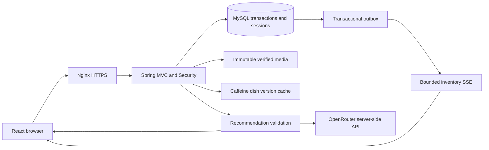

# WeBox实现架构

WeBox使用React19/TypeScript/Vite前端与Spring Boot4.1/JDK17后端，业务数据和服务端会话保存在独立MySQL8.4中。生产由同源Nginx提供静态资源、HTTPS和API代理；当前部署边界为单个应用实例。React组件和TypeScript用于复用表单与菜单配置并保持契约类型一致，React Query管理异步数据和失效，Recharts提供可与附表对应的图表。客户端只展示价格和可用性，后端在每次报价、下单和状态变化时重做权威校验。

## 身份与业务事务

账号密码采用Argon2id，登录旋转session及CSRF，Spring Session JDBC保存8小时空闲会话；HttpOnly/SameSite=Lax Cookie在生产强制Secure。所有写接口校验CSRF，Console与指标要求Admin，员工资源始终按当前身份查询。SSE仅检查会话有效性，不延长空闲期限；退出会终止客户端流和失效服务器会话。

菜单由日期供应关系、上架状态、菜品版本与共享午晚餐库存共同决定。价格使用安全范围内的整数分；配置、数量、版本、日期、配送地址和未知JSON字段严格校验。Caffeine只缓存以菜品ID和版本为键的不可变静态资料，日期成员关系和剩余库存每次读取数据库；提交后失效缓存。

报价保存精确单价与配置快照，五分钟有效，不能当库存预留。下单在READ COMMITTED事务内按统一顺序锁定账号、报价、所有菜品根和日期库存行；重新检查截止时间、当前版本、库存与一个账号/日期/餐别仅一张活跃订单。订单、明细、库存、消费报价与outbox一次提交。唯一约束和成功幂等key处理重试及丢失响应，最多三次锁冲突尝试。取消Pending订单只恢复一次库存；Completed仍占用已消费库存并释放活跃订单限制。历史金额、菜名、选项与配送信息不随现有菜单变化。

## 库存与推荐

库存流先注册，再读取一致性快照并把快照放在已缓冲变更之前。MySQL事务outbox在提交后发布，客户端按库存版本和菜单修订号去重，并在重连时重新取快照。每连接队列256条/1MiB、每会话最多3条、实例最多600条，写超时5秒、心跳15秒、最长30分钟；慢连接会断开，不阻塞业务提交或其他客户端。突发广播将最多16个完整连续帧合并写入，每批通常不超过64KiB（较大的单帧独立写入，仍受1MiB上限）；每次写入前实时读取会话，不缓存会话有效性，也不丢弃或合并事件语义。

AI分两步调用真实OpenRouter：第一步提取严格结构化意图，服务端合并保存偏好、显式过敏原、菜单/库存、预算与历史规则，第二步仅接收经过约束的候选事实。每张流式推荐卡在发送前重新验证数据库、候选范围和理由格式。模型不能决定库存、金额或过敏原安全；普通订餐流程不依赖模型。下游顺序为meta、零或多张card、唯一done/error；取消、排队和异常关闭资源并保留已验证卡片。完整契约见[streaming.md](../specs/001-webox-meal-ordering/contracts/streaming.md)。

推荐并发1、等待队列8、总时限20秒；凭据仅后端读取。推荐首卡/结束耗时和固定类别结果进入聚合指标，日志不保存完整提示词或私人配送信息。真实模型功能、性能、预期无卡与故障测试分别记录，不用mock的结果代替模型验收。

## 前端与经营看板

React Query按账号和查询条件隔离数据；购物车保存日期和规范化配置，并在刷新或菜品变化后重新核对。购物车不预留库存；报价和提交状态分离，网络结果不确定时保留相同幂等key与冻结请求。过敏原提示、预算提示、截止/活跃订单限制均有明确英文状态，用户输入的Unicode地址原样展示。

看板采用一次REPEATABLE READ快照和统一配送日期D：订单数按全部状态，金额只累计Completed历史订单金额，Top10按完成份数和稳定ID排序，趋势覆盖D-6至D，午晚餐分布按订单数。图表由Recharts渲染，并提供可访问的对应表格；Dashboard模块按路由延迟加载。看板没有AI或统计缓存。

## 运维与验证边界

运行限流、聚合指标、受控媒体校验、定期清理、备份和隔离恢复说明见[operations.md](operations.md)。清理不触碰订单/成功幂等key、消费报价和未发布事件；已注册媒体保持不可变并保留。备份的MySQL快照与媒体分别校验，恢复仅允许带指定标签的独立空目标。

测试使用Testcontainers真实MySQL与临时媒体。常规E2E服务只有测试classpath具备隔离夹具入口，发布JAR不包含这些接口。真实模型、Nginx TLS、打包进程重启/备份恢复、Gatling负载与浏览器DOM性能分别拥有独立入口和证据。不要在常规E2E运行期间重新编译其共用backend/target。测试和实现状态见[验证索引](validation/README.md)及[验收台账](../specs/001-webox-meal-ordering/acceptance.md)。

HTTP契约[openapi.yaml](../specs/001-webox-meal-ordering/contracts/openapi.yaml)包含60个schema、32个操作；数据库结构见[data-model.md](../specs/001-webox-meal-ordering/data-model.md)。种子菜单、图片及来源记录随源码交付，具体来源位于`backend/src/main/resources/seed/ATTRIBUTION.md`，运行时不读取开发机下载目录。
