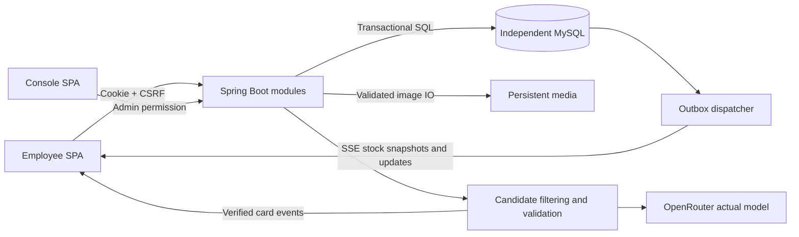

# Implementation Plan: WeBox 企业员工餐食订购平台

**Branch**: `001-webox-meal-ordering`（setup-plan 返回的逻辑特性标识；当前目录无 Git 仓库，未创建实际分支） | **Date**: 2026-10-16 | **Spec**: [spec.md](spec.md)

**Input**: `specs/001-webox-meal-ordering/spec.md` 及 [delivery-constraints.md](delivery-constraints.md)。用户已明确取消开发/交付时限，并要求全部可选功能实现。

**Status**: 全部Tier 1–3工程实现和自动化验收完成。真人验收仍未执行，本轮原生对话完整导出已核验；77项AC通过、4项未执行。实际版本与全部证据见[最终回归](../../docs/validation/release.md)。

## Summary

完整交付员工选餐与订餐、Console 运营管理、准确实时库存、真实 AI 推荐和经营看板。全部 FR-001–047、SC-001–011 都是交付门槛，P1/P2/P3 仅决定实施先后。

采用 React SPA + Java 17 / Spring Boot 4.1.1 模块化单体 + 独立 MySQL 8.4 LTS。订单与库存使用同库显式事务、唯一索引和稳定行锁保证正确性（写事务 READ COMMITTED，报价读取和报表使用只读 REPEATABLE READ 快照）；库存更新通过事务 outbox 与 SSE 发布。真实推荐通过 OpenRouter 调用配置模型（默认 openai/gpt-4.1-mini），在服务器过滤和验证后逐张输出可购买卡片。服务初期按单实例部署设计，不引入 Redis 或分布式事务。

## Technical Context

**Language/Version**: Java 17；TypeScript 5.9.x；Node 24 LTS；SQL 使用 MySQL 8.4 LTS 语义。基线来源及替代方案见 [research.md](research.md)。

**Primary Dependencies**: Spring Boot 4.1.1、Spring MVC、Security、JDBC、Session JDBC、Flyway、Connector/J、Argon2id/BouncyCastle、TwelveMonkeys、Spring Cache/Caffeine；React 19.2.x、Vite 8.x、TanStack Query 5、React Router 7 Declarative、Recharts 3。Java 配套版本由 Boot BOM 管理，npm 精确版本与完整传递依赖写入 lockfile，容器锁定 digest；托管模型记录实际模型/provider/generation ID。

**Storage**: 独立 MySQL 8.4 / InnoDB 持久卷；图片保存至 MEDIA_ROOT 持久目录；会话保存在 MySQL。购物车为按 userId 隔离的 localStorage 草稿，退出保留、同账号重登恢复并重新校验；不保存身份令牌或地址，不跨设备同步、不预留库存。

**Testing**: JUnit/Spring、Testcontainers 的独立 MySQL、Vitest 5/Testing Library、Playwright 三浏览器及 375/768/1440 宽度、Gatling 200 会话 HTTP/SSE 压测；真实 OpenRouter 验收独立运行；使用者任务完成率、提醒理解度和推荐相关性通过真人验收。

**Target Platform**: 手机/桌面现代浏览器；Linux 生产服务器、macOS/Linux 本地开发。生产前端静态文件和 `/api`、`/media` 同源；开发由 Vite 代理到 8080。模型通过后端访问 OpenRouter HTTPS API，浏览器不能获取 provider 凭据。

**Project Type**: 前后端分离、同仓管理的企业 Web 应用；一个业务服务、一个独立关系数据库和一个真实模型推理服务。

**Performance Goals**: 以下是项目自定验收基线，原文约 200 员工不等于 200 并发：200 名同时活跃员工、500 个菜单菜品；菜单/筛选/搜索 p95 ≤2 秒，购物车可见反馈 p95 ≤0.3 秒，下单结果 p95 ≤3 秒，库存变更可见 p95 ≤2 秒；推荐首张有效卡片 p95 ≤5 秒、总完成 p95 ≤20 秒；看板刷新 ≤3 秒。协议延迟不替代浏览器显示耗时，模型 loading/meta 不计首有效卡片。AI 性能使用预先登记的至少 20 次有有效候选、预期 COMPLETE 的正常请求，全部尝试计入分母；预期 NO_MATCH 与故障用例独立核验，详见 [流契约 3.4](contracts/streaming.md#34-时限取消与容量)。

**Constraints**: 全英文用户界面、菜单和错误；人民币整数分计算；每单总数 ≤5；运营时区 Asia/Shanghai，午餐 10:00/晚餐 15:00 截止；同人同日同餐次最多一笔 Pending/Confirmed；Java 17 + Spring Boot + 独立 MySQL；全部功能和原始 AI 对话导出必交付；不设开发或交付时限。

**Scale/Scope**: 约 200 员工、初始 9 个完整样例菜品（业务现状约 50）、增长验收 500；9 个用户故事。没有支付、退款、配送路线、多企业、找回密码或管理员自助注册。

## Constitution Check

`.specify/memory/constitution.md` 仍含 `[PROJECT_NAME]`、`[PRINCIPLE_1_NAME]` 等占位符，没有已批准的项目宪章条款。不能把模板注释作为新增审批或开发规则。本计划按用户需求、规格和明确交付约束设置以下门槛；未来若正式制定宪章，再做兼容性复核。

| 设计门槛 | Phase 0 前检查 | Phase 1 后复核 |
| --- | --- | --- |
| 全部 Tier 1–3、无挑战时限 | PASS：规格已确认 | PASS：模块、契约和全部成功标准均覆盖，无选做分支 |
| 完整前后端 + Java 17/Spring Boot/独立 MySQL | PASS：硬约束明确 | PASS：选型、目录、数据模型和启动指南一致 |
| 英文、多端、输入限制、个人数据隔离 | PASS：有明确验收边界 | PASS：接口校验、会话/权限、前端状态与浏览器验证落实 |
| 幂等、唯一有效订单、库存与历史金额正确 | PASS：需求可测试 | PASS：数据库双重唯一性、报价消费、原子事务和重放优先级完整 |
| 真实 AI、实时库存和真实看板 | PASS：全部必需 | PASS：确定 OpenRouter 路径、SSE/outbox、数据库统计口径和故障语义 |
| 不用模拟替代最终交付 | PASS：原文要求保留 | PASS：真实 MySQL/LLM 与人工验收明确；没有声称已运行 |
| 规划未知项关闭 | 待 Phase 0 核验技术兼容与协议 | PASS：research.md 已完成，剩余为明确实施依赖而非未决设计 |

无需要豁免的设计违规。原始图片包已逐张核对，九道菜采用DEC-R08记录的本地补充插图及映射；模型算力、原始对话和运行环境须在实施/交付落实；这些不使当前设计缺失，也不允许取消对应功能。

## Project Structure

### Documentation (this feature)

```text
specs/001-webox-meal-ordering/
├── spec.md
├── requirements-source.md
├── decisions.md
├── acceptance.md
├── delivery-constraints.md
├── checklists/requirements.md
├── plan.md
├── research.md
├── data-model.md
├── quickstart.md
├── tasks.md
└── contracts/
    ├── README.md
    ├── openapi.yaml
    └── streaming.md
```

`tasks.md` 共137项，工程实现与自动化验证已完成；T133真人任务和T136最终原生导出的实际完成状态由任务清单记录。81项验收中77项通过、4项未执行。原始PRD保留不变。

### Source Code (repository root)

以下为完整交付的目标结构；当前已完成US1–US9，具体状态见任务与阶段验证记录。

```text
backend/
├── pom.xml, mvnw, .mvn/
└── src/
    ├── main/java/com/webox/
    │   ├── auth/                 # 会话、账号、偏好、个人地址
    │   ├── catalog/              # 菜品、选项、每日安排
    │   ├── ordering/             # 报价、幂等、订单与状态
    │   ├── inventory/            # 供应、outbox、SSE
    │   ├── recommendation/       # 意图、候选过滤、OpenRouter provider
    │   ├── reporting/            # 一致性看板聚合
    │   ├── media/                # 上传校验与持久图片
    │   └── shared/               # Clock、金额、错误、配置、seed
    ├── main/resources/db/migration/
    ├── main/resources/seed/      # menu.json、images/ 与 ATTRIBUTION.md，随源码交付
    └── test/                    # 单元、MySQL集成、真实LLM、Gatling
frontend/
├── package.json, package-lock.json
├── src/
│   ├── app/                    # 路由、身份边界、员工与Console布局
│   ├── features/               # 按业务组织页面、组件、查询和reducer
│   ├── shared/                 # API类型/客户端、流解析、金额、英文文案
│   └── styles/
└── tests/                      # 交互与Playwright验收
infra/
└── compose.yaml                # 独立MySQL，具名持久卷
.env.example                    # 参数示例，无真实密钥
README.md                       # 完整启动、架构、接口与验收入口
ai-conversations/               # 工具原生完整对话导出
.local/media/                   # 本地持久图片，忽略版本控制
```

**Structure Decision**: 前端与后端各自构建，后端按业务模块隔离而不拆多服务。数据库迁移属于后端交付，容器只提供独立 MySQL。接口契约为共同边界；含真实配置的 `.env`、运行时上传媒体、数据卷、模型权重与真实凭据不提交到代码仓库。`.env.example`、依赖锁文件及 `backend/src/main/resources/seed/` 下的 `menu.json`、九道菜所需种子图片和 `ATTRIBUTION.md` 必须随源码交付；不得使用忽略所有图片的规则排除种子素材。

## Architecture & Transaction Boundaries



1. **员工选餐**：Query 读取分页菜单，库存流提供版本化绝对数量；本地 reducer 管理配置与 5 份上限，按账号持久化草稿并在恢复时重验。加入前处理必选项和过敏原确认，金额按整数分更新；搜索取消过时请求，页面使用英文空态与错误恢复。
2. **结算**：`POST /checkout/quotes` 对当前菜品、配置、日期、份数、库存及有效订单校验，生成5分钟报价。预算和过敏原为提醒。过期时段返回建议，页面可自动切换选择并提示，但提交时才越界必须重新确认。
3. **订单写入**：身份和格式校验后先查询成功幂等 key；锁用户后再次查询，校验 quote 所有权/未消耗/有效期，按稳定次序锁资源，锁后核对运营时间与当前版本。订单、不可变明细、地址、库存、报价消费和 outbox 一次提交，任一失败整单回滚。
4. **两个唯一性约束**：同 key 永远对应原订单；同日同餐次 Pending/Confirmed 只能有一笔。Completed 和 Cancelled 释放有效名额；只有 Pending→Cancelled 还库存，允许本人或管理员取消，重复取消只返回当前状态。取消/管理员状态转换也先锁所属用户再锁订单。
5. **管理变更**：菜品和每日菜单采用 expectedVersion/expectedRevision 防止覆盖；已有供应保留记录以支持取消恢复。菜品编辑和下架使旧报价失效，不重写历史订单。菜单变更和库存变更均写 outbox。
6. **实时恢复**：dispatcher 只取未发布 outbox，不能按最后数值 ID 漏读晚提交事务；至少一次投递。服务端订阅缓冲后发一致快照；浏览器按版本丢旧/去重，断线重取权威快照。初期仅一个业务实例，扩容前需升级跨实例广播方案。
7. **AI**：服务端真实调用 OpenRouter，两阶段执行意图提取与推荐；过滤掉基础或任一选项标签命中过敏原、售罄、未上架及明确排重的菜品，再逐项校验模型输出。模型无下单/数据库工具、无邮箱地址等个人资料；每张卡片发送前复查实时约束，断流不能宣称成功。
8. **看板**：一次只读一致性快照读取全部统计，以查询 `date` 为 D（省略时为 Asia/Shanghai 运营今天），全部概览、Top 10、餐次及库存预警取 D，趋势补齐 D-6 至 D；收入和销量只计 Completed。响应 `date` 回显 D，`generatedAt` 为本次生成时间，Refresh 拉取新快照；库存表示 D 供应行当前状态，不是历史时点回放。
9. **菜单缓存**：使用 Caffeine 缓存按 dishId/version 定位的不可变菜品资料，最多 10,000 项、写入后 5 分钟过期。日期成员、当前版本与库存直接查 MySQL；资料变更提交后失效，旧事务回填只能产生旧版本键。报价、下单及 AI 硬过滤不依赖缓存。

详细字段、约束及转换见 [data-model.md](data-model.md)，接口恢复优先级见 [contracts/README.md](contracts/README.md)，流生命周期见 [contracts/streaming.md](contracts/streaming.md)。

修订溯源见 [requirements-source.md](requirements-source.md) 和 [decisions.md](decisions.md)，执行台账见 [acceptance.md](acceptance.md)。

## Configuration & Operations

- 基础配置：`DB_URL`、`DB_USERNAME`、`DB_PASSWORD`、`MYSQL_ROOT_PASSWORD`、`MYSQL_DATABASE`、`MYSQL_USER`、`MYSQL_PASSWORD`；数据库连接统一 UTC，业务日期按 Asia/Shanghai。应用使用专用账号，不用 root。
- 模型配置：`OPENROUTER_BASE_URL=https://openrouter.ai/api/v1`、`OPENROUTER_MODEL=openai/gpt-4.1-mini`、`OPENROUTER_API_KEY`、`AI_TOTAL_TIMEOUT_MS=20000`、`AI_MAX_RECOMMENDATIONS=3`；地址仅由运营配置，浏览器无法指定上游地址。
- 初始化：`ADMIN_EMAIL`、`ADMIN_INITIAL_PASSWORD`、`MEDIA_ROOT`；seed 独立运行，首次按运营今天/明天各初始化九道样例、每道 20 份，重复执行只补缺，不覆盖已售数量和已有密码，不在普通服务启动中反复重置数据。
- 安全与运维：HTTPS 同源代理，SSE 关闭缓冲；上传验证实际内容、文件大小和解码像素上限。身份、个人接口和报价使用 no-store；静态指纹资源可长缓存。密码、session、完整提示词和私人地址不进入日志。
- 健康检查：应用/数据库 `/api/v1/health` 与模型可用性分开；LLM 故障显示英文失败且普通订餐继续。记录菜单缓存命中/未命中/逐出/加载耗时、订单/库存冲突、outbox积压、活跃流、首卡/完整推荐时延及失败原因，使用 requestId 关联诊断。
- 持久性：MySQL 数据卷和 MEDIA_ROOT 均备份，定期验证还原。幂等 key 与订单一同保留，不因完成/取消删除；quote 可清理过期记录，但订单重放不依赖 quote 存活。图片替换生成新资源，不破坏历史记录。
- 已配置项目本地 JDK17/Node24、官方 Maven Wrapper 与锁定 digest 的 MySQL；Docker 和依赖网络已可用。T001–T007 完成：前后端构建、真实 MySQL 集成测试、三浏览器9组合与 OpenRouter 生成探针通过；US1–US9已实施并验证，最新证据见验证索引。

## Coverage & Validation Strategy

| 规格范围 | 实现边界 | 验收重点 |
| --- | --- | --- |
| FR-001–009 | auth、shared、全局UI | 英文、长度、128字符密码、刷新/退出、越权拒绝、重启恢复；SC-001/002/006 |
| FR-010–015 | catalog、购物车reducer | 多分类与搜索、必选配置、快速加购、金额与版本；SC-003/004 |
| FR-016–021 | ordering、报价与地址 | 20次同key仅一单、旧key重放、历史快照、取消竞态；SC-004/005/006 |
| FR-022–030 | 订餐规则、偏好UI | 5份、截止边界、切换、有效订单唯一、过敏原/预算；SC-005/008 |
| FR-031–036 | Console、media、seed | 新增编辑上下架、日期供给、状态转换、当日可用数据；SC-007 |
| FR-037–040 | inventory、outbox、SSE | 20人争10份、整单回滚、取消恢复、管理员修改竞态、断线/乱序；SC-009 |
| FR-041–044 | recommendation、AI UI | 至少20组功能输入及独立预登记的至少20次正常性能请求、硬过滤、无候选、半途失败与可继续订餐；SC-010 |
| FR-045–047 | reporting、Console图表 | 七日/四状态/多配置独立样本人工核算、默认今天与显式非今天日期、0值和刷新；SC-011 |
| 完整交付约束 | README、契约、测试、对话导出 | JDK17、独立MySQL、真实模型、全部原生对话文件和启动复现 |

所有用户流程都需通过手机/桌面验收。200 会话压测同时采样浏览器从操作到可见结果的耗时；真实 AI 报告注明客户端硬件、模型/provider标识、预热状态和并发数。未执行的性能或真人指标不得标成通过。具体命令与预期结果见 [quickstart.md](quickstart.md)。

## Implementation Handoff

后续任务按依赖组织：工程与独立数据库/迁移 → 身份、菜品与菜单 → 购物车、报价、事务订单 → Console、偏好和规则 → outbox/SSE → 真实推荐与经营统计 → 全部验证与交付记录。库存事务从订单实现开始即纳入，不延迟为事后补丁。各模块均在本次交付范围，不设置时间盒删减。

Phase 0 已关闭设计未知项；Phase 1 已生成数据模型、32 个 HTTP 操作的 OpenAPI、事件协议及验证指南；任务分解已完成。业务代码、12版迁移和完整测试套件已实现；最终交付状态见任务清单与验收台账。

## Design Validation Record

以下为实施之前的设计审阅历史，保留当时状态，不代表当前运行结果。当前状态以文首和验收台账为准。

- 2026-10-16 初版完成文档交叉审阅：统一了预算成对设置、订单编号派生规则、历史菜品版本、管理员重复状态请求的冲突规则、数据库隔离级别和事件时间字段。
- 本次差异修订后使用 YAML 解析与 JSON Schema Draft 2020-12 校验 60 个组件定义、15 个有效请求/响应示例、7 个带类型的 SSE 示例、13 个正向及 20 个应拒绝的边界输入；全部符合约定。边界覆盖取消状态、选项过敏原、配置快照、告警条目、5 MiB 上限和 Unicode 地址。另检查全部 32 个操作的路径参数、唯一 operationId、管理员权限和写请求 CSRF 声明。
- 47 条功能要求在模块/验收映射中均覆盖，11 条成功标准在 quickstart 中均有验证入口；本地文档链接与活动特性指针有效，无未决设计占位符。
- 初版独立只读复核已检查订单幂等/报价消费、状态码、锁序与字段映射，未发现阻碍实施的实质矛盾。
- 以上为设计与契约静态检查，未执行应用构建、MySQL 集成、模型下载/推理、负载或真人验收；后续必须按 quickstart 实测后才可报告实现通过。

### 差异修订静态检查（2026-10-16）

- 已统一仅完成订单收入/销量、管理员取消及幂等重放、本机购物车恢复、5MiB上传、选项过敏原、用户原文地址、Caffeine版本化菜单缓存和种子基线；原有库存占用与有效订单唯一性语义保留。
- 118条来源REQ、10条采用决策、47条FR、11条SC、10条DC及81项验收记录均可追溯；验收台账全部未执行。51个用户场景与规格一致。
- 校验1,252个本地链接/锚点与行号引用、118段来源短引（忽略Markdown强调标记），检查编号唯一、旧口径残留及Markdown表格/锚点；原PRD SHA-256保持不变。
- API保持32个操作；仅扩展已有管理员状态接口和选项/快照/告警类型，无需新增端点。原始图片包20张已逐张核对；正式九道菜素材与映射已按DEC-R08保存在应用资源。
- 当前没有应用代码或业务数据库迁移，本次新增字段按未来初始迁移实现；运行验收、性能与真人测试仍未执行。

### 分析后修复记录（2026-10-16）

- 按用户“按照建议修复4个问题”的授权完成 A1、I1、I2、I3：A1 明确 AI 功能与性能分组、完整分母、失败计量及浏览器计时；I1 区分运行时上传媒体与必须交付的种子图片；I2 统一查询日 D、D-6 至 D 趋势及当前库存语义；I3 将阶段状态更新为任务分解完成、待实施。
- 同步规格、计划、数据模型、契约、任务、修订决策与验收指南；SC-010/011 与 AC-SC-010/011 判据一致。137 个任务编号、12 个阶段、29 个并行标记及 81 个验收编号和执行状态保持不变；114 条模型表格约束与任务逐字一致。
- 静态复核通过：60 个 schema、32 个 HTTP 操作、15 个请求/响应示例、7 个流事件示例、13 个正向和 20 个拒绝边界；本地链接/锚点/来源引用和 Markdown 表格有效。OpenAPI 仅澄清描述，接口及数据结构未变。原始 PRD、来源追溯、宪章模板和需求质量清单未改动。
- 以上为文档修复与静态验证；全部实施任务仍待执行，81 项业务、质量及交付验收仍未执行。
