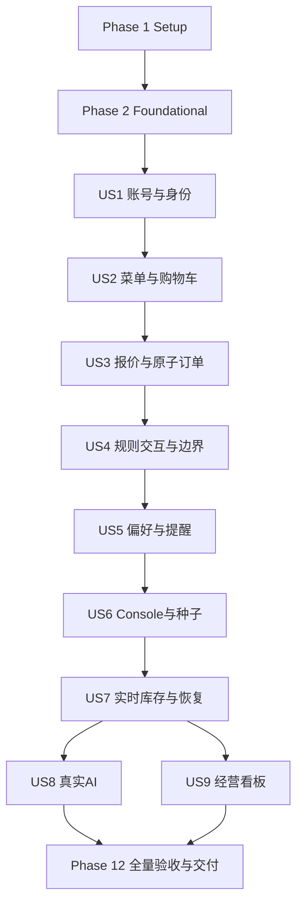

# Tasks: WeBox 企业员工餐食订购平台

**Input**：[plan.md](plan.md)、[spec.md](spec.md)、[research.md](research.md)、[data-model.md](data-model.md)、[contracts/README.md](contracts/README.md)、[contracts/openapi.yaml](contracts/openapi.yaml)、[contracts/streaming.md](contracts/streaming.md)、[quickstart.md](quickstart.md)、[delivery-constraints.md](delivery-constraints.md)、[decisions.md](decisions.md)、[requirements-source.md](requirements-source.md)、[acceptance.md](acceptance.md)。

**日期**：2026-10-16。**状态**：全部Tier 1–3工程实现及自动化验收已完成；T133等待真人参与，T136原生对话已完整导出至本轮结束并核验。最终后端20单元+119集成、前端55单元、完整浏览器324项及库存复核27项全部通过；真实OpenRouter功能24/24、浏览器性能20/20；200会话600秒及140次DOM计时通过。验收台账77项通过、4项未执行，历史失败均保留。证据见[最终回归](../../docs/validation/release.md)与[追溯索引](../../docs/validation/traceability.md)。

**范围**：Tier 1–3 全部必交付，无开发时限；MVP 仅为实施检查点，不缩减最终 47 条 FR、11 条 SC、10 条 DC。原始 PRD 与既有决策优先，不能把参考项目未采用的规则带入实现。

**Tests**：规格 A-014 引入的交付约束 DC-009 明确要求可运行并通过的核心业务测试，计划与 quickstart 已规定验证入口，因此包含测试任务。每阶段先编写有意义的契约/业务测试，确认因目标行为缺失而失败，再实施并运行至通过；缺依赖、编译错误或跳过不算有效红灯/通过。真实 MySQL、真实 LLM、浏览器负载和真人验收各自留证，测试替身仅限隔离故障注入。

**Organization**：按 US1–US9 和 P1→P2→P3 分阶段；共享模型归属首次使用的故事，库存事务在 US3 即完成，US7 补实时投递与恢复。US4 补全规则交互和边界证明，不推迟 US2/US3 已需的数量与截单强校验。

## Format: `[ID] [P?] [Story] Description`

- 未完成任务使用 `- [ ] Tnnn`，完成且有证据后改为 `- [X] Tnnn`；故事阶段使用 `[USn]`，公共阶段不带故事标签。
- `[P]` 仅表示阶段入口及标明的前置任务完成后，同组不同文件可并行；不授权跳过前置任务，也不自动启动其他代理。
- 没有 `[P]` 的任务按编号串行；每个阶段末验收任务依赖该阶段全部实现及测试任务。
- 模型任务中的「…」为数据模型逐字约束，须同时落实到迁移、服务校验和接口映射；不能只写 SQL CHECK 而漏掉跨行或权限校验。

## Path Conventions

所有代码路径均相对于仓库根 `/Users/zhoubo/weboxspec`；具体创建与验证进度以任务勾选和证据记录为准。后端 `backend/src/main/java/com/webox/`，测试 `backend/src/test/java/com/webox/`；前端 `frontend/src/`，端到端 `frontend/tests/e2e/`；报告 `docs/validation/`。迁移编号在本清单预分配，禁止并行任务重复占用同一版本。数据库始终为独立 MySQL 8.4；当前无 Git 仓库，不把提交/推送作为任务完成前提。宪章为占位模板，不新增审批规则。

## Phase 1: Setup — 工程与可重复环境

**Goal**：建立前后端、独立 MySQL、锁定依赖与验证入口。

**Entry gate**：无；仅依赖已有设计文档。

**Independent Test / Checkpoint**：JDK 17/Node 24 和 Docker 实际可用；空工程可构建，独立 MySQL 健康；不能以命令存在代替运行证据。

- [X] T001 创建根目录约定与环境模板 `.gitignore`、`.env.example`、`README.md`，列出 quickstart 所有 DB/管理员/模型/MEDIA_ROOT 参数、8h 会话与 AI/SSE 可调容量；忽略真实凭据、上传媒体、模型、构建产物与测试会话，保留源码素材和锁文件；README 标明当前实现状态。
- [X] T002 [P] 在 `backend/pom.xml`、`backend/mvnw`、`backend/.mvn/wrapper/maven-wrapper.properties`、`backend/src/main/java/com/webox/WeBoxApplication.java` 初始化 Java 17 / Spring Boot 4.1.1 / Maven Wrapper 3.9，配置 MVC/Security/JDBC/Session JDBC/Flyway MySQL/Connector-J、Argon2id/BouncyCastle、TwelveMonkeys、Cache/Caffeine、Actuator 及测试依赖；Boot 依赖由 BOM 管理并锁定其他补丁。
- [X] T003 [P] 在 `frontend/package.json`、`frontend/package-lock.json`、`frontend/tsconfig.json`、`frontend/vite.config.ts` 初始化 Node 24、React/react-dom/react-is 19.2 兼容版本、TS5.9、Vite8、Query5、Router7 Declarative、Recharts3、CSS Modules；精确锁定依赖，开发代理 `/api`、`/media` 到8080并允许流式响应。
- [X] T004 [P] 在 `infra/compose.yaml` 配置唯一服务 mysql（MySQL8.4 锁定 digest）、具名持久卷、UTC/utf8mb4、专用应用用户、healthcheck；配置不销毁已有卷，不将嵌入式数据库作为备选。
- [X] T005 在 `backend/pom.xml` 和 `backend/src/test/java/com/webox/support/MySqlTestSupport.java` 配置 JUnit/Spring、Testcontainers 独立 MySQL、Surefire/Failsafe、`llm-live` 与 `load` profiles；默认verify与真实LLM测试分开，llm-live显式启用LiveRecommendationIT且缺模型失败；测试用隔离库、独立媒体目录及可注入 Clock，Docker 缺失明确失败，不跳过核心集成测试。
- [X] T006 在 `frontend/vitest.config.ts`、`frontend/playwright.config.ts`、`frontend/tests/setup.ts` 和 `frontend/package.json` 提供 typecheck、test:unit、build、test:e2e，配置 Chromium/Firefox/WebKit 与375/768/1440宽度，测试服务启动/readiness和隔离后端地址；复用服务必须显式配置。
- [X] T007 实际检查并记录工程构建、MySQL健康、JDK/Node/Docker实际版本与依赖锁定结果到 `docs/validation/environment.md`；核对 OpenRouter 凭据/模型真实生成验证步骤及图片来源是否可读，未安装项目列为实施依赖，不把模拟运行记为通过。

## Phase 2: Foundational — 公共基础与验证支撑

**Goal**：统一类型、时间、错误、安全接入、数据库会话和 outbox 持久化基础。

**Entry gate**：Phase 1 全部完成；本阶段完成前不启动用户故事。

**Independent Test / Checkpoint**：真实 MySQL 迁移可重跑；金额/Unicode/枚举边界、401/403/404错误形状与健康检查有证据；前端可加载公共布局。

- [X] T008 在 `backend/src/main/java/com/webox/shared/DomainTypes.java` 定义所有固定枚举及契约映射，持久化采用受 CHECK 约束的字符串；模型约束原文：「用户角色：`Employee`、`Admin`；公开注册固定为 Employee」；「Category：`Chinese`、`Western`、`Japanese`、`Light Meal`、`Korean`、`Southeast Asian`」；「Spice：`None`、`Mild`、`Medium`、`Hot`」；「Allergen：`Peanuts`、`Dairy`、`Egg`、`Gluten`、`Soy`、`Fish`、`Shellfish`」；「Flavor：`Light`、`Moderate`、`Strong`」；「Meal：`Lunch`、`Dinner`」；「Order status：`Pending`、`Confirmed`、`Completed`、`Cancelled`」；「配置选择方式：`Single`、`Multiple`；单选组最多一项，多选组每选项每份最多一次」。
- [X] T009 在 `backend/src/main/java/com/webox/shared/ValueRules.java`、`backend/src/main/java/com/webox/shared/BusinessClock.java` 实现金额溢出检查、Unicode码点限长、文本规范化、Clock、版本递增及UTC/JDBC配置；模型约束原文：「数据库：独立 MySQL 8.4 LTS，业务表使用 InnoDB，字符集 utf8mb4；迁移由 Flyway 管理」；「标识：业务实体 ID 为服务端生成的 UUID 字符串；持久化 `CHAR(36)`、ASCII 二进制比较；API 使用字符串，不暴露自增序号」；「金额：人民币整数分；Java `long` / SQL `BIGINT` / JSON 安全整数；合法范围为 0–9,007,199,254,740,991，计算必须检查乘加溢出与 JSON 上界；展示固定两位小数」；「配送日：Java `LocalDate` / SQL `DATE`，接口 `YYYY-MM-DD`；它不是 UTC 时间戳」；「事件时间：Java `Instant`，持久化 `DATETIME(6)` 且 JDBC、数据库会话统一 UTC；接口为带 `Z` 的 ISO 8601」；「运营时区：`Asia/Shanghai`；服务端注入 `Clock`，以运营时间计算今天、截止时间、最近七个自然日」；「版本：可变业务记录使用非负整数 `version`；每次成功修改递增，API 保持 JSON 安全整数范围；日期菜单使用同义的 `revision`」；「文本：必填文本 trim 后非空；密码不 trim、不截断；系统英文业务内容在服务端校验/初始化和界面验收中共同保证；用户自由地址保留原文，不翻译」；「字符长度：校验统一按 Unicode 码点计数；不得一端按 UTF-16 单元、一端按字符而形成不同边界」；「删除：不实现业务实体任意硬删除；菜品下架、供应取消安排使用状态；订单与快照不级联删除」；「空值：未设置的可选标量使用 NULL；未标记过敏原、无偏好菜系、无配置使用空集合，不创建 `None` 伪记录」；「权威来源：MySQL 是权威来源；单实例使用版本化 Caffeine 菜单资料缓存，库存、报价、订单、权限、日期可售范围和经营汇总不缓存」；模型约束原文：「`created_at`、`updated_at` 适用于可变根实体。未另行说明时，外键使用 `RESTRICT`；外键关系不能代替当前用户的所有权检查。API 字段采用 camelCase，本文列名采用 snake_case。」。
- [X] T010 在 `backend/src/test/java/com/webox/shared/ValueRulesTest.java` 验证安全整数边界/乘加溢出、emoji码点、密码不trim、日期与UTC转换；在 `frontend/src/shared/values.test.ts` 编写对应金额展示与输入边界测试，并用共享固定样本校对两端。
- [X] T011 在 `backend/src/main/java/com/webox/shared/ApiExceptionHandler.java`、`backend/src/main/java/com/webox/shared/WebConfiguration.java` 实现英文 `{code,message,requestId,retryable,...context}`、fieldErrors/itemIssues、未知字段拒绝、请求大小限制、no-store、参数化查询约定与脱敏日志；业务错误逐项沿用 contracts/README.md，不把并发冲突统报500。
- [X] T012 在 `backend/src/main/resources/db/migration/V001__spring_session.sql` 采用当前 Spring Session 官方 MySQL schema；保留 SPRING_SESSION/SPRING_SESSION_ATTRIBUTES 主键、SESSION_ID唯一、EXPIRY_TIME/PRINCIPAL_NAME索引和属性关系，不套用业务UUID规则，不级联业务历史。
- [X] T013 在 `backend/src/main/resources/db/migration/V002__outbox.sql`、`backend/src/main/java/com/webox/inventory/OutboxWriter.java` 创建同事务事件持久化基础与索引 `(published_at,next_attempt_at,created_at,id)`；调用方必须在业务事务内写入，此阶段不发布事件；模型约束原文：「id：UUID 主键，事件身份」；「event_type：受内部协议限制的类型，具体名称与 SSE 契约一致」；「aggregate_key：日期/菜品或相关聚合身份，不能携带个人秘密」；「payload：JSON：库存绝对量、行版本、菜单 revision 等必要公开信息；不包含订单地址、邮箱或密码」；「created_at：UTC，原业务事务产生」；「published_at：可空 UTC；NULL 表示尚未完成投递」；「attempt_count, next_attempt_at：非负整数与 UTC，用于有限退避和故障观测；失败不删除事件」；「last_error_code：可空短错误码，不记录敏感 payload/异常密钥」。
- [X] T014 在 `backend/src/main/java/com/webox/auth/SecurityConfiguration.java` 建立默认拒绝、公开health/csrf/register/login/media、其余登录与 `/admin/**` Admin规则；Spring Session JDBC、WEBOXSESSION生产Secure/HttpOnly/SameSite=Lax、CSRF X-XSRF-TOKEN、空闲8h可配，提供不续期的会话有效性检查供流使用；不将SSE心跳视为用户活动。
- [X] T015 在 `backend/src/main/java/com/webox/shared/HealthController.java` 和 `backend/src/main/resources/application.yml` 实现 `GET /health` 仅返回应用/数据库UP或失败，不暴露配置；健康检查与LLM可用性解耦，准备 local/seed/test 环境及媒体持久目录配置，以 `backend/src/test/java/com/webox/shared/HealthContractIT.java` 检查真实DB健康与失败。
- [X] T016 在 `frontend/src/shared/api/types.ts`、`frontend/src/shared/api/client.ts`、`frontend/src/shared/values.ts` 对齐60个OpenAPI schema，封装同源Cookie、CSRF、英文错误、AbortSignal、整数分显示、Unicode码点校验；身份/个人数据不用持久Query缓存。
- [X] T017 在 `frontend/src/app/App.tsx`、`frontend/src/app/router.tsx`、`frontend/src/styles/global.css` 建立QueryProvider、员工/Console独立布局、路由占位与英文状态/表单/焦点组件；375px起可用，不在未实现路由显示假业务成功。
- [X] T018 在 `backend/src/test/java/com/webox/support/FixtureFactory.java`、`backend/src/test/java/com/webox/support/ContractAssertions.java` 和 `frontend/tests/fixtures/session.ts` 提供真实DB隔离夹具、管理员/员工身份、固定Clock、OpenAPI响应验证与浏览器会话工厂；后续故事补其实体夹具，不依赖未来Console/seed。
- [X] T019 运行基础迁移/通用校验/构建与health契约检查，将结果写入 `docs/validation/foundation.md`；确认空库与已迁移库均正常、无H2回退、错误日志无密码/会话/地址，才解除用户故事入口限制。

## Phase 3: User Story 1 — 员工建立账号并持续访问个人空间 (P1)

**Goal**：注册、登录、刷新、退出和服务端角色边界。

**Entry gate**：Phase 2完成；不依赖其他用户故事。

**Independent Test / Checkpoint**：新员工注册后显式登录，刷新保持身份，退出后受限访问拒绝；重复邮箱/非法密码/CSRF/角色注入拒绝。个人实体所有权在相应故事及最终全栈矩阵再次验证。

### Tests for User Story 1 — 先编写并观察目标行为失败

- [X] T020 [P] [US1] 在 `backend/src/test/java/com/webox/auth/AuthContractIT.java` 覆盖 getCsrf/register/login/logout/getCurrentUser、无CSRF/失效CSRF、匿名/Employee/Admin访问、匿名CSRF会话与登录轮换、注销后不可复用；对应 AC-US01-01–05。
- [X] T021 [P] [US1] 在 `frontend/src/features/auth/auth.test.tsx` 编写注册不自动登录、错误保留安全输入、刷新身份、角色入口、退出清空内存/个人Query并关闭流的交互测试；不得把密码持久化到浏览器。

### Implementation for User Story 1

- [X] T022 [US1] 在 `backend/src/main/resources/db/migration/V003__users.sql`、`backend/src/main/java/com/webox/auth/UserRepository.java` 创建账号模型、唯一normalized_email及owner根行锁访问；模型约束原文：「id：UUID 主键」；「email：VARCHAR(200)，trim 后的展示邮箱」；「normalized_email：VARCHAR(200)，trim + `Locale.ROOT` 小写；使用二进制排序规则精确唯一，避免重音折叠」；「password_hash：VARCHAR(255)，包含算法标识、参数及盐的 Argon2id 编码；不保存原始密码」；「role：Employee / Admin；管理员由受控初始化过程创建」；「version：非负整数」；「created_at, updated_at：UTC 时间」；模型约束原文：「注册与登录密码为 8–128 个字符且包含字母与数字；验证原输入，不采用 bcrypt 的 72 字节截断。」。
- [X] T023 [US1] 在 `backend/src/main/java/com/webox/auth/AuthService.java` 完成任意合法邮箱注册、trim+Locale.ROOT大小写唯一、Argon2id编码与参数记录、常量意义的失败反馈、固定Employee角色和重复邮箱冲突；密码/CSRF/会话不进入响应或日志。
- [X] T024 [US1] 在 `backend/src/main/java/com/webox/auth/AuthController.java` 实现5个账号操作及状态码；登录轮换session并建立身份，注册仅创建账号；登录/退出按Security机制刷新CSRF，getCurrentUser只返回安全公开字段。
- [X] T025 [US1] 在 `backend/src/main/java/com/webox/shared/AdminInitializer.java`、`backend/src/main/java/com/webox/shared/SeedApplication.java` 建立同一主应用下仅seed profile启用的CommandLineRunner及管理员初始化；首次读环境且验密码，已有账号不得隐式提权/重置密码，独立seed完成退出0，不在每次Web启动重置。
- [X] T026 [US1] 在 `frontend/src/features/auth/LoginPage.tsx`、`frontend/src/features/auth/RegisterPage.tsx` 和 `frontend/src/features/auth/session.ts` 实现英文登录注册与CSRF轮换、getCurrentUser恢复、空闲失效及主动退出；Employee默认/menu，Admin默认/console/dishes。
- [X] T027 [US1] 在 `frontend/src/app/router.tsx`、`frontend/src/app/SessionBoundary.tsx` 接入身份/角色导航和可扩展注销清理回调；仅认证后加载本人数据，禁止旧请求回填到另一个账号；保留后续按账号草稿，不存身份token。
- [X] T028 [US1] 在 `frontend/tests/e2e/auth.spec.ts` 运行真实后端/MySQL注册、重登、刷新、退出与角色负向场景，连同US1测试将证据写入 `docs/validation/us1.md`；覆盖AC-US01-01–05并注明跨实体所有权待所属故事接入，不提前标全系统权限验收完成。

## Phase 4: User Story 2 — 浏览每日菜单并构建准确购物车 (P1)

**Goal**：按日期浏览菜单、搜索筛选、配置与金额准确的账号隔离购物车。

**Entry gate**：US1完成；所需媒体/菜品/每日供应模型在本故事先建立。

**Independent Test / Checkpoint**：使用真实SQL夹具与图片验证汉堡必选项、配置归并、快速加购最多5份、意面两份59元、刷新/重开/换账号草稿及变价失效提示；不依赖US6管理界面。

### Tests for User Story 2 — 可并行编写的独立测试

- [X] T029 [P] [US2] 在 `backend/src/test/java/com/webox/catalog/MenuContractIT.java` 覆盖getMenu/getMenuDish/getPublicMedia、仅上架且安排、售罄可见、空日期、搜索50码点与LIKE字面量、分类OR关键词AND、分页24/100、稳定名称/ID排序及公开媒体安全。
- [X] T030 [P] [US2] 在 `frontend/src/features/cart/cartReducer.test.ts` 验证配置排序去重合并、不同配置分行、必选/外来选项、快速动作不丢、总份数0/1/5/6、整数分与两份Tomato Pasta+Cheese=5900分；对应AC-US02-03–06。
- [X] T031 [P] [US2] 在 `frontend/src/features/cart/cartStorage.test.ts` 覆盖同账号刷新/重开/退出重登、跨账号隔离、坏JSON/未知版本、变价/下架重验、恢复不自动下单、不存地址quote或凭据；对应AC-US02-07、AC-REV-02。
- [X] T032 [P] [US2] 在 `backend/src/test/java/com/webox/catalog/MenuCacheIT.java` 编写版本匹配、同快照装载、旧事务迟回填、5分钟过期/10000容量逐出/重启冷缓存测试，验证库存/日期成员不从资料缓存读取；US6再补真实编辑提交/回滚场景。

### Implementation for User Story 2

- [X] T033 [US2] 在 `backend/src/main/resources/db/migration/V004__media_assets.sql`、`backend/src/main/java/com/webox/media/MediaRepository.java` 建立媒体身份和受控路径模型，为真实已验证图片夹具提供存取；上传转换在US6实现；模型约束原文：「id：UUID 主键」；「uploaded_by：users 外键，创建者必须为管理员」；「original_filename：VARCHAR(255)，仅审计文本，不参与路径拼接，不作为下载响应的可信文件名」；「source_mime, source_bytes：真实检测的 JPEG/PNG/WebP 类型；输入大小 1–5,242,880 字节」；「content_sha256：固定长度摘要，便于内容核对；不作为业务权限标识」；「width, height：正整数；解码前/过程中执行像素和内存上限，实施默认每边不超过 8192、总像素不超过 16,777,216」；「storage_key：服务端随机生成的相对资源键，唯一；解析后的路径必须位于受控持久媒体目录内」；「served_mime, served_bytes：统一转换后的 image/jpeg 或 image/png 及字节数；转换产物同样不得超过 5,242,880 字节；若无法在上限内生成则拒绝且保留旧图」；「source_attribution：可选来源及授权说明，用于替代素材的交付记录」；「created_at：UTC 时间」。
- [X] T034 [US2] 在 `backend/src/main/resources/db/migration/V005__catalog.sql`、`backend/src/main/java/com/webox/catalog/DishRepository.java` 创建菜品/基础过敏原、配置组/选项及选项过敏原，配置属于根dish version；模型约束原文：「dishes.id：UUID 主键」；「name：VARCHAR(100)，非空英文名称」；「description：VARCHAR(2000)，非空英文描述」；「base_price_cents：BIGINT，非负且不超过安全整数上界」；「category：Category 枚举」；「protein_source：VARCHAR(200)，非空英文内容」；「spice：Spice 枚举」；「media_id：media_assets 外键；必须指向已验证、可展示的图片」；「is_listed：BOOLEAN；只有上架且按目标日期安排的菜品进入员工菜单」；「version：整数；资料、图片、过敏原、配置或价格变化均递增」；「created_at, updated_at：UTC 时间」；「dish_allergens：`(dish_id,allergen)` 复合主键，dish_id 外键；空集合表示无已声明过敏原」；模型约束原文：「customization_groups：`id` UUID；`dish_id` FK；`name` VARCHAR(100) 非空；`selection_mode` Single/Multiple；`required` BOOLEAN；`display_order` 非负整数」；「customization_options：`id` UUID；`group_id` FK；`name` VARCHAR(100) 非空；`extra_price_cents` 非负 BIGINT；`display_order` 非负整数」；「option_allergens：`(option_id,allergen)` 复合主键；option_id 外键，allergen 使用统一枚举；空集合表示未标记」；模型约束原文：「跨行校验：有配置组时每组至少一个选项；required 组必须选择；Single 组只能选一个；Multiple 组不得重复 option；选项必须属于所提交菜品的有效组。」。
- [X] T035 [US2] 在 `backend/src/main/resources/db/migration/V006__daily_supply.sql`、`backend/src/main/java/com/webox/inventory/SupplyRepository.java` 建每日菜单与共享供应、CHECK和 `(dish_id,delivery_date)` 索引，remaining由差值计算，保留取消安排记录且不预留购物车/报价库存；模型约束原文：「delivery_date：DATE 主键；这是日期自然键，非另一个业务 UUID」；「revision：非负整数；供应安排、上下架关联展示变化等菜单结构更新递增」；「updated_by：users 外键，最后一次运营修改者」；「updated_at：UTC 时间」；模型约束原文：「delivery_date, dish_id：复合主键；分别关联 daily_menus 和 dishes」；「scheduled：BOOLEAN；false 表示不在该日安排，但保留历史供应记录」；「total_quantity：INT，0–2,147,483,647」；「allocated_quantity：INT，0–total_quantity；所有未取消订单已占用份数，包含 Completed」；「version：非负整数；供应设置、安排状态、购买扣减和取消恢复均递增」；「updated_at：UTC 时间」。
- [X] T036 [US2] 在 `backend/src/main/java/com/webox/catalog/MenuQueryRepository.java` 查询目标日期成员、版本与真实剩余量，显式只读REPEATABLE READ内分页、英文名/ID排序、分类并集与关键词交集、LIKE通配符转义；空日期不自动创建菜单，查询限长与page/size来自契约。
- [X] T037 [US2] 在 `backend/src/main/java/com/webox/catalog/MenuDetailsCache.java`、`backend/src/main/java/com/webox/catalog/MenuService.java` 实现Caffeine menuDishDetails，key=dishId:version、maximumSize=10000、expireAfterWrite=5m；命中只复用不可变资料，miss在同DB快照加载根和子表，旧事务只填旧key，当前库存/成员/个性化每次组合；提供after-commit失效入口及命中/未命中/逐出/加载指标。
- [X] T038 [US2] 在 `backend/src/main/java/com/webox/catalog/MenuController.java`、`backend/src/main/java/com/webox/media/PublicMediaController.java` 实现 getMenu/getMenuDish 和根路径 `/media/{mediaId}`，返回完整英文选项allergens及基础标签、版本与库存；媒体只从验证过的受控资源读取，MIME/nosniff/不可变缓存与路径防逃逸正确。
- [X] T039 [US2] 在 `frontend/src/features/cart/cartReducer.ts`、`frontend/src/features/cart/configuration.ts` 实现规范化配置键、每个已接受动作恰好+1、所有增加入口5份上限、单选/必选校验、整数分小计/总价；保留按配置扣除已提交数量的动作接口。
- [X] T040 [US2] 在 `frontend/src/features/cart/cartStorage.ts`、`frontend/src/features/cart/CartProvider.tsx` 实现 `webox.cart.v1:<userId>` 草稿，身份确认后才恢复；坏版本提示重建、退出保留草稿但清页面，恢复查新菜单并对变化要求确认/不可用阻止结算；模型约束原文：「只保存 dishId、排序去重的 selectedOptionIds、quantity、非敏感展示快照和已见 dishVersion，不保存凭据、CSRF、地址、quote 或提交请求。」。
- [X] T041 [US2] 在 `frontend/src/features/menu/MenuPage.tsx`、`frontend/src/features/menu/menuQuery.ts` 实现默认今日、日期切换、分页、卡片、六菜系多选、50码点搜索/200ms防抖/取消旧请求，空态/重试/图片替代说明与真实剩余数；保留后续偏好排序和流版本合并接点。
- [X] T042 [US2] 在 `frontend/src/features/menu/DishDialog.tsx` 实现描述/蛋白质/辣度/基础与选项过敏原、必选单选多选、即时报价、键盘焦点与同一加购入口；未知选项不得进入有效购物车，售罄和5份上限解释可见。
- [X] T043 [US2] 在 `frontend/src/features/cart/CartPage.tsx` 连接配置明细、加减/移除、总量/总价与恢复变化确认，0/售罄/失效条目阻止进入有效结算，更新 `frontend/src/app/router.tsx` 接通/menu和/cart。
- [X] T044 [US2] 在 `frontend/tests/e2e/menu-cart.spec.ts` 与 `docs/validation/us2.md` 执行AC-US02-01–07、缓存清理AC-REV-07及金额固定样本；使用真实菜单夹具验证两端价格和身份草稿，保留US6变更后补测缓存一致性的入口。

## Phase 5: User Story 3 — 完成下单并查看、取消个人订单 (P1)

**Goal**：报价、地址、订单幂等、历史快照及原子库存事务组成真实订餐闭环。

**Entry gate**：US1、US2完成；US4的服务器规则核心在本阶段先实现，US7不重写库存事务。

**Independent Test / Checkpoint**：真实MySQL验证同key20次只有一单、同quote换key拒绝、10份20人不超卖、整单回滚、地址仅成功保存、原key过期/取消后重放、Pending取消恰好一次；浏览器未知结果复用原请求。

### Tests for User Story 3

- [X] T045 [P] [US3] 在 `backend/src/test/java/com/webox/ordering/OrderContractIT.java` 覆盖listAddresses/createQuote/placeOrder/listOrders/getOrder/cancelOrder，201/200重放、addressId XOR addressText、UUID key、owner404、分页/过滤与全部恢复错误码；所有请求拒绝额外userId/price/status。
- [X] T046 [P] [US3] 在 `backend/src/test/java/com/webox/ordering/OrderTransactionIT.java` 使用独立MySQL屏障并发验证20次同key、换payload、同quote换key、同餐次不同key、10份20人、跨菜品回滚、锁后跨截止/报价到期、旧quote清理/取消/完成后重放和outbox原子性。
- [X] T047 [P] [US3] 在 `frontend/src/features/checkout/checkoutSubmission.test.ts` 验证冻结quote/key/payload、重复点击、结果丢失复用原key、修正后才换key、成功只移除本次份数且保留提交中新增、中文地址安全原值；对应AC-US03-01–06及AC-REV-09。

### Implementation for User Story 3

- [X] T048 [US3] 在 `backend/src/main/resources/db/migration/V007__delivery_addresses.sql`、`backend/src/main/java/com/webox/auth/AddressRepository.java` 建用户地址、精确二进制唯一(user_id,address_text)与最近使用索引，成功订单事务才保存/复用地址；模型约束原文：「id：UUID 主键」；「user_id：users 外键；每次按当前用户过滤读取」；「address_text：VARCHAR(200)，trim 后非空，不擅自合并内部空格或改变大小写」；「created_at, last_used_at：UTC 时间」。
- [X] T049 [US3] 在 `backend/src/main/resources/db/migration/V008__checkout_quotes.sql`、`backend/src/main/java/com/webox/ordering/QuoteRepository.java` 建不可变报价/条目与用户、到期索引，consumed_order_id唯一但订单FK在V009建orders后补齐，避免循环建表失败；归并配置保留排序选项集合；模型约束原文：「checkout_quotes.id：UUID 主键，服务端生成」；「user_id：users 外键；报价不可跨用户使用」；「delivery_date, meal：员工已确认的日期和餐次」；「total_quantity：整数 1–5」；「total_cents：由服务器计算的非负安全整数分」；「created_at, expires_at：UTC；`expires_at = created_at + 5 分钟`，到期时刻本身即失效」；「consumed_order_id：可空订单 FK、唯一；只在成功创建订单的事务内设置，禁止改绑」；「checkout_quote_items.id：UUID 主键」；「quote_id：checkout_quotes FK」；「dish_id, dish_version：报价时的真实菜品身份及版本」；「configuration_key：规范化的 option ID 集合标识；与 dish_id 一起确定条目身份」；「dish_name_snapshot：VARCHAR(100)」；「options_snapshot：JSON 数组：每项含 groupId、groupName、optionId、optionName、extraCents、allergens；按 ID 稳定排序」；「effective_allergens_snapshot：JSON 数组；菜品基础与已选选项标签并集，API 为 effectiveAllergens；报价与订单保持不可变」；「base_price_cents, unit_price_cents：整数分；unit = base + 所选 option 加价」；「quantity, subtotal_cents：quantity 1–5；subtotal = unit × quantity」。
- [X] T050 [US3] 在 `backend/src/main/resources/db/migration/V009__orders.sql`、`backend/src/main/java/com/webox/ordering/OrderRepository.java` 建订单与报价消费FK，创建UNIQUE(user_id,idempotency_key)、UNIQUE(quote_id)、UNIQUE(user_id,delivery_date,meal,active_slot)和员工/看板/历史查询索引；不建立会使清理quote删除订单的级联；模型约束原文：「id：UUID 主键，API 的 orderId；对外 orderNumber 固定派生为 `WB-` 加大写 UUID，无需另存自增编号」；「user_id：users 外键，创建后不可改变」；「quote_id：原报价 UUID，唯一；订单不依赖报价存在才能读取/重放，不配置删除订单的级联关系」；「idempotency_key：UUID 字符串；与 user_id 组成唯一键，与订单同生命周期保留」；「request_hash：SHA-256 固定长度摘要；规范化请求的稳定表示」；「delivery_date, meal：从已确认且有效的报价复制，创建后不可改变」；「delivery_address_snapshot：VARCHAR(200)，trim 后非空，创建后不可改变」；「status：Pending / Confirmed / Completed / Cancelled」；「active_slot：生成列：Pending/Confirmed 为 1，其他状态为 NULL；不可由应用直接写入」；「total_quantity, total_cents：1–5 份和安全整数分；等于全部条目合计，创建后不可改变」；「version：非负整数，状态每次改变递增」；「created_at：UTC」；「confirmed_at, completed_at, cancelled_at：可空 UTC，分别在对应成功转换中设置；禁止互相矛盾的组合」；「updated_at：UTC」。
- [X] T051 [US3] 在 `backend/src/main/resources/db/migration/V010__order_items.sql`、`backend/src/main/java/com/webox/ordering/OrderItemRepository.java` 建只写一次的订单快照和(order_id,id)/(dish_id,order_id)索引，复用报价约束且不JOIN当前目录改写历史；模型约束原文：「字段：`id` UUID 主键、`order_id` FK、`dish_id`（保留真实菜品身份）、`dish_name_snapshot`、`dish_version_snapshot`（API 的 dishVersion）、`configuration_key`、`options_snapshot`、`effective_allergens_snapshot`、`base_price_cents`、`unit_price_cents`、`quantity`、`subtotal_cents`。内容结构与报价条目一致，写入后不可修改；索引 `(order_id,id)` 和 `(dish_id,order_id)`。」。
- [X] T052 [US3] 在 `backend/src/main/java/com/webox/ordering/OrderPolicy.java` 实现总份数1–5、过去日期拒绝、Asia/Shanghai午餐10:00/晚餐15:00等号截止、未来选择保留、仅建议今Dinner/明Lunch及有效餐次唯一检查；无菜单不再向后跳日，服务端Clock为权威，供quote/create/AI共用。
- [X] T053 [US3] 在 `backend/src/main/java/com/webox/ordering/QuoteService.java` 先只读REPEATABLE READ取得同快照真实配置/价格/日期/库存/有效订单并归并行，再短写事务存5分钟报价；不预留库存，校验所属选项/必选/总量/版本并计算effectiveAllergens快照，itemIssues返回变价/下架，预留US5提示计算接入。
- [X] T054 [US3] 在 `backend/src/main/java/com/webox/ordering/IdempotencyRequest.java` 实现协议版本+规范UUID quoteId+地址选择方式+规范UUID或trim原文地址的稳定SHA-256；不哈希原始JSON顺序、可变地址内容、时间/价格。身份和结构校验后、所有quote/地址业务检查前先查成功user/key并比较hash。
- [X] T055 [US3] 在 `backend/src/main/java/com/webox/inventory/InventoryMutationService.java` 实现caller事务内按dish汇总各配置需求、dish规范UUID升序→日期/dish升序锁供应、条件更新allocated/version与绝对量outbox；任一不足返回具体availableQuantity并整单回滚，Pending取消按原日期恰好恢复一次，Completed不恢复。
- [X] T056 [US3] 在 `backend/src/main/java/com/webox/ordering/PlaceOrderService.java` 显式READ COMMITTED事务按user→quote→dish→supply加锁，锁user后再次查key；核验owner、消费、最新版本/安排及锁后截止/到期，原子写订单/不可变条目/地址/库存/consumed_order_id/outbox；成功重放优先于quote存活/时间/当前地址检查。
- [X] T057 [US3] 在 `backend/src/main/java/com/webox/ordering/OrderTransactionExecutor.java` 对死锁/锁超时有限重试整个事务且保留key；唯一冲突先完整回滚，再新事务依次解析key重放、quote消费、有效订单冲突；失败不留下成功key或部分库存/地址/事件。
- [X] T058 [US3] 在 `backend/src/main/java/com/webox/ordering/OrderStatusService.java` 先只读定位不可变owner，再user→order→dish→supply锁定重验；员工仅owner、仅Pending可取消，Cancelled重复返回不改时间/version/outbox；集中实现状态机供US6复用，Confirmed→Completed不回库存且释放active_slot。
- [X] T059 [US3] 在 `backend/src/main/java/com/webox/ordering/OrderController.java`、`backend/src/main/java/com/webox/ordering/CheckoutController.java`、`backend/src/main/java/com/webox/auth/AddressController.java` 接通6个操作、创建201/重放200、只读本人历史与地址、快照金额/配置/配送原值和Pending取消；orderNumber按WB-大写UUID派生。
- [X] T060 [US3] 在 `frontend/src/features/checkout/CheckoutPage.tsx`、`frontend/src/features/checkout/checkoutSubmission.ts` 接通日期餐次/历史或新地址、服务端quote、5分钟到期/改价/缺货恢复、冻结提交和未知结果重试；不静默替换菜品/日期/价格，提交成功执行按配置精确扣除草稿。
- [X] T061 [US3] 在 `frontend/src/features/orders/OrdersPage.tsx`、`frontend/src/features/orders/OrderDetailPage.tsx` 接通分页本人历史、唯一编号/状态/历史快照、配送原文与合法取消，失败展示最终状态，成功刷新订单/菜单缓存；更新 `frontend/src/app/router.tsx`。
- [X] T062 [US3] 在 `frontend/tests/e2e/ordering.spec.ts`、`docs/validation/us3.md` 执行AC-US03-01–06、AC-REV-09及至少20个金额配置订单，核对订单/quote/地址/库存/outbox数据库一致性；运行US3全部契约与并发测试并留证，SC-004金额须100%精确。

## Phase 6: User Story 4 — 遵守数量、截单和重复订餐规则 (P2)

**Goal**：完整呈现截单切换、既有有效订单入口和日期/价格重新确认。

**Entry gate**：US3完成；复用US2 reducer和US3服务器规则，不另写一套时间或唯一性逻辑。

**Independent Test / Checkpoint**：固定Clock验证09:59:59/10:00:00/14:59:59/15:00:00/跨日、锁等待跨界、未来选择/过去日期、无菜单、取消/完成后重订及旧key重放；全部入口5份上限一致。

### Tests for User Story 4

- [X] T063 [P] [US4] 在 `backend/src/test/java/com/webox/ordering/OrderRulesIT.java` 验证边界Clock、锁后再判截止/报价到期、0/1/5/6及非整数、同餐次竞争、Completed释放名额但占库存、旧key在所有变化后仍返回原单；完成状态用真实DB隔离夹具，不依赖US6界面。
- [X] T064 [P] [US4] 在 `frontend/src/features/checkout/slotSelection.test.tsx` 验证截止通知/提交瞬间重新确认、未来不改、过去拒绝、View Existing Order、目标无菜单不继续后跳、切换重取版本且保留失效条目；对应AC-US04-01–06。

### Implementation for User Story 4

- [X] T065 [US4] 在 `backend/src/main/java/com/webox/ordering/OrderPolicy.java`、`backend/src/main/java/com/webox/ordering/PlaceOrderService.java` 补齐边界测试暴露的规则遗漏并保证 suggestedDeliveryDate/suggestedMeal/existingOrderId/itemIssues 契约，服务器校验始终在锁后执行，不因UI已拦截省略。
- [X] T066 [US4] 在 `frontend/src/features/checkout/slotSelection.ts`、`frontend/src/features/checkout/DeliverySelection.tsx` 以服务器返回时间/建议校准截止选择，页面跨界、重新聚焦及请求冲突均刷新；当日15点前Dinner否则明Lunch，提交冲突先确认再quote，日期无菜单保留选择并解释。
- [X] T067 [US4] 在 `frontend/src/features/checkout/ExistingOrderAction.tsx`、`frontend/src/features/checkout/CheckoutPage.tsx` 根据本人日期餐次有效订单将Place Order改为View Existing Order，取消/完成后新quote/key可订；换日期/餐次使旧quote失效并重验配置/菜单/价格，不用跳更晚餐次绕过。
- [X] T068 [US4] 在 `frontend/src/features/cart/usePurchaseAvailability.ts` 集中计算5份/售罄/失效可加购状态并接入 `frontend/src/features/menu/DishDialog.tsx`、`frontend/src/features/menu/MenuPage.tsx`、`frontend/src/features/cart/CartPage.tsx`；所有入口使用同一规则与英文解释。
- [X] T069 [US4] 在 `frontend/tests/e2e/order-rules.spec.ts` 与 `docs/validation/us4.md` 执行AC-US04-01–06及SC-005完整矩阵，直接API绕过页面同样拒绝，记录数量/时间/新旧key/有效订单与库存结果。

## Phase 7: User Story 5 — 保存饮食偏好并获得可控提醒 (P2)

**Goal**：偏好持久化、普通菜单个性化排序、所选配置过敏原确认和预算提醒。

**Entry gate**：US2、US3、US4完成；AI整菜硬过滤在US8单独实现。

**Independent Test / Checkpoint**：保存/清除/并发版本/重登一致；基础无Egg而选项有Egg时仅实际选择触发提醒，拒绝保持原购物车；30元不警告、30.01元警告但可下单。

### Tests for User Story 5

- [X] T070 [P] [US5] 在 `backend/src/test/java/com/webox/auth/PreferencesContractIT.java` 覆盖getPreferences/replacePreferences、首次version0、空数组/null清除、预算成对设置/倒置/负数、expectedVersion冲突与owner隔离；验证quote逐条FLAGGED_ALLERGEN的非空交集和最终归并itemIndex。
- [X] T071 [P] [US5] 在 `frontend/src/features/preferences/preferences.test.tsx` 验证开关保留搜索/分类、菜系优先再辣度、基础+所选标签确认、新匹配重提醒/拒绝回滚，以及预算等于/高于上限；对应AC-US05-01–05、AC-REV-03普通加购部分。

### Implementation for User Story 5

- [X] T072 [US5] 在 `backend/src/main/resources/db/migration/V011__preferences.sql`、`backend/src/main/java/com/webox/auth/PreferencesRepository.java` 建偏好根与枚举集合、外键和CHECK，空记录读取为未设置，清除保留根和递增version；模型约束原文：「dietary_preferences：`user_id` 同时为主键及 users 外键；`spice`、`flavor` 可为 NULL；`budget_min_cents`、`budget_max_cents` 可为 NULL；`version`；UTC `updated_at`」；「preference_cuisines：复合主键 `(user_id, category)`；user_id 关联偏好根记录；category 受枚举约束」；「preference_allergens：复合主键 `(user_id, allergen)`；user_id 关联偏好根记录；allergen 受枚举约束」；模型约束原文：「预算上下限必须同时为 NULL 或同时为非负整数，设置时下限不大于上限。」。
- [X] T073 [US5] 在 `backend/src/main/java/com/webox/auth/PreferencesService.java`、`backend/src/main/java/com/webox/auth/PreferencesController.java` 实现GET/PUT全量替换，user→preference加锁、expectedVersion冲突、子集合与version同事务、空集合/null清除；不接收他人userId。
- [X] T074 [US5] 在 `backend/src/main/java/com/webox/catalog/MenuQueryRepository.java`、`backend/src/main/java/com/webox/catalog/MenuService.java` 接入recommended排序/匹配字段：菜系优先、组内辣度优先、最终英文名/ID，口味浓淡不强排；筛选条件不丢、不按过敏原过滤普通菜单，偏好不进入公共资料缓存。
- [X] T075 [US5] 在 `backend/src/main/java/com/webox/ordering/CheckoutWarnings.java`、`backend/src/main/java/com/webox/ordering/QuoteService.java` 接入当前个人偏好，基础+所选option标签算每行交集；FLAGGED_ALLERGEN必须含dishId/非空allergens/itemIndex=最终Quote.items零基序号0–4，预算仅总价严格高于上限提示，不因低于下限或超上限拒单。
- [X] T076 [US5] 在 `frontend/src/features/preferences/SettingsPage.tsx`、`frontend/src/features/preferences/PreferenceToggle.tsx` 实现读取/修改/清除/保存、成对预算校验、并发重读确认和重登恢复，接通/settings及菜单Recommended for Me高亮排序；未新增开关跨登录持久化要求。
- [X] T077 [US5] 在 `frontend/src/features/preferences/AllergenConfirmation.tsx`、`frontend/src/features/cart/CartProvider.tsx` 接入所有加购/配置编辑路径，新匹配才再次确认、拒绝不改原条目；弹窗列明匹配项且键盘可用，空标签不承诺安全，AI以后复用相同正常加购入口。
- [X] T078 [US5] 在 `frontend/src/features/checkout/CheckoutWarnings.tsx`、`frontend/src/features/checkout/CheckoutPage.tsx` 显示逐配置警告和预算英文说明，不混同菜不同配置、不按预算阻止提交；偏好改变时刷新菜单/报价提示。
- [X] T079 [US5] 在 `frontend/tests/e2e/preferences.spec.ts`、`docs/validation/us5.md` 执行AC-US05-01–05与AC-REV-03普通配置部分，真实后端验证所有权、重登保留、警告后合法订单与30/30.01边界；SC-008真人理解度留到最终阶段。

## Phase 8: User Story 6 — 管理员维护菜品、每日供应并处理订单 (P2)

**Goal**：Console完整运营、图片上传、每日供应、订单处理和可重复种子。

**Entry gate**：US1–US5完成；复用既有模型、统一状态/库存服务与outbox writer。

**Independent Test / Checkpoint**：Admin可创建/编辑/发布/安排当日与次日并处理订单；Employee拒绝；上传边界、版本冲突、取消与确认竞态、历史快照、缓存提交后失效以及种子重跑均可独立核验。

### Tests for User Story 6

- [X] T080 [P] [US6] 在 `backend/src/test/java/com/webox/catalog/AdminCatalogContractIT.java` 编写adminListDishes/adminCreateDish/adminGetDish/adminUpdateDish/adminSetPublication/adminGetDailyMenu/adminReplaceDailyMenu契约与Admin/CSRF检查，覆盖选项归属、未知枚举、负价格、expectedVersion/revision及供应不能低于allocated。
- [X] T081 [P] [US6] 在 `backend/src/test/java/com/webox/ordering/AdminOrderContractIT.java` 覆盖adminListOrders/adminGetOrder/adminChangeOrderStatus，分别验证Pending→Confirmed→Completed与Pending→Cancelled两条合法路径，明确拒绝Confirmed/Completed取消；Cancelled重复先于版本返回、其他旧版本先冲突、确认/取消并发只能成功一个。
- [X] T082 [P] [US6] 在 `backend/src/test/java/com/webox/media/MediaUploadIT.java` 覆盖adminUploadMedia、真实JPEG/PNG/WebP、5,242,880/5,242,881输入与产物字节、假MIME/截断/像素上限/路径逃逸、转换失败旧图保留、byteLength为真实产物；对应AC-REV-05。
- [X] T083 [P] [US6] 在 `backend/src/test/java/com/webox/shared/SeedIT.java` 编写D/D+1九道各20份、配置/素材映射与重复运行保护测试，管理员改价/安排/供应/密码及真实占用不重置，不产生虚构收入；对应AC-US06-05/08、AC-REV-08。

### Implementation for User Story 6

- [X] T084 [US6] 在 `backend/src/main/java/com/webox/media/MediaService.java`、`backend/src/main/java/com/webox/media/AdminMediaController.java` 实现真实解码与TwelveMonkeys WebP读取、单边8192/总像素16,777,216、输入和JPEG/PNG产物均≤5,242,880字节、随机受控路径/临时文件原子重命名；完整成功才保存可引用记录，失败清理临时文件、保留旧图。
- [X] T085 [US6] 在 `backend/src/main/java/com/webox/catalog/AdminDishService.java`、`backend/src/main/java/com/webox/catalog/AdminDishController.java` 实现5个菜品管理操作、英文校验、创建默认未上架、全量更新/已有选项归属、group至少一项/required规则、分别维护基础与选项标签；锁dish且expectedVersion，原子递增根version，历史身份不硬删。
- [X] T086 [US6] 在 `backend/src/main/java/com/webox/catalog/CatalogChangePublisher.java` 接入菜品编辑/发布事务：dish→日期升序daily_menus→供应锁序，对所有受影响日期递增revision并写menu.changed outbox；仅after-commit失效资料旧缓存，rollback不逐出，不缓存当前成员和库存；更新 `backend/src/test/java/com/webox/catalog/MenuCacheIT.java` 验证真实写入、回滚及旧事务迟回填。
- [X] T087 [US6] 在 `backend/src/main/java/com/webox/catalog/AdminDailyMenuService.java`、`backend/src/main/java/com/webox/catalog/AdminDailyMenuController.java` 实现日期GET/PUT，新增expectedRevision0、重复dishId拒绝，dish→daily_menus→supply排序锁定；仅改total/scheduled，遗漏项取消安排但保留占用，total≥allocated，递增supply version/revision并同事务outbox。
- [X] T088 [US6] 在 `backend/src/main/java/com/webox/ordering/AdminOrderController.java`、`backend/src/main/java/com/webox/ordering/OrderStatusService.java` 实现全单查询/筛选/详情与PATCH `{status,expectedVersion}`，先Admin/CSRF再owner/order锁；Cancelled重复200且不改时间/version/事件/供应，其余先版本再合法转换，取消复用库存事务。
- [X] T089 [US6] 逐张核对原始 `/Users/zhoubo/Downloads/WeBox-PRD-候选人交付包/webox_product_images.zip`；依DEC-R08补齐与九道菜相符的插图并复制/验证到 `backend/src/main/resources/seed/images/`，建立 `backend/src/main/resources/seed/menu.json` 的九道菜价格/配置/过敏原/图片映射与 `backend/src/main/resources/seed/ATTRIBUTION.md`；逐项核对原PRD §6，运行不依赖Downloads，不凭菜名猜标签。 复核忽略规则保留seed图片/映射/来源，在干净项目副本中验证无需原始Downloads路径即可读取素材。
- [X] T090 [US6] 在 `backend/src/main/java/com/webox/shared/MenuSeeder.java`、`backend/src/main/java/com/webox/shared/SeedApplication.java` 扩展单次seed：使用项目内素材和稳定ID、运营D/D+1九菜各20份，只补缺失且保留已有全部运营修改/allocated/密码；受控写入遵守锁序、版本和outbox，正常Web启动不执行，不放开演示截单。
- [X] T091 [US6] 在 `frontend/src/features/console/DishesPage.tsx`、`frontend/src/features/console/DishEditor.tsx` 实现表格分页/搜索/分类、完整英文菜品字段和基础/选项过敏原、单/多选配置、图片上传/预览/失败保留、发布/下架与版本冲突重新确认。
- [X] T092 [US6] 在 `frontend/src/features/console/DailyMenusPage.tsx` 默认次日且允许当日，显示total/allocated/remaining并只编辑total与安排，保存expectedRevision、防重复dish/非整数/低于占用，冲突保留输入并重读，不把total标成remaining。
- [X] T093 [US6] 在 `frontend/src/features/console/OrdersPage.tsx`、`frontend/src/app/router.tsx` 接通Console全部订单/日期餐次状态筛选与详情、确认/完成/Pending取消；传expectedVersion，冲突展示当前状态，成功使相应订单/库存查询失效，普通员工不可进入。
- [X] T094 [US6] 在 `frontend/tests/e2e/console.spec.ts`、`docs/validation/us6.md` 运行AC-US06-01–09、AC-REV-04/05/06/08，联测图片/种子/历史/取消竞态/真实缓存更新；使用真实后端测员工重取2秒可见，管理员5分钟操作验收在最终真人任务补齐。

## Phase 9: User Story 7 — 查看准确剩余供应并避免超卖 (P3，必交付)

**Goal**：持久outbox投递、版本化库存流、低库存提示及重连恢复。

**Entry gate**：US3库存事务与US6全部运营写入口完成；不依赖US8/US9。

**Independent Test / Checkpoint**：两个真实浏览器中一方下单/取消/运营变更，另一方无需刷新更新；断网/重启/重复乱序/旧HTTP不回退；10份20人竞争份数守恒、慢客户端不拖延事务。

### Tests for User Story 7

- [X] T095 [P] [US7] 在 `backend/src/test/java/com/webox/inventory/InventoryStreamIT.java` 覆盖getInventory/streamInventory及inventory.snapshot/updated/menu.changed/session.expired，订阅与快照间竞态、小ID晚提交、发布前后崩溃、无订阅者、重复投递、会话失效/30分钟寿命/慢连接；用真实MySQL验证未发布记录不漏。
- [X] T096 [P] [US7] 在 `frontend/src/features/inventory/inventoryState.test.ts` 验证全量快照删除旧成员、绝对量version去重、menuRevision变化重取、旧HTTP/旧日期/旧连接丢弃、unknown dish重取、1–3低库存/0售罄及会话失效停止重连。

### Implementation for User Story 7

- [X] T097 [US7] 在 `backend/src/main/java/com/webox/inventory/OutboxDispatcher.java` 按250ms分批扫描已提交未发布记录和next_attempt_at，入有界订阅队列后标记published；失败有限退避且不删事件，绝不用最大ID游标；无在线订阅者也可标发布，崩溃重投按至少一次语义，清理只针对已发布历史。
- [X] T098 [US7] 在 `backend/src/main/java/com/webox/inventory/InventorySubscriptions.java` 实现单实例按日期订阅，先注册缓冲→只读一致快照→发送snapshot→排空；有界队列/写超时/慢连接关闭不阻塞其他订阅和订单，15秒心跳与会话重验不延长空闲期，默认每session3/实例600/最长30分钟。
- [X] T099 [US7] 在 `backend/src/main/java/com/webox/inventory/InventoryController.java` 实现GET快照/事件接口与4种库存事件，空菜单可订阅、快照覆盖完整日期而非分页、occurredAt用outbox原时间、每次重连强制新快照；响应no-store/不缓冲，401在流前、失效事件在流后，公开payload不带私人数据。
- [X] T100 [US7] 在 `frontend/src/features/inventory/inventoryState.ts` 实现按日期/dish版本合并与连接epoch，快照移除缺席成员、menuRevision防旧事件复活、unknown/newrevision触发重取；菜单HTTP也通过同一合并器，不覆盖更高版本供应。
- [X] T101 [US7] 在 `frontend/src/features/inventory/useInventoryStream.ts` 使用同源EventSource，先接流缓冲再请求菜单；重连先查会话并有限退避，页面恢复即校准，换日/离开/退出关流，session.expired清理并进入登录；仅当前连接事件可影响状态。
- [X] T102 [US7] 在 `frontend/src/features/menu/MenuPage.tsx`、`frontend/src/features/cart/usePurchaseAvailability.ts`、`frontend/src/features/inventory/StockBadge.tsx` 接入版本化数量、Low Stock 1–3/Sold Out 0、断线状态及售罄禁用；同菜不同配置/午晚餐仍共用供应，未知流状态不伪装实时成功。
- [X] T103 [US7] 在 `frontend/tests/e2e/inventory.spec.ts`、`docs/validation/us7.md` 跑AC-US07-01–04、20人10份/整单不足/取消恢复与两浏览器实时/断线重连/应用重启，保留DB与DOM时间证据；完整200连接p95最终负载阶段执行。

## Phase 10: User Story 8 — 用自然语言获得个性化选餐建议 (P3，必交付)

**Goal**：真实OpenRouter两阶段推荐，硬过滤和验证后的逐卡流式展示。

**Entry gate**：US1–US7完成；US9可在其所需前置完成后与本故事不同文件并行。

**Independent Test / Checkpoint**：至少20组功能输入验证100%真实可售/无标记过敏原冲突、明确日期排重与无候选，有候选正常推荐必须真实推理；另以预登记的至少20次预期COMPLETE请求验证首卡/完成p95，固定分母包含全部尝试，预期无卡/澄清/故障独立核验；故障注入验证partial/error/取消，模型停止时普通订餐仍可用。

### Tests for User Story 8

- [X] T104 [P] [US8] 在 `backend/src/test/java/com/webox/recommendation/RecommendationContractIT.java` 覆盖streamRecommendations、1000码点诉求/日期餐次/CSRF、额外provider/userId拒绝、meta→0..3card→恰一done或error、COMPLETE1–3/NO_MATCH0、英文reason1–240、断流不可假完成。
- [X] T105 [P] [US8] 在 `backend/src/test/java/com/webox/recommendation/CandidatePolicyIT.java` 使用真实DB验证基础或任意选项过敏原硬排除、未安排/下架/售罄、D-6..D非取消软排重、明确更长日期区间硬排重、无历史可用与发卡前偏好/历史/供应变化重验。
- [X] T106 [P] [US8] 在 `backend/src/test/java/com/webox/recommendation/OpenRouterStreamTest.java` 故障注入外层SSE跨块/注释/usage重复stop/转义/Unicode、内层JSON分片、虚构/重复ID、HTML理由、中途error/EOF/预算截断/stop或[DONE]缺失、全流程20秒deadline、并发1队列8/满503、取消释放槽位。
- [X] T107 [P] [US8] 在 `frontend/src/features/recommendations/recommendations.test.tsx` 验证POST SSE解析/UTF8分块、requestId过滤、终止状态/partial、旧请求取消、普通菜单恢复、推荐卡走同一配置/过敏原/5份入口；对应AC-US08-01–05。

### Implementation for User Story 8

- [X] T108 [US8] 在 `backend/src/main/java/com/webox/recommendation/OpenRouterConfiguration.java` 配置服务端 OPENROUTER_BASE_URL/API_KEY/MODEL、temperature:0、max_tokens:512、require_parameters:true；默认 openai/gpt-4.1-mini，配置/返回模型与provider/generation ID/可用usage和fingerprint用于证据，记录客户端环境/暖机/并发，不编造上游硬件或模型digest；密钥不进前端和日志，缺失时明确模型不可用且不影响普通订餐。
- [X] T109 [US8] 在 `backend/src/main/java/com/webox/recommendation/OpenRouterProvider.java`、`backend/src/main/java/com/webox/recommendation/IncrementalRecommendationParser.java` 适配 /chat/completions；第一阶段 stream:false 严格 json_schema 意图，第二阶段 stream:true；正确解析外层SSE注释/事件/UTF-8和delta.content，再增量解析内JSON，只有完整item可校验，不用正则找大括号；HTTP200中途error也失败，需完整合法JSON、finish_reason:stop和[DONE]，兼容usage帧重复stop，取消关闭上游。
- [X] T110 [US8] 在 `backend/src/main/java/com/webox/recommendation/IntentService.java`、`backend/src/main/resources/recommendation/intent-schema.json` 实现repeatPolicy/repeatFrom/repeatThrough/repeatEvidence/needsClarification及偏好解析；服务器运营今天解释today/yesterday/天数/明确日期，no repeats无期间用7天，含混返回INTENT_CLARIFICATION_REQUIRED，明确长区间查全范围。
- [X] T111 [US8] 在 `backend/src/main/java/com/webox/recommendation/CandidateService.java` 权威DB读取本人偏好/历史和目标已安排上架且remaining>0菜品，基础∪所有当前选项标签硬排除，显式排重硬过滤、默认7天软排序，菜系/辣度/口味/预算筛至最多30候选；模型无email/地址/密码/session/他人记录或执行工具，不缓存硬判断。
- [X] T112 [US8] 在 `backend/src/main/java/com/webox/recommendation/RecommendationValidator.java`、`backend/src/main/resources/recommendation/recommendation-schema.json` 校验候选UUID/重复ID/英文纯文本理由1–240及真实事实；每张卡发送前重读偏好version、当前菜品/菜单/库存/所需历史，资料由数据库构造，不接受模型自造名称价格/营养医疗断言；预算以真实基础或最低必选价说明配置影响。
- [X] T113 [US8] 在 `backend/src/main/java/com/webox/recommendation/RecommendationService.java` 串联请求总deadline20s含排队/两阶段/校验，默认并行1队列8、满AI_BUSY；空安全候选NO_MATCH、非法模型输出error、合法候选全失效可NO_MATCH；浏览器取消/会话失效取消上游并释放资源，日志不记录完整提示词。
- [X] T114 [US8] 在 `backend/src/main/java/com/webox/recommendation/RecommendationController.java` 接通认证+CSRF的POST fetch SSE，requestId/meta、连续index卡片、最终done/error及partial，头前503/验证错误和头后error语义区分；以真实有效卡片计首内容耗时，非meta/心跳。
- [X] T115 [US8] 在 `frontend/src/shared/stream/readSse.ts`、`frontend/src/features/recommendations/RecommendationPanel.tsx` 实现带Cookie/CSRF的POST流、增量TextDecoder/事件解析、逐张真实MenuDish+reason、NO_MATCH/部分失败/重试/返回菜单、新请求取消旧请求；reason按纯文本渲染，未知终止EOF为失败，卡片接入既有配置和加购，并在 `frontend/src/features/menu/MenuPage.tsx` 接通AI入口及当前目标日期/餐次。
- [X] T116 [US8] 在 `backend/src/test/java/com/webox/recommendation/LiveRecommendationIT.java`、`backend/src/test/resources/recommendation/live-cases.json` 创建至少20组功能输入，涵盖预算/菜系/辣度/过敏原/售罄/历史/明确长区间/提示注入/空候选，并预登记各用例的COMPLETE/NO_MATCH/澄清结果；另预登记至少20次有有效候选、预期COMPLETE的正常性能请求，可复用合格输入但样本量独立达标。按流契约3.4固定夹具/环境/顺序/并发，全部尝试进入固定分母，缺首卡或未COMPLETE的对应耗时记正无穷，p95取ceil(0.95×N)，不得事后删失败或用重试替换；预期无卡及故障另组。`-Pllm-live verify` 模型缺失必须失败，有候选正常用例必须真实推理，记录逐次结果/服务端耗时/失败原因/实际生成证据，浏览器5秒/20秒门槛由T117与T132核验。
- [X] T117 [US8] 在 `frontend/tests/e2e/recommendations.spec.ts`、`docs/validation/us8.md` 执行AC-US08-01–05及AC-REV-03 AI整菜排除，真实模型卡片→正常下单、停模型普通订餐继续、partial/取消/恢复；分别汇总至少20组功能输入与预登记的至少20次正常性能请求，按流契约3.4记录浏览器发起至有效首卡/合法COMPLETE显示完成的时延和完整分母，保留全部失败及无穷项，预期NO_MATCH/澄清/故障独立核验；SC-010的8/10人相关性留最终真人验收。

## Phase 11: User Story 9 — 管理员查看真实经营状况 (P3，必交付)

**Goal**：真实一致性经营快照、图表与库存预警。

**Entry gate**：US3、US6、US7完成；不依赖US8，序号顺序默认在US8之后，也可按依赖并行。

**Independent Test / Checkpoint**：连续7日/四状态/不同配置/零值/历史改名样本在默认今天T及显式非今天D下与独立人工期望完全相符；D四单10/20/30/40元只计30元完成收入，全部指标及预警取D、趋势D-6..D，刷新3秒内反映查询范围内已提交变化。

### Tests for User Story 9

- [X] T118 [P] [US9] 在 `backend/src/test/java/com/webox/reporting/DashboardContractIT.java` 覆盖adminGetDashboard、Admin/401/403、完整schema/date/generatedAt和空数据；固定Clock验证省略date取Asia/Shanghai运营今天、显式非今天D回显且影响全部指标/预警/趋势，合法过去与未来日期接受、非法日历日期400；READ ONLY+REPEATABLE READ快照下一致聚合，不以响应自身生成期望。
- [X] T119 [P] [US9] 在 `backend/src/test/resources/reporting/seven-day-orders.sql`、`backend/src/test/resources/reporting/expected-metrics.json` 建7日四状态含加料/配置/零日/改名/同销量与跨配送日期真实样本，固定运营今天T并选D≠T，为两日准备可区分订单和供应库存，手工独立计算默认T及显式D的全部指标、预警和各自七日范围期望；对应AC-US09-01–04、AC-REV-01、AC-SC-011。
- [X] T120 [P] [US9] 在 `frontend/src/features/dashboard/dashboard.test.tsx` 验证Completed Order Amount英文口径、真实返回图表/附表、空态、Refresh、查询date与生成时间generatedAt分别显示、低库存0/1–3分类、失败保留可识别旧结果。

### Implementation for User Story 9

- [X] T121 [US9] 在 `backend/src/main/java/com/webox/reporting/DashboardRepository.java` 接收统一查询日D，按delivery_date聚合真实orders/order_items与D的daily_supply：全部状态订单/餐次，Pending+Confirmed待处理，仅Completed含加料收入与份数；Top10按份数降序/dishId升序、合并配置，名称取最近计入订单快照(created_at/orderId裁决)，收入安全整数检查；模型约束原文：「查询日订单总数：delivery_date = D，全部四种状态」；「查询日收入：D 配送的 Completed 订单 orders.total_cents 合计，含加料；显示 Completed Order Amount，不表示收款」；「已完成 / 待处理 / 已取消：Completed；Pending + Confirmed；Cancelled，均按配送日 D」；「Top 10：D 配送的 Completed 订单 order_items.quantity 按 dish_id 合并，不同配置合并；按销量降序、菜品 ID 升序稳定排序」；「午晚餐量：D 配送的全部状态订单按 meal 计订单数」；「七日趋势：D-6 至 D（含首尾），按 delivery_date；每日总订单量和上述收入口径，应用层生成完整七日序列并补零」；「低库存：D 的 scheduled 且上架菜品，当前快照 remaining 0–3；0 为 Sold Out，1–3 为 Low Stock」。
- [X] T122 [US9] 在 `backend/src/main/java/com/webox/reporting/DashboardService.java`、`backend/src/main/java/com/webox/reporting/DashboardController.java` 解析可选date为D，仅省略时通过Clock取Asia/Shanghai运营今天；显式合法过去/未来日接受、非法日历日期400。全部查询传同一个D，使用一次只读REPEATABLE READ快照生成概览/Top10/餐次/预警，补齐D-6..D七天零值；预警仅D的scheduled且上架供应行当前remaining为0–3，不回放历史库存。响应date回显D，generatedAt为当前UTC生成时间；不缓存、不预置收入、不依赖AI。
- [X] T123 [US9] 在 `frontend/src/features/dashboard/DashboardPage.tsx`、`frontend/src/app/router.tsx` 接通Console仪表盘，默认省略date查询运营今天；Recharts柱状Top10/午晚分布/七日双指标和可核对数据表、真实预警、Refresh、响应查询date/更新时间generatedAt及英文口径分别呈现；键盘可用且不只靠颜色。
- [X] T124 [US9] 在 `backend/src/test/java/com/webox/reporting/DashboardAggregationIT.java`、`frontend/tests/e2e/dashboard.spec.ts`、`docs/validation/us9.md` 跑AC-US09-01–04、AC-REV-01与SC-011，分别对省略date的今天T和显式非今天D逐项比独立期望，核对所有概览/Top10/餐次/预警同日及趋势D-6..D；验证Completed后重订、取消、改名改价与查询范围内刷新3秒，保存人工核算表和真实结果。

## Phase 12: Polish & Cross-Cutting Concerns — 全量验证与交付

**Goal**：完成全故事集成、生产运行配置、负载/真人验收与原始资料交付。

**Entry gate**：US1–US9全部完成；本阶段测试对全量应用执行，不能以MVP替代。

**Independent Test / Checkpoint**：全部FR/SC/DC及81项AC有对应实现和实际证据；失败/未执行/依赖缺失如实保留，不能用静态文档或mock算通过。

- [X] T125 在 `backend/src/test/java/com/webox/security/AuthorizationMatrixIT.java`、`frontend/tests/e2e/security.spec.ts` 完成全32操作角色/CSRF/owner矩阵、跨用户quote/address/order/preferences访问、未知字段注入、XSS/SQL输入与超长Unicode、128字符密码、会话轮换/8h空闲/流不续期/注销断流；修复所属文件并记录 `docs/validation/security.md`。
- [X] T126 在 `frontend/tests/e2e/responsive-accessibility.spec.ts`、`docs/validation/accessibility-language.md` 验证三浏览器和375/768/1440全部员工流程、Console关键操作、键盘/焦点/图表附表/无横向溢出，逐页系统/菜单/错误/AI理由英文且用户Unicode地址原样；整改所属组件后跑受影响用例。
- [X] T127 在 `infra/nginx.conf`、`backend/src/main/resources/application-prod.yml` 完成同源HTTPS/static SPA回退/api/media代理、SSE不缓冲/超时与安全Cookie、生产专用DB账号、受保护健康指标；应用单实例部署，LLM故障不影响普通订餐，记录部署约束于 `docs/operations.md`。
- [X] T128 在 `backend/src/main/java/com/webox/shared/OperationalMetrics.java`、`backend/src/main/java/com/webox/shared/RateLimitFilter.java` 提供有界认证/写入/AI请求限流与Retry-After、requestId、订单/库存冲突、锁重试、outbox积压、活跃流、缓存和首卡/完成时延指标；参数可配置并随负载校准，日志不含密码、session、完整提示词或私有地址。
- [X] T129 在 `backend/src/main/java/com/webox/shared/MaintenanceJobs.java`、`infra/backup.sh`、`infra/restore.sh` 落实安全清理过期未消费quote/已发布outbox/无引用临时媒体，绝不清未发布事件或订单key/历史；备份MySQL及MEDIA_ROOT，恢复脚本只用于指定隔离目标，记录备份/验证步骤和频率到 `docs/operations.md`。
- [X] T130 在 `frontend/tests/e2e/persistence.spec.ts`、`docs/validation/persistence.md` 执行正常应用/MySQL重启，核验账号/偏好/地址/订单/库存/图片/未过期会话保留、已注销仍无效，seed重跑不覆盖；另在隔离目标验证DB+媒体备份可还原，区分正常重启与恢复演练，不宣称未测灾难SLA。
- [X] T131 在 `backend/src/test/java/com/webox/load/LoadFixture.java`、`backend/src/test/java/com/webox/load/MealOrderingSimulation.java` 实现隔离500菜品/200员工/合法时段与足量供应，Gatling60秒爬升至200活跃会话、持续≥10分钟、每人1条SSE、1–5秒思考、≥200合法下单，分开统计业务冲突和有效请求；`-Pload gatling:test`可执行且不碰业务库。
- [X] T132 在 `frontend/tests/performance/user-visible.spec.ts`、`docs/validation/performance.md` 于相同200会话负载下采样DOM可用时延：菜单/搜索含防抖p95≤2s、购物车≤0.3s、有效下单≤3s、库存≤2s、看板≤3s；真实AI单独使用T116预登记的至少20次正常请求，按流契约3.4固定完整分母及nearest-rank计算首卡p95≤5s/完整完成p95≤20s，缺首卡/未COMPLETE的对应耗时计正无穷，非预期失败及重试原样留证，预期无卡/澄清/故障另组；记录硬件/版本/model/provider IDs/暖机/并发/逐次结果/样本及失败数，发现瓶颈修复后只重测受影响项。
- [ ] T133 在 `docs/validation/user-acceptance.md` 准备并执行10名首次使用者任务，SC-001至少9/10在5分钟内完成且答对配送信息，SC-008至少9/10理解两类警告，SC-010至少8/10认为真实理由相关，管理员SC-007在5分钟内新建上传安排上下架；真人未参与则记录未执行/依赖，不伪造完成。
- [X] T134 按 `specs/001-webox-meal-ordering/quickstart.md` 在干净隔离环境执行npm ci/typecheck/test:unit/build/test:e2e、Maven verify/llm-live/load和完整从零启动，保存命令/退出码/报告到 `docs/validation/release.md`；复核60schema/32HTTP操作/全部流协议与118来源REQ→FR/SC/DC→任务，未覆盖或失败必须落实修复并重验。
- [X] T135 完成 `README.md`、`docs/architecture.md`、`docs/validation/README.md` 的从零JDK17/Node/独立MySQL/真实OpenRouter/seed/前后端启动、API与流文档链接、模块数据流、缓存/并发/备份/单实例边界、实际验证入口与图片来源；核对 `.env.example` 与运行入口可复制，不把未达标内容写成通过。
- [X] T136 将从项目开始至结束使用的所有工具原生完整对话导出放入 `ai-conversations/`，在 `ai-conversations/manifest.json` 记录工具/原生文件路径/时间范围/校验摘要，并在 `README.md` 链接；若原生导出须用户操作则保留明确依赖和原生导出步骤，不用截图/节选/事后总结代替。
- [X] T137 逐项回填 `specs/001-webox-meal-ordering/acceptance.md` 的81项真实执行状态/版本/证据和 `docs/validation/traceability.md`，复核47FR/11SC/10DC/10DEC-R及全量功能；只对证据齐全的任务勾选 `specs/001-webox-meal-ordering/tasks.md`，不得把生成本清单或文档检查当应用验收通过。

## Dependencies & Execution Order

### Phase Dependencies

这是默认无返工执行顺序。每个故事可在已完成前置与隔离真实数据库夹具上单独测试，无需等待后续故事；“独立测试”不表示可以省略身份、菜单或订单这些实际依赖。US9不依赖US8，可在US7后与US8并行；其余阶段默认按编号执行。

| 阶段 | 任务范围 | 入口/主要依赖 | 交付检查点 |
| --- | --- | --- | --- |
| Phase 1 | T001–T007 | 无；仅依赖已有设计文档。 | T007，完成本阶段验证后推进 |
| Phase 2 | T008–T019 | Phase 1 全部完成；本阶段完成前不启动用户故事。 | T019，完成本阶段验证后推进 |
| Phase 3 / US1 | T020–T028 | Phase 2完成；不依赖其他用户故事。 | T028，完成本阶段验证后推进 |
| Phase 4 / US2 | T029–T044 | US1完成；所需媒体/菜品/每日供应模型在本故事先建立。 | T044，完成本阶段验证后推进 |
| Phase 5 / US3 | T045–T062 | US1、US2完成；US4的服务器规则核心在本阶段先实现，US7不重写库存事务。 | T062，完成本阶段验证后推进 |
| Phase 6 / US4 | T063–T069 | US3完成；复用US2 reducer和US3服务器规则，不另写一套时间或唯一性逻辑。 | T069，完成本阶段验证后推进 |
| Phase 7 / US5 | T070–T079 | US2、US3、US4完成；AI整菜硬过滤在US8单独实现。 | T079，完成本阶段验证后推进 |
| Phase 8 / US6 | T080–T094 | US1–US5完成；复用既有模型、统一状态/库存服务与outbox writer。 | T094，完成本阶段验证后推进 |
| Phase 9 / US7 | T095–T103 | US3库存事务与US6全部运营写入口完成；不依赖US8/US9。 | T103，完成本阶段验证后推进 |
| Phase 10 / US8 | T104–T117 | US1–US7完成；US9可在其所需前置完成后与本故事不同文件并行。 | T117，完成本阶段验证后推进 |
| Phase 11 / US9 | T118–T124 | US3、US6、US7完成；不依赖US8，序号顺序默认在US8之后，也可按依赖并行。 | T124，完成本阶段验证后推进 |
| Phase 12 | T125–T137 | US1–US9全部完成；本阶段测试对全量应用执行，不能以MVP替代。 | T137，完成本阶段验证后推进 |

### Within Each Story

1. 并行编写该阶段开头的 `[P]` 测试，使用已完成公共测试支撑；故事专属样本留各自测试文件。公共FixtureFactory的结构变更先串行处理，禁止两个任务同时改公共文件。
2. 按模型/迁移→服务→接口→页面/集成的顺序实现；集成测试在真实MySQL执行。模型任务同时落实类型、nullable/required、长度、唯一性/外键、枚举和跨行约束。
3. 完成阶段末验收，并将实际证据写入对应us报告。管理员修改、偏好等后续接入引起的历史用例影响在相应集成任务重验，不提前宣称全系统通过。
4. `frontend/src/app/router.tsx`、`backend/pom.xml`、`frontend/package.json`、`backend/src/main/resources/application.yml`、公共夹具和验收台账均串行集成；依赖锁文件不能多人同时更新。

关键跨阶段约束：T055、T056、T058在US3已经实现防超卖与库存恢复；T086、T087、T088复用同一事务/锁序，T097、T099只负责提交后的可靠投递。T052在首次报价/订单前实现服务器截止判断，T066、T067补齐UI；不能等US4才开始拒绝非法订单。媒体和供应表在US2先建，避免US2依赖未来US6。报价与订单循环引用按V008→V009建表并补FK处理，订单的quote_id不采用阻碍报价独立清理的级联关系。

### Parallel Opportunities

完成T001后，T002、T003、T004可并行。每个用户故事开头的测试任务可在该故事入口满足后并行编写，总计29项任务带`[P]`。普通实现阶段有共享模型/服务/路由修改，默认串行；不要因为标签存在就跳过入口。US8和US9在US7后可按不同模块并行，但共享配置/路由/最终报告的合并仍串行。

## Parallel Examples by User Story

以下示例均为任务调度说明；未在本轮启动并行代理。只并行同一行任务，先满足入口，再串行实现并联调。

| 故事 | 已满足入口 | 可并行的任务与独立文件 |
| --- | --- | --- |
| US1 | Phase 2完成；不依赖其他用户故事。 | T020 `backend/src/test/java/com/webox/auth/AuthContractIT.java`；T021 `frontend/src/features/auth/auth.test.tsx` |
| US2 | US1完成；所需媒体/菜品/每日供应模型在本故事先建立。 | T029 `backend/src/test/java/com/webox/catalog/MenuContractIT.java`；T030 `frontend/src/features/cart/cartReducer.test.ts`；T031 `frontend/src/features/cart/cartStorage.test.ts`；T032 `backend/src/test/java/com/webox/catalog/MenuCacheIT.java` |
| US3 | US1、US2完成；US4的服务器规则核心在本阶段先实现，US7不重写库存事务。 | T045 `backend/src/test/java/com/webox/ordering/OrderContractIT.java`；T046 `backend/src/test/java/com/webox/ordering/OrderTransactionIT.java`；T047 `frontend/src/features/checkout/checkoutSubmission.test.ts` |
| US4 | US3完成；复用US2 reducer和US3服务器规则，不另写一套时间或唯一性逻辑。 | T063 `backend/src/test/java/com/webox/ordering/OrderRulesIT.java`；T064 `frontend/src/features/checkout/slotSelection.test.tsx` |
| US5 | US2、US3、US4完成；AI整菜硬过滤在US8单独实现。 | T070 `backend/src/test/java/com/webox/auth/PreferencesContractIT.java`；T071 `frontend/src/features/preferences/preferences.test.tsx` |
| US6 | US1–US5完成；复用既有模型、统一状态/库存服务与outbox writer。 | T080 `backend/src/test/java/com/webox/catalog/AdminCatalogContractIT.java`；T081 `backend/src/test/java/com/webox/ordering/AdminOrderContractIT.java`；T082 `backend/src/test/java/com/webox/media/MediaUploadIT.java`；T083 `backend/src/test/java/com/webox/shared/SeedIT.java` |
| US7 | US3库存事务与US6全部运营写入口完成；不依赖US8/US9。 | T095 `backend/src/test/java/com/webox/inventory/InventoryStreamIT.java`；T096 `frontend/src/features/inventory/inventoryState.test.ts` |
| US8 | US1–US7完成；US9可在其所需前置完成后与本故事不同文件并行。 | T104 `backend/src/test/java/com/webox/recommendation/RecommendationContractIT.java`；T105 `backend/src/test/java/com/webox/recommendation/CandidatePolicyIT.java`；T106 `backend/src/test/java/com/webox/recommendation/OpenRouterStreamTest.java`；T107 `frontend/src/features/recommendations/recommendations.test.tsx` |
| US9 | US3、US6、US7完成；不依赖US8，序号顺序默认在US8之后，也可按依赖并行。 | T118 `backend/src/test/java/com/webox/reporting/DashboardContractIT.java`；T119 `backend/src/test/resources/reporting/seven-day-orders.sql`；T120 `frontend/src/features/dashboard/dashboard.test.tsx` |

## Coverage — 实现与验收追踪

下表指向负责实现和验证的任务，不表示执行通过；全部验收状态仍以acceptance.md实际记录为准。原118条来源REQ沿requirements-source.md映射到本表FR/SC/DC，不重新改写原文要求。

### Functional Requirements

| FR | 主要实现任务 | 验证任务 |
| --- | --- | --- |
| [FR-001](spec.md#fr-001) | T011、T016、T017 | T126、T116 |
| [FR-002](spec.md#fr-002) | T017、T041、T060、T115 | T126 |
| [FR-003](spec.md#fr-003) | T009、T039、T053、T056 | T030、T062 |
| [FR-004](spec.md#fr-004) | T009、T011、T023、T036、T060 | T125、T029、T045 |
| [FR-005](spec.md#fr-005) | T022、T023、T024 | T020、T028 |
| [FR-006](spec.md#fr-006) | T022、T023 | T020、T125 |
| [FR-007](spec.md#fr-007) | T012、T014、T024、T027 | T028、T125、T130 |
| [FR-008](spec.md#fr-008) | T014、T027、T059、T073、T088 | T020、T045、T125 |
| [FR-009](spec.md#fr-009) | T004、T012、T048、T050、T072、T033、T035 | T130 |
| [FR-010](spec.md#fr-010) | T036、T037、T038、T041 | T029、T044 |
| [FR-011](spec.md#fr-011) | T034、T038、T042 | T029、T044 |
| [FR-012](spec.md#fr-012) | T036、T041 | T029、T044 |
| [FR-013](spec.md#fr-013) | T034、T039、T042、T053 | T030、T045 |
| [FR-014](spec.md#fr-014) | T039、T040 | T030、T031、T044 |
| [FR-015](spec.md#fr-015) | T039、T043 | T030、T132 |
| [FR-016](spec.md#fr-016) | T048、T053、T060 | T045、T062 |
| [FR-017](spec.md#fr-017) | T052、T053、T056、T060 | T046、T069 |
| [FR-018](spec.md#fr-018) | T054、T056、T057、T060 | T046、T047、T062 |
| [FR-019](spec.md#fr-019) | T055、T056、T060、T061 | T046、T062 |
| [FR-020](spec.md#fr-020) | T051、T059、T061 | T045、T062、T094 |
| [FR-021](spec.md#fr-021) | T058、T059、T061 | T046、T081、T062 |
| [FR-022](spec.md#fr-022) | T039、T052、T068 | T030、T063、T069 |
| [FR-023](spec.md#fr-023) | T052、T056、T065 | T046、T063、T069 |
| [FR-024](spec.md#fr-024) | T052、T066、T060 | T064、T069 |
| [FR-025](spec.md#fr-025) | T050、T056、T067 | T046、T063、T069 |
| [FR-026](spec.md#fr-026) | T040、T053、T066、T067 | T031、T064、T069 |
| [FR-027](spec.md#fr-027) | T072、T073、T076 | T070、T079、T130 |
| [FR-028](spec.md#fr-028) | T075、T077 | T070、T071、T079 |
| [FR-029](spec.md#fr-029) | T074、T076 | T071、T079 |
| [FR-030](spec.md#fr-030) | T075、T078 | T071、T079 |
| [FR-031](spec.md#fr-031) | T027、T091 | T080、T094 |
| [FR-032](spec.md#fr-032) | T034、T084、T085、T091 | T080、T082、T094 |
| [FR-033](spec.md#fr-033) | T085、T086、T091 | T080、T032、T094 |
| [FR-034](spec.md#fr-034) | T035、T087、T092 | T080、T094 |
| [FR-035](spec.md#fr-035) | T025、T089、T090 | T083、T094、T130 |
| [FR-036](spec.md#fr-036) | T058、T088、T093 | T081、T094 |
| [FR-037](spec.md#fr-037) | T035、T041、T100、T102 | T096、T103 |
| [FR-038](spec.md#fr-038) | T055、T056 | T046、T103 |
| [FR-039](spec.md#fr-039) | T013、T086、T097、T098、T099、T101 | T095、T103、T132 |
| [FR-040](spec.md#fr-040) | T055、T058、T087、T088 | T046、T081、T103 |
| [FR-041](spec.md#fr-041) | T110、T111、T109、T113 | T105、T116、T117 |
| [FR-042](spec.md#fr-042) | T111、T112 | T105、T116、T117 |
| [FR-043](spec.md#fr-043) | T109、T112、T114、T115 | T104、T107、T116、T117 |
| [FR-044](spec.md#fr-044) | T109、T113、T114、T115 | T106、T104、T107、T117 |
| [FR-045](spec.md#fr-045) | T121、T122、T123 | T118、T119、T124 |
| [FR-046](spec.md#fr-046) | T121、T122、T123 | T120、T124 |
| [FR-047](spec.md#fr-047) | T121、T122、T123 | T119、T124 |

### HTTP Contract Ownership

API统一以`/api/v1`为基址；公开媒体使用根路径`/media/{mediaId}`。每个operationId恰好一项主实现归属；所属契约测试验证请求、成功、权限、错误及必要schema，流生命周期另外依streaming.md测试。

| 操作 | operationId | 主实现任务 | 契约/验证任务 |
| --- | --- | --- | --- |
| `GET /health` | `health` | T015 | T019 |
| `GET /auth/csrf` | `getCsrf` | T024 | T020 |
| `POST /auth/register` | `register` | T024 | T020 |
| `POST /auth/login` | `login` | T024 | T020 |
| `POST /auth/logout` | `logout` | T024 | T020 |
| `GET /auth/me` | `getCurrentUser` | T024 | T020 |
| `GET /me/preferences` | `getPreferences` | T073 | T070 |
| `PUT /me/preferences` | `replacePreferences` | T073 | T070 |
| `GET /me/addresses` | `listAddresses` | T059 | T045 |
| `GET /menus/{date}` | `getMenu` | T038 | T029 |
| `GET /menus/{date}/dishes/{dishId}` | `getMenuDish` | T038 | T029 |
| `GET /menus/{date}/inventory` | `getInventory` | T099 | T095 |
| `GET /menus/{date}/events` | `streamInventory` | T099 | T095 |
| `POST /checkout/quotes` | `createQuote` | T059 | T045 |
| `POST /orders` | `placeOrder` | T059 | T045 |
| `GET /orders` | `listOrders` | T059 | T045 |
| `GET /orders/{orderId}` | `getOrder` | T059 | T045 |
| `POST /orders/{orderId}/cancel` | `cancelOrder` | T059 | T045 |
| `POST /recommendations/stream` | `streamRecommendations` | T114 | T104 |
| `GET /admin/dishes` | `adminListDishes` | T085 | T080 |
| `POST /admin/dishes` | `adminCreateDish` | T085 | T080 |
| `GET /admin/dishes/{dishId}` | `adminGetDish` | T085 | T080 |
| `PUT /admin/dishes/{dishId}` | `adminUpdateDish` | T085 | T080 |
| `PATCH /admin/dishes/{dishId}/publication` | `adminSetPublication` | T085 | T080 |
| `GET /admin/menus/{date}` | `adminGetDailyMenu` | T087 | T080 |
| `PUT /admin/menus/{date}` | `adminReplaceDailyMenu` | T087 | T080 |
| `GET /admin/orders` | `adminListOrders` | T088 | T081 |
| `GET /admin/orders/{orderId}` | `adminGetOrder` | T088 | T081 |
| `PATCH /admin/orders/{orderId}/status` | `adminChangeOrderStatus` | T088 | T081 |
| `GET /admin/dashboard` | `adminGetDashboard` | T122 | T118 |
| `POST /admin/media` | `adminUploadMedia` | T084 | T082 |
| `GET /media/{mediaId}` | `getPublicMedia` | T038 | T029 |

### Acceptance Ownership

每个AC保持原编号。验收任务负责执行与证据，最终台账任务统一回填；编写测试不等于AC通过。多任务组合的AC只有全部相关证据齐备才能通过，真人/模型/性能依赖不得被自动测试替代。

| 验收编号 | 验证及证据任务 |
| --- | --- |
| [AC-US01-01](acceptance.md#ac-us01-01) | T028、T125 |
| [AC-US01-02](acceptance.md#ac-us01-02) | T028、T125 |
| [AC-US01-03](acceptance.md#ac-us01-03) | T028、T125 |
| [AC-US01-04](acceptance.md#ac-us01-04) | T028、T125 |
| [AC-US01-05](acceptance.md#ac-us01-05) | T028、T125 |
| [AC-US02-01](acceptance.md#ac-us02-01) | T044 |
| [AC-US02-02](acceptance.md#ac-us02-02) | T044 |
| [AC-US02-03](acceptance.md#ac-us02-03) | T044 |
| [AC-US02-04](acceptance.md#ac-us02-04) | T044 |
| [AC-US02-05](acceptance.md#ac-us02-05) | T044 |
| [AC-US02-06](acceptance.md#ac-us02-06) | T044 |
| [AC-US02-07](acceptance.md#ac-us02-07) | T044 |
| [AC-US03-01](acceptance.md#ac-us03-01) | T062 |
| [AC-US03-02](acceptance.md#ac-us03-02) | T062 |
| [AC-US03-03](acceptance.md#ac-us03-03) | T062 |
| [AC-US03-04](acceptance.md#ac-us03-04) | T062 |
| [AC-US03-05](acceptance.md#ac-us03-05) | T062 |
| [AC-US03-06](acceptance.md#ac-us03-06) | T062 |
| [AC-US04-01](acceptance.md#ac-us04-01) | T069 |
| [AC-US04-02](acceptance.md#ac-us04-02) | T069 |
| [AC-US04-03](acceptance.md#ac-us04-03) | T069 |
| [AC-US04-04](acceptance.md#ac-us04-04) | T069 |
| [AC-US04-05](acceptance.md#ac-us04-05) | T069 |
| [AC-US04-06](acceptance.md#ac-us04-06) | T069 |
| [AC-US05-01](acceptance.md#ac-us05-01) | T079 |
| [AC-US05-02](acceptance.md#ac-us05-02) | T079 |
| [AC-US05-03](acceptance.md#ac-us05-03) | T079 |
| [AC-US05-04](acceptance.md#ac-us05-04) | T079 |
| [AC-US05-05](acceptance.md#ac-us05-05) | T079 |
| [AC-US06-01](acceptance.md#ac-us06-01) | T094 |
| [AC-US06-02](acceptance.md#ac-us06-02) | T094 |
| [AC-US06-03](acceptance.md#ac-us06-03) | T094 |
| [AC-US06-04](acceptance.md#ac-us06-04) | T094 |
| [AC-US06-05](acceptance.md#ac-us06-05) | T094 |
| [AC-US06-06](acceptance.md#ac-us06-06) | T094 |
| [AC-US06-07](acceptance.md#ac-us06-07) | T094 |
| [AC-US06-08](acceptance.md#ac-us06-08) | T094 |
| [AC-US06-09](acceptance.md#ac-us06-09) | T094 |
| [AC-US07-01](acceptance.md#ac-us07-01) | T103、T132 |
| [AC-US07-02](acceptance.md#ac-us07-02) | T103、T132 |
| [AC-US07-03](acceptance.md#ac-us07-03) | T103、T132 |
| [AC-US07-04](acceptance.md#ac-us07-04) | T103、T132 |
| [AC-US08-01](acceptance.md#ac-us08-01) | T116、T117 |
| [AC-US08-02](acceptance.md#ac-us08-02) | T116、T117 |
| [AC-US08-03](acceptance.md#ac-us08-03) | T116、T117 |
| [AC-US08-04](acceptance.md#ac-us08-04) | T116、T117 |
| [AC-US08-05](acceptance.md#ac-us08-05) | T116、T117 |
| [AC-US09-01](acceptance.md#ac-us09-01) | T124 |
| [AC-US09-02](acceptance.md#ac-us09-02) | T124 |
| [AC-US09-03](acceptance.md#ac-us09-03) | T124 |
| [AC-US09-04](acceptance.md#ac-us09-04) | T124 |
| [AC-SC-001](acceptance.md#ac-sc-001) | T133 |
| [AC-SC-002](acceptance.md#ac-sc-002) | T126 |
| [AC-SC-003](acceptance.md#ac-sc-003) | T131、T132 |
| [AC-SC-004](acceptance.md#ac-sc-004) | T062 |
| [AC-SC-005](acceptance.md#ac-sc-005) | T069、T046 |
| [AC-SC-006](acceptance.md#ac-sc-006) | T125、T130 |
| [AC-SC-007](acceptance.md#ac-sc-007) | T094、T133 |
| [AC-SC-008](acceptance.md#ac-sc-008) | T079、T133 |
| [AC-SC-009](acceptance.md#ac-sc-009) | T103、T132 |
| [AC-SC-010](acceptance.md#ac-sc-010) | T116、T117、T132、T133 |
| [AC-SC-011](acceptance.md#ac-sc-011) | T124、T132 |
| [AC-DC-001](acceptance.md#ac-dc-001) | T134、T137 |
| [AC-DC-002](acceptance.md#ac-dc-002) | T007、T134、T135 |
| [AC-DC-003](acceptance.md#ac-dc-003) | T004、T019、T130、T134 |
| [AC-DC-004](acceptance.md#ac-dc-004) | T032、T086、T094 |
| [AC-DC-005](acceptance.md#ac-dc-005) | T126、T116 |
| [AC-DC-006](acceptance.md#ac-dc-006) | T125、T127、T128、T129、T130 |
| [AC-DC-007](acceptance.md#ac-dc-007) | T134、T135 |
| [AC-DC-008](acceptance.md#ac-dc-008) | T134、T135、T137 |
| [AC-DC-009](acceptance.md#ac-dc-009) | T134、T137 |
| [AC-DC-010](acceptance.md#ac-dc-010) | T136 |
| [AC-REV-01](acceptance.md#ac-rev-01) | T124 |
| [AC-REV-02](acceptance.md#ac-rev-02) | T031、T044 |
| [AC-REV-03](acceptance.md#ac-rev-03) | T079、T105、T117 |
| [AC-REV-04](acceptance.md#ac-rev-04) | T081、T094 |
| [AC-REV-05](acceptance.md#ac-rev-05) | T082、T094 |
| [AC-REV-06](acceptance.md#ac-rev-06) | T086、T094 |
| [AC-REV-07](acceptance.md#ac-rev-07) | T032、T044 |
| [AC-REV-08](acceptance.md#ac-rev-08) | T083、T094、T130 |
| [AC-REV-09](acceptance.md#ac-rev-09) | T062、T126 |

## Implementation Strategy

### MVP First — 先验证账号，再形成订餐闭环

先完成Phase 1–3（US1），得到可演示、可单独测试的账号与权限增量。业务MVP推进到US2、US3：真实菜单→配置购物车→报价→原子订单→历史/取消；数量、截止与库存事务从第一笔订单开始生效。MVP仅用于尽早验证，不是最终交付范围，也不是暂停后续工作的理由。

### Incremental Delivery

完成US4完整规则体验→US5偏好→US6运营与种子→US7实时恢复后，交付具备真实运营流程的内部测试版本。随后完成US8真实推荐与US9经营看板；最后执行Phase12全部质量和交付验收。所有功能均必须完成，无按时间盒删减或将Tier3改回可选的分支。

### Execution and Evidence

普通实施按编号推进，只有标明的并行组在其入口满足后可同时处理。每项完成要核对对应目标文件、约束与验证结果；故事末保存实际报告。修复失败只重跑受影响验证，最终按quickstart执行全量交付入口。缺真实模型、原生对话或真人记录时继续推进无依赖工作并保留具体依赖；不得用假证据勾选任务。

## Task Summary & Generation Validation

| 阶段 | 任务数 | 可并行标记数 |
| --- | ---: | ---: |
| Setup | 7 | 3 |
| Foundational | 12 | 0 |
| US1 | 9 | 2 |
| US2 | 16 | 4 |
| US3 | 18 | 3 |
| US4 | 7 | 2 |
| US5 | 10 | 2 |
| US6 | 15 | 4 |
| US7 | 9 | 2 |
| US8 | 14 | 4 |
| US9 | 7 | 3 |
| Polish / 全量交付 | 13 | 0 |
| **合计** | **137** | **29** |

生成时静态核验：任务ID连续且唯一，初始全部未勾选；所有任务有明确目标路径；US1–US9标签只用于对应故事，公共阶段不带标签；32个HTTP操作、47条FR及81项AC均有任务归属；数据模型字段表的约束已逐字纳入模型任务；并行测试不同文件、入口明确。这里只记录任务分解质量，当前执行状态以任务标记和实际证据为准。

## Notes

- 本清单的代码/报告路径是实施约定，与plan.md目录边界一致；已创建文件不等于对应任务已经验证完成。
- 只修改本项目交付目录；参考 `/Users/zhoubo/webox1016` 保持只读，原PRD不改写。
- 最终交付以真实运行、测试、完整原生对话与验收记录为准；计划、任务和静态校验不能替代。
